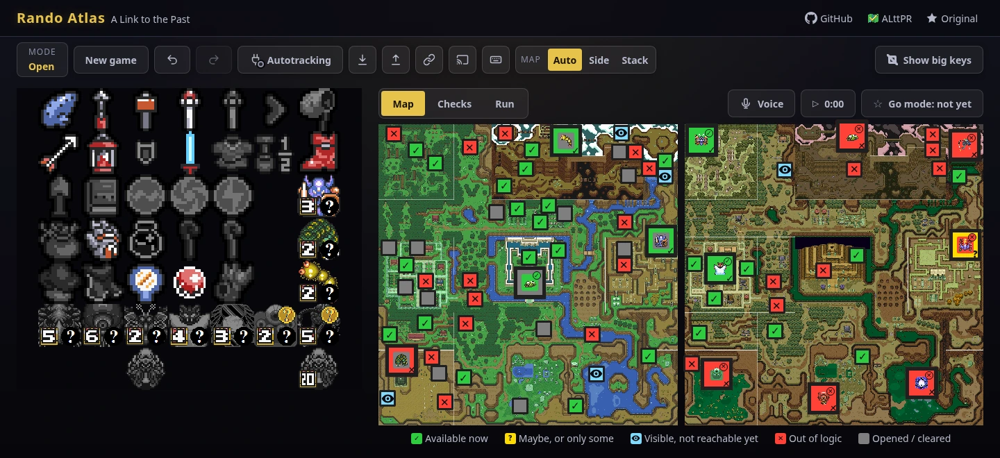
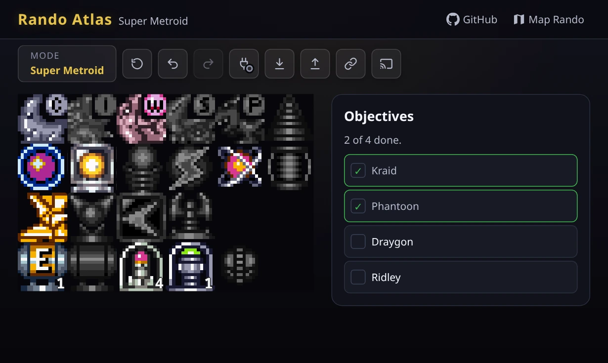
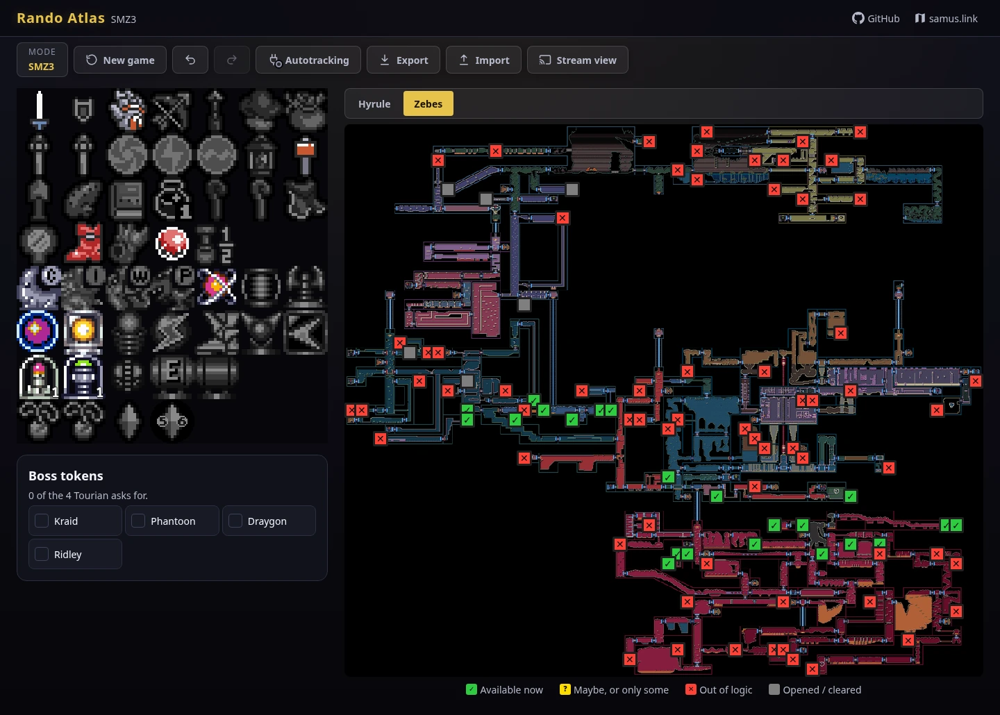
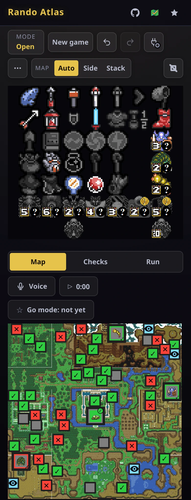

# Rando Atlas

An item and map tracker for randomizer runs of A Link to the Past, Super Metroid and SMZ3.

**[Open the tracker](https://kqesar.github.io/alltp-tracker/)** in a browser, or get the
[desktop app](https://github.com/kqesar/alltp-tracker/releases/latest) for Windows, macOS or Linux.

## Games

**A Link to the Past (ALttPR).** Mark the items you find and the map shows which locations
you can reach: in logic, maybe (a dark room, an unknown medallion), in sight only, or out of
logic. Each state has its own glyph as well as its colour. The rules are ported from
[the randomizer's source](https://github.com/sporchia/alttp_vt_randomizer) (logic v31) and
held to its own tests. Run types: Open, Standard, Inverted, Keysanity, All Dungeons,
Swordless, Triforce Hunt, Retro, Crosskeys (with an entrance assistant) and Mystery. Paste an
alttpr.com seed link and the tracker sets the run type from the seed's settings. There is
also a list of every check, a go mode indicator, a run timer with splits, and a timeline.

**Super Metroid ([Map Rando](https://maprando.com/)).** The items, the pack and tank counts,
and the seed's objectives. There is no map: Map Rando reconnects the rooms, so the game's
own map is the one to follow.

**SMZ3 ([samus.link](https://samus.link/)).** Both games' items, the maps of Hyrule and
Zebes, and SMZ3's own logic, ported from
[`tewtal/SMZ3Randomizer`](https://github.com/tewtal/SMZ3Randomizer) and held to its tests.

| Super Metroid | SMZ3, on Zebes |
|---|---|
|  |  |

## Features

- **Autotracking.** The tracker reads your game while you play, through
  [SNI](https://github.com/alttpo/sni/releases/latest) or QUsb2Snes: RetroArch with the
  bsnes-mercury core, an FX Pak Pro, BizHawk or an NWA emulator. The desktop app also reads
  RetroArch directly. On an ALttPR race seed it reads only what the
  [race-legal specification](https://link.alttpr.com/autotracking) allows. The
  **Autotracking** button opens a setup guide for your system.
- **Voice commands** (A Link to the Past). Say "tracker hook shot" to mark the hookshot.
  Speech is recognized in the browser by [Vosk](https://alphacephei.com/vosk/), in English;
  no audio leaves your computer.
- **Share.** The **Share** button copies a link that holds your run in its address (never sent
  to a server) and shows it as a QR code, to open the run on a phone. Whoever opens it is asked
  before their own run is replaced.
- **Stream view.** `?view=obs` shows the item grid alone on a transparent background, for an
  OBS browser source.
- **Offline.** A game opened once online then works without a network, and the site can be
  installed as an app from the browser.
- **Keyboard and screen readers.** Every control can be reached from the keyboard, and each
  one has a name a screen reader announces, with its state.

The [user guide](docs/guide.md) covers each of these in detail.

 

## Privacy

Your runs stay on your device. Visits to the site are counted with
[GoatCounter](https://www.goatcounter.com/): no cookies and no personal data. The desktop
app and the stream view are never counted, nor are browsers that send Do Not Track or Global
Privacy Control.

## Documentation

The [docs index](docs/README.md) lists the user guide and the design documents. To build the
project or propose a change, read [CONTRIBUTING.md](CONTRIBUTING.md). To report a security
issue, see [SECURITY.md](SECURITY.md).

## Credits and licence

MIT, see [LICENSE](LICENSE). The project started as a fork of
[TestRunnerSRL/lttp-tracker](https://github.com/TestRunnerSRL/lttp-tracker) and has since been
rewritten in React and TypeScript.

Super Metroid's item sprites are Map Rando's item sheet (`blkerby/MapRandomizer`, MIT). SMZ3's
map of Zebes is composed from VARIA's area maps, its locations placed as VARIA's autotracker
places them (`theonlydude/RandomMetroidSolver`, MIT). Each ships with its licence beside it.
The games' art belongs to Nintendo.
