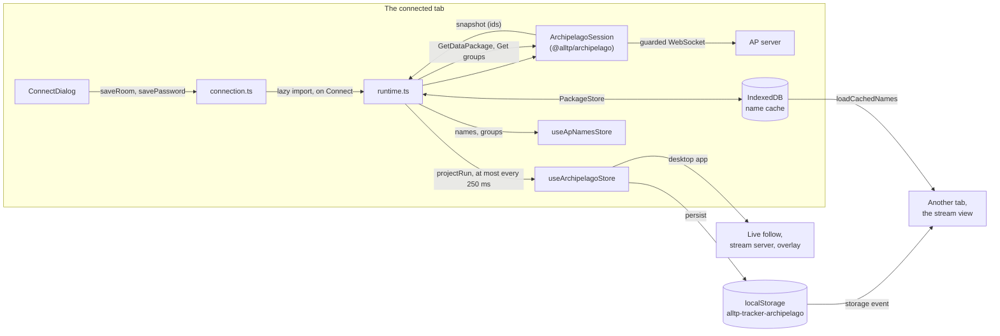
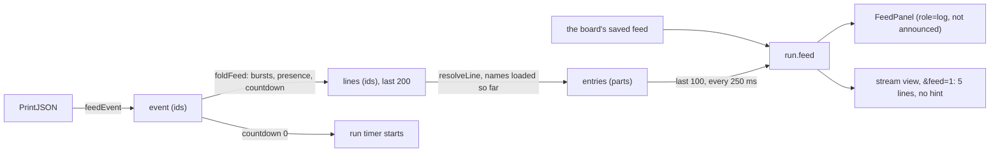

# The Archipelago board

The `archipelago` game module (`apps/web/src/games/archipelago/`) shows a
player's slot in an [Archipelago](https://archipelago.gg) (AP) room: it joins
the room as a read-only **Tracker** on that slot and draws what the room's
server states. The connection itself (the protocol subset, the read-only
guard, reconnects, name data, diagnostics) is the
[`@alltp/archipelago`](../packages/archipelago/README.md) package; this
document is the app's side.

## What it is, and what it is not

- **AP is its own randomizer.** The player runs their game and AP's own
  client (SNIClient and the like), which sends checks and receives items. The
  board never reads the console and never maps an AP seed onto the tracker's
  packs (`packs/alttpr`, `packs/sm`, `packs/smz3`): their logic and run
  settings model alttpr.com, Map Rando and samus.link seeds, not AP's worlds.
  Only art is shared: the skins draw AP's item names with the tracker's
  sprites (ALttPR's assets, the frames of Map Rando's Super Metroid sheet).
  AP's Super Metroid is VARIA's randomizer and its SMZ3 TotalSMZ3's: their
  item names are theirs, not Map Rando's or samus.link's.
- **No logic.** The server says what the slot received and which of its
  locations are checked; it does not say what is reachable, and the board
  says so under the checks. Porting AP's Python logic per world was weighed
  and set aside (the Map Rando precedent: the server is the truth).
- **No manual marks.** Nothing on the board is clickable: there is no undo,
  New game, Export, Import or Share, and `importRun` refuses every save or
  link ("connect to the room instead").
- **Any game.** The room's own name data names every item and location, so
  every world gets a board: a skin (art) where one exists, the generic list
  otherwise.

## Module layout

| File | What it holds |
| --- | --- |
| `module.ts` | The `GameModule`: `start` follows other tabs (`syncAcrossTabs` on the run, `followOtherTabs` on the connection's settings); `importRun` refuses |
| `store.ts` | The run (`useArchipelagoStore`), persisted and published; its version 1 to 2 migration (`migrateRun`) |
| `connection.ts` | The connection's settings, the password, the one session per page, its status; the Web Lock |
| `runtime.ts` | A chunk of its own, loaded on Connect: the package's session, the name data it loads (other games' lazily), the feed it folds, "While you were away", the countdown, the batched writes of the run |
| `project.ts` | Pure: the session's snapshot (ids) to the run (names: items, hints, what was sent, players' status, slot data outside races); the items received while away; the games the run needs names of; AP's item flags |
| `datapackageCache.ts` | The IndexedDB name cache (the package's `PackageStore` seam), with a memory fallback |
| `names.ts` | The names and location groups of the slot's game, for the checks (never saved or published) |
| `checks.ts` | Pure: the slot's locations by location group, and the filter. `ChecksPanel` draws each group as a `
` disclosure ("Group — n left / m"): open by default while it has checks left, every one closed where the board stacks (`max-width: 60rem`), every match open while a filter is typed; what the player opens or closes holds until the page reloads (not saved) |
| `status.ts` | The status dot's phase and the short headline per session status |
| `worlds/skin.ts`, `worlds/cells.ts`, `worlds/skins.ts` | Skins: the model, the kinds of cell and the grid shapes the skins share, and the loader (`useSkin`, `loadSkin`): each skin a chunk of its own, fetched for its world only |
| `worlds/alttp.ts`, `worlds/sm.ts`, `worlds/smz3.ts` | The skins: AP item names to cells of the tracker's art; Super Metroid's and SMZ3's location groups as data (`worlds/sm-groups.json`, `worlds/smz3-groups.json`, written by `apps/web/scripts/ap-location-groups.mjs`) |
| `overlay.ts` | The overlay API's whitelist: items only |
| `components/` | `ApControls` (toolbar), `ConnectDialog` (lazy), `RoomLine` with `ApRunTimer`, `ItemsPanel`, `SkinGrid`, `ItemList`, `FeedPanel` and `FeedLine` (a line's words, the stream view's too), `SidePanel` (tabs over `ChecksPanel`, `HintsPanel`, `PlayersPanel`), `AwayNotice` |
| `ArchipelagoApp.tsx`, `ArchipelagoObsView.tsx` | The board and the stream view |

What a device downloads (Vite's gzip sizes, 2026-10-24, with the feed and
hints and the three skins): the module chunk (11.3 KB, the package's
address, name-data, feed and hints code included), the slot's skin (A Link
to the Past 1.3 KB, Super Metroid 1.3 KB, SMZ3 4.3 KB with its 316
locations' groups; 0.9 KB of cell kinds they share, and for Super Metroid
and SMZ3 the 0.6 KB of SM board data the SM and SMZ3 boards load too), the run's store (3.3 KB, a chunk of its own since the
overlay's whitelist reads it too), the shared run timer (1.5 KB, ALttPR's
too) and its stylesheet (2.3 KB) when it tracks Archipelago; the connect
dialog (5.8 KB) and the session (8.6 KB, plus archipelago.js, 7 KB) on
demand. The feed and hints series added 8.1 KB to the board's start and
2.6 KB to the session. Every other game's start-up is unchanged but for the
registry's entries and the stream view's `&feed=1` (+0.3 KB on the shared
entry chunk); ALttPR's run timer moved to the shared chunk (+1 KB, the cost
of a chunk of its own).

## Stores and keys

| Where | Key | What | Published |
| --- | --- | --- | --- |
| localStorage | `alltp-tracker-archipelago` | The run (zustand persist, version 2, a `zod/mini` schema): `room` (seed name, generator version, team, slot, slot name, game, the game's name-data checksum), `items` (`{name, count, flags}`, names resolved), `checked` and `missing` location ids, `sent` (what each checked location held: `{location, item, to, flags}`), `players` (slot, alias, game, client status), `hints` (names resolved, `forMe`, status), `hintPoints`, `hintCost`, `slotData` (plain values, outside races only), `feed` (the last 100 lines, resolved into parts), `raceMode`, `received` (the server's next item index), `updatedAt`, `timer`, and `prefs` (`hideChecked`, `feedScope`, `announce`, `countdownTimer`, `side`) | Yes: live follow, the stream view, the overlay read it |
| localStorage | `alltp-tracker-archipelago-connection` | The Room field as typed (or the address a room link resolved to), the room link, the slot name, `connectOnStart`, `rememberPassword`, this device's uuid in the room | No: device-only |
| sessionStorage | `alltp-tracker-archipelago-password` | The password, for this tab | No |
| localStorage | `alltp-tracker-archipelago-password` | The password, only while "Remember on this device" is ticked; unticking removes it at once | No |
| IndexedDB | `alltp-tracker-archipelago`, store `datapackages` | Per game and checksum: the data package and the location groups, with their size and last use; least recently used dropped past 20 MB | No |
| Web Lock | `alltp-tracker-archipelago` | Held by the one tab of the browser connected to the room | |

The run's schema is the source of its type: a saved run that does not parse
is dropped for an empty board, which the next connection fills again. The
run never holds the address, the port or the password: the server never
sends them, and they live under the connection's key, which nothing reads
but `connection.ts`.

**Version 2** (S2) added `feed`, `hints`, `hintPoints`, `hintCost`, `sent`,
`slotData`, `timer`, each player's `status` and the new prefs. `migrateRun`
brings a version 1 run up before the schema reads it: the new fields empty,
the timer idle, the prefs at their defaults with `hideChecked` kept, every
status unread (null). Without that step persist would drop every version 1
run for an empty board.

The connection's store also holds `away` (transient, never saved): the items
the slot received while the board was not connected, until dismissed.

## Data flow

- **Batched writes.** Every change of the session's snapshot pokes a 250 ms
  trailing timer (`utils/trailing.ts`); the run is projected and written once
  when it fires, and not at all when the projection did not change. A
  Release, which sends hundreds of items in a burst, renders and persists
  once (`burst.spec.tsx`, 1,000 sends).
- **Only the server's current word is written.** Between connections and
  before Connected the projection is null: a reload draws the saved run at
  once ("Reconnecting…" in the room line) and keeps it until the server
  speaks. For the same run (seed, generator, team, slot and game) the item
  list only grows, so a shorter one, the moment between Connected and the
  items the server resends at index 0, is not written. Another run replaces
  the board, with a notice.
- **Names.** Items are saved with their names, so the stream view and live
  follow draw them without any name data. The checks need location names and
  groups: the connected tab gets them from the server (one `GetDataPackage`
  for the slot's game, `Get _read_location_name_groups_<game>`) and leaves
  them in the IndexedDB cache, where any other tab reads them by the run's
  checksum. Other games' names load only when the run needs them: a feed
  line's item (the receiver's game) or location (the finder's), a hint's, a
  checked location's item for another slot, an item received while away.
  Each game is asked once per connection (`want` in `runtime.ts`); until it
  comes the line reads "Item 84194", and it is written out again once it
  does. Lines saved before are kept as written.

## The feed, hints and players

- **Folding** is the package's (`feed.ts`, its README "The feed"): a
  release or collect is one line however many sends follow it; joins and
  parts in a row are one line. The runtime keeps this connection's lines by
  id and writes them out on each batched write after the board's saved feed,
  the last 100 kept. Another run (identity) starts the feed afresh.
- **Filters.** "Involving me" (the default, `prefs.feedScope`) keeps the
  slot's items sent or received, its hints, its goal, a burst with its items,
  the countdown; "Whole room" shows every line, the slot's own marked by a
  rule as well as its name in bold. No chat ever reaches the feed.
- **Accessibility.** The feed is a `role="log"` with `aria-live="off"`: a
  busy room would talk over the game. "Announce items I receive"
  (`prefs.announce`, off by default) says, in a polite status of its own,
  each new progression item the slot receives, never a line it held already.
  The log scrolls, so it takes focus (axe's scrollable-region-focusable).
- **Hints** are the slot's `_read_hints` value, resolved: two lists (items for
  the slot, wherever they are; others' items in its world), most wanted
  first (priority, unspecified, no priority, avoid, found), each status a
  word. The hint cost is the server's own formula over the slot's locations
  (`hintCost`), shown with the hint points.
- **Players**: every slot of the team with its `_read_client_status` in
  words. Outside races (`raceMode === false`) the slot data's plain values,
  64 at most, as information: the board reads nothing into them.
- **What I sent**: the session scouts the slot's checked locations
  (`LocationScouts`, `create_as_hint: 0`, through the guard); each checked
  row of the checks says what it held and for whom.
- **While you were away**: the runtime knows the board's run and item count;
  when a connection's Connected brings the list again (in its own frame,
  before the session says "connected") and it holds more items for the same
  run, the items past that count go to `away`, named with their sender and
  where they were found. A slot's first item ever, which comes at index 0 in
  a later frame, is not "away".
- **Run timer**: the shared `RunTimer` (`components/ui/RunTimer.tsx`) over
  `run.timer`. While `prefs.countdownTimer` (on by default, "Start at the
  room's countdown, stop at your goal") holds, the countdown's 0 starts an
  idle timer and the slot's own `_read_client_status_{team}_{slot}` reaching
  30 (`CLIENT_GOAL`, AP 0.6.8's NetUtils.py) stops a running one for good,
  at the moment its `SetReply` arrives. A status already at 30 when a
  connection reads it stops nothing: it says nothing of when. The stopped
  time is the run's `timer`, saved with it, so a reload shows it.
- **Performance.** Feed lines poke the same 250 ms batch as the snapshot: a
  release of 1,000 sends, each its own `PrintJSON` and `ReceivedItems`,
  renders the items and the feed once and writes the run once
  (`burst.spec.tsx`).

## Connecting

The dialog opens on its own while no room is set (no saved address and no
run), and from the toolbar's **Room** button. The Room field takes every
form `parseAddress` reads; a room link `https://archipelago.gg/room/<id>` is
resolved through `/api/room_status/<id>` (archipelago.gg allows the site's
origin), which fills the port and turns **Slot** into a list of the room's
slots (name · game). Before any socket, `blockedWhy` runs the package's
`connectPlan` for this page (`pageContext`: the desktop app, an http page, or
an https page and its browser): a ws:// server on the internet from the
site is refused with the way out (wss, or the desktop app), as is a ws://
this browser refuses to the local network. The status, its sentence
(`describeStatus`), Retry now while the session waits, the room's page when
archipelago.gg looks paused, the package's setup steps ticked from the
status, and **Copy a report** (`diagnosticReport`: the port masked, never the
slot or the password) follow.

Once the player connected, `connectOnStart` connects again as the board
opens. **Disconnect** clears it.

## Tabs and devices

- **One connection per browser.** The session takes the Web Lock
  `alltp-tracker-archipelago` (`createTabLock` in `autotrack/lock.ts`); a
  second tab says "Connected in another tab" (`elsewhere`), follows the run
  through storage and the names through the cache, and takes over when the
  first tab closes or disconnects. A Disconnect in any tab stops a waiting
  one too, and a room changed in one tab is the one the waiting tab connects
  to (`followOtherTabs`).
- **Other devices** connect on their own: AP lets several clients share a
  slot, each announced to the room as tracking. Or they follow the desktop
  app's board through live follow, which relays the run as for any game.

## The stream view (OBS)

`?view=obs` draws the skin's grid (A Link to the Past, Super Metroid, SMZ3),
or the progression items held, a line each, for a world without a skin. Its
size follows the rows the grid shows: SMZ3's keycards' row adds one once it
appears. It never connects and
never loads the session: it reads the run from storage, which holds no
address or password. The desktop app's stream server and live follow need
nothing of their own.

`&timer=1` draws the run timer under the grid with the shared `StreamTimer`
(`components/ui/StreamTimer.tsx`), on its row and as wide as the grid
(`--obs-columns`), as every game's stream view does.

`&feed=1` (off unless asked: the Stream view dialog has the
checkbox, the desktop app's Stream tools too) adds the feed's last
five lines involving the slot under the grid, oldest first as a chat
overlay reads, never a hint, on rows `useObsStage` keeps for them
(`extraRows`).

## Overlay API

`overlay.ts` is items only: each item by its AP name as `id` (stable within a
world's name data) and its count as `level`. A world with a skin lists every
name its grid counts first, held or not, in the grid's order, its `max` the
most AP's world puts in a pool where it fixes one (1 for a unique item or a
big key, a progressive item's levels, 4 bottles); then the items no cell
counts, in the order they came. An open-ended count (packs, tanks, small
keys, any item of a world without a skin) has its count as `max`: AP's
options set those pools and the server states none. The skin arrives as a
chunk: until it has, the reading is the received items alone, and the
source tells the API again once it has. No room, slot, player, location,
hint, timer or go mode ([overlay-api.md](overlay-api.md#ids-per-game)).

## Security rules

- The address, port, password and slot name together let anyone join the
  slot. None of them reaches the run, an export, a link, live follow, the
  stream view, the overlay or the report (which keeps the host and masks the
  port).
- The password is `type="password"`, `autocomplete="off"`, kept per tab in
  sessionStorage, and on the device only on request. It is stored as typed:
  a page has nowhere to keep a key a script on it could not read too, so
  encrypting it there would hide nothing. CodeQL's clear-text storage alerts
  on `connection.ts` are dismissed for that reason. An AP room's password
  gates one room, shared by its players; it is no account's credential.
- Read-only twice over: the Tracker tag, and the package's guard on the
  socket, which refuses any packet off its whitelist and stops the session
  (`packages/archipelago/README.md`, "Read-only guarantee").

## Skins

A skin (`worlds/skin.ts`) maps AP item names to cells: progressive items to
levels (AP's `progression_mapping`), bits (the bow and silver arrows, the
boomerangs), counts (bottles of any content), counters (tanks and packs,
their count drawn on the sprite), keys per dungeon (a big key, small keys,
either missing where the dungeon's pool has none) and an area's keycards.
It lays them in an explicit `layout` of full rows of seven, never a gap,
and may add `extraRows` once the slot holds an item they count. Whatever
the slot received that no cell counts goes under **More items**, grouped by
AP's flags as the generic list is. Only art is shared with the packs: the
names are AP's, read from its worlds at the pinned release (0.6.8, commit
`54803be0`).

| Skin | AP's source | Grid |
| --- | --- | --- |
| A Link to the Past (`alttp.ts`) | `worlds/alttp/Items.py` | ALttPR's board: its item order, two dungeons' keys where that board has key and boss cells, then the last seven dungeons'; 6 rows |
| Super Metroid (`sm.ts`) | `worlds/sm/__init__.py` over VARIA's `rando/Items.py` | The SM board's order (beams, morph ball and suits, movement, counted items) on Map Rando's sheet; 3 rows |
| SMZ3 (`smz3.ts`) | `worlds/smz3/TotalSMZ3/Item.py`, `create_items` | A Link to the Past's six rows, then Super Metroid's three; under keysanity a row of keycards by area and Super Metroid's maps, shown once the slot holds one |

`worlds/cells.ts` holds the kinds of cell and the two shared grid shapes
(`ZELDA_LAYOUT`, `SM_LAYOUT`): each skin's ids are those. Each skin's spec
(`worlds/*.spec.ts`, through `skinProblems` in `fixtures.ts`) holds it to
the pinned name data (`packages/archipelago/test/datapackages/`): every
mapped and excluded name exists, every progression item of the world's
source has a cell or an exclusion with its reason (ALttP's capacity
upgrades, Triforce pieces and Power Star; SMZ3's dungeon maps and compasses;
SM's `Generic`, never in a pool), no exclusion hides a counted name, every
row is full and every cell placed once.

**Location groups.** AP 0.6.8's Super Metroid and SMZ3 worlds name no
location group but `Everywhere` (recorded: `sm-smz3-session.json`), so
their skins carry groups as data (`groups`), used where the server's are
empty (`groupsFor` in `checks.ts`): VARIA's graph areas for Super Metroid
(`GraphArea` in `variaRandomizer/graph/location.py`, named in words: 10
groups), TotalSMZ3's regions for SMZ3 (each region's `Name`, in World.py's
order: 40 groups). `apps/web/scripts/ap-location-groups.mjs` writes both
tables from an AP checkout, keeping only the pinned data's locations (the
bosses carry no id); the specs hold every location in exactly one group.

**Loading.** `worlds/skins.ts` imports each skin when a board, the stream
view or the overlay first needs that world's: a device on an ALttP slot
never fetches the SMZ3 skin. Until it arrives the items panel shows its
heading alone; a skin that cannot be fetched falls back to the list.

## Not verified

- The desktop app on macOS and Windows reaching a remote `ws://` (measured on
  Linux only, see the package's README).
- A real archipelago.gg room driven through the board (the package's bench
  reached one with archipelago.js; the browser tests use the package's fake
  server).
