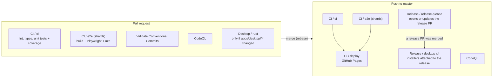

# Continuous integration and delivery

How a change travels from a pull request to the site, and from a release to the desktop installers. Everything runs on GitHub-hosted runners, which are free and unmetered for a public repository. The scarce resources are therefore not minutes but **wall-clock time** (the wait of whoever pushed), the **20 concurrent jobs** per repository, and the **10 GB of Actions cache**.

## Overview

| Workflow | Trigger | Role |
|---|---|---|
| `ci.yml` | PR, push to master, manual | `ci` gates the code; `e2e` drives the production build in a real browser; `deploy` publishes the site (master only, after both). |
| `codeql-analysis.yml` | PR, push to master, weekly | Static security analysis of the workflows and of the TypeScript. Never blocks a deploy. |
| `validate-commits.yml` | PR | Runs the repository's own `commitlint` over the PR's commits, so release-please can read them. |
| `desktop.yml` | PR and master, `apps/desktop/**` only | Rust side of the desktop app: `fmt`, `clippy`, tests. |
| `release-please.yml` | push to master | Keeps the release PR up to date; when that PR is merged, tags the release and builds the installers for 4 targets. |
| `logic-drift.yml` | weekly, manual | Compares the pinned randomizer commit with upstream and opens an issue on drift. |

Markdown-only changes skip `ci.yml` and CodeQL (`paths-ignore`): no job reads them.

## Jobs

- **`ci`** runs lint (Biome), the TypeScript build over every workspace, and the unit tests with coverage floors. It is CPU-bound (Vitest creates one jsdom per spec file) and is the longest non-browser job. On a PR it also posts a results comment.
- **`e2e`** builds the site and serves that production build to Playwright with axe-core, on the runner's preinstalled Chrome (no browser download). The suite is split over runners with Playwright's `--shard`, because a runner's cores are already saturated by two browsers: only another runner shortens the wait. The shard that runs on master also uploads the built site as the Pages artifact, so `deploy` publishes exactly what the tests exercised.
- **`deploy`** needs `ci` and `e2e`, runs on master only and publishes the artifact. Pushes to master are serialised (`concurrency` without cancellation), so deployments never overlap; a PR's older runs are cancelled by its next push.
- **`release-please`** is a separate workflow and does not wait for CI. Its `desktop` matrix builds, signs and attaches the installers when a release is cut.

## Caches

Three kinds of cache exist, with three different policies.

| Cache | Key | Written by | Policy |
|---|---|---|---|
| pnpm store (about 120 MB on Linux) | `pnpm-cache-<os>-<arch>-<runtimes>-<lockfile hash>-<runtimes resolved>-<run id>-<attempt>-<uuid>` | the `ci` job, on master, once per lockfile | every other job restores it and saves nothing |
| Rust build (0.4 to 1 GB per target) | `v0-rust-…` (`Swatinem/rust-cache`) | master only (`desktop.yml`, the release matrix) | kept; the most expensive to rebuild |
| Speech model (40 MB), CodeQL database, pnpm lockfile-verification log | various | the job that needs them | small; left as they are |

### Why the pnpm store is saved once

`pnpm/setup` with `cache: true` restores the store, and at the end of the job saves a new copy of it. The save key ends with the run id and a random UUID, so it never collides with an earlier one, **even when the lockfile did not change**. Left alone, every job of every push wrote its own 120 MB copy: a PR push wrote five, a master push four to eight. Measured on 2026-10-20 that was 3.5 GB of duplicates in a repository whose quota is 10 GB, with the Rust caches (the largest, the least often read, and the costliest to lose: a release build takes 7.2 min cold against 3.4 min warm) first in line for LRU eviction.

The policy:

1. `pnpm/setup` is called with `save-cache: false` in every job except `ci`.
2. In `ci`, the save is enabled only on master **and** only if no cache for the current lockfile exists yet. A step lists the master caches with `gh cache list` and looks for `hashFiles('pnpm-lock.yaml')` in a key (the action puts the same hash in its keys). On a listing failure it saves anyway: a spare copy is better than none.
3. A pull request reads caches written for its base branch, so it restores master's store. A cache written by a PR is visible to that PR only and is never reused by master, which is why PRs write nothing.

The restore uses prefix fallbacks, so a PR that changes a dependency starts from master's older store and installs only the difference. The first master push after a lockfile change saves the new store.

Consequences and limits:

- The macOS and Windows jobs of the release matrix no longer keep their own pnpm store (66 and 79 MB): they download the dependencies at each release, a few seconds. Saving one copy per release from each would have re-created the duplicates.
- Cache entries of a deleted branch or closed PR are evicted after 7 days without access, or earlier by LRU. `gh cache list` and `gh api repos/<owner>/<repo>/actions/cache/usage` show the state; `gh cache delete <key>` removes an entry.
