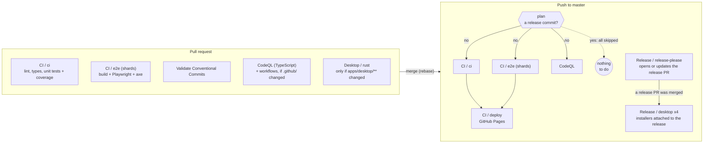

# Continuous integration and delivery

How a change travels from a pull request to the site, and from a release to the desktop installers. Everything runs on GitHub-hosted runners, which are free and unmetered for a public repository. The scarce resources are therefore not minutes but **wall-clock time** (the wait of whoever pushed), the **20 concurrent jobs** per repository, and the **10 GB of Actions cache**.

## Overview

| Workflow | Trigger | Role |
|---|---|---|
| `ci.yml` | PR, push to master, manual | `ci` gates the code; `e2e` drives the production build in a real browser; `deploy` publishes the site (master only, after both). |
| `plan.yml` | called by `ci.yml` and `codeql-analysis.yml` on a push | Answers one question: is this push only a release-please release commit? See "Release commits". |
| `codeql-analysis.yml` | PR, push to master, weekly | Static security analysis of the TypeScript. Never blocks a deploy. |
| `codeql-actions.yml` | PR and master when `.github/**` changed, weekly | The same analysis for the workflows themselves. Its only input is `.github/`, so no other change can alter its result; the weekly run covers new CodeQL queries. |
| `validate-commits.yml` | PR | Runs the repository's own `commitlint` over the PR's commits, so release-please can read them. |
| `desktop.yml` | PR and master, `apps/desktop/**` only | Rust side of the desktop app: `fmt`, `clippy`, tests. |
| `release-please.yml` | push to master | Keeps the release PR up to date; when that PR is merged, tags the release and builds the installers for 4 targets. |
| `logic-drift.yml` | weekly, manual | Compares the pinned randomizer commit with upstream and opens an issue on drift. |

Markdown-only changes skip `ci.yml` and CodeQL (`paths-ignore`): no job reads them.

## Jobs

- **`plan`** exists on pushes only (a pull request has none, and without one every job runs). It checks out `.github/scripts` alone and runs `is-release-commit.sh`, which prints `release=true|false`. About 10 s on a runner of its own.
- **`ci`** runs lint (Biome), the TypeScript build over every workspace, and the unit tests with coverage floors. It is CPU-bound (Vitest creates one jsdom per spec file) and is the longest non-browser job. On a PR it also posts a results comment.
- **`e2e`** builds the site and serves that production build to Playwright with axe-core, on the runner's preinstalled Chrome (no browser download). The suite is split over three runners with Playwright's `--shard`, because a runner's cores are already saturated by two browsers: only another runner shortens the wait. Playwright splits by test count, not by duration, so shards are never equal (the heaviest files hold a few 7 to 12 s tests); a fourth shard would gain about 35 s more while a PR already takes 7 to 8 of the 20 concurrent job slots. The shard count is the matrix's size (`strategy.job-total`) and is read from there by the job name and the `--shard` flag. A failed shard uploads its own report (`playwright-report-<n>`, 7 days); the reports are not merged. The shard that runs on master also uploads the built site as the Pages artifact, so `deploy` publishes exactly what the tests exercised.
- **`deploy`** needs `ci` and `e2e`, runs on master only and publishes the artifact. Pushes to master are serialised (`concurrency` without cancellation), so deployments never overlap; a PR's older runs are cancelled by its next push.
- **`release-please`** is a separate workflow and does not wait for CI. Its `desktop` matrix builds, signs and attaches the installers when a release is cut.

## Release commits

When the release PR that release-please keeps open is merged, master receives `chore(master): release x.y.z`. It changes the version in `package.json`, the manifest and the changelog, and nothing the site is built from: the web app never reads the version, and the desktop installers are built by the release workflow, from the tag. Running CI, the browser tests, the deploy and CodeQL on it repeated about 12 runner-minutes, for an identical site, and the run waited for the previous one in the master queue (19 of the 23 queued runs measured over four days were release commits).

`plan` recognises it by **what it changes**, never by what its title claims; every condition must hold, and any doubt or error runs everything (fail-safe):

| Condition | Why |
|---|---|
| The push only adds commits and every title is `chore(master): release <version>` | the commit list is complete and is release-please's |
| The diff is exactly `CHANGELOG.md`, `.release-please-manifest.json` and `package.json` | a release that also touched code is a normal push |
| In the manifest and `package.json`, one line out and one line in, both the version | `package.json` also holds scripts and dependencies |
| The previous commit has a green `ci.yml` run on a push | see below |

The last condition closes a hole. Pushes to master queue in one concurrency group, and a queued run is **replaced** by a newer queued one. If a feature is merged and the release PR right after it, the release commit replaces the feature's pending run: until now that was harmless, because the release run built the whole tree and deployed the feature with it. Skipping the release run unconditionally would leave that feature undeployed. The release run therefore checks that its parent was built and deployed; if its parent's run was replaced, it has no green run, and the release run does everything.

What is skipped on a release commit: `ci`, `e2e`, `deploy` and CodeQL. What is not: `release-please.yml` (it tags the release and starts the installers). `codeql-actions.yml` is path-filtered to `.github/**`, which a release never touches.

The script is `.github/scripts/is-release-commit.sh`. It reads the push through the compare API (`BEFORE...AFTER`), so it needs no deep checkout.

## Concurrency

A push makes the checks of the previous push obsolete, but only on a pull request: its older runs are cancelled, which frees runners and keeps the check list about the latest commit.

| Workflow | Group | Cancelled by a newer run |
|---|---|---|
| `ci.yml` | PR number, or the ref | PR only; pushes to master queue, so deployments never overlap |
| `codeql-analysis.yml`, `codeql-actions.yml` | PR number, or the commit SHA | PR only; each master run has a group of its own, so none is cancelled |
| `validate-commits.yml` | PR number | always (it only runs on PRs) |
| `desktop.yml` | ref | always, as it already was |
| `release-please.yml` | fixed | never: two quick merges must not race on the release PR |

Within a group, a queued run is replaced by a newer pending one. That is why master's CodeQL groups are keyed by commit rather than by ref: with the ref, a burst of merges would silently skip the scans of the middle commits.

## Caches

Three kinds of cache exist, with three different policies.

| Cache | Key | Written by | Policy |
|---|---|---|---|
| pnpm store (about 120 MB on Linux) | `pnpm-cache-<os>-<arch>-<runtimes>-<lockfile hash>-<runtimes resolved>-<run id>-<attempt>-<uuid>` | the `ci` job, on master, once per lockfile | every other job restores it and saves nothing |
| Rust build (0.4 to 1 GB per target) | `v0-rust-…` (`Swatinem/rust-cache`) | master only (`desktop.yml`, the release matrix) | kept; the most expensive to rebuild |
| Speech model (40 MB), CodeQL database, pnpm lockfile-verification log | various | the job that needs them | small; left as they are |

### Why the pnpm store is saved once

`pnpm/setup` with `cache: true` restores the store, and at the end of the job saves a new copy of it. The save key ends with the run id and a random UUID, so it never collides with an earlier one, **even when the lockfile did not change**. Left alone, every job of every push wrote its own 120 MB copy: a PR push wrote five, a master push four to eight. Measured on 2026-10-20 that was 3.5 GB of duplicates in a repository whose quota is 10 GB, with the Rust caches (the largest, the least often read, and the costliest to lose: a release build takes 7.2 min cold against 3.4 min warm) first in line for LRU eviction.

The policy:

1. `pnpm/setup` is called with `save-cache: false` in every job except `ci`.
2. In `ci`, the save is enabled only on master **and** only if no cache for the current lockfile exists yet. A step lists the master caches with `gh cache list` and looks for `hashFiles('pnpm-lock.yaml')` in a key (the action puts the same hash in its keys). On a listing failure it saves anyway: a spare copy is better than none.
3. A pull request reads caches written for its base branch, so it restores master's store. A cache written by a PR is visible to that PR only and is never reused by master, which is why PRs write nothing.

The restore uses prefix fallbacks, so a PR that changes a dependency starts from master's older store and installs only the difference. The first master push after a lockfile change saves the new store.

Consequences and limits:

- The macOS and Windows jobs of the release matrix no longer keep their own pnpm store (66 and 79 MB): they download the dependencies at each release, a few seconds. Saving one copy per release from each would have re-created the duplicates.
- Cache entries of a deleted branch or closed PR are evicted after 7 days without access, or earlier by LRU. `gh cache list` and `gh api repos/<owner>/<repo>/actions/cache/usage` show the state; `gh cache delete <key>` removes an entry.
