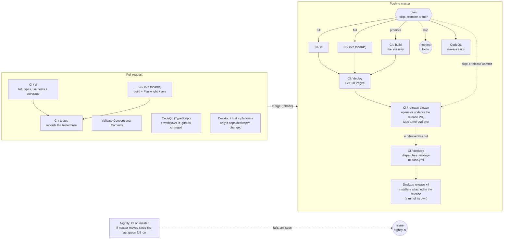
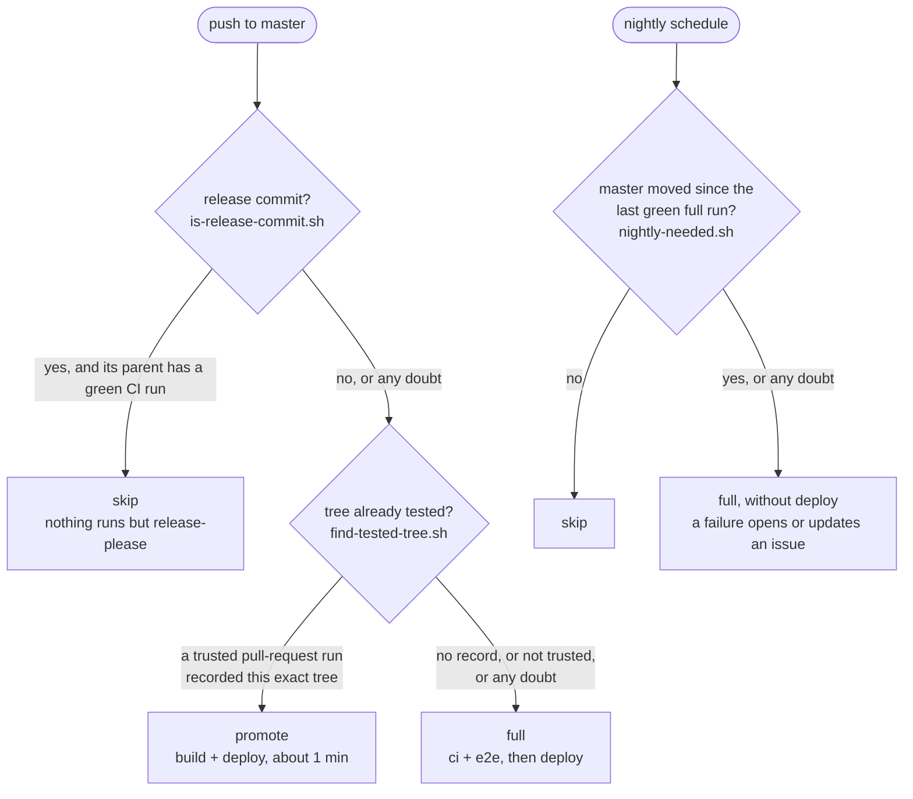
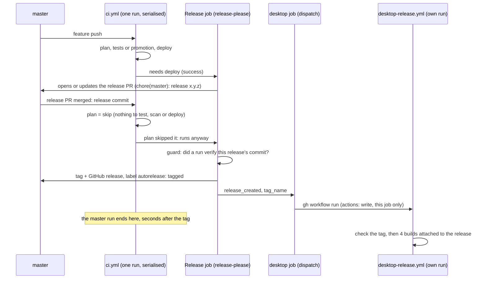

# Continuous integration and delivery

How a change travels from a pull request to the site, and from a release to the desktop installers. Everything runs on GitHub-hosted runners, which are free and unmetered for a public repository. The scarce resources are therefore not minutes but **wall-clock time** (the wait of whoever pushed), the **20 concurrent jobs** per repository, and the **10 GB of Actions cache**.

## Overview



| Workflow | Trigger | Role |
|---|---|---|
| `ci.yml` | PR, push to master, nightly, manual | `ci` gates the code; `e2e` drives the production build in a real browser; `tested` records on a PR that its tree passed; `build` builds the site of a tree already tested; `deploy` publishes the site (master only); `release-please` then opens or updates the release PR, and tags a merged one; `desktop` starts the build of the installers of a release just cut; `nightly-report` opens an issue when the nightly run does not pass. |
| `plan.yml` | called by `ci.yml` and `codeql-analysis.yml` on a push, and by `ci.yml` on the nightly run | Answers one question: what has this push to do? `skip`, `promote` or `full`. CodeQL calls it with `deploys: false`: it is never told to promote, and a release commit is skipped without waiting for a deployed parent (each commit has a scan of its own). See "Release commits", "Promoting a tested tree" and "The nightly run". |
| `codeql-analysis.yml` | PR, push to master, weekly | Static security analysis of the TypeScript. Never blocks a deploy. |
| `codeql-actions.yml` | PR and master when `.github/**` changed, weekly | The same analysis for the workflows themselves. Its only input is `.github/`, so no other change can alter its result; the weekly run covers new CodeQL queries. |
| `validate-commits.yml` | PR | Runs the repository's own `commitlint` over the PR's commits, so release-please can read them. |
| `docs.yml` | PR and push to master, every path | `scripts/check-docs.mjs` over the tracked Markdown: each relative link and its `#anchor`, and each repository path quoted in backticks, must exist. See "The docs check". |
| `desktop.yml` | PR and master, `apps/desktop/**` only | Rust side of the desktop app: `fmt`, `clippy` and tests on Linux, and `clippy` again on Windows and macOS (the code that compiles on one system only), plus the tests of the two servers (`stream::`, `relay::`) on Windows, where an exclusive bind and a restart behave differently. |
| `desktop-release.yml` | `workflow_dispatch`, started by the `desktop` job of `ci.yml` or by hand | The desktop installers for 4 targets, built from the release's tag and attached to it, after a check of the tag. A run of its own, so it neither holds the master queue nor turns master red. See "Releases". |
| `logic-drift.yml` | weekly, manual | Compares the pinned randomizer commits (ALttPR, SMZ3) with upstream and opens a `logic-drift` issue on drift. For Archipelago, which has no branch to follow, it compares the pinned release with the latest stable one and opens an `ap-drift` issue listing the watched files that changed. |
| `archipelago.yml` | PR and master when `packages/archipelago/**` or the workflow changed, weekly, manual | Runs `real-server.spec.ts` against the pinned Archipelago server. See "The Archipelago real-server run". |

Markdown-only changes skip `ci.yml` and CodeQL (`paths-ignore`): no job reads them, but `docs.yml` has no path filter and still checks their links.

## Jobs

- **`plan`** exists on pushes and on the nightly run (a pull request has none, and without one every job runs). It checks out `.github/scripts` alone and runs `plan.sh`, which prints `mode=skip|promote|full`. About 10 s on a runner of its own. If it fails, its mode is empty and everything runs.
- **`ci`** runs lint (Biome), the TypeScript build over every workspace, and the unit tests with coverage floors. It is CPU-bound (Vitest creates one jsdom per spec file) and is the longest non-browser job. On a PR it also posts a results comment. It runs in `full` mode and on pull requests.
- **`docs`** (`docs.yml`, job `check-docs`) runs `node scripts/check-docs.mjs` on every pull request and push to master, on the runner's own Node, with no install. See "The docs check".
- **`e2e`** builds the site and serves that production build to Playwright with axe-core, on the runner's preinstalled Chrome (no browser download). The suite is split over three runners with Playwright's `--shard`, because a runner's cores are already saturated by two browsers: only another runner shortens the wait. Playwright splits by test count, not by duration, so shards are never equal (the heaviest files hold a few 7 to 12 s tests); a fourth shard would gain about 35 s more while a PR already takes 7 to 8 of the 20 concurrent job slots. The shard count is the matrix's size (`strategy.job-total`) and is read from there by the job name and the `--shard` flag. A failed shard uploads its own report (`playwright-report-<n>`, 7 days); the reports are not merged. The shard that runs on master (not the nightly run) also uploads the built site as the Pages artifact, so `deploy` publishes exactly what the tests exercised. Like `ci`, it runs in `full` mode and on pull requests.
- **`tested`** runs on a pull request whose head is in this repository, once `ci` and every `e2e` shard are green, and uploads the record of the tested tree. See "Promoting a tested tree". Its condition tests `needs.*.result` instead of the implicit `success()`: a pull request has no `plan`, a skipped job that `ci` and `e2e` wait for, and an implicit `success()` would count it against this job too. It is `continue-on-error`: a failing lookup must not turn a green pull request red; master just tests.
- **`build`** runs in `promote` mode only: it builds the site (`vite build`, the speech model from its cache) and uploads the Pages artifact, in place of the `e2e` shard that does so in `full` mode.
- **`deploy`** runs on master, never on the nightly run, when the site is ready: `build` succeeded (`promote`), or `ci` and `e2e` did (`full`). Pushes to master are serialised (`concurrency` without cancellation), so deployments never overlap; a PR's older runs are cancelled by its next push.
- **`nightly-report`** runs when the nightly run's `ci` or `e2e` did anything but succeed (a timeout or a cancelled shard included), unless `plan` skipped the run. See "The nightly run".
- **`release-please`** (job name `Release`) runs after `deploy` succeeded, or on a release commit that `plan` skipped. A guard step first refuses to tag a release no run verified. It is the only job with write access to the repository. See "Releases".
- **`desktop`** runs when `release-please` reports that it cut a release, and only dispatches `desktop-release.yml` for the new tag (`actions: write`, nothing else). The installers are built, signed and attached by that run. See "Releases".

## What a push to master does

`plan.sh` answers with one of three modes. The checks run in this order, and each one that does not give a positive answer, or fails for any reason, hands over to the next, so the default is always `full`.



Manual runs (`workflow_dispatch`) and pull requests have no plan: everything runs, and the manual run on master redeploys.

## Release commits

When the release PR that release-please keeps open is merged, master receives `chore(master): release x.y.z`. It changes the version in `package.json`, the manifest and the changelog, and nothing the site is built from: the web app never reads the version, and the desktop installers are built by the release workflow, from the tag. Running CI, the browser tests, the deploy and CodeQL on it repeated about 12 runner-minutes, for an identical site, and the run waited for the previous one in the master queue (19 of the 23 queued runs measured over four days were release commits).

`plan` recognises it by **what it changes**, never by what its title claims; every condition must hold, and any doubt or error runs everything (fail-safe):

| Condition | Why |
|---|---|
| The push only adds commits and every title is `chore(master): release <version>` | the commit list is complete and is release-please's |
| The diff is exactly `CHANGELOG.md`, `.release-please-manifest.json` and `package.json` | a release that also touched code is a normal push |
| In the manifest and `package.json`, one line out and one line in, both the version | `package.json` also holds scripts and dependencies |
| The previous commit has a green `ci.yml` run on a push | see below. A run counts only when every job is green, `release-please` and `desktop` included (the installers' build is a run of its own and does not count): a parent whose release job failed sends its release commit through the full pipeline, which is safe, only slower |

The last condition closes a hole. Pushes to master queue in one concurrency group, and a queued run is **replaced** by a newer queued one. If a feature is merged and the release PR right after it, the release commit replaces the feature's pending run: until now that was harmless, because the release run built the whole tree and deployed the feature with it. Skipping the release run unconditionally would leave that feature undeployed. The release run therefore checks that its parent was built and deployed; if its parent's run was replaced, it has no green run, and the release run does everything. A parent that was promoted counts: its run is green only if its `deploy` succeeded.

What is skipped on a release commit: `ci`, `e2e`, `build`, `deploy` and CodeQL. What is not: the `release-please` job of the same run (it tags the release), and so the `desktop` job after it (see "Releases"). `codeql-actions.yml` is path-filtered to `.github/**`, which a release never touches.

The release check comes **first** in `plan.sh`, so a release commit is never promoted. The two rules would rarely overlap anyway, since a release commit's tree is not one a feature pull request tested. The release pull request itself has that tree, but the bot token that opens it starts no checks, so nothing records it today; with a GitHub App token in place of the bot token it would, which is harmless: the release is checked first, and the site is identical.

The script is `.github/scripts/is-release-commit.sh`. It reads the push through the compare API (`BEFORE...AFTER`), so it needs no deep checkout.

## Promoting a tested tree

Pull requests are merged by rebase. When master has not moved since the pull request's last test run, the commits it pushes hold **the very tree the PR's CI tested** (measured over 109 pushes before this rule: 77 were identical to a green PR). Testing it again on master repeated about 9.5 runner-minutes and 5 minutes of waiting for nothing. The principle is content addressing, as in Bazel or Turborepo caches: a git *tree* is a hash of the content of every file, so the same hash means the same sources, hence the same test outcome (up to the randomness of property-based tests and the runner image, which the nightly run covers).

### The record

When `ci` and every `e2e` shard of a pull request are green, the `tested` job uploads the artifact `tested-<tree>` (a few bytes, 7 days). `<tree>` is the tree of the merge commit the jobs tested (`refs/pull/N/merge`, `GITHUB_SHA`), read through the API: the job checks nothing out and runs no code of the pull request.

On master, `find-tested-tree.sh` reads the tree of the pushed commit, lists the artifacts with that name, and examines the runs that hold them, newest first (ten at most).

The record holds the tree, the test merge commit and the run id. It is only a name that any run could upload, so master checks what it claims, not that it exists (next section).

### The trust rule

A pull request runs **its own copy** of the workflows. Anyone can write a `ci.yml` that uploads `tested-<tree>` without testing anything, so the artifact proves nothing by itself: it is believed only because of the run that holds it. Every condition must hold, or the record is ignored and master tests (fail-safe):

| Condition | What it rules out |
|---|---|
| The artifact is not expired, and its run's head repository is the repository itself (`head_repository_id == repository_id`) | a fork's run: its workflow is the fork author's code |
| The run is on the `pull_request` event | a `workflow_dispatch` or branch run started by hand |
| The run is `.github/workflows/ci.yml` | another workflow file added by a branch |
| The run's head repository has this repository's name and id, and is not a fork | a renamed or forked head |
| The run is completed and its conclusion is `success` | a failed, cancelled or still running run |
| Its jobs include a successful `ci`, no job that is neither successful nor skipped, and every shard `k/n` of the browser tests for the `n` the job names announce | a run missing part of the suite. A run that failed and was re-run to success is accepted (its jobs are the latest attempt's); a last attempt that is red or incomplete is not |
| The record, downloaded, names the run's own test merge commit: that commit's tree is the recorded one and its parents hold the run's head commit | a trusted run publishing `tested-<some other tree>` |
| It is the newest *completed* run holding this tree (a run still going is ignored), and no newer run of the same commit failed | an older green run outvoting a newer red one: no "retry until green", even on identical content |
| The tree is the pushed commit's own | a record for another content |

What remains trusted is a collaborator with write access to the repository, who can push a branch and so change `ci.yml`; such a person can already push to master, so the rule does not try to defend against them. Fork pull requests, and anything the script does not recognise, take the full run.

**Dependabot.** Its pull requests come from branches of this repository (observed on #206: run on the `pull_request` event, head repository `kqesar/alltp-tracker`), so their runs meet the rule and can promote. What their runs can do is limited by GitHub: the secret source is Dependabot's (this repository defines none there), and the repository secrets, among them the desktop signing key, are not exposed. The `GITHUB_TOKEN` had `contents: read` and the `pull-requests: write` the workflow asks for. A dependency update's code does run (Vitest, the Vite build) with those limits, as it did before this rule; promotion adds nothing the later master run would not have had. The `tested` job needs no more than `contents: read`: `actions/upload-artifact` authenticates with the runner's own runtime token, not `GITHUB_TOKEN`, so a Dependabot run can upload (this is also why a fork's run can, and why the rule above exists).

Dependabot's configuration puts three ecosystems into one weekly group, hence one pull request: npm (the whole workspace, through the root lockfile), the desktop app's Rust crates (`apps/desktop/src-tauri`) and GitHub Actions. The crates are there so that the Tauri crates and their `@tauri-apps/*` npm twins are updated together and cannot drift apart; before that, only the npm side was ever updated. A crate update touches `apps/desktop/`, so `desktop.yml` lints and tests it on the pull request like any other change to that folder.

### What it costs and what it cannot see

| Limit | Consequence |
|---|---|
| The record expires after 7 days | an old, untouched pull request is tested again on master; promotions normally follow the pull request's run within hours |
| Master moved after the pull request was tested | the rebased tree differs: full run |
| The pull request was merged before its run finished | no record yet: full run |
| Random inputs (property-based tests draw a new seed each run) and the runner's Chrome are not part of the tree | the nightly run explores them |
| A promoted site is **built** on master, not carried over from the pull request | the build is reproducible (two builds are identical bit for bit); a changed build tool or a non-deterministic step would show only as a difference between the two, never as a wrong site, since the tree is the same |

The promoted site is built with `pnpm --filter @alltp/web build`, the same `vite build` the browser tests serve, and deployed by the same `deploy` job and Pages artifact as in a full run.

## The nightly run

`ci.yml` runs every night (`17 3 * * *` UTC, on master) so that what master deployed without testing again is still checked against new property-test seeds and the runner's current Chrome.

It is **not unconditional**: `plan` runs `nightly-needed.sh`, which finds the newest green run of `ci.yml` on master whose `ci` job really ran (a promoted or skipped push is green too, but is not a full run) and compares its commit with master's head. Same commit: `skip`, nothing runs. Different, or anything unreadable: `full`. Development that slows to Dependabot patches still moves master, so those nights run. Master only counts as moved if something the tests or the site can see changed: release commits and Markdown-only commits between that run and the head are ignored (each is checked: release by the same file-set rule as above, without requiring a deployed parent; Markdown by its file names). More than 30 commits, a merge commit or any doubt: `full`.

The nightly run tests and **deploys nothing** (the Pages upload and `deploy` are skipped on `schedule`), and has a concurrency group of its own so it neither waits for a push nor holds one back.

When `ci` or `e2e` does not succeed, `nightly-report` creates the `nightly-ci` label if needed (`gh label create --force`, idempotent: an issue created with a missing label silently loses it), then looks for an open issue with that label **or** that title. If there is one it comments on it; otherwise it opens one. At most one is open at a time, even if the label is lost. It is not closed automatically: close it once fixed. While master stays red, each night adds a comment.

## Releases

A release is cut **by the master pipeline, after the deploy**, never beside it. Before, `release-please.yml` was a workflow of its own that started on the same push as CI and waited for nothing: release 2.30.0 was tagged and published while the CI run of the commit it contained had just failed on master. Now a red master cuts nothing. The installers are built in a run of their own, started by the pipeline once the tag exists.



There are **two runs to look at** after a release: the master run (tag and release) and the `Desktop release` run (installers). A failed installer build does not turn master red.

### When the `release-please` job runs

```yaml
if: !cancelled() && (needs.deploy.result == 'success'
      || (github.event_name == 'push' && needs.plan.outputs.mode == 'skip'))
```

| Run | `deploy` | `plan` | `release-please` |
|---|---|---|---|
| Push, `full` (tests green) | success | `full` | runs |
| Push, `promote` (a tested tree) | success | `promote` | runs |
| Push, red (`ci`, `e2e` or `build` failed) | skipped | `full` or `promote` | **skipped**: nothing is released from a master that was not verified |
| Release commit | skipped | `skip` | runs: the tag is what remains to do |
| Manual run on master | success | none | runs (a way to unstick a release) |
| Pull request, nightly run | skipped | none or `skip` on `schedule` | skipped |

`plan` answers `skip` on a push only for a release commit whose parent was built and deployed (see "Release commits"). Any doubt makes it `full`, and then `deploy` is what lets the job run. If `deploy` fails, the release waits: the next green deploy runs `release-please` again, which finds the merged release PR still to tag (see "A release that waits").

Checked against the 60 latest master runs of `ci.yml` (2026-10-20), with the mode of `plan` inferred from the jobs the API lists (its outputs are not exposed): 58 would run the job (every deployed run, and the release commit `dcc8926`, 2.32.0, the one run `plan` skipped); the 2 others would not, a cancelled run and the red run of `b736eb1`, the commit whose failing CI did not stop the 2.30.0 release.

### The `desktop` job's condition

```yaml
if: !cancelled() && needs.release-please.result == 'success'
      && needs.release-please.outputs.created == 'true'
```

A condition with no status function (`success()`, `always()`, `!cancelled()`...) gets an implicit `success()`, and that one looks at **every ancestor job**, not only at the `needs`: one skipped ancestor skips the job, even though its direct parent ran (actions/runner#491). Here there is always one (`build` in a full run, `ci` and `e2e` in a promoted one, `ci`, `e2e`, `build` and `deploy` on a release commit, `plan` on a manual run), so the plain `if: needs.release-please.outputs.created == 'true'` the first version of this change had would have tagged every release and built no installer.

Observed, not assumed: a throwaway workflow reproduced the graph (a skipped `ci`, a `deploy` that depends on it and is skipped too, a `release` job that runs through `!cancelled()` and outputs `created=true`, and three children) on the branch of the pull request. The child with the implicit condition was skipped, the child with the condition above ran, and a child testing `created == 'false'` was skipped. The workflow was deleted before the merge.

### The guard: no release on a tree nobody verified

`release-please` does not tag the commit of its run: it tags each pending release at **that release pull request's merge commit M**. Without a guard, a release held back (a red master, a replaced run) would be tagged later, by a green run of another commit, on a tree in which the bug may still be, and the installers would ship it through the updater: the 2.30.0 defect, only delayed.

`release-guard.sh` runs before `release-please`, in the same job, for every merged pull request labelled `autorelease: pending`. It accepts M if one of these holds, in this order:

| Rule | Why M is verified |
|---|---|
| M is the commit of this run | the run got here because its `deploy` succeeded, or `plan` skipped a release commit over a deployed parent |
| M is a release commit whose parent is the commit of this run | the run has just verified the parent, and M changes only the version (`is-release-commit.sh`, without requiring a deployed parent). This is a release PR merged while the run of its parent was going |
| M has a green push run of `ci.yml` | tested and deployed, or skipped as a release commit over a deployed parent |
| M is a release commit whose parent has a green push run of `ci.yml` | `is-release-commit.sh` as `plan` uses it |

Otherwise, or if the pending pull requests cannot be listed, the job **fails** with an error that names the commit, and nothing is tagged, nor is the release PR updated (release-please refuses to open another while a merged one is untagged anyway). A person decides: check the commit and tag it by hand, or remove the label and cut a new release. A red job that a phone shows is the point: a silent skip would leave the release waiting without anybody knowing.

Tried on real commits (`GH_TOKEN`, past runs): 2.33.0 as the run's own commit, and over the commit just verified; 2.30.0 and 2.32.0 through their own green runs (the 2.32.0 one is the run `plan` skipped); the commit `b736eb1`, whose run was red, **refused**; a release commit with no run of its own over a parent that has none (simulated with a workflow that never ran) **refused**; `is-release-commit.sh` says "no" for 2.30.0 over its red parent `b736eb1`; no pending release: nothing to do. A branch of the rules (a release commit with no run of its own, over a green parent) is the one only a real replaced run can show.

### A release that waits

Pushes to master queue in one concurrency group, and a queued run is replaced by a newer queued one. If the run of a release commit is replaced, **no job of it runs, and nothing is tagged**. A later run tags it, because `release-please` does not look at the commit it runs on but at the merged pull requests (release-please 17.6, the version in `release-please-action` v5.0.0, `Manifest.findMergedReleasePullRequests`, read in the action's `dist/index.js`):

- it lists the merged pull requests of the target branch, newest first, up to 200, and keeps those that carry **all** the labels `autorelease: pending`;
- for each one it builds the release from the pull request's body and **its merge commit** (`target_commitish` is that SHA, not the commit the run is on), creates the GitHub release and the tag, comments on the pull request, then swaps the label for `autorelease: tagged`;
- if creating the release fails (an API error), the label is not swapped and the next run retries;
- if the tag already exists (for instance the release was created, then the label swap failed), the labels are swapped, and then the action **throws** `DuplicateReleaseError` once every release of the pull request is a duplicate. `main()` does not catch it: the `Release` job fails, **`release_created` is not set, and the `desktop` job does not start**. Whoever sees that red job starts the installers by hand (below);
- `createReleases()` runs first, then `createPullRequests()`: a run that tags also brings the next release PR up to date.

So a release is **late, never lost**, and the guard decides whether its tree may go out. The installers are built from the tag (the release commit), whichever run tagged it.

**Who tags a release PR merged during its parent's run?** The `Release` job of the **parent's** run, when it reaches that point after the merge: it finds the pending PR, and the guard accepts it (second rule). The release commit's own run then waits in the queue, is skipped by `plan`, and its `Release` job finds nothing pending. Both are harmless; there is one tag and one dispatch, from whichever run came first.

**Nothing runs twice.** `release-please.yml` is gone, so the release commit gets one `ci.yml` run, whose `plan` skips the tests, the build, the deploy and CodeQL, and whose `Release` job tags it. The tag and the release that job creates use the workflow token and start no workflow.

### The docs-only window

A push that changes only Markdown starts no `ci.yml` run (`paths-ignore`), so it does not refresh the release PR either. `docs` is a type listed in the changelog. If the release PR is merged before the next push that starts a run, the docs commit is in the tag without appearing in its changelog, and as it precedes the tag it appears in no later changelog.

The window also grew: the release PR is now updated after the deploy, one to six minutes after a push, where it was updated about 30 seconds after it. A hasty merge publishes the code of the last push without its changelog entry, and that entry never appears. The rule of use: **merge the release PR once the `Release` job of the last push has finished** (its title and body then list that push). The cost of ignoring it is one missing line in the changelog, never a wrong release.

### The installers

`desktop-release.yml` is the former `desktop` matrix of `release-please.yml`, unchanged in what it builds: 4 targets (macOS arm64 and x64 on one runner each, Ubuntu 22.04, Windows), `tauri-action` attaching the installers and their `.sig`, then an `updater` job writing the updater's `latest.json` once (`.github/scripts/updater-json.sh`, `docs/desktop.md`, "Releases"), the commit of the tag checked out. It is started by `workflow_dispatch` and has no other trigger.

**Why a dispatch, and not a job of the master run.** The workflow-level concurrency group is held until the last job of the run ends: installers built in the master run would keep every later push waiting 4 to 8 minutes (the matrix measured 4 to 6 minutes), about 5 times a day, and the pushes of the window would replace one another in the queue. A failed leg would also turn master red, which `is-release-commit.sh` and `nightly-needed.sh` read as "not green". A dispatch is the one event a job's `GITHUB_TOKEN` may start (a tag, a release or a push made with it starts nothing), so the master run only calls `gh workflow run desktop-release.yml --ref master -f tag=vX.Y.Z` and ends seconds after the tag. The alternatives were rejected: a trigger on `push: tags` or `release: published` never fires for a tag the token created; `workflow_run` runs after every CI run, forks' pull requests included, in a privileged context.

- **Check.** A first job, `check`, refuses to go on unless the run is on `refs/heads/master`, the tag matches `^v[0-9]+\.[0-9]+\.[0-9]+$` (the input is read from an environment variable, never interpolated into the script), a release has that tag, and the tag is an ancestor of master. Anyone with write access can dispatch the workflow from any branch with that branch's copy of the file, so the copy that counts is master's (`--ref master` in the dispatch job); a branch's copy can still be run by such a person, who can already change `ci.yml` and read the repository secrets: nothing here defends against them.
- **Concurrency.** One build per tag (`desktop-release-<tag>`), a second one waits and never cancels.
- **Pins.** Every action stays pinned by commit SHA (checkout, `pnpm/setup`, `rust-toolchain`, `rust-cache`, `tauri-action`), and pnpm still saves no cache (`save-cache: false`).
- **Rust cache.** `Swatinem/rust-cache` puts the job id in its key (`v0-rust-desktop-<os>-…`, plus the target as `key`). The matrix job is still called `desktop`, so the keys of the caches the previous release saved are the ones it restores (`gh cache list --key v0-rust` shows them). Renaming it would start from a cold cache (7.2 min instead of 3.4). The dispatch job of `ci.yml` is also called `desktop` and runs no Rust: the id only matters in `desktop-release.yml`. The run is on `refs/heads/master`, the scope the existing caches have.
- **Secrets.** `TAURI_SIGNING_PRIVATE_KEY` and its password stay **repository** secrets, read by the workflow directly (nothing is passed any more, so there is no `secrets: inherit` either). Moving them to a GitHub Environment limited to master, so that no other branch can read the key, is a hardening left for a separate change, once this flow has been seen to work.
- **Permissions.** Per job, least privilege. The workflow default stays `contents: read` (plus `pull-requests: write` in `ci.yml`, for the coverage comment of the `ci` job). `release-please` alone has `contents: write` (tag, release), `issues: write` (its labels) and `pull-requests: write` (the release PR). The dispatch job has `actions: write` and nothing else: that permission also allows cancelling and re-running workflows, so it stays on a job that runs one command. The matrix has `contents: write` only, to attach files to the release.
- **Starting the installers by hand**, for a tag whose build failed, or whose release was created without the dispatch (the duplicate case above): from a clone, `gh workflow run desktop-release.yml --ref master -f tag=v1.2.3`; from the Actions tab (or a phone), "Desktop release" > "Run workflow" on master, with the tag. A failed leg of the run itself is retried with "Re-run failed jobs" of that run. Attaching again replaces the files of the release.
- The workflow can be dispatched only once it exists on the default branch: it could not be run before the change that introduced it was merged.

### What it costs

- The release PR is updated after the deploy (one to six minutes after a push), and a Pages incident delays the release as it delays the site. Both are accepted: waiting is better than releasing a master that was not verified.
- A `Release` failure (the guard, the API, a duplicate) turns the master run red. The next release commit then does not find a green parent and runs the full pipeline (safe, slower), and the nightly run counts a red run as not green. A failed installer build does not.
- Two runs to follow instead of one.

## Concurrency

A push makes the checks of the previous push obsolete, but only on a pull request: its older runs are cancelled, which frees runners and keeps the check list about the latest commit.

| Workflow | Group | Cancelled by a newer run |
|---|---|---|
| `ci.yml` | PR number, `nightly` for the schedule, or the ref | PR only; pushes to master queue, so deployments never overlap |
| `codeql-analysis.yml`, `codeql-actions.yml` | PR number, or the commit SHA | PR only; each master run has a group of its own, so none is cancelled |
| `validate-commits.yml` | PR number | always (it only runs on PRs) |
| `desktop.yml` | ref | always, as it already was |
| `desktop-release.yml` | `desktop-release-<tag>` | never: a second build of a tag waits for the first |

A master run lasts as long as its last job, so the installers are not built in it: the `desktop` job only dispatches `desktop-release.yml`, and the run ends seconds after the tag (see "Releases"). `release-please` needs no group of its own, since the master runs are already serialised.

Within a group, a queued run is replaced by a newer pending one. That is why master's CodeQL groups are keyed by commit rather than by ref: with the ref, a burst of merges would silently skip the scans of the middle commits. Promoted runs stay in the master group: a deploy never starts before the previous one ends, and the newest pending push is the one that runs after it.

## Caches

Three kinds of cache exist, with three different policies. (The `tested-<tree>` records are artifacts, not caches: a few bytes each, 7 days.)

| Cache | Key | Written by | Policy |
|---|---|---|---|
| pnpm store (about 120 MB on Linux) | `pnpm-cache-<os>-<arch>-<runtimes>-<lockfile hash>-<runtimes resolved>-<run id>-<attempt>-<uuid>` | the `ci` job, on master, once per lockfile | every other job restores it and saves nothing |
| Rust build (0.4 to 1 GB per target) | `v0-rust-…` (`Swatinem/rust-cache`) | master only (`desktop.yml`, `desktop-release.yml`) | kept; the most expensive to rebuild |
| Speech model (40 MB), CodeQL database, pnpm lockfile-verification log | various | the job that needs them | small; left as they are |

### Why the pnpm store is saved once

`pnpm/setup` with `cache: true` restores the store, and at the end of the job saves a new copy of it. The save key ends with the run id and a random UUID, so it never collides with an earlier one, **even when the lockfile did not change**. Left alone, every job of every push wrote its own 120 MB copy: a PR push wrote five, a master push four to eight. Measured on 2026-10-20 that was 3.5 GB of duplicates in a repository whose quota is 10 GB, with the Rust caches (the largest, the least often read, and the costliest to lose: a release build takes 7.2 min cold against 3.4 min warm) first in line for LRU eviction.

The policy:

1. `pnpm/setup` is called with `save-cache: false` in every job except `ci`.
2. In `ci`, the save is enabled only on master **and** only if no cache for the current lockfile exists yet. A step lists the master caches with `gh cache list` and looks for `hashFiles('pnpm-lock.yaml')` in a key (the action puts the same hash in its keys). On a listing failure it saves anyway: a spare copy is better than none.
3. A pull request reads caches written for its base branch, so it restores master's store. A cache written by a PR is visible to that PR only and is never reused by master, which is why PRs write nothing.

The restore uses prefix fallbacks, so a PR that changes a dependency starts from master's older store and installs only the difference. The first master push after a lockfile change saves the new store.

Consequences and limits:

- The macOS and Windows jobs of the installers' matrix no longer keep their own pnpm store (66 and 79 MB): they download the dependencies at each release, a few seconds. Saving one copy per release from each would have re-created the duplicates.
- A promoted push runs no `ci`, so it saves no store. After a dependency update merged that way, the new store is saved by the next full run on master, at the latest the nightly one; until then pull requests restore the older store and install the difference.
- Cache entries of a deleted branch or closed PR are evicted after 7 days without access, or earlier by LRU. `gh cache list` and `gh api repos/<owner>/<repo>/actions/cache/usage` show the state; `gh cache delete <key>` removes an entry.

## The Archipelago real-server run

`packages/archipelago` is tested against recorded frames and an in-process fake server in `ci.yml`. `archipelago.yml` adds the one check those cannot make: that the recording still matches a real server. It downloads the Linux release `packages/archipelago/upstream.json` pins (`release`, and the sha256 under `assets`, the one place a bump changes), checks it with `sha256sum`, hosts the committed `test/server/normal-seed4242.archipelago` with `ArchipelagoServer` (`packages/archipelago/scripts/serve.sh`; hosting needs no ROM), waits for the port, and runs `pnpm vitest run --project archipelago real-server` with `AP_SERVER_URL` pointing at it. The server's log tail is printed at the end.

- **Triggers.** A pull request or push to master that changes `packages/archipelago/**` or the workflow, once a week (Monday), and by hand. Nothing else can change its outcome, so no other change pays for it.
- **Cost.** Under a minute of one runner: 19 s for the first run on the pull request that added it (install from the cached store, a 10 s download of the 122 MB release, the server's start, 0.3 s of tests). It runs beside `ci` and `e2e` and finishes long before them, so it adds no wait; a pull request that does not touch the package does not start it.
- **The release is cached** as one entry per version (`archipelago-release-<version>`), saved by master only, like the pnpm store: a copy saved by a pull request would be its own and never reused. The cache is a courtesy more than a speed-up; the checksum is verified on every run, a cached copy included.
- **Not a required check.** It reads a third party's release asset over the network, so a GitHub or download outage would otherwise block unrelated merges, and it protects a package that no other check depends on. A red run on a pull request is read like any other; nothing enforces it.
- **A failed weekly run opens an issue**, the same way `nightly-report` does: `report` creates the `archipelago-server` label if needed (`gh label create --force`), then comments on the open issue with that label or title, or opens one. Close it once fixed. Pull requests and pushes show their failure on the check itself, so only the scheduled run reports.

The other half of the pin is the `ap-drift` issue, opened by `logic-drift.yml` when Archipelago releases a version past the pinned one (see `packs/alttpr/scripts/logic-drift.mjs`, `checkReleaseDrift`): it lists the watched files that changed between the two tags, the new release's Linux assets with their sha256, and says the name-data checksums are *to check*, since the data package is built by the server rather than shipped as a file. A bump of the pin then runs this workflow on the pull request.

## The docs check

`scripts/check-docs.mjs` (plain Node, no dependency; `pnpm check:docs` locally) reads every git-tracked `.md` file except `CHANGELOG.md` and reports `file:line message`, exiting 1 on any failure:

- **Links.** Each relative Markdown link (inline, image, reference definition, `href` / `src`) must point at an existing file or folder, and its `#anchor` at a heading of the target file, slugged as GitHub does (`github-slugger`: lowercase, punctuation dropped, spaces to `-`, repeated headings numbered `-1`, `-2`). External URLs are not fetched.
- **Quoted paths.** Each code span that starts with `apps/`, `packages/`, `packs/`, `docs/`, `.github/`, `scripts/` or `.claude/` must exist. A trailing `:line` is dropped; a span with a glob or a placeholder (`*`, `<id>`, `{a,b}`) is no path; a path that git ignores (a build output) passes. Spell a path from the repository root, not from the package that holds it: that is what the check resolves.
- Fenced code blocks are skipped: they hold trees and commands, not claims.

It runs in `docs.yml` rather than in the `ci` job because `ci.yml` ignores Markdown-only changes (`paths-ignore`, see above), the changes most likely to break a link; a workflow with no path filter also catches a code change that renames a file a doc quotes. It catches the commonest cause of a false doc, a moved or deleted file, and nothing else: a description that stopped being true still passes, which is why `CLAUDE.md` asks for the doc to change in the same pull request as the behaviour. The slug and parsing logic is unit-tested in `scripts/check-docs.spec.mjs` (the `scripts` Vitest project).
