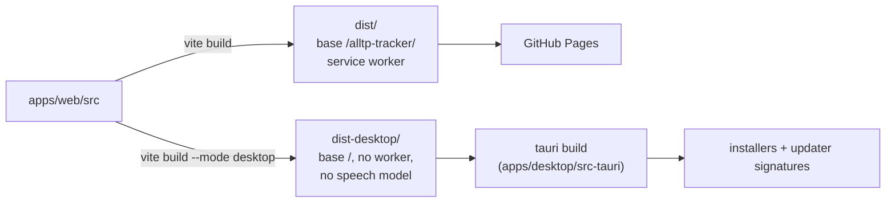
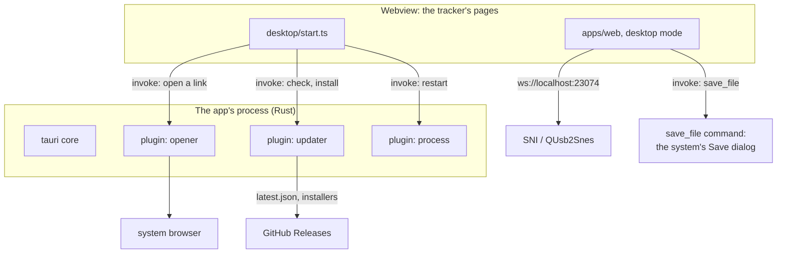
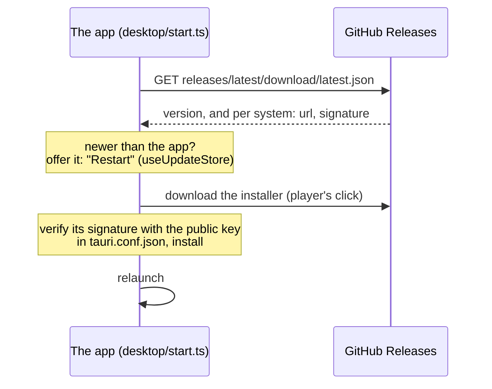
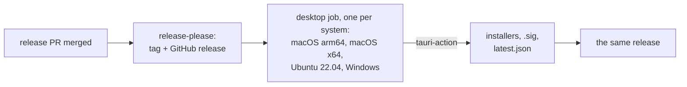

# The desktop app

`apps/desktop` (`@alltp/desktop`) is the tracker as a native app for Windows, macOS and Linux, built with [Tauri](https://v2.tauri.app/) 2. It exists for what a page on GitHub Pages cannot do:

- **Reach SNI from Safari's Macs.** WebKit treats `ws://localhost` from an https page as mixed content (WebKit bug 171934), so the site cannot autotrack in Safari or on iOS. The app's pages are not https: the restriction does not apply.
- **Talk to RetroArch directly** over UDP, without SNI (planned, series 2).
- **Global shortcuts** that work while the emulator has the focus (planned, series 3).

The site stays the main product. The app adds no byte to it, and costs nothing: no store, no paid signing, builds on GitHub's free runners, updates served by GitHub Releases.

## One codebase, two builds

The app's pages are `apps/web`, built in Vite's `desktop` mode. Nothing is forked.



What the `desktop` mode changes (`apps/web/vite.config.ts`):

| | Site | Desktop app |
|---|---|---|
| Base path | `/alltp-tracker/` | `/` (the app serves its own files) |
| Service worker | yes, for offline use and updates | none: the files are local, updates come from the app |
| Speech model (40 MB) | `models/` on the site, fetched on demand | the site's copy, fetched on demand (GitHub Pages sends `access-control-allow-origin: *`); never in an installer |
| Stream view (OBS) | yes | hidden: OBS can neither load the app's pages nor follow its `localStorage` |

The code reads the mode through `isDesktopApp` (`apps/web/src/utils/platform.ts`), a constant the site's build folds to `false`. One exception: `main.tsx` tests `import.meta.env.MODE === "desktop"` inline, because Rollup does not fold a constant imported from another module far enough to drop a dynamic `import()`. With the inline test, the site's build emits no chunk of the desktop code (checked in the build output: no `start-*.js`).

## At runtime



- **The webview** is each system's own: WebView2 on Windows (pages at `http://tauri.localhost`), WKWebView on macOS and WebKitGTK on Linux (pages at `tauri://localhost`). None of these origins is https, so autotracking's WebSocket to SNI is not mixed content. `detectEnvironment` (`packages/autotrack/src/environment.ts`) gates loopback on https pages only, else the WebKit of macOS and Linux would read as a blocked Safari.
- **What the pages may ask of the app** is listed in `src-tauri/capabilities/default.json`: open an https URL (`opener:allow-open-url` scoped to `https://*`: without a scope the permission grants the command but no URL), check for and install an update, restart, and the app's own `save_file` command. Nothing else.
- **Links** to other sites open in the system browser (`openLinksOutside` in `apps/web/src/desktop/start.ts`). In the app's window they would replace the tracker.
- **Exports** go through the system's Save dialog: `saveFile` (`apps/web/src/utils/saveFile.ts`) calls the app's `save_file` command (`src-tauri/src/lib.rs`), which asks where and writes there. A webview handles a download link its own way (WebKitGTK writes it, unasked, into the process's working directory), and the page gets no file-system access at all: it can write only where the player picks.
- **The run** is saved in the webview's `localStorage`, apart from any browser's. Export and Import move it.

## Updates



- The app checks when it opens, then every hour, and never installs on its own: the same notice as the site's offers **Restart**, and the player picks the moment.
- **Signing key.** Every installer is signed with the project's updater key, a free minisign (Ed25519) pair made by `tauri signer generate`. The public half is in `tauri.conf.json` (`plugins.updater.pubkey`). The private half and its password live in the repository's secrets, `TAURI_SIGNING_PRIVATE_KEY` and `TAURI_SIGNING_PRIVATE_KEY_PASSWORD`, and in the owner's own backup, never in the repository. An installed app refuses an update its key did not sign: losing the private key means no update can reach the installed apps again (players would reinstall by hand).
- This is separate from the systems' code signing (below): it proves an update comes from this project, whatever the system thinks of the publisher.

## Releases



- The `desktop` job of `.github/workflows/release-please.yml` runs only when a release is cut: about five minutes per system, in parallel. Pull requests that touch `apps/desktop` run `.github/workflows/desktop.yml` instead (Linux: `cargo fmt`, `clippy`, tests); the web side is tested by the CI workflow as always.
- The app's version is the product's: `tauri.conf.json` reads the root `package.json`, which release-please bumps.
- Linux is built on Ubuntu 22.04, the oldest glibc the AppImage should run on.

| System | Installers | Code signing |
|---|---|---|
| Windows | NSIS `-setup.exe` | none yet: SmartScreen warns on first run. SignPath Foundation signs open-source projects for free, on the owner's application (planned after series 3). |
| macOS | `.dmg`, Apple silicon and Intel | ad hoc (`signingIdentity: "-"`): without it an Apple silicon Mac calls the download "damaged". Not notarized (a paid Apple account): the player allows it once in Privacy & Security. |
| Linux | AppImage, `.deb`, `.rpm` | none needed |

## Known limits

- **Size.** The AppImage weighs about 113 MB: it carries WebKitGTK. The `.deb` (7.7 MB) and `.rpm` use the system's.
- **Tested here on Linux only**: the release build in a private display (Xvfb, its own session bus and home), driven by xdotool. It renders the tracker, autotracks through SNI with RetroArch (the seed's run type read from alttpr.com), opens links in the system browser, saves an export through the Save dialog, copies the diagnostic report. The macOS and Windows builds come from CI, unproven until someone runs them.
- **No stream view** (above). A future version could serve it to OBS from the app over local HTTP.

## Development

```bash
pnpm --filter @alltp/desktop dev     # the app on Vite's dev server, with HMR
pnpm --filter @alltp/desktop build   # this system's installers
```

Needs Rust ≥ 1.90 (`rustup`) and Tauri's system libraries ([prerequisites](https://v2.tauri.app/start/prerequisites/)). A local build signs the updater artifacts too: export `TAURI_SIGNING_PRIVATE_KEY` and its password first, or pass `--no-bundle` to skip them.
