# The desktop app

`apps/desktop` (`@alltp/desktop`) is the tracker as a native app for Windows, macOS and Linux, built with [Tauri](https://v2.tauri.app/) 2. It exists for what a page on GitHub Pages cannot do:

- **Reach SNI from Safari's Macs.** WebKit treats `ws://localhost` from an https page as mixed content (WebKit bug 171934), so the site cannot autotrack in Safari or on iOS. The app's pages are not https: the restriction does not apply.
- **Talk to RetroArch directly** over UDP, without SNI (below, "Autotracking").
- **Global shortcuts** that work while the emulator has the focus (below, "Global shortcuts").
- **A menu entry for a downloaded AppImage**, which installs none (below, "Application menu").
- **Live follow on the local network**: a phone or a second screen watches the run update, served by the app itself (below, "Live follow on the LAN").
- **The stream view for OBS**: a Browser Source shows the item grid, served by the app, which OBS could otherwise neither load nor follow (below, "Stream tools").

The site stays the main product. The app adds none of its code to it but two small view chunks, the followed view (`?view=follow`) and the relayed stream view (`?view=obs&token=…`), each loaded only for its own address (below, "Live follow on the LAN" and "Stream tools"), and costs nothing: no store, no paid signing, builds on GitHub's free runners, updates served by GitHub Releases.

## One codebase, two builds

The app's pages are `apps/web`, built in Vite's `desktop` mode. Nothing is forked.

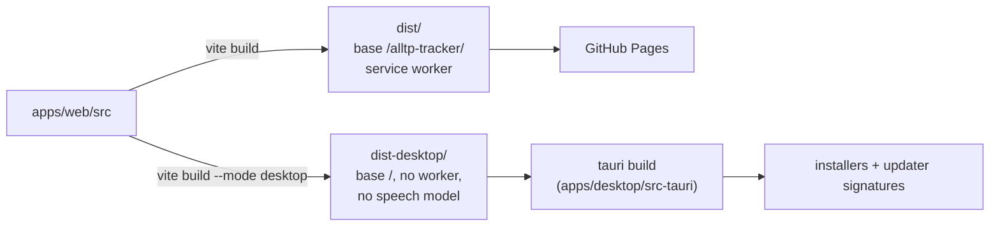

What the `desktop` mode changes (`apps/web/vite.config.ts`):

| | Site | Desktop app |
|---|---|---|
| Base path | `/alltp-tracker/` | `/` (the app serves its own files) |
| Service worker | yes, for offline use and updates | none: the files are local, updates come from the app |
| Speech model (40 MB) | `models/` on the site, fetched on demand | the site's copy, fetched on demand (GitHub Pages sends `access-control-allow-origin: *`); never in an installer |
| Stream view (OBS) | `?view=obs`, an address to paste: the source follows the tracker through its `localStorage`, so the tracker runs in an OBS dock | the **Stream view** button opens the stream tools: the app serves `?view=obs&token=…` to the source itself (below, "Stream tools"), since OBS can neither load the app's pages nor follow its `localStorage` |
| Share a run | a link to this deployment | a link to the published site (`SITE_URL`): the app's own address, `tauri://localhost`, opens nowhere else. A viewer opens it in a browser, where it keeps a run apart from the app's own |

The code reads the mode through `isDesktopApp` (`apps/web/src/utils/platform.ts`), a constant the site's build folds to `false`. Every lazy `import()` of desktop-only code is the exception: it sits behind an inline `import.meta.env.MODE === "desktop"` test (`main.tsx`'s start-up and run feed, `ShareDialog`'s live follow section, `StreamTools`' dialog, `GameShell`'s and `TrackerControls`' application menu chunks, ALttPR's global shortcuts, and the rest), because Rollup does not fold a constant imported from another module far enough to drop a dynamic `import()`. With the inline test, the site's build emits no chunk of the desktop code (checked in the build output: no `start-*.js`).

## At runtime

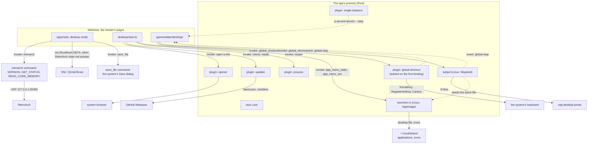

- **The webview** is each system's own: WebView2 on Windows (pages at `http://tauri.localhost`), WKWebView on macOS and WebKitGTK on Linux (pages at `tauri://localhost`). None of these origins is https, so autotracking's WebSocket to SNI is not mixed content. `detectEnvironment` (`packages/autotrack/src/environment.ts`) gates loopback on https pages only, else the WebKit of macOS and Linux would read as a blocked Safari.
- **What the pages may ask of the app** is listed in `src-tauri/capabilities/default.json`: open an https URL (`opener:allow-open-url` scoped to `https://*`: without a scope the permission grants the command but no URL), check for and install an update, restart, and the app's own commands, `save_file`, `retroarch`, `app_menu_*`, `follow_*`, `stream_*`, `run_publish`, `overlay_publish` and the `global_shortcuts_*` ones (an app's own commands need no permission entry). Nothing else: in particular no `global-shortcut:*` permission, so the page cannot register a key through the plugin itself, only through the app's command, which checks it.
- **Links** to other sites open in the system browser (`openLinksOutside` in `apps/web/src/desktop/start.ts`). In the app's window they would replace the tracker.
- **Exports** go through the system's Save dialog: `saveFile` (`apps/web/src/utils/saveFile.ts`) calls the app's `save_file` command (`src-tauri/src/lib.rs`), which asks where and writes there. A webview handles a download link its own way (WebKitGTK writes it, unasked, into the process's working directory), and the page gets no file-system access at all: it can write only where the player picks.
- **The run** is saved in the webview's `localStorage`, apart from any browser's. Export and Import move it.

## Autotracking: RetroArch first, then SNI

A page cannot send UDP, so the site needs SNI between it and RetroArch. The app does not: on every connection it tries RetroArch itself, then SNI for every other device (an FX Pak Pro, BizHawk, an NWA emulator). `bridgeOptions` (`apps/web/src/autotrack/bridge.ts`) hands each game's session the app's transport (`apps/web/src/desktop/bridge.ts`), a chunk the site's build leaves out.

- **The transport** is `@alltp/autotrack`'s `RetroArchTransport` behind `FirstAnsweringTransport`; its README ("RetroArch, direct") has the protocol as measured on a real RetroArch 1.22.2, the sequence and the choices (the pack's mapping, eight pieces in flight, short replies, no content).
- **The Rust side** (`src-tauri/src/retroarch.rs`) sends one datagram and waits for one reply, on a socket of its own per command, so a reply can only answer its own command. It passes `VERSION`, `GET_STATUS` and `READ_CORE_MEMORY` and refuses every other command: the pages can never write the game's memory, load a state or quit RetroArch. A closed port answers at once (an ICMP refusal, a reset on Windows), so an absent RetroArch delays SNI by nothing; a silent one by 500 ms.
- **What the player sets up**: bsnes-mercury and RetroArch's Network Commands, as with SNI. The setup guide shows the app's steps (`desktopSetupSteps`): for RetroArch, the emulator and the game; for any other device, SNI's, without the browser's permission step.
- **RetroArch wins.** With RetroArch open and its network commands on, the app reads RetroArch, even from its menu; it falls back to SNI only while RetroArch does not answer, and leaves SNI for RetroArch the moment RetroArch answers, as long as SNI has no device attached. So a player on an FX Pak Pro closes RetroArch, or turns its network commands off.
- **Port**: RetroArch's default, 55355. A player who changed `network_cmd_port` is not reached directly; SNI still reaches that RetroArch once told the port (`SNI_RETROARCH_HOSTS`, SNI's README at `77ba8ac`).

## Global shortcuts

A player runs the tracker beside the emulator and wants to step an item without leaving the game: the key must work while RetroArch has the focus, which a page cannot do. The app registers the keys with the system and tells the page when one is pressed; the page runs the action exactly as a key in its window does (`isControlShown`, then `stepControl`, one undo step).

The keys are the player's: the Global tab of the Shortcuts dialog (the desktop app only) binds the same actions (`advance:hookshot`, `back:chest3`) as the window's tab, by physical key (`KeyboardEvent.code`). **None is bound by default and the switch starts off**: a global grab takes the key from every app (RetroArch's own F-keys, the chat, OBS), and no combination is free on every machine (Ctrl+Alt+T opens GNOME's terminal, Ctrl+Alt+L locks KDE, Ctrl+Alt is AltGr on Windows). On a portal, defaults would make the desktop's dialog list dozens of shortcuts at the first launch.

### Three mechanisms

No single API works everywhere, so the app picks one per process (`src-tauri/src/shortcuts/detect.rs`, a pure function over the environment, unit-tested) and tells the page, which says so in the tab.

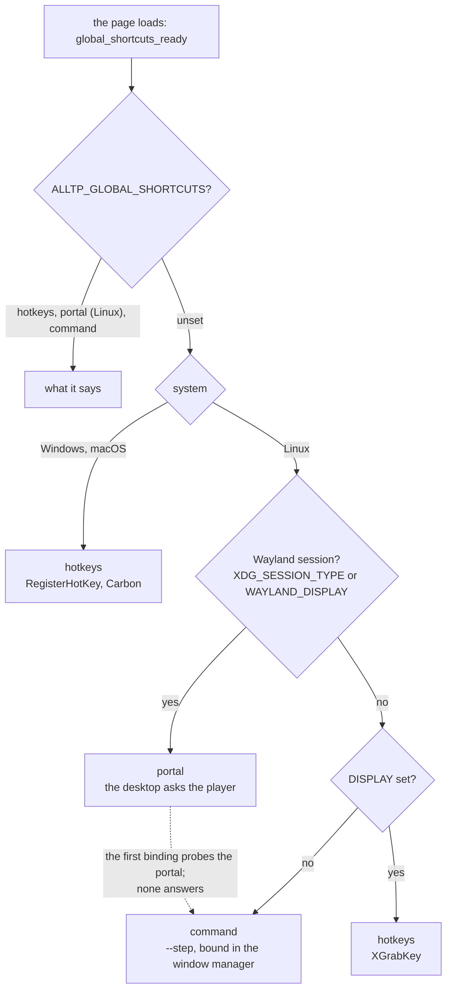

| Mechanism | Where | How |
|---|---|---|
| `hotkeys` | Windows, macOS, a Linux X11 session | `tauri-plugin-global-shortcut` (wraps `global-hotkey`: RegisterHotKey, Carbon `RegisterEventHotKey`, `XGrabKey`). The key is registered at once. |
| `portal` | a Linux Wayland session whose desktop has the GlobalShortcuts portal (KDE, GNOME 48+, Hyprland) | `ashpd` calls `org.freedesktop.portal.GlobalShortcuts`. The desktop shows the keys asked for and the player approves or changes them. |
| `command` | any other Linux session (sway, i3 on Wayland, old GNOME), or a portal that fails | `alltp-tracker --step advance:hookshot`, handed to the running app by `tauri-plugin-single-instance`. The player binds it in the window manager. |

The **session** decides, not the app's own GDK backend. On KDE, Tauri's window is a native Wayland client, and so is a native-Wayland RetroArch; an X11 grab lands on XWayland's root and fires only while an X11 window has the focus. `ALLTP_GLOBAL_SHORTCUTS` (`hotkeys`, `portal` or `command`) overrides the choice, for the test bench and for a KDE user who turned on "Legacy X11 app support" and wants X11 grabs anyway. It is deliberately not in the UI.

The command line works under every mechanism, on every system: a Stream Deck or a script can run it too. `alltp-tracker --step=advance:hookshot --step back:chest3` runs both, in order; an invalid action is named on stderr and ignored, as is any argument the AppImage runtime or a launcher adds. The Global tab shows the command with the real executable (`$APPIMAGE` when set, which survives updates, else the running binary) and a Copy button per action. For sway or i3:

```
bindsym Ctrl+Alt+h exec "/path/to/alltp-tracker" --step advance:hookshot
```

```
# Hyprland
bind = CTRL ALT, H, exec, /path/to/alltp-tracker --step advance:hookshot
```

### What crosses the boundary

- **The page asks, the app checks again** (`shortcuts/chord.rs`). The page may be compromised, and a global grab on a key the player types with would let it read what they type in every other app. So the app refuses, whatever the page sends, an action that is not `^(advance|back):[a-z]+[0-9]*$`, a chord that is not written in the page's canonical order, a key outside the supported set, more than 256 bindings, and **the floor**, which covers **character keys** (letters, digits, punctuation, F1 to F12):
  - everywhere: Control, Alt or Meta with it (never bare or Shift alone);
  - Windows: not exactly Ctrl+Alt, which is AltGr and types `@ # { [` on AZERTY and QWERTZ;
  - macOS: Control or Cmd with it, because Option types characters (Option+E is the acute accent).

  The finer rules (two modifiers, a chord the window already uses) live on the page only (`globalKeymap.ts`), so they are not maintained twice.
- **The floor does not cover the numpad.** A bare `Numpad0` to `Numpad9` or `NumpadDecimal` is allowed, and with NumLock on it types a digit: while the shortcut is on, that key is taken from every app and a compromised page that bound them all could read a PIN typed on the numpad. This is a decision, not an oversight: LiveSplit's default global hotkeys are numpad keys, players expect it, and each binding is opt-in per action behind a switch that starts off. The Global tab says so as soon as one is bound.
- **The supported keys** are letters, digits, the punctuation keys, the numpad and F1 to F24. No `Intl*` code (global-hotkey 0.8 cannot register them) and no `NumpadEqual` (it registers the letter E on Windows).
- **Events** go the other way: `global-step` (`{ action }`, a press, never a release) and `global-shortcuts-changed` (the portal: the player edited the keys in the system's settings).

### Physical keys and layouts

The page stores a chord by physical key, so a binding stays on the same key on QWERTY, AZERTY and QWERTZ. The backends do not all mean the same by "a key":

| Backend | A key is | Translation (`shortcuts/keys.rs`) |
|---|---|---|
| macOS (Carbon `kVK_ANSI_*`) | a physical position | none |
| Windows (`VK_*`) | what the layout labels it: `VK_Q` is the key labelled Q, at `KeyA`'s place on AZERTY | physical → scancode → `MapVirtualKeyW` → virtual key → the Code global-hotkey registers as it |
| X11 (keysym) | what the layout labels it: global-hotkey grabs the first keycode whose keysyms hold the letter | physical → X keycode (evdev + 8) → the keyvals GDK gives it (group 0, level 0 first) → the Code whose keysym is among them |
| Portal | a keysym name in the preferred trigger (`CTRL+ALT+a`) | the same GDK lookup, the name of the level 0 keyval; the numpad and F keys have fixed names |

Without this, an AZERTY player who pressed the key labelled A would get a shortcut on the key labelled Q. The decision tables are pure and tested with the keyvals of xkb's `fr` layout; the lookups of each system are thin. Proved on the bench with `setxkbmap fr`: a binding captured on the physical Q key is grabbed on the keycode that types `a`, and the keycode that types `q` still reaches other apps.

The same GDK lookup feeds the key labels on Linux (`key_labels`): WebKitGTK has no `navigator.keyboard`, so the page showed QWERTY names to an AZERTY player in both tabs. Windows' WebView2 and macOS' WKWebView read the layout themselves.

### The portal

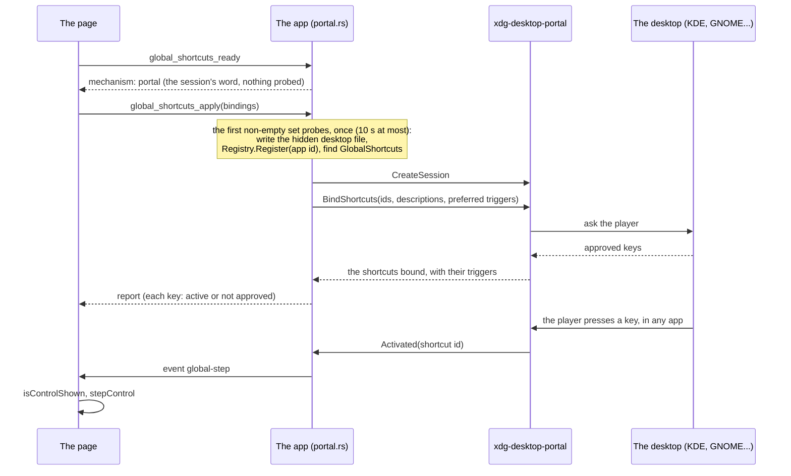

- **A host app has no app id**, and the portal refuses a session without one ("An app id is required"). A non-sandboxed process gets one from its systemd scope or from `org.freedesktop.host.portal.Registry.Register`, which must come before any other portal call and wants a `<app id>.desktop` file GIO can find. Tauri's bundler names its desktop file `ALLTP Tracker.desktop` (a space is no app id), so the app writes one at runtime: `$XDG_DATA_HOME/applications/io.github.kqesar.alltp-tracker.desktop`, for every package (AppImage, `.deb`, `.rpm`, dev). It is `NoDisplay=true` (the package's own menu entry stays the only one), unless the player added the AppImage to the application menu (below): the file is the same one, and the portal keeps the visibility it finds. `launcher.rs` is its one writer. It rewrites the file when its `Exec` or `Icon` differs (the AppImage moved), and `Register` is retried three times at 200 ms while GIO notices a new file. A small file and the icons stay in the home after uninstalling: the price of one code path. **Future Flathub caveat:** Flathub requires this exact id for the app's own desktop file. A user-level copy with the same id overrides a system or Flatpak one, and with `NoDisplay=true` it would hide the app from the menu. If a package ever ships `io.github.kqesar.alltp-tracker.desktop`, stop writing this one (or delete it when another with that id exists in `$XDG_DATA_DIRS`).
- **Lazy start.** A launch with the feature off touches nothing: no desktop file, no `Register`, no listener. On a Wayland session the mechanism is the portal on the session's word alone, and the first non-empty apply probes it, bounded to 10 s so a hanging portal frontend cannot hold the shared state. A probe that finds no portal gives the mechanism up to `command` for the process, with the reason shown (the Global tab shows the commands then, which a sway or i3 player sees after the first binding rather than at launch).
- **Ids** replace the action's colon with a dot (`advance.hookshot`): Hyprland's `global` dispatcher splits `appid:id` on the colon.
- **Always bind at the start of a session.** Plasma 6.7.4 and later keep a shortcut dead until `BindShortcuts` is called in the current session (KDE bug 523063, the lesson of KeePassXC's PR 13579).
- **Never per keystroke.** Each bind may pop the desktop's dialog, so the page applies at the moments the player expects it: when the Global tab or the dialog closes, on **Send to desktop**, on **Ask again** (a new session), and at start-up. Turning the switch off closes the session at once.
- **A refusal** is a state, not an error, and it is remembered (saved with the Global prefs): the tab says the approval was declined, marks the keys "Not approved" and offers **Ask again**. The tracker never asks again by itself at the next launch, as a browser does not ask again for a permission the person denied; turning the switch off and on also clears it. A portal that cannot create a session at all (no backend answers within 20 s, "An app id is required") downgrades the mechanism to `command` for the rest of the process, with the reason shown. The player gets 5 minutes to answer the desktop's dialog.
- **A page that goes away** (a reload, a switch to another game) drops its portal request and closes its session: the next page never queues behind a dialog nobody reads. Requests are counted per page, so one that arrives from the old page after it left is dropped.

### The hotkeys backend

- **Lazy start.** Adding the plugin creates the platform manager: on X11 a thread that polls every 50 ms and holds a connection, on Windows a hidden message window. A player who never turns the feature on pays none of that: the plugin is added, on the main thread (macOS needs it there), at the first binding.
- **Registrations block on the main thread**, so every command is `async` and the work runs off it: calling it from the main thread would deadlock.
- **Nothing is unregistered at quit**: the unregistration would wait for the main thread, which is running the exit. The system frees the grabs with the process (the X connection closes, Windows hotkeys belong to the plugin's window, Carbon's to the process).
- **A page load releases the old page's keys** (`on_page_load`, spawned, never inline). Switching to Super Metroid or SMZ3 reloads the page without re-applying, and the global feature is A Link to the Past's alone (only it has a keymap).
- **Ungrabs are buffered.** global-hotkey 0.8's X11 thread sends its "ungrab" requests with the next request that waits for an answer, which only a registration is. Without one, the last keys released stay grabbed in every app: found on the bench, where switching game left one of two keys swallowed. A registration of a key nobody presses (`Control+Alt+Shift+Super+Escape`) after each release flushes them.
- **Releases are one request.** `unregister_multiple` sends every key to release in one message: one by one, each waits for the X thread's 50 ms loop, so a long set stayed grabbed for seconds and the key pressed to capture a new one was eaten. A refused registration is followed by a flush too: global-hotkey grabs a key's lock variants one at a time, and when a later one is refused its first variant could stay grabbed if nothing else followed.
- **A taken key** is reported per binding (`taken`, "In use by another app or the system"): one taken key never hides the others. Detection must not rely on registration errors alone: if the X connection fails the thread dies silently and later registrations answer `Ok`.

### Single instance

`tauri-plugin-single-instance` is the first plugin. A second launch hands its arguments to the first and exits: with `--step` the steps run in the first instance. They queue (the last 32) only until the process's **first** `global_shortcuts_ready`. After that a step that finds no page listening is dropped and named on stderr: Super Metroid and SMZ3 never call `ready`, so a queue kept across a game switch would replay stale steps into the next A Link to the Past run (`StepQueue` in `cli.rs`), without it the window comes forward. Two webviews would share one `localStorage` and overwrite each other's run, so this stands whatever the shortcuts do. A first instance started with `--step` (a window manager key pressed while the app is closed) opens and counts the step once the page has loaded: the player asked for that action. A second process costs about 31 ms from exec to exit (measured on the bench, release build). The updater's **Restart** still works: the plugin releases its D-Bus name on `RunEvent::Exit`, which `relaunch()` emits before the new process starts (read in the code of Tauri 2.12.4 and the plugin; it can be tested only at the next real update).

### Verified, and what is not

Proved on a private Xvfb display (its own session bus and home), with a window standing for the emulator and another X client for "another app":

- an X11 grab fires while another window has the focus, the key does not reach that window, and one press is one step (also for a key held for 0.75 s and 0.9 s, where the sink saw an even number of auto-repeats);
- AZERTY (above), a key another client holds (the row says so), the game switch (keys released, probed from a second client), `--step` through single-instance (running, closed, repeated, invalid, a plain relaunch), the command mechanism (forced, and an unanswering portal), the tabs at 1440 and 390 px.

**Verified by the owner on KDE Wayland** (CachyOS, the v2.32.0 AppImage downloaded from GitHub, 2026-10-20), points 1 to 6 of the checklist: KDE's registration dialog shows our descriptions and keys, a key steps the tracker while a native-Wayland RetroArch has the focus, a relaunch asks nothing again, declining then **Ask again** works, System Settings opens on the tracker's entry and a key changed there shows in the tab, and on AZERTY the trigger the desktop suggests is the key pressed. Point 7 (the hidden desktop file) found two defects: a downloaded AppImage had no entry in the application menu, and the file's `Icon=alltp-tracker` named a file nothing provides, so KDE showed a generic icon. Both are what the application menu below fixes: it installs the icons and names them.

**Unverified until someone runs it:**

1. The application menu on a real desktop (below): the entry shows in KDE's and GNOME's menus with the app's icon, and the shortcut settings page shows that icon too.
2. The updater's Restart relaunches the app, from a version that already holds the single-instance D-Bus name (the next release).

GNOME 48 and later, Hyprland, Windows and macOS are built in CI and untested here (the Windows and macOS code is linted on their own runners, `desktop.yml`). Feedback from players is welcome.

## Application menu (Linux AppImage)

A downloaded AppImage installs no menu entry: it is a file the player runs, while the `.deb`, the `.rpm` and the Windows and macOS installers add their own. So the AppImage offers to add itself, on request, and only the AppImage (`$APPIMAGE` set, an absolute path to an existing file): anywhere else the app shows nothing.

### One file, two features

The entry is the file the portal already needs (above): `$XDG_DATA_HOME/applications/io.github.kqesar.alltp-tracker.desktop`. A second file would be a duplicate in the menu, and two writers of one file overwrite each other's intent, so `src-tauri/src/launcher.rs` is its only writer. The file itself is the record of the player's choice (`NoDisplay=false` is "in the menu"): there is no second state to keep in step with it.

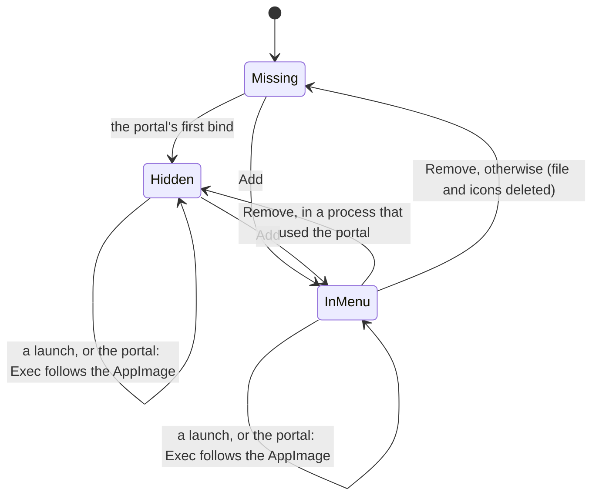

| Who | What it does to the file |
|---|---|
| **Add** (the notice, or More) | Writes it visible. |
| **Remove** | Hides it when this process used the portal (`Register` still wants the file), deletes it and the icons otherwise. The portal writes it again, hidden, at its next first binding. |
| **The portal** (first binding of a process) | Writes it hidden when missing. Keeps the visibility it finds, except outside an AppImage, where it is always hidden: a package's own entry is the only one. |
| **A launch as an AppImage** | If the file exists and its `Exec` names another path (the AppImage was moved or renamed, or a newer one downloaded), rewrites it with the running `$APPIMAGE`, visibility unchanged. Never creates it, and never touches a file that already names the running AppImage (the updater replaces the AppImage in place, so its path stays valid). |

The `Exec` line is quoted as the Desktop Entry specification asks: `"`, `` ` ``, `$` and `\` escaped, `%` doubled, and a path with a control character refused (a newline would start another key of the file). A write goes through a temporary file and a rename, so a desktop watching the directory never reads half a file. The entry carries `Categories=Game;`: without one KDE files it under "Lost & Found".

### The icon

The icons are the bundle's own PNGs (`src-tauri/icons/`, 32, 128 and 256 px, drawn by `apps/web/scripts/pwa-icons.mjs`, embedded with `include_bytes!`, about 6 kB of the binary), installed to `$XDG_DATA_HOME/icons/hicolor/<size>x<size>/apps/io.github.kqesar.alltp-tracker.png`. Every file written says `Icon=io.github.kqesar.alltp-tracker`, the portal's hidden one included, so the icon shows in the menu and in KDE's shortcut settings. They are written before the file (whenever the file exists, its icon does) and deleted with it.

### The page

- **Once**, on the first launch as an AppImage: a notice among the page's notices, styled as the update notice, "Add Rando Atlas to your application menu?" with **Add** and **Not now** (`desktop/AppMenuPrompt.tsx`, in every game). An answer, either one, is remembered in the webview's `localStorage` (`alltp-tracker-app-menu-asked`) and the notice is never shown again. Ignoring it is no answer: it comes back at the next launch. Changing the entry from More counts as an answer too.
- **Always**, in the toolbar's **More** menu of A Link to the Past (Super Metroid and SMZ3 have no More menu): "Add to application menu" or "Remove from application menu", by the file's state (`desktop/AppMenuItem.tsx`). More is on the toolbar only while it has folded actions away. In the app it shows at every width while this item is there (`desktop/appMenu.css`, a `:has` rule), and then holds this item alone: Export, Import and Shortcuts stay on the bar until it folds them.
- The page sends no path: `app_menu_set` takes a boolean, and the entry always names the running AppImage.
- The site gets none of it: the notice and the item are lazy chunks behind inline `import.meta.env.MODE === "desktop"` tests, the site's build keeping a `null` where each would stand.

### Does the desktop need a refresh?

No command is run. KDE (KSycoca, which watches the applications directory) and GNOME (GIO's app info monitor, an inotify watch) pick up a new file in `$XDG_DATA_HOME/applications` by themselves. `update-desktop-database` only rebuilds `mimeinfo.cache` for the files that declare a `MimeType`, which this one does not. That is how the desktops are documented to behave, not measured on a real one here (see "Unverified"); the one case that needs a new login is a session that began while `~/.local/share/applications` did not exist yet.

### Proved

In the private Xvfb bench (a temporary home and session bus, the AppImage built from this branch, the owner's own directories untouched):

- the notice shows on the first launch, and neither after Add, nor after Not now, nor after a change from More, at the next launch; nothing is written before the player asks;
- Add writes the visible file and the three icons, Remove deletes them (the portal not being used there);
- an AppImage renamed after Add gets its `Exec` fixed at the next launch with the visibility kept, a launch that finds it already right leaves the file untouched (same inode and modification time), and a name with a space, a quote, a `$` and a backtick is read back by GLib's parser (`Gio.DesktopAppInfo`) as the real file, with `desktop-file-validate` clean, `should_show` true and the icon named;
- the toolbar holds at 1440, 1180, 1000 and 760 px with More showing.

The state machine (with the portal flag), the escaping and the icon paths are Rust unit tests (`launcher.rs`) over temporary directories.

## Live follow on the LAN

A player wants a second screen (a phone on the desk, a laptop for a co-commentator) to show the tracker as it updates. A page cannot open a server, so the site cannot do it; the app can. While the player has it on, the app serves its own page and a WebSocket that relays the run to devices on the same network. Nothing leaves the network: no relay service, no account, no cost.

The Rust side is `apps/desktop/src-tauri/src/follow.rs` (live follow's port, seat limit, token and session) over `feed.rs` (the run the page published, and the `/follow` route that streams it) and `relay.rs`, the building blocks any server the app runs for the network is made of: the lifecycle (preferred port, free fallback, stop), the accept loop and its limits, the seats, the snapshot pump with its beat, the file routes and the token check. A second server, the stream view for OBS (`stream.rs`, below, "Stream tools"), is built from the same blocks and reads the same run; its overlay API adds `overlay.rs`. The page side is the publisher (`apps/web/src/follow/publish.ts`, run by `apps/web/src/desktop/runFeed.ts` and started by `apps/web/src/desktop/liveFollow.ts`), the switch in the Share dialog (`apps/web/src/desktop/LiveFollowSection.tsx`) and the followed view (`apps/web/src/follow/`), below the relay's contract.

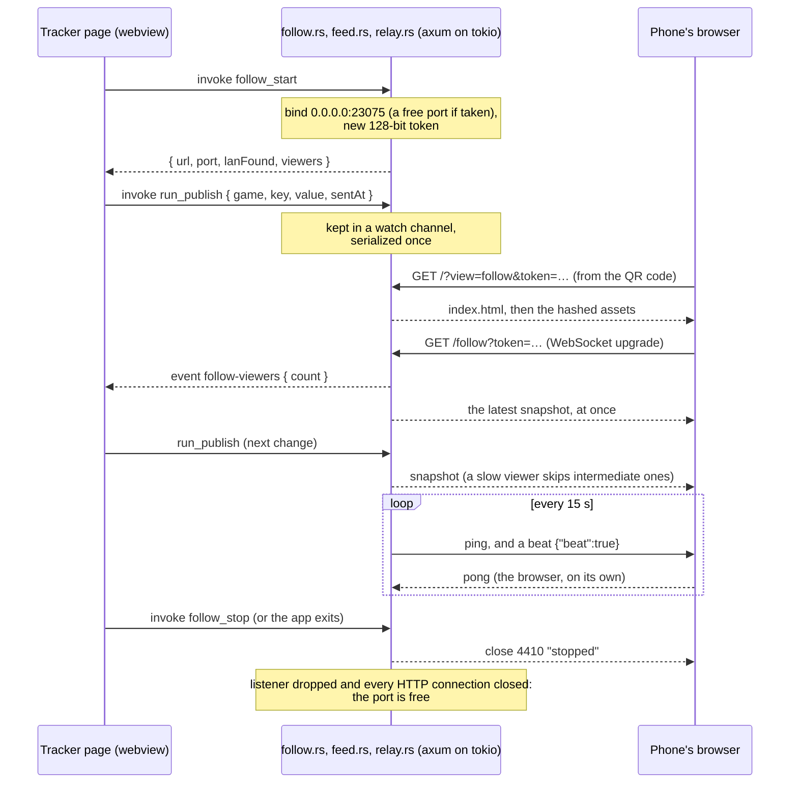

### Routes

| Request | Answer |
|---|---|
| `GET /follow?token=<t>` with a WebSocket upgrade | the stream (below). A wrong or missing token, or a ninth viewer, gets a socket closed at once with a code (below); a plain GET gets an HTTP error |
| `GET /` | `index.html`, `Cache-Control: no-cache` |
| `GET /<path>` of an embedded file | that file, with its MIME type and `X-Content-Type-Options: nosniff` |
| `GET /<path>` without an extension, not a file | `index.html` (the page's own routes) |
| `GET /<path>` with an extension, not a file | 404 |
| any other method | 405 |

The files are the app's own, through Tauri's asset resolver (`tauri_assets`): embedded in a release, read from `apps/web/dist-desktop` in development (the last `vite build --mode desktop`, not the dev server: see "Development"). A path must be made of `[A-Za-z0-9._-]` segments, none of them `.` or `..`, else 404: in development Tauri reads the path from disk, so a traversal, a drive letter or a backslash must never reach it. Tauri's resolver falls back to `index.html` for a missing file; the adapter turns that fallback into a 404 unless HTML was asked for.

### The stream

- **Message**: a text frame, `{"game","key","value","sentAt"}`, or the beat (below). `value` is the game's persisted state exactly as the page stored it (a JSON string, opaque to Rust: each game's own validation and migration read it on the viewer's side); `sentAt` is the page's `Date.now()`, so the viewer can correct its timer for clock skew.
- **Semantics**: the `RunFeed` (`feed.rs`, a `tokio::sync::watch` shared by both servers) holds the latest snapshot. A viewer gets it at once on connect, then each change; a viewer slower than the updates skips the states it had no time for, never queues them. The snapshot survives `follow_stop` (and the stream's stop), so a session started later serves the run at once.
- **Read-only**: what a viewer sends is read only to answer pings, to hear that it is there and to see it leave, never acted on; incoming frames are capped at 4 KiB.
- **Liveness, both ways**: every 15 s the relay pings each viewer (the browser answers with a pong on its own, even while the page's timers are throttled) and sends it a beat, the text frame `{"beat":true}`, which the page can see where it cannot see a ping. A viewer that has not answered the last ping by the next one has vanished (out of range, battery dead: no FIN ever comes) and loses its seat, 15 to 30 s after it went. A followed view that hears no frame for 35 s, two beats, drops its connection and opens a new one (below).
- **Close codes.** A browser cannot read the HTTP status of a refused WebSocket (it only sees the socket close), so a refusal is an accepted socket closed at once with a code that says why:

| Code | Reason | The viewer should |
|---|---|---|
| 4401 | `token`: missing, or not this session's (the relay was restarted) | ask for the new link, not retry |
| 4503 | `full`: eight viewers already | retry later |
| 4410 | `stopped`: the player turned it off, or quit | say so, not retry |

### Commands and event

| Name | Arguments | Returns |
|---|---|---|
| `follow_start` | none | `{ url, port, lanFound, viewers }`; while running, the running session (same token) |
| `follow_state` | none | the running session as `follow_start` describes it, or `null` while off: what a page that loaded again (a game switch reloads it) reads to pick the relay up |
| `follow_stop` | none | nothing; idempotent. Closes the port and every connection still in HTTP at once, and waits up to 2 s for the viewers' sockets to close |
| `run_publish` | `{ game, key, value, sentAt }` (`sentAt` an integer, ms) | nothing; an error when `value` is over 1 MiB or `game`/`key` over 64 bytes. Feeds every server (live follow and the stream view alike): it was `follow_publish` before the stream view shared the feed |
| event `follow-viewers` | | `{ count }`, each time a viewer joins or leaves; never once its session has stopped (the event names no session: a late one would overwrite the next session's count) |

`url` is `http://<lan-address>:<port>/?view=follow&token=<token>`. The address is the one the default route leaves from: a UDP socket "connected" to a documentation address (192.0.2.1) sends nothing but makes the system pick the route, and its local address is read back, without a crate. With no route (offline), `lanFound` is `false` and the URL is on 127.0.0.1, which only this machine can open. On a machine whose default route is a VPN, the address is the VPN's.

### Security

- **On the local network only, by design**: no relay service, no port forwarding. Anyone who can reach the port is on the same network.
- **The token gates the stream**: 128 bits from the system's random source (`getrandom`), base64url, new at each `follow_start`, compared in constant time. An old link stops working when the player restarts the relay: a request sent before the stop has its connection closed with it, and a stopped session refuses an upgrade (4410) before it reads the token, and sends nothing past the stop. The page's files are not gated: they are the public site's code.
- **Nothing is writable**: no route but the files and the stream, no method but GET, no incoming message acted on.
- **Bounded before the token is read**: the relay runs its own accept loop on hyper's HTTP/1 (`axum::serve` sets no timer, so hyper's header timeout would never run). At most 32 connections still in HTTP at once (eight viewers loading the page together); one more is closed as soon as it is accepted. A connection that takes over 10 s to send a request's headers, or stays idle that long between two, is closed; its read buffer is 16 KiB (hyper's default allows about 400 KiB). An upgraded viewer leaves that count for the seats below.
- **Bounded after**: eight viewers at most (each costs a socket, a task and a write buffer), 1 MiB per snapshot, 4 KiB per incoming frame. A viewer that takes more than 10 s to accept a frame is dropped (a stalled device), and one that stops answering pings is dropped by the next one (a vanished device, above), so neither holds a seat. A refused socket (4401, 4503) is closed within about a second, a close frame being given 1 s at most.
- **No port open while it is off**: `follow_start` starts the server; `follow_stop` and the app's exit close the listener and every socket: a viewer's with a close frame first, a connection still in HTTP at once. A Windows update ends the app without its exit event (the updater runs the installer, then exits the process), so the page stops live follow itself between the download and the install (`desktop/start.ts`); a failed download leaves it running. The stream view is left running on purpose: a browser source that loses its connection keeps retrying and comes back with the relaunched app (below, "Stream tools").
- **Plain `http://`**: the token crosses the network in clear, visible to anything on it. Acceptable for a read-only view of a run; TLS on a LAN address would need a certificate no phone trusts.

### Firewalls

The relay listens on all interfaces, port 23075, or a free one, shown in the URL, if binding 23075 fails for any reason: taken, or refused, as Windows refuses (access denied, not "in use") a port inside a range Hyper-V, WSL or Docker excluded (`netsh int ipv4 show excludedportrange protocol=tcp`).

- **Windows** asks on the first start whether the app may accept connections: allow it on private networks. On a network marked Public, inbound connections stay blocked: mark the Wi-Fi Private. A refusal is undone in "Allow an app through Windows Firewall".
- **macOS**: the application firewall is off by default; when on, it asks on the first start.
- **Linux**: many desktops run no firewall by default, but some distributions enable one that drops inbound connections (CachyOS and Manjaro ship ufw on; openSUSE ships firewalld). With ufw: `sudo ufw allow 23075/tcp`. With firewalld: `sudo firewall-cmd --add-port=23075/tcp` opens it until the next reload or reboot; run it again with `--permanent` to keep it (`--permanent` alone writes the saved configuration only and does not open the port now).

### Budget

- **Off**: nothing runs, no port, no task; the managed state is one channel holding the last published snapshot (empty until the page first publishes it, which it does only while live follow or the stream is on): the run, at most 1 MiB, and its envelope.
- **On**: one accept-loop task; per connection still in HTTP (32 at most) one task, a socket and a read buffer of 16 KiB at most; per viewer one task and one socket. A publish serializes the snapshot once, and the viewers' frames share it (reference-counted) until each viewer's socket copies it into its own write buffer, which keeps its size: count one copy per viewer at worst, 8 × 1 MiB at the size cap, a few kB for a real run. The beat costs each viewer two small frames every 15 s.
- **Binary**: axum 0.8 (HTTP/1 and WebSocket only, no default features) on the hyper, hyper-util, tokio and tower the app already carries for the updater, plus tungstenite: +745 KiB on the stripped Linux x86-64 release binary (15.0 → 15.7 MiB), measured before the relay ran its own accept loop.

### The player's side: publishing

- **The switch**: the Share dialog's "Follow live on this network" section, in the desktop app only (`LiveFollowSection`, a lazy chunk behind the inline desktop test, so the site never downloads it). The Share button is how the player reaches it, so while Race Mode is on or not yet known to be off (where the web build turns Share off, a link holding the places checked and when) it stays on here and the dialog shows a note instead of the link, its QR code and Copy (`ShareDialog`'s `race`). Off at every launch: no port opens unless the player asks. On, it shows the live link as a QR code and an address to copy, how many devices follow (the `follow-viewers` event) and what the other device needs (the same network, the firewall, auto-lock off).
- **What is published** (`publishRun`): the game's run as its store saved it in `localStorage`, read rather than taken from the state, because it is exactly what the viewer's store reads, through the same validation and migration. The page subscribes to the active game's store (`GameModule.store`); a change starts a 250 ms wait, the changes during it ride along, and the saved run is read when it ends (the store saves after it tells its subscribers), so a burst (a sync from the game, an undo held down) costs one `run_publish` and the last state always goes out. There is one publisher for the page, `desktop/runFeed.ts`: live follow and the stream view each hold it while they run (a set of holders), it works while any does, and it stops when the last lets go, so both running costs one publication per change, not two. A run unchanged since the last one is not sent; a run never saved is saved first. **In Race Mode**, and on Auto while autotracking is about to read the seed's race flag (a session starting, or set to connect as the tracker opens, and no reading yet: the stream starts with the app, before SNI answers; `isRaceModeOrPending`), the saved run goes cut to what the relayed views draw (`follow/raceRun.ts`, each game's `GameModule.race`): the grid's fields and the timer kept, every other field at a fresh run's value, so a device following or an OBS source never holds the places checked and their times, the entrances noted, the locations found, the pads noted or the seed; Race Mode coming or going publishes again, and a run the cut cannot read is not sent. A game without a race feed (Archipelago) is published as saved.
- **On**: the run is published at once, then after each change. **Off**: live follow lets go of the publisher before `follow_stop`; it unsubscribes unless the stream still needs it.
- **A device joins**: the page publishes the run again at once, freshly stamped, for that device's clock (below). The same goes for a browser source that connects to the stream.
- **The page loads again** (a game switch reloads it) while the relay runs: `follow_state` says so, the switch shows on and the new game's run is published; the viewers switch game with it.

### The viewer's side: the followed view

`?view=follow&token=…` is picked in `main.tsx` before anything else starts. The desktop app serves its own build (`dist-desktop`) to the phone, and that build believes it runs in the app (`isDesktopApp` is a build-time constant), so the view must not reach the app's start-up: no `startDesktop`, no game `start()` (ALttPR's would import the global shortcuts and call the app), no service worker, no update notice, no visit counted. The view itself needs no Tauri API at all.

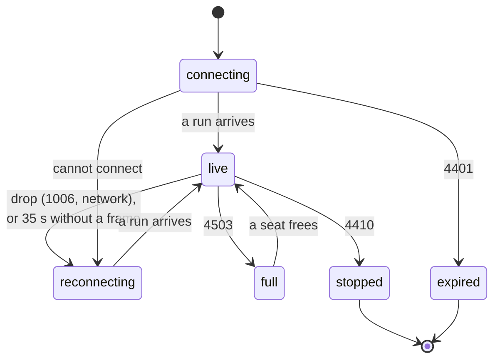

The diagram shows the usual path. `follow/client.ts` reads a close the same way whatever the state, so from **any** state but the two ends: 4401 leads to `expired`, 4410 to `stopped`, 4503 to `full`, any other drop (or 35 s of silence) to `reconnecting`, and a run received to `live`. A phone that slept through a restart of the relay on the same port therefore wakes on `reconnecting`, then `expired`.

- **Connection** (`follow/client.ts`): `ws://<the page's host>/follow?token=<the link's>`; only the token is read from the address, so a link cannot point the page at another host. A drop retries after 1 s, doubling to 30 s, at once when the device comes back online or the page back into view (a phone that slept); a full relay is retried after 5 s at least. A connection can die without a close reaching the phone (it slept with its Wi-Fi off, the computer left the network or lost power): the browser still calls it open and fires no `close`. So every frame, a run or a beat, re-arms a 35 s timer; when it runs out the socket is closed (its late `close` ignored) and the view says "reconnecting" and tries again. Coming back online or into view checks the same deadline at once, since a sleeping page's timers do not run; a socket still heard from is left alone. 4401 and 4410 end it: a new session has a new token, so retrying the old link is pointless. The banner (a polite `role="status"`, with autotracking's status dot shapes) says each state and what to do.
- **Applying a run**: each frame is checked (a known game, a value that is JSON and at most 1 MiB, a finite `sentAt`); the frame's `key` is never used: the run is written under the loaded game's own storage key, then `persist.rehydrate()` reloads the store. Each game's `merge` judges the data as it judges another tab's change: validation, migration, the undo history cleared.
- **The game**: nothing renders until the first run; its game is loaded and saved as the device's, as a `?game=` link does. A run of another game later (the player switched) loads the page again on that game.
- **Read-only**: the grid is the game's stream view (`ObsView` with `relay="follow"`: no keyboard shortcut hooks, `data-view="follow"`, an opaque page, the grid fitted to the room under the banner), inside an `inert` container: no click, tap or key reaches it. The cost: `inert` also hides the grid from screen readers, who hear the banner only.
- **The timer's clock**: a running timer counts from `startedAt`, stamped on the player's computer. The view keeps the largest `sentAt − arrival` seen as the offset between the two clocks (network latency only makes a sample smaller, so the largest is the closest; the stale run the relay sends on connecting is discounted the same way, and the fresh one the page sends as the device joins wins) and draws the timer on `Date.now() + offset` (`utils/clock.ts`, read by `useNow`). A clock set back on the player's computer while the view is open keeps the old offset until the view reloads.

### Known limits

- Only a device on the same network can follow: no remote restreamer (a choice: no server, no cost).
- A device that cannot be reached when the player turns live follow off (asleep, offline) never receives 4410: on waking it says "Reconnecting", and keeps retrying while the relay stays off or came back on another port; if the relay came back on the same port, it says "Link expired".
- On `http://`, a phone's browser cannot keep its screen awake (the Wake Lock API needs a secure context): the viewer turns auto-lock off while watching.
- The site has no live follow: a browser cannot open a server. Its build carries the followed view (a 3.5 kB chunk loaded only for `?view=follow`), which the browser tests drive against a fake relay (`apps/web/e2e/follow.e2e.ts`).
- Proved on Linux only. The Rust tests run the real server (`follow.rs` for live follow's own route and limits, `relay.rs` for the generic server: seats, header timeout, connection cap, beats, port fallback): token refused, snapshot then update, incoming messages ignored, the viewer limit, stop closing the sockets and freeing the port, the file routes, `follow_state`, a connection that never finishes its headers (or sends nothing, or idles after a request) closed by the timeout, the connection cap, a half-sent request closed by the stop and never reaching the next session, and a viewer that stops answering pings losing its seat while one that answers keeps it and gets beats. On a real machine (KDE Plasma, Wayland, the app in development under XWayland): the relay served the page to a headless Chromium on the same machine through its LAN address, the followed grid showed the app's run and followed a `--step` from the command line in under 300 ms, the app counted the device, a reload of the app's page picked the running relay up, and turning it off showed "Stopped" and closed the port. The limits, against the app in development on a private X display (Xvfb), from a client on the same machine: of 40 connections that sent nothing, alongside one with half its headers, 31 were held and 9 closed at once (32 in all), and every held one was closed 10 s after it opened; a viewer that answered pings got a ping and a beat every 15 s and kept its seat, one that never read was closed within 40 s and the dialog's count went from "1 device follows." back to "No device follows yet."; turning the switch off closed a half-sent upgrade within 1 s and the listener, and turning it on again took 23075 again with the closed connections still in TIME-WAIT. All of that traffic stayed on the loopback interface, so it exercised neither the Wi-Fi nor the firewall (that machine's ufw drops inbound connections, and would need `ufw allow 23075/tcp` for a phone). No second device has followed yet: a phone (Safari on iOS, Chrome on Android) opening the QR code over the Wi-Fi is not yet tried.

## Stream tools

A streamer runs the tracker in the app and wants OBS to show it. On the site, the stream view (`?view=obs`) works because OBS's Browser Source and a Custom Dock share one browser storage: the dock is the tracker, the source follows its `localStorage`. The app breaks both halves: OBS cannot load the app's pages (`tauri://localhost`) and cannot read the webview's storage. So the app serves the stream view itself, to a Browser Source on the same computer, over a second server built from the blocks live follow uses. The same server also tells stream tools what the run holds, over a WebSocket of their own, the overlay API ([overlay-api.md](overlay-api.md)).

The Rust side is `apps/desktop/src-tauri/src/stream.rs` (the server, its settings and its sessions) and `overlay.rs` (the overlay API's feed and route). The page side is `apps/web/src/desktop/streamTools.ts` (the store), `StreamToolsDialog.tsx` (the dialog, lazy behind `components/ui/StreamTools.tsx`'s inline desktop test) and, in the source, `apps/web/src/follow/StreamSourceView.tsx`.

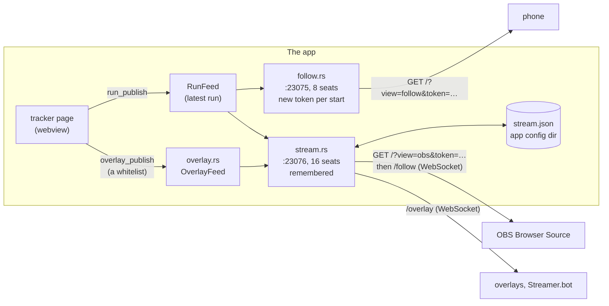

### Why a second server, and why it remembers

A phone watches for a moment the player starts: a new token and a free port each time are fine (and safer), since the player scans a fresh QR code. A Browser Source is set up once and left for weeks; its address is pasted into OBS and must survive a restart of the app, a reboot and an update. The two lifetimes differ, hence two servers with their own port, seats, token policy and switch, sharing the run (`RunFeed`) and the building blocks (`relay.rs`). Folding the stream into live follow's server would have tied OBS to a switch that is off at every launch and a token that changes at every start. The alternative, one server with two route sets and two policies, was rejected for the same reason: the lifecycle is what differs, and it is the lifecycle `Session` owns.

### What is remembered

`<app config dir>/stream.json` (`~/.config/io.github.kqesar.alltp-tracker/` on Linux; Tauri's `app_config_dir`), written whole or not at all (`files.rs`: a temporary file created new, so a leftover cannot lend it its permissions, and a rename; 0600 on Unix. A file that already holds the right content has its mode tightened only if it is looser, and a chmod that fails, on a file system with no modes or a file another user owns, is logged and does not stop the stream):

| Field | Meaning |
|---|---|
| `enabled` | the player's switch, kept across launches. The stream starts by itself at launch when it was on |
| `port` | the port the source's address names. Bound in this order: the saved one, 23076, then 23077 to 23085 (a small fixed range below the system's own 49152-and-up range for outgoing connections, so a player can recognise it and open it in a firewall), and only then any free port. The port finally held is **saved**, so the new address keeps working at the next launch; the dialog says the port moved and the source's address must be pasted again, and when it happens at the launch's auto-start a notice outside the dialog says it too (below) |
| `viewToken` | gates the page's stream (128 bits, base64url, 22 characters) |
| `apiToken` | gates the overlay API (`/overlay`, [overlay-api.md](overlay-api.md)): 128 bits like the view token, and never accepted in its place |
| `lan` | whether other devices on the network may reach the server. Off by default (and when the field is absent, as in a file written before it existed): the server binds `127.0.0.1`. On: it binds every interface (`0.0.0.0`). See "Security" |

A missing file is replaced by a fresh config with the switch **off**, tokens new. An unparsable or tampered one (a token that is empty, not 22 characters of `[A-Za-z0-9_-]`, or a port of 0: an empty token would match a missing one) is first kept as `stream.json.bad` beside it (0600: it may hold tokens; if one is already there the first is kept and this one is simply replaced), then replaced the same way: a damaged file never opens a port by itself, and nothing the player might want back is lost. A file that cannot be *read* (permissions, a directory where it should be) is neither: the error is returned, nothing is overwritten and nothing is remembered, so the stream stays off for this launch (a start reports why) and works once the file can be read. With no config directory at all (`app_config_dir` failed) the app starts anyway, logs it, and the stream refuses to start. Saving fails loudly: a start or new addresses that cannot be written start nothing (and close what was opened), so what runs is always what the next launch will start; turning the switch off cannot fail from the page's side (a save that fails is logged, the server is stopped regardless).

### Routes

The same as live follow's (`GET /follow` as a WebSocket, the token in a subprotocol or in `?token=`, the app's files for any other GET, 405 for any other method; see "Routes" above) on 16 seats, plus the overlay API: `GET /overlay` as a WebSocket, gated by the API token. A source loads `/?view=obs&token=…`, which the app serves its own page for, and the page opens `/follow` on the host it came from. A live follow token does not open the stream and the other way round (each server has its own, and the check is the same constant-time one); likewise the view token does not open `/overlay` and the API token does not open `/follow` (4401 either way: both routes check their own token in the one `Gate::admit`). The two servers on the same machine count their seats apart, and the stream's 16 seats are shared by its sources and its overlay clients (the dialog's count of sources includes them).

`/overlay` is one route over `relay::pump` with a source of its own (`overlay.rs`), where `/follow` streams the latest run: a `state` frame at once, then a numbered `update` per publication and a per-client `beat`. It follows the stream's network setting, since it is the same listener. What it says, its frames and its guarantees (order, no duplicate, a slow client given the state again) are in [overlay-api.md](overlay-api.md); the design decisions are below.

#### The overlay feed

- **The page decides what a stream may see, the app only relays.** The whitelist (the items a game's grid shows, the bosses, the timer, the go mode; in Race Mode no time at all, `overlay/race.ts`) is computed on the page from each game's store (`games/<id>/overlay.ts`), which already holds the run in a typed form; the app would have to parse each game's persisted state to do it, and would then know every game's secrets. `overlay_publish` hands it `{state, events}` as JSON text, which Rust checks for what it can know (a JSON object and a JSON array, each within 64 KiB: a compromised page's bound) and embeds in the frames as raw JSON without reading it further (`serde_json::value::RawValue`).
- **One sequence for all clients.** `OverlayFeed::publish` numbers each publication under a mutex that also sets the latest state and sends the update, so numbers reach every client in order. A client subscribes to the updates first and reads the latest state after (`OverlaySource`), skips any update numbered at or below what it sent, and, when it lagged (the broadcast keeps 16), sends the state again: no update is lost or sent twice, and a stalled client costs 16 frames, not a queue. The feed outlives the server, as the run feed does, except that turning the stream off forgets the latest state (`OverlayFeed::clear`, from `Stream::stop`): the page publishes only while the stream is on, and a client connecting after the next start must not be told a run that may be gone. A restart for the network switch or new addresses keeps it, the page still publishing.
- **The beat is the source's** (`Source::beat`, which `relay::pump` calls per client): `{"v":1,"type":"beat","seq":…,"now":…}`, where live follow's is the constant `{"beat":true}`. The client gets the last `seq` (a way to see a missed update) and the app's clock, from which it counts the timer.
- **Events are the page's too**, from `overlay/diff.ts`, comparing the reading it last published with the new one; the 250 ms trailing throttle (`utils/trailing.ts`, shared with live follow's publisher) makes a burst one update.

### Commands and event

| Name | Arguments | Returns |
|---|---|---|
| `stream_start` | none | `{ address, port, moved, token, apiToken, viewers, lan, lanAddress }`; turns the switch on and saves it. While running, the running session (same token) |
| `stream_state` | none | the same, or `null` while off: what a page that loaded again, or that opened after the launch's auto-start, reads |
| `stream_stop` | none | nothing; turns the switch off, saves it, closes the port and every connection (the sources with 4410) |
| `stream_new_tokens` | none | the new session, or `null` while off. Replaces both tokens (saved first: a failure leaves the old address working), then closes the sources and opens the server again on the same port. The old address now gets 4401 |
| `stream_set_lan` | `{ lan }` | the new session, or `null` while off. Keeps the choice (saved first: a failure changes nothing), then, while running, opens the server again on the same port with the same tokens on the other address: the sources are closed (4410) and come back by themselves |
| `overlay_publish` | `{ state, events }`, JSON text: an object and an array, each at most 64 KiB | nothing, or an error that names what was refused (nothing is then relayed). Hands the overlay API what the page's whitelist reads of the run and what changed ([overlay-api.md](overlay-api.md)) |
| event `stream-viewers` | | `{ count }`, as `follow-viewers` |
| event `stream-started` | | the session, once, when the launch's auto-start (`resume`) has opened the stream: the page asks `stream_state` when it loads, and this reaches it if it asked first |

`address` is `http://127.0.0.1:<port>/`: the loopback address, where an OBS on the same computer reaches the app whatever the network does (no network, a VPN). The page adds `?view=obs&token=<token>` and, if asked, `&timer=1` and (Archipelago's) `&feed=1` (`obsViewUrl`). `lanAddress` is `http://<lan-address>:<port>/` (the address the default route leaves from, as live follow's), set only when `lan` is on and the app found one. It is worked out again at every `stream_state` answer, not once at start (a laptop changes networks), and the dialog asks for it when it opens on a running stream.

### Lifecycle

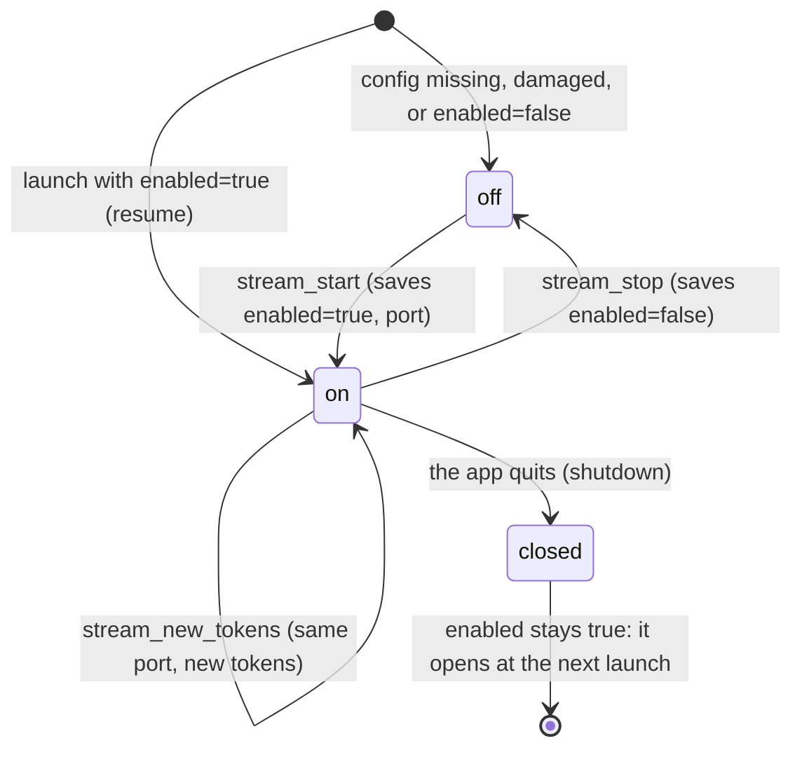

- **Quitting the app** stops the server (sources are closed with 4410) without turning the switch off: the next launch opens it again. Both servers are stopped at once, so quitting waits for the slower of them, not for both in turn.
- **A launch race is closed.** The auto-start runs beside the page's load. The page registers its `stream-started` listener first, then asks `stream_state`; whichever the app answers first, the page learns of the session, and a count of sources heard before it knew a session is applied to it, not lost.
- **A failed change is never left showing the old state.** After any command that fails (a start, a stop, new addresses, the network choice: a restart that cannot reopen its port leaves the stream off), the page asks `stream_state` again, so the dialog never shows the stream on with a dead server. The store stays `pending` until that answer is in, so no other command runs meanwhile and an old answer can never overwrite a newer command's result. A command that answers "off" (`null`) also stops the page's publisher.
- **An update does not stop it.** Live follow is stopped before an install because its phones would retry forever instead of saying "Stopped". A browser source never gives up, so there is nothing to tell: it sees the connection drop, retries, and finds the app again when it has relaunched.
- **The page publishes the run only while the stream or live follow is on** (`runFeed.ts`, above), and the overlay state only while the stream is on (`overlayFeed.ts`, held and released with the stream's switch, whatever the way it changes: a start, a stop, a restart that could not reopen). A stream that is on while no page has published yet (the app just launched) shows nothing until the page loads and publishes: the source draws nothing, not a stale run.

### The source's side: the relayed stream view

`?view=obs&token=…` is routed in `main.tsx` before anything else starts, as `?view=follow` is (the app serves its own build, which believes it runs in the app: no start-up, no service worker, no visit counted). Without a token, `?view=obs` is the site's stream view and follows the tracker through storage; with one, it follows the app's relay. Both builds carry it.

It reuses the followed view's machinery (`follow/useFollowedRun.ts`, extracted from `FollowView`: the socket, the checked snapshot written under the game's own storage key, the game switch, the clock offset), with what a browser source needs instead of a phone's banner:

- **Transparent, no banner**, the game's own `ObsView` (`relay="obs"`: no keyboard shortcuts, the page transparent as the site's stream view is), in an `inert` container, `&timer=1`, `&feed=1` and `&bg=` read from the address as on the site. Nothing shows until the first run.
- **It never gives up.** `follow()` is called with `endOnStop: false`: a 4410 (the player turned the stream off, or quit the app) is a drop like any other, retried with the usual backoff **capped at 5 s**, not 30. A source in OBS has no one to reload it; it must come back by itself when the player turns the stream on again. The last grid stays through every drop.
- **4401 is the one thing it says**: "This address is out of date…", on a panel that reads over any scene, and no grid (a stale grid would pass for the run). It then stops asking: the token will not become valid.
- **A stale build reloads itself.** After a drop, once it is live again, the page fetches `/` fresh and compares the entry script's address (a content hash) with the one it runs (`follow/staleBuild.ts`). Different means the app updated while OBS kept the page open: its lazy chunks no longer exist, so it loads the page again. Unreachable or unclear is not stale: a reload would only lose the grid.

### Security

- **Same model as live follow, with a longer-lived secret.** Plain `http://` on the local network, a 128-bit token compared in constant time, read-only, bounded before and after the token, nothing writable (see "Security" above). The token outlives a session, so it is stored: `stream.json` is 0600 on Unix and under the user's profile elsewhere.
- **The token stays out of the WebSocket's address.** The page opens `ws://host/follow` and sends the token as a WebSocket subprotocol, `Sec-WebSocket-Protocol: alltp.<token>` (`utils/view.ts`, `followProtocol`; the relay reads it in `Gate::admit`, compares in constant time, and echoes the protocol back: a browser drops a connection whose answer names none of the protocols it offered, which would turn a wrong token's 4401 into a bare failure). Why: Chromium logs a failed WebSocket connection with its address in the page's console, and a source retries every 5 s while the app is not running, so a query token would sit in that console all day. OBS 32.2 (CEF 127) does not copy that line into its own log, which streamers share to get support: it logs only the page's `console.error` and uncaught errors (run on the bench, 2026-10-23: no token in the log or on stdout while sources failed to connect). The subprotocol keeps the token out whatever a later OBS or another browser logs. The query form (`?token=`) is still accepted, by both servers, for a client that has not moved. **What still carries the token**: the page's own address (`?view=obs&token=…`: OBS needs it, it is the source's URL, shown in its properties, and OBS can log it when the page itself fails to load, as when the app is not running at the first load, and OBS 33 logs it with any file the page fails to load: so every file the page asks for is served, `manifest.webmanifest` included, which Tauri types as HTML and `tauri_assets` (`follow.rs`) tells apart from its index.html fallback by the bytes). So the address stays a secret to keep out of shared logs and screens, and **New addresses** replaces it if it leaked.
- **The address is a secret.** OBS shows a source's URL in its properties window: keep it off screen. **New addresses** (behind a confirmation) replaces both tokens and closes every source holding the old ones; use it if the address leaked.
- **No port sharing on Windows.** The stream's listener sets `SO_EXCLUSIVEADDRUSE` before it binds (`relay::bind_exclusive`). Without it, another process could hold `127.0.0.1:P` while the app holds `0.0.0.0:P`: the more specific address wins, and the source on this computer would reach that process and its page, not the app. With it, the bind fails and the port falls to the next candidate. The reverse is allowed, and harmless: a process holding `0.0.0.0:P` does not stop the stream binding `127.0.0.1:P` exclusively (Microsoft's bind tables), and a source on this computer then reaches the app, the more specific address; the Rust tests hold ports on the address the stream binds for that reason. It needs `socket2` (already built under tokio and hyper-util: the only change to `Cargo.lock` is the app's dependency edge) to make the socket before the bind, and `windows-sys` (already a Windows dependency, one more feature) for the option, which `socket2` has no setter for. Live follow keeps the plain bind. On Linux the plain bind already refuses a second listener on the port, as the Rust tests show; **macOS does not** (see "Known limits").
- **The price of an exclusive bind: a restart waits for its own port.** [Microsoft's note on `SO_EXCLUSIVEADDRUSE`](https://learn.microsoft.com/en-us/windows/win32/winsock/so-exclusiveaddruse) says that while a connection accepted on an exclusive listener is still active, another exclusive bind to the port fails. "Active" there is ESTABLISHED, FIN_WAIT and LAST_ACK, not TIME_WAIT. When the network switch or **New addresses** reopens the server on the same port, a source's old connection is still finishing its close (the app has sent its FIN and waits for OBS's), so the first bind of the port would fail and the port would drift: the dialog's "moved" notice, and an address the source can no longer reach. So a restart retries the saved port every 50 ms for up to 2 s before it goes down the candidate list (`stream.rs`, `bind`). A first start does not wait. The page's WebSocket closes with a close frame, not the `shutdown` and read-to-EOF the page recommends: axum's `WebSocket` gives no access to the TCP stream, and the wait covers it. The Rust tests of `stream.rs` and `relay.rs` run on the Windows runner of `desktop.yml`, where the restart tests (`allowing_the_network_opens_the_same_port_with_the_same_tokens`, `a_new_address_closes_the_sources_and_refuses_the_old_one`) exercise this path; nothing was run on a real Windows machine.
- **Loopback by default, the network on request.** The server binds `127.0.0.1`: an OBS on this computer, the usual case, needs nothing more, and nothing else on the network can even connect, token or not. Live follow listens on every interface because its whole purpose is a phone; the stream's is not, and a source's address is long-lived and kept in OBS's profile, where a leaked token would otherwise be a standing invitation. The checkbox **Allow other devices on the network** (`lan` in `stream.json`) binds every interface, for an OBS on a second computer (a streaming PC beside the gaming one): the dialog then shows the address those devices use beside the loopback one, and says that anyone on the network holding the address can show the tracker, that the secret keeps others out, and which port a firewall must let in. Turning it on or off restarts the session on the same port with the same tokens. The overlay API's route is on the same listener, so the same switch governs it.

### The dialog

The toolbar's **Stream view** button, back in the desktop build (it was hidden while OBS could not be served), opens **Stream tools** (`components/ui/StreamTools.tsx`, a lazy chunk behind the inline desktop test, so the site's build has none of it; the site keeps its own **Stream view** dialog, an address to paste). In the More menu it appears only once the bar folds it away, like the other secondary actions the desktop's always-visible More menu would otherwise repeat.

A `role="switch"` ("Serve the stream view to OBS", `aria-disabled` while a change is under way so it keeps the focus, failures as a `role="alert"`), then, while on: the Browser Source URL with Copy, for a game with a run timer (ALttPR, Archipelago) the run timer checkbox and the source size (ALttPR 768 × 256, its band, or 1536 × 512, a row more with the timer; Archipelago's A Link to the Past skin 448 × 384), for Archipelago the feed checkbox (`&feed=1`, off until ticked: the last five lines involving the slot, three rows more), a notice when the port moved, how many sources are connected (`role="status"`; overlay clients hold seats too and are counted), the `&bg=` note, the **Overlay API address** (a `ws://` address with the API token and Copy, and a note on what the API says), the checkbox **Allow other devices on the network** (with, once on, the addresses for another device, the stream view's and the API's, a note on who can then reach it and the firewall hint with the port, or that the computer is on no network), and **New addresses** in the footer. A moved port found at the launch's auto-start is also said outside the dialog, in a notice among the page's notices (`StreamMovedNotice`, dismissible). It is said **once per app launch**: the port told is kept in `sessionStorage`, which survives a reload (a game switch) and not an app restart, so neither a reload nor Dismiss brings it back, a port the player just started and saw in the dialog is not told again, and a different port is news. The dialog keeps saying it while the port is moved. The switch, address and counts come from `useStreamStore` (`streamTools.ts`), which keeps nothing itself: the app is asked at every page load (`attachStream`), since it may have started the stream at launch.

### Known limits

- **A stream left on while the page has not loaded** shows nothing (above). In practice the page loads in well under a second.
- **A port that moves** (23076 taken) changes the address once: the dialog says so, and the source must be pasted again. It does not return to 23076 by itself later.
- **macOS, with the network on, does not stop another program from sitting on the loopback address.** Elsewhere than Windows the stream binds with tokio, whose `mio` sets `SO_REUSEADDR` on every non-Windows platform. Linux still refuses a second listener on the same port. macOS (BSD) checks only the exact address, so a process of the same user can listen on `127.0.0.1:P` beside the app's `0.0.0.0:P`, and an OBS on this computer would reach it (with the network off the app binds `127.0.0.1` itself; whether macOS refuses a second listener on exactly that address was not checked). The earlier claim in this document that "a plain bind already refuses, as the tests show" held on Linux only, the one system the tests run on. Not handled: the fix would be a second listener on loopback in that mode; live follow has the same exposure on `0.0.0.0:23075`.
- **Without a token, a peer can fill the pre-upgrade connection budget.** At most 32 connections still in HTTP are served at once (see "Security" above), counted across every peer, and an upgraded socket leaves that count. A device that can reach the port (any on the network with `lan` on, any local process otherwise) can hold all 32 with keep-alive requests that need no token, and a refused upgrade (4401) leaves its socket open for up to a second after its slot is freed: the source is then kept out until the peer stops, and many such upgrades hold file descriptors. This is live follow's relay, which the stream now starts at every launch; the budget is not per peer and has no slots kept for loopback. Not handled: it needs per-peer limits and counting upgraded sockets against the budget.
- **OBS does not retry a source whose page failed to load.** If OBS opens the source while the app is not running (connection refused), the source stays blank until OBS reloads it. A source that loaded once does wait for the app and returns by itself (above); this is only the very first load. So: start Rando Atlas before OBS, or tick "Refresh browser when scene becomes active" in the source's properties. The dialog says so.
- **Proved on Linux only.** The Rust tests (`stream.rs`) run the real server over temporary config directories: the saved port and tokens surviving a restart, `resume` at launch and the switch left on by `shutdown`, a damaged or tampered config replaced with the switch off, the port fallback and its `moved` flag, a config that cannot be written starting nothing, new addresses closing the sources and leaving the old one refused (4401), each server's token refused by the other, one publish reaching both servers while each stops alone, the 16 seats, and the files. The browser tests (`apps/web/e2e/stream-source.e2e.ts`) drive the source page against a fake relay: transparent page, the grid alone with axe at four widths and at OBS's sizes, `&timer=1` and `&bg=`, the last grid kept through a lost connection and a 4410, the 4401 line, and the reload after an update. On a real run of the app in development (a private Xvfb display, a temporary home, a headless Chromium standing in for OBS on `http://127.0.0.1:23076`): the source drew the run with its timer and followed an item clicked in the app; the app was killed and started again and the source, never touched, was back on the same address, followed the next click and the dialog said "1 source is connected."; **New addresses** changed `stream.json`'s token and the source switched to its out-of-date line; with 23076 held by another process the app started on a free port, saved it, and the dialog said the port moved. The dialog and the toolbar were looked at at 1440, 820 and 390 px (the Stream view item sits in More once the bar folds). The bench was run again on the loopback-by-default build: the stream bound `127.0.0.1:23076` (a request to the machine's network address was refused, one to loopback answered), the source followed a click in the app, ticking **Allow other devices on the network** rebound `0.0.0.0:23076` with the same token (the network address then served the page, the dialog showed it, the source stayed connected), the app restarted again with the source untouched, and with 23076 held by another process the app started on 23077 after its auto-start and showed the moved-port notice. The Rust tests cover the rest (the bound address, a connection to the network address refused while `lan` is off and accepted while on, the saved port then 23076 then the range, a damaged config kept as `stream.json.bad`, an unreadable one left alone, a loose file corrected to 0600). The overlay API was run on the same bench (a private Xvfb display, a temporary home, the app in development, Node's WebSocket client and the page of overlay-api.md in headless Chromium): a client got the `state` at once, one `update` per burst of `--step` items with an event each, the item found while the timer ran dated by it, the timer's `start`, `pause`, `resume` and `reset` events from the popover, a `reset` from New game, the view token and a wrong token closed with 4401 on `/overlay` and the API token with 4401 on `/follow`, **New addresses** closing the client with 4410 and refusing the old API token, a game switch to Super Metroid publishing its state, and the doc's example overlay showing the items found and counting the timer, pausing and resetting with it. Not tried: an OBS itself, another computer on the network, graceful quit (the `Exit` event is the unit-tested `shutdown`; the bench's kill is the abrupt case), macOS and Windows.

## Updates

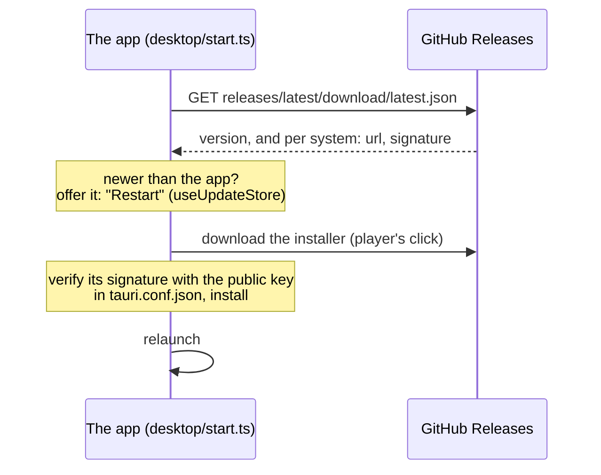

- The app checks when it opens, then every hour, and never installs on its own: the same notice as the site's offers **Restart**, and the player picks the moment.
- **Restart** downloads the update, stops live follow if it runs (the devices following are told "Stopped"), installs, then relaunches. The stream view is left running: a browser source retries until the relaunched app serves it again. The stop cannot wait for the app's exit event: on Windows the updater starts the installer and ends the process without one (above, "Security").
- **Signing key.** Every installer is signed with the project's updater key, a free minisign (Ed25519) pair made by `tauri signer generate`. The public half is in `tauri.conf.json` (`plugins.updater.pubkey`). The private half and its password live in the repository's secrets, `TAURI_SIGNING_PRIVATE_KEY` and `TAURI_SIGNING_PRIVATE_KEY_PASSWORD`, and in the owner's own backup, never in the repository. An installed app refuses an update its key did not sign: losing the private key means no update can reach the installed apps again (players would reinstall by hand).
- This is separate from the systems' code signing (below): it proves an update comes from this project, whatever the system thinks of the publisher.

## Releases

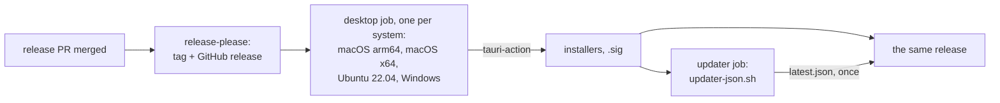

- The `desktop` job of `.github/workflows/desktop-release.yml` (dispatched by `ci.yml` once release-please cuts a release, after the site's deploy; it can also be started by hand for a tag, see `docs/ci.md`) runs only then: about five minutes per system, in parallel. Pull requests that touch `apps/desktop` run `.github/workflows/desktop.yml` instead (Linux: `cargo fmt`, `clippy`, tests; Windows and macOS: `clippy` again, for the code that compiles there only, and on Windows the tests of the two servers); the web side is tested by the CI workflow as always.
- **latest.json is written once, after every build**, by the workflow's `updater` job (`.github/scripts/updater-json.sh`): one entry per updater platform key, each the installer's asset URL and its `.sig`. The builds no longer write it: while each one did, two finishing together kept only one side's entries (v2.42.0 lost its four Linux keys, put back by hand from their `.sig` files). The job does not run when a build failed, so the apps are never offered an update with a platform missing; rerunning the failed build runs it. `updater-json.sh <tag> --dry-run` prints the file without attaching it.
- The app's version is the product's: `tauri.conf.json` reads the root `package.json`, which release-please bumps.
- **Display name versus technical ids.** The product is called Rando Atlas: the window title, the menu entry's `Name=` and the page say so (an existing entry takes the name at the next launch, `refresh_at_launch` rewriting it). What installed apps rest on keeps the old name, `alltp-tracker`: the Tauri `identifier` (it fixes the webview's data folder, so changing it loses the run), `productName` (NSIS keys its install folder and uninstall entry on it: a new one installs a second copy beside the old), the updater endpoint (it survives a repository rename only through GitHub's redirect) and the storage keys.
- Linux is built on Ubuntu 22.04, the oldest glibc the AppImage should run on.

| System | Installers | Code signing |
|---|---|---|
| Windows | NSIS `-setup.exe` | none yet: SmartScreen warns on first run. SignPath Foundation signs open-source projects for free, on the owner's application (planned after series 3). |
| macOS | `.dmg`, Apple silicon and Intel | ad hoc (`signingIdentity: "-"`): without it an Apple silicon Mac calls the download "damaged". Not notarized (a paid Apple account): the player allows it once in Privacy & Security. |
| Linux | AppImage, `.deb`, `.rpm` | none needed |

## Archipelago rooms

The Archipelago board connects from the webview itself: no Rust is
involved. Its page context is `desktop` (`isDesktopApp`), so the package's
pre-check never refuses an address and no local network permission is asked
(`docs/archipelago.md`, "The pre-check and the local network permission").
That is what the app adds over the site for a self-hosted room: a plain
`ws://` server on the LAN (which Firefox and Safari refuse from the site)
or on the internet (which every browser refuses from an https page).

Measured on 2026-10-24 (the Archipelago bench's gate B), the Linux release
build (WebKitGTK 2.54.2, page `tauri://localhost`) driven through WebKit's
inspector (`WEBKIT_INSPECTOR_HTTP_SERVER=127.0.0.1:9333`, which a release
build honours):

| From the app on Linux | Result |
| --- | --- |
| `wss://archipelago.gg:<port>` | connects |
| `ws://127.0.0.1:38281` | connects |
| `ws://<LAN IP>:38285` | connects |
| `ws://` on a public host | not tested |
| `isSecureContext`, `Origin` | true, `tauri://localhost` |
| IndexedDB (the name cache), `navigator.locks` (the tab lock) | work; `navigator.storage` is undefined |

- **No Rust WebSocket.** The plan kept one in reserve (a WebSocket-like
  class over a Rust socket) in case WebKit refused remote `ws://` from
  `tauri://localhost`; gate B showed it does not, so none is built. It
  would be built only if macOS or Windows turns out to block it.
- **Windows keeps `http://tauri.localhost`.** With `useHttpsScheme` the
  pages would be https and every plain `ws://` mixed content: SNI's
  `ws://localhost` and a self-hosted room's alike.
  `apps/web/src/desktop/webviewOrigin.spec.ts` fails if the setting appears.
- **Not verified**: macOS (WKWebView, `tauri://localhost`) and Windows
  (WebView2, a Chromium whose `http://tauri.localhost` page may meet its
  Local Network Access rules: a prompt, or a refusal the board would report
  as unreachable). Nobody has run either against a room yet.

## Known limits

- **Size.** The AppImage weighs about 86 MB (v2.30.0's): it carries WebKitGTK. The `.deb` and `.rpm` (about 8 MB) use the system's, the Windows installer 5.4 MB, each macOS `.dmg` about 7 MB.
- **Tested here on Linux only**: the release build in a private display (Xvfb, its own session bus and home), driven by xdotool. It renders the tracker, autotracks through SNI with RetroArch (the seed's run type read from alttpr.com), opens links in the system browser, saves an export through the Save dialog, copies the diagnostic report. The macOS and Windows builds come from CI, unproven until someone runs them.
- **The application menu entry** (below) is the AppImage's alone, and Linux's. A player who also runs AppImageLauncher or appimaged gets that tool's own entry too, hence two: this one can be removed from **More**. A path holding a `%` is written escaped as the specification asks (`%%`), which GLib refuses to load (it looks the executable up before unescaping, measured on the bench): GNOME would not list the entry and the portal's `Register` would fail, the shortcuts then falling to the command mechanism. Left as is for a path nobody has.
- **Global shortcuts** (above):
  - Unverified on the systems listed there: GNOME 48+, Hyprland, Windows, macOS (KDE Wayland passed the checklist, above).
  - A Link to the Past's only: the other games have no keymap.
  - One keyboard layout is read: the first group on Linux, the process's default on Windows (a layout picked per window is not seen), punctuation keys best-effort on layouts that move them.
  - Changing the layout while the app runs leaves grabs made under the old one until the app restarts (global-hotkey's X11 backend finds the keycode again when it ungrabs).
  - On X11 `Quote` cannot be grabbed (global-hotkey 0.8 looks for U+2018, which no layout puts on a key) and F13 to F23 need a layout that types them (most map them to XF86 keysyms). The tab says so for the key.

## Development

```bash
pnpm --filter @alltp/desktop dev     # the app on Vite's dev server, with HMR
pnpm --filter @alltp/desktop build   # this system's installers
```

Live follow and the stream view in development serve `apps/web/dist-desktop` from disk, not the dev server (Tauri embeds no files under `devUrl` and its resolver reads `frontendDist`): run `pnpm --filter @alltp/web exec vite build --mode desktop` before testing it on a phone, and again after any change to the followed or relayed stream view (`?view=follow`, `?view=obs&token=`, `apps/web/src/follow/`, `main.tsx`). Without a build the phone gets a 404; with an old one, the old page.

Needs Rust ≥ 1.90 (`rustup`) and Tauri's system libraries ([prerequisites](https://v2.tauri.app/start/prerequisites/)). A local build signs the updater artifacts too: export `TAURI_SIGNING_PRIVATE_KEY` and its password first, or pass `--no-bundle` to skip them.
