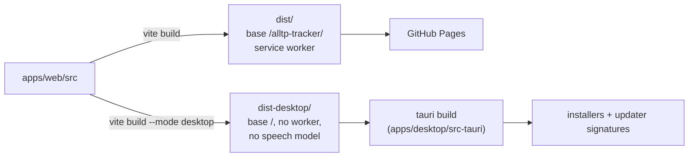
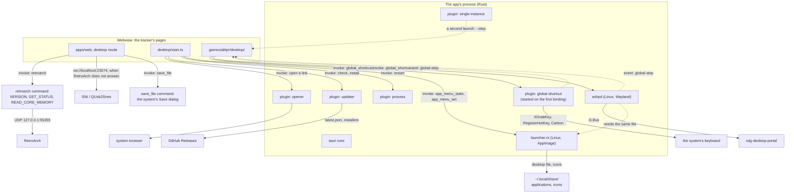
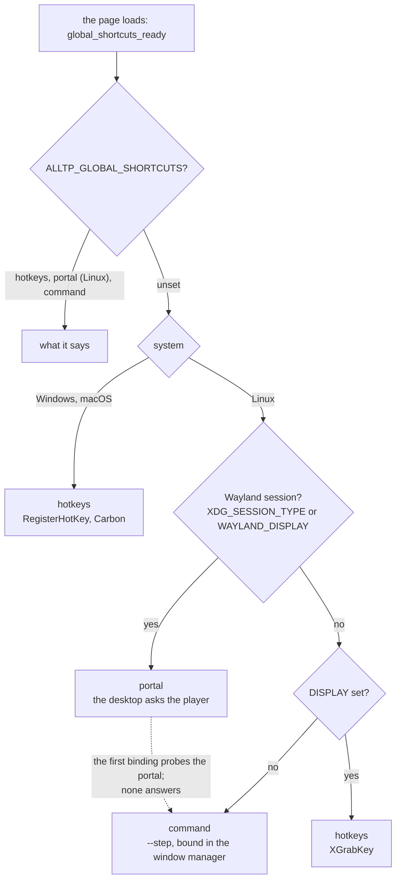
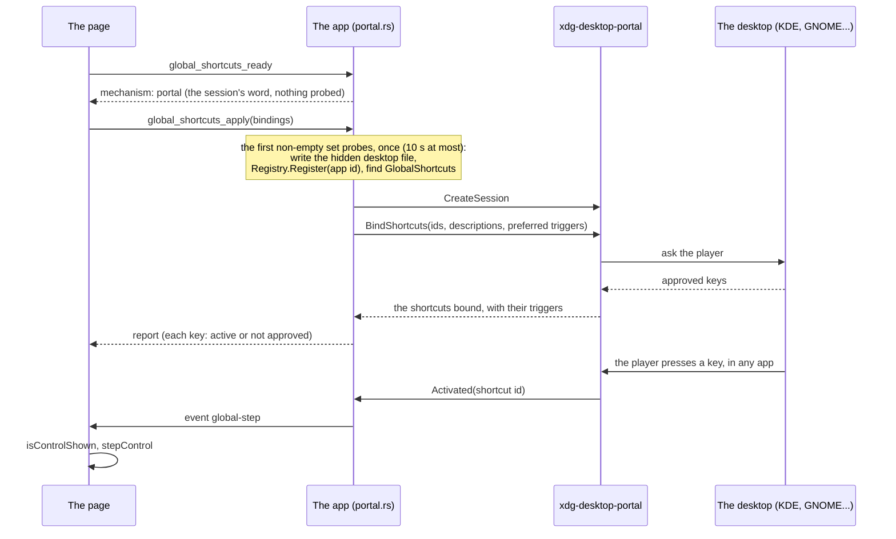
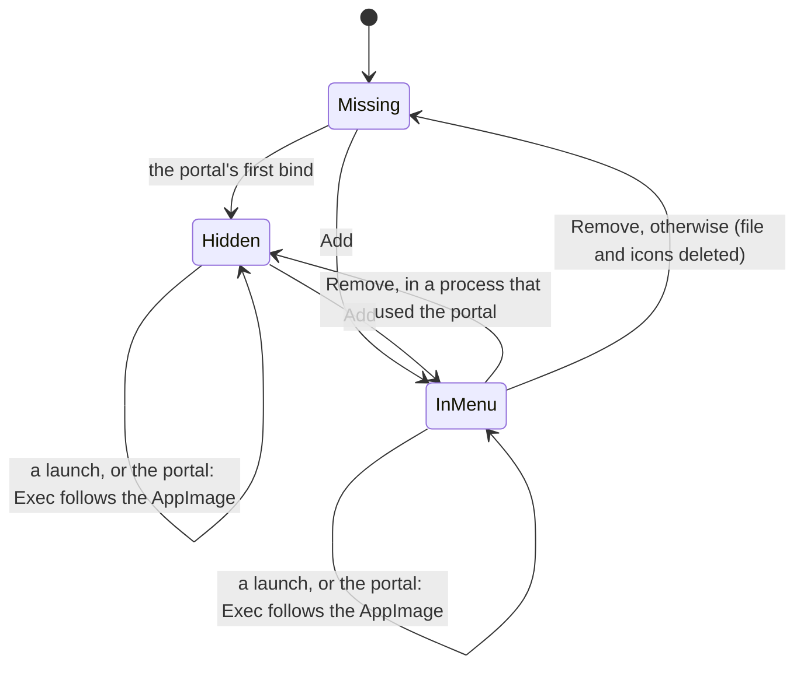
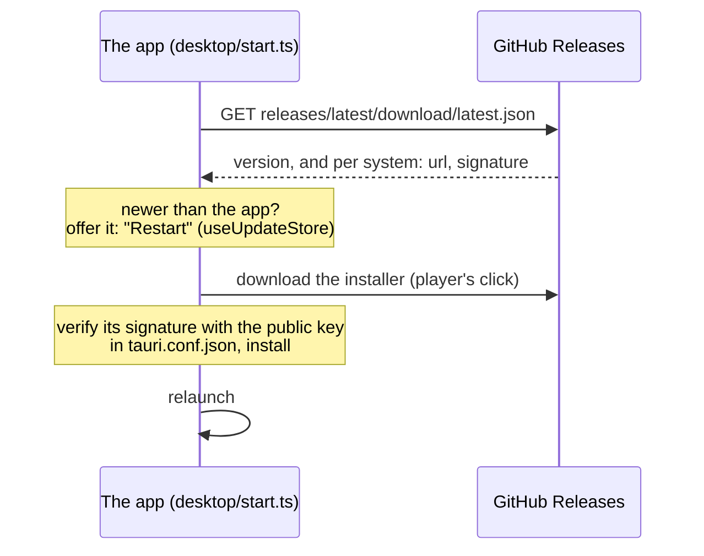
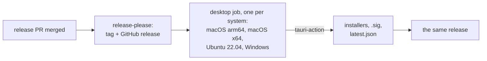

# The desktop app

`apps/desktop` (`@alltp/desktop`) is the tracker as a native app for Windows, macOS and Linux, built with [Tauri](https://v2.tauri.app/) 2. It exists for what a page on GitHub Pages cannot do:

- **Reach SNI from Safari's Macs.** WebKit treats `ws://localhost` from an https page as mixed content (WebKit bug 171934), so the site cannot autotrack in Safari or on iOS. The app's pages are not https: the restriction does not apply.
- **Talk to RetroArch directly** over UDP, without SNI (below, "Autotracking").
- **Global shortcuts** that work while the emulator has the focus (below, "Global shortcuts").
- **A menu entry for a downloaded AppImage**, which installs none (below, "Application menu").

The site stays the main product. The app adds no byte to it, and costs nothing: no store, no paid signing, builds on GitHub's free runners, updates served by GitHub Releases.

## One codebase, two builds

The app's pages are `apps/web`, built in Vite's `desktop` mode. Nothing is forked.



What the `desktop` mode changes (`apps/web/vite.config.ts`):

| | Site | Desktop app |
|---|---|---|
| Base path | `/alltp-tracker/` | `/` (the app serves its own files) |
| Service worker | yes, for offline use and updates | none: the files are local, updates come from the app |
| Speech model (40 MB) | `models/` on the site, fetched on demand | the site's copy, fetched on demand (GitHub Pages sends `access-control-allow-origin: *`); never in an installer |
| Stream view (OBS) | yes | hidden: OBS can neither load the app's pages nor follow its `localStorage` |

The code reads the mode through `isDesktopApp` (`apps/web/src/utils/platform.ts`), a constant the site's build folds to `false`. One exception: `main.tsx` tests `import.meta.env.MODE === "desktop"` inline, because Rollup does not fold a constant imported from another module far enough to drop a dynamic `import()`. With the inline test, the site's build emits no chunk of the desktop code (checked in the build output: no `start-*.js`).

## At runtime



- **The webview** is each system's own: WebView2 on Windows (pages at `http://tauri.localhost`), WKWebView on macOS and WebKitGTK on Linux (pages at `tauri://localhost`). None of these origins is https, so autotracking's WebSocket to SNI is not mixed content. `detectEnvironment` (`packages/autotrack/src/environment.ts`) gates loopback on https pages only, else the WebKit of macOS and Linux would read as a blocked Safari.
- **What the pages may ask of the app** is listed in `src-tauri/capabilities/default.json`: open an https URL (`opener:allow-open-url` scoped to `https://*`: without a scope the permission grants the command but no URL), check for and install an update, restart, and the app's own commands, `save_file`, `retroarch`, `app_menu_*` and the `global_shortcuts_*` ones (an app's own commands need no permission entry). Nothing else: in particular no `global-shortcut:*` permission, so the page cannot register a key through the plugin itself, only through the app's command, which checks it.
- **Links** to other sites open in the system browser (`openLinksOutside` in `apps/web/src/desktop/start.ts`). In the app's window they would replace the tracker.
- **Exports** go through the system's Save dialog: `saveFile` (`apps/web/src/utils/saveFile.ts`) calls the app's `save_file` command (`src-tauri/src/lib.rs`), which asks where and writes there. A webview handles a download link its own way (WebKitGTK writes it, unasked, into the process's working directory), and the page gets no file-system access at all: it can write only where the player picks.
- **The run** is saved in the webview's `localStorage`, apart from any browser's. Export and Import move it.

## Autotracking: RetroArch first, then SNI

A page cannot send UDP, so the site needs SNI between it and RetroArch. The app does not: on every connection it tries RetroArch itself, then SNI for every other device (an FX Pak Pro, BizHawk, an NWA emulator). `bridgeOptions` (`apps/web/src/autotrack/bridge.ts`) hands each game's session the app's transport (`apps/web/src/desktop/bridge.ts`), a chunk the site's build leaves out.

- **The transport** is `@alltp/autotrack`'s `RetroArchTransport` behind `FirstAnsweringTransport`; its README ("RetroArch, direct") has the protocol as measured on a real RetroArch 1.22.2, the sequence and the choices (the pack's mapping, eight pieces in flight, short replies, no content).
- **The Rust side** (`src-tauri/src/retroarch.rs`) sends one datagram and waits for one reply, on a socket of its own per command, so a reply can only answer its own command. It passes `VERSION`, `GET_STATUS` and `READ_CORE_MEMORY` and refuses every other command: the pages can never write the game's memory, load a state or quit RetroArch. A closed port answers at once (an ICMP refusal, a reset on Windows), so an absent RetroArch delays SNI by nothing; a silent one by 500 ms.
- **What the player sets up**: bsnes-mercury and RetroArch's Network Commands, as with SNI. The setup guide shows the app's steps (`desktopSetupSteps`): for RetroArch, the emulator and the game; for any other device, SNI's, without the browser's permission step.
- **RetroArch wins.** With RetroArch open and its network commands on, the app reads RetroArch, even from its menu; it falls back to SNI only while RetroArch does not answer, and leaves SNI for RetroArch the moment RetroArch answers, as long as SNI has no device attached. So a player on an FX Pak Pro closes RetroArch, or turns its network commands off.
- **Port**: RetroArch's default, 55355. A player who changed `network_cmd_port` is not reached directly; SNI still reaches that RetroArch once told the port (`SNI_RETROARCH_HOSTS`, SNI's README at `77ba8ac`).

## Global shortcuts

A player runs the tracker beside the emulator and wants to step an item without leaving the game: the key must work while RetroArch has the focus, which a page cannot do. The app registers the keys with the system and tells the page when one is pressed; the page runs the action exactly as a key in its window does (`isControlShown`, then `stepControl`, one undo step).

The keys are the player's: the Global tab of the Shortcuts dialog (the desktop app only) binds the same actions (`advance:hookshot`, `back:chest3`) as the window's tab, by physical key (`KeyboardEvent.code`). **None is bound by default and the switch starts off**: a global grab takes the key from every app (RetroArch's own F-keys, the chat, OBS), and no combination is free on every machine (Ctrl+Alt+T opens GNOME's terminal, Ctrl+Alt+L locks KDE, Ctrl+Alt is AltGr on Windows). On a portal, defaults would make the desktop's dialog list dozens of shortcuts at the first launch.

### Three mechanisms

No single API works everywhere, so the app picks one per process (`src-tauri/src/shortcuts/detect.rs`, a pure function over the environment, unit-tested) and tells the page, which says so in the tab.



| Mechanism | Where | How |
|---|---|---|
| `hotkeys` | Windows, macOS, a Linux X11 session | `tauri-plugin-global-shortcut` (wraps `global-hotkey`: RegisterHotKey, Carbon `RegisterEventHotKey`, `XGrabKey`). The key is registered at once. |
| `portal` | a Linux Wayland session whose desktop has the GlobalShortcuts portal (KDE, GNOME 48+, Hyprland) | `ashpd` calls `org.freedesktop.portal.GlobalShortcuts`. The desktop shows the keys asked for and the player approves or changes them. |
| `command` | any other Linux session (sway, i3 on Wayland, old GNOME), or a portal that fails | `alltp-tracker --step advance:hookshot`, handed to the running app by `tauri-plugin-single-instance`. The player binds it in the window manager. |

The **session** decides, not the app's own GDK backend. On KDE, Tauri's window is a native Wayland client, and so is a native-Wayland RetroArch; an X11 grab lands on XWayland's root and fires only while an X11 window has the focus. `ALLTP_GLOBAL_SHORTCUTS` (`hotkeys`, `portal` or `command`) overrides the choice, for the test bench and for a KDE user who turned on "Legacy X11 app support" and wants X11 grabs anyway. It is deliberately not in the UI.

The command line works under every mechanism, on every system: a Stream Deck or a script can run it too. `alltp-tracker --step=advance:hookshot --step back:chest3` runs both, in order; an invalid action is named on stderr and ignored, as is any argument the AppImage runtime or a launcher adds. The Global tab shows the command with the real executable (`$APPIMAGE` when set, which survives updates, else the running binary) and a Copy button per action. For sway or i3:

```
bindsym Ctrl+Alt+h exec "/path/to/alltp-tracker" --step advance:hookshot
```

```
# Hyprland
bind = CTRL ALT, H, exec, /path/to/alltp-tracker --step advance:hookshot
```

### What crosses the boundary

- **The page asks, the app checks again** (`shortcuts/chord.rs`). The page may be compromised, and a global grab on a key the player types with would let it read what they type in every other app. So the app refuses, whatever the page sends, an action that is not `^(advance|back):[a-z]+[0-9]*$`, a chord that is not written in the page's canonical order, a key outside the supported set, more than 256 bindings, and **the floor**, which covers **character keys** (letters, digits, punctuation, F1 to F12):
  - everywhere: Control, Alt or Meta with it (never bare or Shift alone);
  - Windows: not exactly Ctrl+Alt, which is AltGr and types `@ # { [` on AZERTY and QWERTZ;
  - macOS: Control or Cmd with it, because Option types characters (Option+E is the acute accent).

  The finer rules (two modifiers, a chord the window already uses) live on the page only (`globalKeymap.ts`), so they are not maintained twice.
- **The floor does not cover the numpad.** A bare `Numpad0` to `Numpad9` or `NumpadDecimal` is allowed, and with NumLock on it types a digit: while the shortcut is on, that key is taken from every app and a compromised page that bound them all could read a PIN typed on the numpad. This is a decision, not an oversight: LiveSplit's default global hotkeys are numpad keys, players expect it, and each binding is opt-in per action behind a switch that starts off. The Global tab says so as soon as one is bound.
- **The supported keys** are letters, digits, the punctuation keys, the numpad and F1 to F24. No `Intl*` code (global-hotkey 0.8 cannot register them) and no `NumpadEqual` (it registers the letter E on Windows).
- **Events** go the other way: `global-step` (`{ action }`, a press, never a release) and `global-shortcuts-changed` (the portal: the player edited the keys in the system's settings).

### Physical keys and layouts

The page stores a chord by physical key, so a binding stays on the same key on QWERTY, AZERTY and QWERTZ. The backends do not all mean the same by "a key":

| Backend | A key is | Translation (`shortcuts/keys.rs`) |
|---|---|---|
| macOS (Carbon `kVK_ANSI_*`) | a physical position | none |
| Windows (`VK_*`) | what the layout labels it: `VK_Q` is the key labelled Q, at `KeyA`'s place on AZERTY | physical → scancode → `MapVirtualKeyW` → virtual key → the Code global-hotkey registers as it |
| X11 (keysym) | what the layout labels it: global-hotkey grabs the first keycode whose keysyms hold the letter | physical → X keycode (evdev + 8) → the keyvals GDK gives it (group 0, level 0 first) → the Code whose keysym is among them |
| Portal | a keysym name in the preferred trigger (`CTRL+ALT+a`) | the same GDK lookup, the name of the level 0 keyval; the numpad and F keys have fixed names |

Without this, an AZERTY player who pressed the key labelled A would get a shortcut on the key labelled Q. The decision tables are pure and tested with the keyvals of xkb's `fr` layout; the lookups of each system are thin. Proved on the bench with `setxkbmap fr`: a binding captured on the physical Q key is grabbed on the keycode that types `a`, and the keycode that types `q` still reaches other apps.

The same GDK lookup feeds the key labels on Linux (`key_labels`): WebKitGTK has no `navigator.keyboard`, so the page showed QWERTY names to an AZERTY player in both tabs. Windows' WebView2 and macOS' WKWebView read the layout themselves.

### The portal



- **A host app has no app id**, and the portal refuses a session without one ("An app id is required"). A non-sandboxed process gets one from its systemd scope or from `org.freedesktop.host.portal.Registry.Register`, which must come before any other portal call and wants a `<app id>.desktop` file GIO can find. Tauri's bundler names its desktop file `ALLTP Tracker.desktop` (a space is no app id), so the app writes one at runtime: `$XDG_DATA_HOME/applications/io.github.kqesar.alltp-tracker.desktop`, for every package (AppImage, `.deb`, `.rpm`, dev). It is `NoDisplay=true` (the package's own menu entry stays the only one), unless the player added the AppImage to the application menu (below): the file is the same one, and the portal keeps the visibility it finds. `launcher.rs` is its one writer. It rewrites the file when its `Exec` or `Icon` differs (the AppImage moved), and `Register` is retried three times at 200 ms while GIO notices a new file. A small file and the icons stay in the home after uninstalling: the price of one code path. **Future Flathub caveat:** Flathub requires this exact id for the app's own desktop file. A user-level copy with the same id overrides a system or Flatpak one, and with `NoDisplay=true` it would hide the app from the menu. If a package ever ships `io.github.kqesar.alltp-tracker.desktop`, stop writing this one (or delete it when another with that id exists in `$XDG_DATA_DIRS`).
- **Lazy start.** A launch with the feature off touches nothing: no desktop file, no `Register`, no listener. On a Wayland session the mechanism is the portal on the session's word alone, and the first non-empty apply probes it, bounded to 10 s so a hanging portal frontend cannot hold the shared state. A probe that finds no portal gives the mechanism up to `command` for the process, with the reason shown (the Global tab shows the commands then, which a sway or i3 player sees after the first binding rather than at launch).
- **Ids** replace the action's colon with a dot (`advance.hookshot`): Hyprland's `global` dispatcher splits `appid:id` on the colon.
- **Always bind at the start of a session.** Plasma 6.7.4 and later keep a shortcut dead until `BindShortcuts` is called in the current session (KDE bug 523063, the lesson of KeePassXC's PR 13579).
- **Never per keystroke.** Each bind may pop the desktop's dialog, so the page applies at the moments the player expects it: when the Global tab or the dialog closes, on **Send to desktop**, on **Ask again** (a new session), and at start-up. Turning the switch off closes the session at once.
- **A refusal** is a state, not an error, and it is remembered (saved with the Global prefs): the tab says the approval was declined, marks the keys "Not approved" and offers **Ask again**. The tracker never asks again by itself at the next launch, as a browser does not ask again for a permission the person denied; turning the switch off and on also clears it. A portal that cannot create a session at all (no backend answers within 20 s, "An app id is required") downgrades the mechanism to `command` for the rest of the process, with the reason shown. The player gets 5 minutes to answer the desktop's dialog.
- **A page that goes away** (a reload, a switch to another game) drops its portal request and closes its session: the next page never queues behind a dialog nobody reads. Requests are counted per page, so one that arrives from the old page after it left is dropped.

### The hotkeys backend

- **Lazy start.** Adding the plugin creates the platform manager: on X11 a thread that polls every 50 ms and holds a connection, on Windows a hidden message window. A player who never turns the feature on pays none of that: the plugin is added, on the main thread (macOS needs it there), at the first binding.
- **Registrations block on the main thread**, so every command is `async` and the work runs off it: calling it from the main thread would deadlock.
- **Nothing is unregistered at quit**: the unregistration would wait for the main thread, which is running the exit. The system frees the grabs with the process (the X connection closes, Windows hotkeys belong to the plugin's window, Carbon's to the process).
- **A page load releases the old page's keys** (`on_page_load`, spawned, never inline). Switching to Super Metroid or SMZ3 reloads the page without re-applying, and the global feature is A Link to the Past's alone (only it has a keymap).
- **Ungrabs are buffered.** global-hotkey 0.8's X11 thread sends its "ungrab" requests with the next request that waits for an answer, which only a registration is. Without one, the last keys released stay grabbed in every app: found on the bench, where switching game left one of two keys swallowed. A registration of a key nobody presses (`Control+Alt+Shift+Super+Escape`) after each release flushes them.
- **Releases are one request.** `unregister_multiple` sends every key to release in one message: one by one, each waits for the X thread's 50 ms loop, so a long set stayed grabbed for seconds and the key pressed to capture a new one was eaten. A refused registration is followed by a flush too: global-hotkey grabs a key's lock variants one at a time, and when a later one is refused its first variant could stay grabbed if nothing else followed.
- **A taken key** is reported per binding (`taken`, "In use by another app or the system"): one taken key never hides the others. Detection must not rely on registration errors alone: if the X connection fails the thread dies silently and later registrations answer `Ok`.

### Single instance

`tauri-plugin-single-instance` is the first plugin. A second launch hands its arguments to the first and exits: with `--step` the steps run in the first instance. They queue (the last 32) only until the process's **first** `global_shortcuts_ready`. After that a step that finds no page listening is dropped and named on stderr: Super Metroid and SMZ3 never call `ready`, so a queue kept across a game switch would replay stale steps into the next A Link to the Past run (`StepQueue` in `cli.rs`), without it the window comes forward. Two webviews would share one `localStorage` and overwrite each other's run, so this stands whatever the shortcuts do. A first instance started with `--step` (a window manager key pressed while the app is closed) opens and counts the step once the page has loaded: the player asked for that action. A second process costs about 31 ms from exec to exit (measured on the bench, release build). The updater's **Restart** still works: the plugin releases its D-Bus name on `RunEvent::Exit`, which `relaunch()` emits before the new process starts (read in the code of Tauri 2.12.4 and the plugin; it can be tested only at the next real update).

### Verified, and what is not

Proved on a private Xvfb display (its own session bus and home), with a window standing for the emulator and another X client for "another app":

- an X11 grab fires while another window has the focus, the key does not reach that window, and one press is one step (also for a key held for 0.75 s and 0.9 s, where the sink saw an even number of auto-repeats);
- AZERTY (above), a key another client holds (the row says so), the game switch (keys released, probed from a second client), `--step` through single-instance (running, closed, repeated, invalid, a plain relaunch), the command mechanism (forced, and an unanswering portal), the tabs at 1440 and 390 px.

**Verified by the owner on KDE Wayland** (CachyOS, the v2.32.0 AppImage downloaded from GitHub, 2026-10-20), points 1 to 6 of the checklist: KDE's registration dialog shows our descriptions and keys, a key steps the tracker while a native-Wayland RetroArch has the focus, a relaunch asks nothing again, declining then **Ask again** works, System Settings opens on the tracker's entry and a key changed there shows in the tab, and on AZERTY the trigger the desktop suggests is the key pressed. Point 7 (the hidden desktop file) found two defects: a downloaded AppImage had no entry in the application menu, and the file's `Icon=alltp-tracker` named a file nothing provides, so KDE showed a generic icon. Both are what the application menu below fixes: it installs the icons and names them.

**Unverified until someone runs it:**

1. The application menu on a real desktop (below): the entry shows in KDE's and GNOME's menus with the app's icon, and the shortcut settings page shows that icon too.
2. The updater's Restart relaunches the app, from a version that already holds the single-instance D-Bus name (the next release).

GNOME 48 and later, Hyprland, Windows and macOS are built in CI and untested here (the Windows and macOS code is linted on their own runners, `desktop.yml`). Feedback from players is welcome.

## Application menu (Linux AppImage)

A downloaded AppImage installs no menu entry: it is a file the player runs, while the `.deb`, the `.rpm` and the Windows and macOS installers add their own. So the AppImage offers to add itself, on request, and only the AppImage (`$APPIMAGE` set, an absolute path to an existing file): anywhere else the app shows nothing.

### One file, two features

The entry is the file the portal already needs (above): `$XDG_DATA_HOME/applications/io.github.kqesar.alltp-tracker.desktop`. A second file would be a duplicate in the menu, and two writers of one file overwrite each other's intent, so `src-tauri/src/launcher.rs` is its only writer. The file itself is the record of the player's choice (`NoDisplay=false` is "in the menu"): there is no second state to keep in step with it.



| Who | What it does to the file |
|---|---|
| **Add** (the notice, or More) | Writes it visible. |
| **Remove** | Hides it when this process used the portal (`Register` still wants the file), deletes it and the icons otherwise. The portal writes it again, hidden, at its next first binding. |
| **The portal** (first binding of a process) | Writes it hidden when missing. Keeps the visibility it finds, except outside an AppImage, where it is always hidden: a package's own entry is the only one. |
| **A launch as an AppImage** | If the file exists and its `Exec` names another path (the AppImage was moved or renamed, or a newer one downloaded), rewrites it with the running `$APPIMAGE`, visibility unchanged. Never creates it, and never touches a file that already names the running AppImage (the updater replaces the AppImage in place, so its path stays valid). |

The `Exec` line is quoted as the Desktop Entry specification asks: `"`, `` ` ``, `$` and `\` escaped, `%` doubled, and a path with a control character refused (a newline would start another key of the file). A write goes through a temporary file and a rename, so a desktop watching the directory never reads half a file. The entry carries `Categories=Game;`: without one KDE files it under "Lost & Found".

### The icon

The icons are the bundle's own PNGs (`src-tauri/icons/`, 32, 128 and 256 px, embedded with `include_bytes!`, about 8 kB of the binary), installed to `$XDG_DATA_HOME/icons/hicolor/<size>x<size>/apps/io.github.kqesar.alltp-tracker.png`. Every file written says `Icon=io.github.kqesar.alltp-tracker`, the portal's hidden one included, so the icon shows in the menu and in KDE's shortcut settings. They are written before the file (whenever the file exists, its icon does) and deleted with it.

### The page

- **Once**, on the first launch as an AppImage: a notice among the page's notices, styled as the update notice, "Add ALLTP Tracker to your application menu?" with **Add** and **Not now** (`desktop/AppMenuPrompt.tsx`, in every game). An answer, either one, is remembered in the webview's `localStorage` (`alltp-tracker-app-menu-asked`) and the notice is never shown again. Ignoring it is no answer: it comes back at the next launch. Changing the entry from More counts as an answer too.
- **Always**, in the toolbar's **More** menu of A Link to the Past (Super Metroid and SMZ3 have no More menu): "Add to application menu" or "Remove from application menu", by the file's state (`desktop/AppMenuItem.tsx`). More is on the toolbar only while it has folded actions away. In the app it shows at every width while this item is there (`desktop/appMenu.css`, a `:has` rule), and then holds this item alone: Export, Import and Shortcuts stay on the bar until it folds them.
- The page sends no path: `app_menu_set` takes a boolean, and the entry always names the running AppImage.
- The site gets none of it: the notice and the item are lazy chunks behind inline `import.meta.env.MODE === "desktop"` tests, the site's build keeping a `null` where each would stand.

### Does the desktop need a refresh?

No command is run. KDE (KSycoca, which watches the applications directory) and GNOME (GIO's app info monitor, an inotify watch) pick up a new file in `$XDG_DATA_HOME/applications` by themselves. `update-desktop-database` only rebuilds `mimeinfo.cache` for the files that declare a `MimeType`, which this one does not. That is how the desktops are documented to behave, not measured on a real one here (see "Unverified"); the one case that needs a new login is a session that began while `~/.local/share/applications` did not exist yet.

### Proved

In the private Xvfb bench (a temporary home and session bus, the AppImage built from this branch, the owner's own directories untouched):

- the notice shows on the first launch, and neither after Add, nor after Not now, nor after a change from More, at the next launch; nothing is written before the player asks;
- Add writes the visible file and the three icons, Remove deletes them (the portal not being used there);
- an AppImage renamed after Add gets its `Exec` fixed at the next launch with the visibility kept, a launch that finds it already right leaves the file untouched (same inode and modification time), and a name with a space, a quote, a `$` and a backtick is read back by GLib's parser (`Gio.DesktopAppInfo`) as the real file, with `desktop-file-validate` clean, `should_show` true and the icon named;
- the toolbar holds at 1440, 1180, 1000 and 760 px with More showing.

The state machine (with the portal flag), the escaping and the icon paths are Rust unit tests (`launcher.rs`) over temporary directories.

## Updates



- The app checks when it opens, then every hour, and never installs on its own: the same notice as the site's offers **Restart**, and the player picks the moment.
- **Signing key.** Every installer is signed with the project's updater key, a free minisign (Ed25519) pair made by `tauri signer generate`. The public half is in `tauri.conf.json` (`plugins.updater.pubkey`). The private half and its password live in the repository's secrets, `TAURI_SIGNING_PRIVATE_KEY` and `TAURI_SIGNING_PRIVATE_KEY_PASSWORD`, and in the owner's own backup, never in the repository. An installed app refuses an update its key did not sign: losing the private key means no update can reach the installed apps again (players would reinstall by hand).
- This is separate from the systems' code signing (below): it proves an update comes from this project, whatever the system thinks of the publisher.

## Releases



- The `desktop` job of `.github/workflows/desktop-release.yml` (called by `ci.yml` once release-please cuts a release, after the site's deploy) runs only then: about five minutes per system, in parallel. Pull requests that touch `apps/desktop` run `.github/workflows/desktop.yml` instead (Linux: `cargo fmt`, `clippy`, tests); the web side is tested by the CI workflow as always.
- The app's version is the product's: `tauri.conf.json` reads the root `package.json`, which release-please bumps.
- Linux is built on Ubuntu 22.04, the oldest glibc the AppImage should run on.

| System | Installers | Code signing |
|---|---|---|
| Windows | NSIS `-setup.exe` | none yet: SmartScreen warns on first run. SignPath Foundation signs open-source projects for free, on the owner's application (planned after series 3). |
| macOS | `.dmg`, Apple silicon and Intel | ad hoc (`signingIdentity: "-"`): without it an Apple silicon Mac calls the download "damaged". Not notarized (a paid Apple account): the player allows it once in Privacy & Security. |
| Linux | AppImage, `.deb`, `.rpm` | none needed |

## Known limits

- **Size.** The AppImage weighs about 86 MB (v2.30.0's): it carries WebKitGTK. The `.deb` and `.rpm` (about 8 MB) use the system's, the Windows installer 5.4 MB, each macOS `.dmg` about 7 MB.
- **Tested here on Linux only**: the release build in a private display (Xvfb, its own session bus and home), driven by xdotool. It renders the tracker, autotracks through SNI with RetroArch (the seed's run type read from alttpr.com), opens links in the system browser, saves an export through the Save dialog, copies the diagnostic report. The macOS and Windows builds come from CI, unproven until someone runs them.
- **The application menu entry** (below) is the AppImage's alone, and Linux's. A player who also runs AppImageLauncher or appimaged gets that tool's own entry too, hence two: this one can be removed from **More**. A path holding a `%` is written escaped as the specification asks (`%%`), which GLib refuses to load (it looks the executable up before unescaping, measured on the bench): GNOME would not list the entry and the portal's `Register` would fail, the shortcuts then falling to the command mechanism. Left as is for a path nobody has.
- **No stream view** (above). A future version could serve it to OBS from the app over local HTTP.
- **Global shortcuts** (above):
  - Unverified on the systems listed there: GNOME 48+, Hyprland, Windows, macOS (KDE Wayland passed the checklist, above).
  - A Link to the Past's only: the other games have no keymap.
  - One keyboard layout is read: the first group on Linux, the process's default on Windows (a layout picked per window is not seen), punctuation keys best-effort on layouts that move them.
  - Changing the layout while the app runs leaves grabs made under the old one until the app restarts (global-hotkey's X11 backend finds the keycode again when it ungrabs).
  - On X11 `Quote` cannot be grabbed (global-hotkey 0.8 looks for U+2018, which no layout puts on a key) and F13 to F23 need a layout that types them (most map them to XF86 keysyms). The tab says so for the key.

## Development

```bash
pnpm --filter @alltp/desktop dev     # the app on Vite's dev server, with HMR
pnpm --filter @alltp/desktop build   # this system's installers
```

Needs Rust ≥ 1.90 (`rustup`) and Tauri's system libraries ([prerequisites](https://v2.tauri.app/start/prerequisites/)). A local build signs the updater artifacts too: export `TAURI_SIGNING_PRIVATE_KEY` and its password first, or pass `--no-bundle` to skip them.
