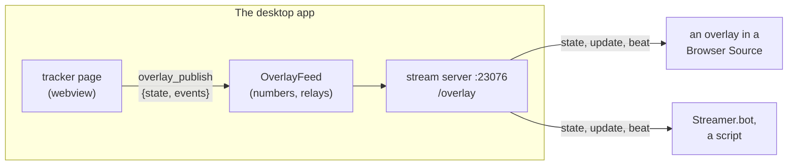
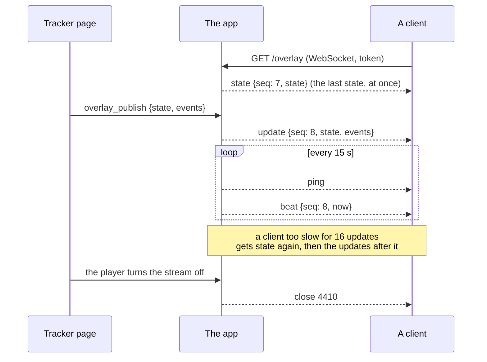

# Overlay API

The desktop app tells stream tools what the run holds, and when it changes, over a WebSocket: a custom overlay in an OBS Browser Source, Streamer.bot, a script. It is for a streamer who wants their own graphics (a "Hookshot!" banner, a boss counter, a timer in their font) instead of the stream view's item grid, which stays the way to show the grid itself ([Stream tools](desktop.md#stream-tools)).

It is a route of the stream's server, not a server of its own: the same port (23076 first), the same switch, the same loopback-by-default rule. It is race-safe by construction: it carries a short whitelist of the run, never the run.



The page, not the app, decides what a stream may see: each game's whitelist (`apps/web/src/games/<id>/overlay.ts`) reads the items, the bosses, the timer and the go mode off its run, and `apps/web/src/overlay/diff.ts` turns two readings into events. The app numbers what the page hands it and relays it; it never reads the run.

## Turn it on

1. In the desktop app, open **Stream tools** (the toolbar's **Stream view** button) and turn on **Serve the stream view to OBS**. The overlay API is on while that switch is, and stays on across launches like the stream does.
2. Copy the **Overlay API address** the dialog shows: `ws://127.0.0.1:23076/overlay?token=…`.
3. Paste it into the tool.

For a tool on another computer, tick **Allow other devices on the network** and use the second address the dialog shows (`ws://<this computer's address>:23076/overlay?token=…`); the firewall must let Rando Atlas through, and anyone on the network with the address can read what the API says. The API follows the stream's switch for the network: loopback only unless you allow it.

**New addresses** (behind a confirmation) replaces both tokens, the stream view's and the API's: every client is closed with 4410 and the old address now gets 4401.

The app must be open on the run. The API tells what the tracker's page publishes: with the window closed there is nothing to tell, and a client that connects before the page's first publication gets only beats until it is there.

### The token

The API has its own token, never the stream view's: the view's token is refused on `/overlay` (4401), the API's on `/follow`. Give it in the address (`?token=`), or as a WebSocket subprotocol, `alltp.<token>`, which keeps it out of the address a browser logs when a connection fails:

```js
new WebSocket("ws://127.0.0.1:23076/overlay", ["alltp." + token]);
```

An OBS Browser Source writes its page's console errors to OBS's log, and streamers share those logs to get support: a page of yours should use the subprotocol. A tool that takes only an address (Streamer.bot) takes the `?token=` form.

### Mixed content

A page served over `https://` cannot open a `ws://` address on another machine: the browser blocks it as mixed content, and no setting of the app changes that. The usual case has no such problem: a Browser Source on the same computer opens a local file or an `http://` page and connects to `ws://127.0.0.1:23076`. Chromium (so OBS's browser) and Firefox treat loopback as a secure origin, so even an `https://` page may connect there; a page hosted on `https://` meant for a second computer cannot, and should be served over `http://` on the local network.

## What is never sent

The whitelist is the whole of what the API says. Never, in any game:

- the locations checked, chests left in a dungeon, and the checks' logic;
- prizes (pendants, crystals, rewards) and which medallion a dungeon asks for;
- entrances, and where the player noted they lead;
- the run's settings, preset, goal text, seed and hash;
- small keys, big keys, maps, compasses and SMZ3's keycards;
- shops.

What it does say, per game: the items the board's grid shows, the bosses beaten (and the seed's objectives for Super Metroid), the run timer (A Link to the Past), and where the run stands against its go mode (A Link to the Past). A test per game (`apps/web/src/overlay/safety.spec.ts`) fills a run with all of the above, compares the reading with the one of a run without them, and pins the ids below: adding to the whitelist is a decision that shows in a diff.

## Frames

Every frame is one JSON text message. `v` is the protocol's version (1), `type` the kind, `seq` the number of the publication it carries.



| Frame | When | Fields |
|---|---|---|
| `state` | on connect (once the page has published), and after a client fell behind | `v`, `type`, `seq`, `state` |
| `update` | each publication: the new state and what changed | `v`, `type`, `seq`, `state`, `events` |
| `beat` | every 15 s, with the ping | `v`, `type`, `seq` (the last), `now` |

```json
{"v":1,"type":"update","seq":8,"state":{"game":"alttpr","items":[…],"objectives":[…],"timer":{"state":"running","elapsedMs":0,"startedAt":1789000000000},"goMode":"no"},"events":[{"type":"item","id":"hookshot","name":"Hookshot","level":1,"previous":0,"ms":83211}]}
```

`seq` starts at 1 with the app and counts publications; there is one sequence for all clients. A client sees them in order and never twice: a client that reads `seq` going back or repeating can drop the frame. A `beat` carrying a `seq` ahead of the last one the client saw means it missed an update (it is behind a slow socket, and a `state` is on its way). `state` and `update` carry the whole state: a client needs the events only for what a state cannot say (a flash, a sound), and can ignore them.

### State

| Field | Meaning |
|---|---|
| `game` | `alttpr`, `sm` or `smz3` |
| `items` | each item of the game's list, held or not: `{id, name, level, max}`. `level` is 0 when not held, up to `max` |
| `objectives` | the goals: `{id, name, done, ms}`. `ms` is the run timer's reading when it was done, `null` when unknown |
| `timer` | `{state, elapsedMs, startedAt}`, or `null` for a game with no timer. `state` is `idle`, `running`, `paused` or `finished` |
| `goMode` | `yes` (every step in logic), `maybe`, `no`, or `null` |

`goMode` is `null` when the game has none (Super Metroid, SMZ3), for a goal without one (all dungeons, triforce hunt), while a Mystery run's goal is not known, for a run whose logic the tracker does not model, and, for a run with shuffled entrances, until its solver has loaded (it is then recomputed at the next change to the run).

### Events

| `type` | Fields | When |
|---|---|---|
| `item` | `id`, `name`, `level`, `previous`, `ms` | an item's level changed (a loss too). `ms` is the run time of the change while the timer counts, else `null` |
| `objective` | `id`, `name`, `done`, `ms` | a boss or objective was done, or undone |
| `timer` | `action`: `start`, `pause`, `resume`, `finish`, `reset` | the run timer changed state |
| `goMode` | `goMode`, `previous` | the go mode changed |
| `reset` | | the run fell back to its start: a new game |

Rules (`diffOverlay`): one event per item that changed, then the objectives, the timer, the go mode; none on the first publication of a page, nor when the game changed (the state says it all). Changes inside one 250 ms window are one publication: an item given and taken back inside it is no event. A run that falls back to its start in one publication, with more than one thing changed, is one `reset` and nothing else; a single thing undone is its own event. **A run type that starts with items never reads as fresh**, so a new game on it gives a loss per item instead of a `reset`.

A new event type can appear in version 1 (see "Compatibility"): ignore a type you do not know.

### The timer

The state holds the timer as data, not as a time that goes stale. While it runs, the time is `elapsedMs + (now - startedAt)`, where `now` is **the app's clock**. On the same computer it is yours. On another, a `beat` carries the app's `now` every 15 s: keep the difference to your own clock and count with it.

```js
let skew = 0; // your clock minus the app's, from the last beat
const timeMs = (timer) =>
  timer.state === "running"
    ? timer.elapsedMs + (Date.now() - skew - timer.startedAt)
    : timer.elapsedMs;
// on a beat: skew = Date.now() - frame.now;
```

## Ids per game

A level is the tracker's own. Where SMZ3 has an item A Link to the Past has, the id is SMZ3's, so an overlay written for one works for the other's Zelda items.

**A Link to the Past**, 29 items in the grid's order. `level` counts as the tracker does: the bow and the boomerang are masks of what is held (bow: 1 silver arrows, 2 bow, 3 both; boomerang: 1 blue, 2 red, 3 both), `halfMagic` is 0 or 1, the `tunic` starts at 1 (green mail) and goes to 3, the bottles count from 0 to 4, the sword from 0 to 4, the shield to 3, the glove to 2.

| Ids |
|---|
| `flute` `hookshot` `hammer` `firerod` `icerod` `boomerang` `net` |
| `bow` `lamp` `shield` `sword` `tunic` `halfMagic` `boots` |
| `shovel` `book` `quake` `bombos` `ether` |
| `powder` `glove` `bottle` `somaria` `byrna` |
| `mushroom` `cape` `mirror` `moonPearl` `flippers` |

Objectives, 12, named by their dungeon as the Run tab's splits are: `boss0` Eastern Palace, `boss1` Desert Palace, `boss2` Tower of Hera, `boss3` Palace of Darkness, `boss4` Swamp Palace, `boss5` Skull Woods, `boss6` Thieves' Town, `boss7` Ice Palace, `boss8` Misery Mire, `boss9` Turtle Rock, `agahnim` Castle Tower, `agahnim2` Ganon's Tower. `ms` is from the run's timeline. The timer and the go mode are those of the Run tab and the go mode button.

**Super Metroid**, 24 items, always the same list (the options that change the grid, Wall Jump Boots and the split Speed Booster, are settings, never sent): `energyTank` `missile` `superMissile` `powerBomb` `bombs` `charge` `ice` `hiJump` `speedBooster` `wave` `spazer` `springBall` `varia` `gravity` `xRay` `plasma` `grapple` `spaceJump` `screwAttack` `morph` `reserveTank` `wallJump` `sparkBooster` `blueBooster`. A pack's `level` counts it (`missile` up to 46); the others are 0 or 1 (`reserveTank` to 4). Objectives are the seed's, by Map Rando's ids (`kraid`, `phantoon`, `draygon`, `ridley`, `sporeSpawn`, `crocomire`, `botwoon`, `goldenTorizo`, …), in the order the player set them. No timer, no go mode.

**SMZ3**, Hyrule's 26 items then Zebes's 19: `sword` `shield` `glove` `bow` `hookshot` `mushroom` `powder` `firerod` `icerod` `bombos` `ether` `quake` `lamp` `hammer` `shovel` `flute` `book` `bottle` `somaria` `byrna` `cape` `mirror` `boots` `flippers` `moonPearl` `halfMagic`, then `charge` `ice` `wave` `plasma` `varia` `gravity` `grapple` `morph` `bombs` `springBall` `screwAttack` `hiJump` `spaceJump` `speedBooster` `missile` `super` `powerBomb` `eTank` `reserveTank`. Objectives are the four boss tokens, `tokenKraid`, `tokenPhantoon`, `tokenDraygon`, `tokenRidley`. The rewards (pendants, crystals) are never sent. No timer, no go mode.

## Close codes

A browser cannot read the HTTP status of a refused WebSocket, so a refusal is an accepted socket closed at once with a code, as for the stream view:

| Code | Reason | The client should |
|---|---|---|
| 4401 | `token`: missing, wrong (the view's token too), or from before **New addresses** | ask the player for the new address, not retry |
| 4410 | `stopped`: the player turned the stream off, changed the network setting, or quit | retry with a backoff: the stream comes back at the same address after a restart or a network change |
| 4503 | `full`: sixteen already hold a seat | retry later |

The 16 seats are the stream's, shared by the Browser Sources and the overlay clients (the dialog's count of sources includes them).

## Liveness

Every 15 s the app pings each client (a browser answers on its own) and sends a `beat`. A client that has not answered the last ping by the next loses its seat, 15 to 30 s after it vanished. On the client's side, no frame in 35 s (two beats) means the connection died: close it and open a new one.

## Compatibility

Version 1 only ever grows:

- a new field on a frame, a state, an item, an objective or an event can appear: **ignore what you do not know**;
- a new event `type` can appear: ignore a type you do not know;
- an id, once given, keeps its meaning; a new item appears at the end of its game's list;
- a change a client must know about (a field's meaning, a frame or an id removed) bumps `v`, and the old version is documented here until the app stops sending it.

Read `v` on each frame and ignore a frame whose `v` you do not know rather than guess.

## Limits

- **Read-only.** Whatever a client sends is read only to answer pings and see it leave; frames over 4 KiB close the socket.
- **16 seats**, shared with the Browser Sources of the stream view.
- **One publication per 250 ms at most**: a burst of changes (autotracking's first sync, an undo held down) is one update with all its events. The app keeps 16 updates for a slow client; one further behind gets `state` again, and the updates it skipped are not replayed.
- **What the page sends the app is bounded** (the whitelist is a few kB): a state or an events list over 64 KiB, or that is not a JSON object and array, is refused and nothing is relayed.
- **The tracker's page publishes**, so the app must be open on the run. With the stream on and no page yet (the app just launched), clients get beats and no state.
- **Loopback by default**, and plain `ws://`: see "Turn it on" and "Mixed content".

## A minimal overlay

An HTML page that lists what the run holds and shows the timer. Save it as `overlay.html`, add it to OBS as a *Browser Source* with *Local file* ticked, and open it with the API's token, `overlay.html?token=…` (the dialog's address has it after `token=`), or put the token in `TOKEN` below:

```html
<!doctype html>
<meta charset="utf-8" />
<body style="font: 20px sans-serif; color: white; background: transparent">
  <div id="timer">0:00</div>
  <ul id="items"></ul>
  <script>
    const params = new URLSearchParams(location.search);
    const TOKEN = params.get("token") ?? "";
    const ADDRESS = `ws://127.0.0.1:${params.get("port") ?? 23076}/overlay`;
    let state = null;
    let skew = 0;

    const timeMs = (timer) =>
      timer.state === "running"
        ? timer.elapsedMs + (Date.now() - skew - timer.startedAt)
        : timer.elapsedMs;
    const clock = (ms) => {
      const s = Math.floor(ms / 1000);
      const two = (n) => String(n).padStart(2, "0");
      return `${Math.floor(s / 3600)}:${two(Math.floor(s / 60) % 60)}:${two(s % 60)}`;
    };

    function show() {
      if (!state) return;
      document.getElementById("items").replaceChildren(
        ...state.items
          .filter((item) => item.level > 0)
          .map((item) => Object.assign(document.createElement("li"), {
            textContent: item.max > 1 ? `${item.name} ${item.level}` : item.name,
          })),
      );
    }
    setInterval(() => {
      if (state?.timer) {
        document.getElementById("timer").textContent = clock(timeMs(state.timer));
      }
    }, 100);

    function connect() {
      const socket = new WebSocket(ADDRESS, ["alltp." + TOKEN]);
      let last = 0;
      let watchdog;
      const arm = () => {
        clearTimeout(watchdog);
        // No frame in two beats: the connection died
        watchdog = setTimeout(() => socket.close(), 35_000);
      };
      arm();
      socket.onmessage = ({ data }) => {
        arm();
        const frame = JSON.parse(data);
        if (frame.v !== 1) return;
        if (frame.type === "beat") skew = Date.now() - frame.now;
        if (frame.type === "state" || frame.type === "update") {
          if (frame.seq <= last) return; // seen already
          last = frame.seq;
          state = frame.state;
          show();
        }
        if (frame.type === "update") {
          for (const event of frame.events) {
            if (event.type === "item" && event.level > event.previous) {
              console.log("Found:", event.name);
            }
          }
        }
      };
      socket.onclose = ({ code }) => {
        clearTimeout(watchdog);
        if (code !== 4401) setTimeout(connect, 2_000); // 4401: the address is out of date
      };
    }
    connect();
  </script>
</body>
```

Try the same stream from a terminal with [websocat](https://github.com/vi/websocat):

```sh
websocat 'ws://127.0.0.1:23076/overlay?token=<the API token>'
# or, without the token in the address:
websocat --protocol 'alltp.<the API token>' ws://127.0.0.1:23076/overlay
```

It prints a `state` frame at once, an `update` for each change (click an item in the app), and a `beat` every 15 s.

## Where it lives

| What | Where |
|---|---|
| The route and the feed | `apps/desktop/src-tauri/src/overlay.rs` (numbers, relays, the beat), served by `stream.rs` |
| The command the page publishes with | `overlay_publish` (`lib.rs`): `{state, events}` as JSON text, each at most 64 KiB |
| The protocol's types | `apps/web/src/overlay/protocol.ts` |
| The whitelists | `apps/web/src/games/{alttpr,sm,smz3}/overlay.ts` |
| The events | `apps/web/src/overlay/diff.ts` |
| The publisher, and the stream's hold on it | `apps/web/src/overlay/publish.ts`, `apps/web/src/desktop/overlayFeed.ts` |
