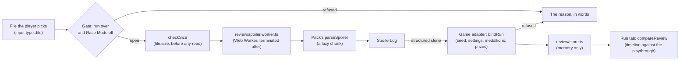
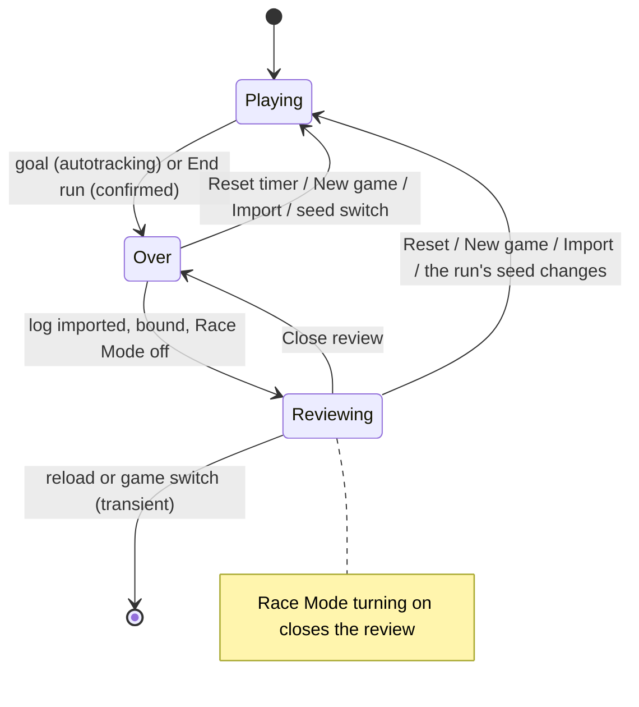

# Reviewing a finished run

Once a run is over, the player can import the seed's spoiler log and see the board and the Run tab
against it. This document is the design: when a review may open, how a log is read and bound to
the run, where it lives, and what ALttPR's Run tab and SMZ3's Review tab compare. What players see is
in the [guide](guide.md#reviewing-a-run); the log formats and the model are the packages'
([`@alltp/spoiler`](../packages/spoiler/README.md), the ALttPR pack's
[Spoiler logs](../packs/alttpr/README.md#spoiler-logs), the SMZ3 pack's
[Spoiler logs](../packs/smz3/README.md#spoiler-logs)).

**A Link to the Past**, **Super Metroid** (Map Rando) and **SMZ3** review today. The shared parts (`apps/web/src/review/`,
`components/ui/Review*.tsx`) take a game's adapter. [Super Metroid's review](#super-metroid-map-rando) goes place by place for a run autotracking followed (the collected bits and their times) and by count for one tracked by hand; [SMZ3's](#smz3) has the places but no times.

## The gate

A review opens only when the run is **over** and **Race Mode is off** (`review/gate.ts`).

- **Over** is the run timer's `finished`: autotracking stopped it at the goal, or the player used
  **End run** (the shared `components/ui/RunTimer.tsx`, a `ConfirmDialog` that opens on Cancel,
  "End this run?"). End run is offered while the timer counts or is paused; it is final, so peeking
  at a spoiler costs the player their timer, and the board never shows one while a run is live (a
  stream of the window included).
- **Race Mode** is `isRaceModeOn` (`autotrack/raceMode.ts`, shared with the seed import): the
  player's "always on", the race flag of the game last read, or a connected session whose status
  says race. It refuses even a finished run, and turning it on closes an open review.

`useReview` (`games/alttpr/review/useReview.ts`) returns the review only while the gate stands open
and the run is still on the seed it was bound to, so a stale review never shows for a frame;
`useCloseReview`, mounted once by the board, then drops it from the store.

## Reading a file

`review/read.ts` checks the size on `file.size` (`checkSize`: 1 MiB for ALttPR) before a byte is
read, then posts the `File` (a handle: cloning copies nothing) to a module worker. The worker
(`review/spoiler.worker.ts`) reads the text, loads the game's parser as a chunk and answers with the
`SpoilerLog`; the page terminates it after the one answer, or after 30 s. The page never holds the
text. Where there is no `Worker` (jsdom), the same `parseFile` runs in place. Nothing in the
parser throws on a file's content: every reason not to show it is a refusal, worded by
`review/words.ts`.

The worker and its chunks are named `review-*` (`worker.rollupOptions` in `apps/web/vite.config.ts`)
and listed `onDemand` in the service worker, so no install downloads them. A pack's parser loads
through its own entry (`@alltp/pack-alttpr/spoiler`, `@alltp/pack-smz3/spoiler`: the pack's
`./spoiler` export), never the pack's index, which the board imports: a dynamic import of a module
the board already holds lands in the board's chunk, which then carries the parser for every player.
The ALttPR parser's chunk holds the pack's location tables (`known.ts` reads the three worlds' regions
to check names): about 255 kB (51 kB gzip), fetched once, the first time a log is imported; out of
the board's chunk, it took 105 kB off what the ALttPR board downloads at start. Slimming it means a generated
list of location ids in the pack; it has not been worth its keep yet.

## Binding the log to the run

`bindRun` (`games/alttpr/review/adapter.ts`) gives `@alltp/spoiler`'s `bindSeed` the evidence and
follows its rule: **refuse on any contradiction, verified when the seeds are equal, otherwise
"not verified" with the note shown**.

| Evidence | Run | Log |
|---|---|---|
| Seed | `Progress.seed` (the ROM's `VT <hash>`, or the seed the run started from) | the seed file's `hash`, or the `_<hash>` in the file's name (said "matched by its file name") |
| Settings | the run type's compared settings, through the seed import's `checkSeed` | the log's `meta`, read as a seed file's |
| Medallions | the board's two pads, when set | `Special` |
| Prizes | each dungeon's reward, when set | `<Dungeon> - Prize` |

A mystery run's hidden settings are not compared. A run that knows no seed (tracked by hand) or a
log that names none (a renamed file) opens "Not verified", with how many settings agreed.

## Memory only

The review is `useReviewStore` (`review/store.ts`): Zustand, no `persist`. It is not in
`localStorage`, an export, a shared link, the stream view, the overlay API or live follow, all of
which read the game's own store or storage; a spec asserts the saved run, the link and storage are
the same after an import, and that none of those modules imports the review. A reload drops it.

## The Run tab

`compareReview` (adapter) turns the run's timeline into `@alltp/spoiler` finds and sets them against
the playthrough with `compareRun`:

- a `check:<location>` is a find at that location; an `item:<id>:<level>` is a find of that pack item
  (`PACK_ITEMS`; a progressive item's levels are one more of it each); a boss beaten (`item:bossN:2`)
  is a find at the dungeon's boss and prize locations;
- a check and the item it gave, stamped at one instant (autotracking lays a reading's news at
  one), are **one** find, so the item is not matched again by its order;
- a find with a location matches that placement exactly; an item found with no location matches
  the k-th placement of that item in sphere order, marked "by item order";
- **late** is `compareRun`'s `behind`: placements of later spheres found before this one. The
  playthrough lists items by the sphere where they become reachable, so a late item means another
  route (a shortcut, a trick, a different order), not a mistake.

What the board cannot tell is **unknown**, never missed: locations it does not track (the bottles,
the medallion pads, Ganon) and a dungeon's checks when only its counter was kept (a manual run, a
race: autotracking checks them one by one otherwise). A dungeon the counter finished reads "done,
no time recorded". The Missed list names the rest with what they held, required items first, and
says how many items a counted dungeon has left.

The tab shows the table (Sphere, Item, Where, Found, Note, with a caption "12 required items:
9 in order, 2 late, 1 missed"), the Missed list and the seed's facts (medallions, prizes, starting
items, bosses when shuffled). An entrance randomizer log reads the same way; its real entrance
connections are not shown yet. The timeline's `check:` rows gain "→ the item held".

## The board

While a review is open (`games/alttpr/review/labels.ts`) the board shows what each place held, and nothing changes outside one: every hook answers null and the components render as before.

- **Markers.** A location marker (not a dungeon's square) gains `data-held`, the most notable item it held as a small image on its corner (`--held`, drawn by `::before`, `image-rendering: pixelated`), and `data-review` `found` or `missed`: a solid ring when every location it stands for is checked, a dashed one when not, so the state is a shape as well as a colour. Its accessible name ends with the words, "Held: Bug Catching Net, Magic Powder and 3 more; not all checked". The image is decoration (the CSS draws it, the name says it).
- **Checks.** Each row names the item after the check, inside the checkbox's label so a screen reader hears it with the check, with its image; **Missed only** (shown in a review only) lists every unchecked check, over the state filters.
- **Grid.** A cell's name says where its item was: "Hookshot, at Eastern Palace - Map Chest", or "4 places: …" for a progressive item; the tooltip says it too (`Seed: …`). A marker's tooltip adds "→ item" to each location.
- **Notable first.** Items sort required (in the playthrough) > progression or prize > dungeon item > the rest; the first is the one drawn. Progressive items are drawn at their first level, which is the one a find of them gives.

The labels are worked out once per review (`labelsOf`, a `WeakMap` over the immutable `Loaded`) and read with `useReviewStore` selectors that return the same object until the review changes, so a review costs the board nothing past its first paint.

## Files

| File | Role |
|---|---|
| `apps/web/src/review/gate.ts`, `store.ts`, `read.ts`, `parse.ts`, `spoiler.worker.ts`, `words.ts` | Gate, memory store, bounded read in a worker, the parse, the sentences |
| `apps/web/src/autotrack/raceMode.ts` | Race Mode for any game's autotracking state |
| `apps/web/src/components/ui/ReviewDialog.tsx`, `ReviewNotice.tsx` | The import dialog and the standing banner |
| `apps/web/src/games/sm/review/` | `adapter.ts` (binding, the board's items against the seed's, places by item), `useReview.ts`, `fixtures.ts` (specs) |
| `apps/web/src/games/sm/components/` | `SmReview.tsx` (Review run beside the timer, the banner, the section), `SmReviewDialog.tsx` and `SmReviewResult.tsx` (lazy) |
| `apps/web/src/games/alttpr/review/` | `adapter.ts` (binding, finds, comparison), `useReview.ts`, `labels.ts` (what each place held), `fixtures.ts` (specs) |
| `apps/web/src/games/alttpr/components/map/` | `ReviewSection.tsx` (Review run, the Run tab section), `ReviewResult.tsx` (lazy), `AlttprReviewDialog.tsx` (lazy) |
| `apps/web/src/games/smz3/review/` | `adapter.ts` (binding, comparison), `labels.ts` (what each place held), `useReview.ts`, `fixtures.ts` (specs) |
| `apps/web/src/games/smz3/components/` | `Smz3ReviewButton.tsx` (Review run, the banner), `Smz3ReviewDialog.tsx` (lazy), `Smz3ReviewPanel.tsx` (the tab, lazy), `Smz3Maps.tsx`, `Smz3Grid.tsx` |
| `apps/web/src/review/active.ts` | Which review is a game's own run's, and the rule that drops a stale one (each game's hooks call it) |
| `apps/web/src/games/review.css` | The styles, loaded by the module of each game that reviews |

## Super Metroid (Map Rando)

The same gate, store and read as ALttPR's (`games/sm/review/useReview.ts`; the timer's **End run** is
the shared `GameRunTimer`'s `endable`, which SMZ3 leaves off until it reviews). Race Mode is
`isRaceModeOn` over the autotracking store with no reading: Map Rando has no race flag in the ROM, so
it is the player's choice or a session that says race.

```mermaid
flowchart LR
  file["spoiler.json<br/>(about 21 MB)"] --> size["checkSize(sm): 64 MiB<br/>on file.size, before any read"]
  size --> worker["Web Worker<br/>file.text()"]
  worker --> sniff["sniffSpoiler (head, name)"]
  sniff --> slice["sliceTopLevel:<br/>7 keys, about 39 KB kept"]
  slice --> parse["parseSpoiler (zod/mini)"]
  parse --> log["SpoilerLog + MapRandoExtra"]
  log -- structured clone --> bind["bindRun: mapRandoEvidence"]
  bind --> store["review/store.ts (memory)"]
  store --> board["Review section, grid cells' names"]
```

- **Reading.** The file is read where the page cannot freeze: the worker decodes it (`file.text()`),
  `sliceTopLevel` keeps `all_items`, `summary`, `objectives`, `start_location` and the three pack
  sizes without building the rest (`details`, `game_data` and the traversals are 99.8 % of it), and
  only the log, about 15 KB, crosses back. The real 20 MB file of seed `dsjF6gGsH` reads in 70 ms
  from picking the file to the review standing (Chromium on the desktop; 123 ms with the page's CPU
  throttled 6 times), the page's longest frame 17 ms (33 ms throttled). The size bound is the log's
  own: 64 MiB (`MAX_SPOILER_BYTES`), where ALttPR's is 1 MiB; a file over it is refused before a
  byte is read. The pack names another randomizer's file by its head and name (`other-game`,
  `unsupported`, a ROM), as the other packs do.
- **Binding is never "verified".** Map Rando's file names no seed, so `bindRun` gives
  `mapRandoEvidence` (`packs/sm`) no seed id and the banner always says "Not verified: Map Rando's log
  names no seed". It refuses on the facts both sides state: the same set of objectives, the Wall Jump
  Boots and the split Speed Booster the seed placed against the run's. The board's objectives and
  options start at a default that a player tracking by hand never declared (the four bosses, no extra
  item), which would contradict any other seed, so a run states them only when the ROM did
  (autotracking read the seed, so the run knows its name) or when the player moved them off the
  default (`runStatements`). "The run holds more of an item than the seed placed" is no refusal: Map
  Rando's starting items are not in the log's placements.
- **What the run knows of its places.** Map Rando keeps one bit per item location in WRAM
  (`$7E:D870`, 20 bytes; `item_count.asm`), which the patcher never moves: the bit of a location is
  the argument of its item's PLM in the vanilla ROM, so a static 100-row table
  (`packs/sm/src/locations.ts`, generated by `packs/sm/scripts/locations.mjs` from sm-json-data's item nodes
  and the vanilla ROM, held to the real log's `all_items` by `locations.spec.ts`) maps the log's
  `room_id:node_id` to its bit. A location holding **Nothing** has its bit set from the first frame
  (`new_game.asm` copies the ROM's mask at `$B5:FE12` into it), so the decoder applies Map Rando's own
  `bits & ~mask` (`decodeCollected`; the two ranges are polled at one cadence, so a reading takes the
  mask and the bits from the same tick, and a mask the bits do not cover, which a running game never
  shows, is the menus' leftovers or another ROM's and reads as "not read"): the run never holds a
  Nothing location, and neither an export,
  a shared link, live follow, the stream view nor the overlay can say where the seed put none. Both
  ranges are category `locations`, forbidden in Race Mode: it reads nothing of them, `found`
  stays empty and the review goes by count (and a review stays closed in Race Mode anyway). Map
  Rando's ROM has no race flag, so Race Mode is the player's switch, turned on for a race; Auto
  leaves it off, and a race tracked in Auto is read as any other run. The
  follower (`games/sm/autotrack/follow.ts`) adds each location newly seen collected to the run's
  `found` with the stamp (`games/stamp.ts`: the instant and the run timer's reading) of that reading,
  as the game's news (no undo step, never taken back, never re-dated). A location already collected
  when autotracking connects mid-run is dated by that moment, not by the pickup: the review says so.
  What the rig showed (RetroArch, bsnes-mercury, seed `dsjF6gGsH`): picking up three items by the
  game itself set exactly the table's bits, and the production build, connected to the real SNI,
  stored the three locations in `found` with the timer's reading when each was taken; importing the
  seed's log then listed them "Found at 1:01", "1:15" and "1:24" and every other place "Not
  found". Not seen in a running game: a seed with Nothing
  locations (none of the four seeds checked had any), which the unit tests and Map Rando's source
  (`patch.rs:853-856`, `new_game.asm:121-128`, `item_count.asm:126-128`) cover.
- **What it shows.** Two modes, told by `ReviewComparison.mode` and the section's first paragraph
  (`review-mode`). **By place**, once the run's `found` is not empty and agrees with the board
  (`compareItems`: every single item the board holds has its place among those found; an item
  held that the seed did not place, a start's, asks nothing): every placement is found, with
  its time ("Found at 12:34", "Found" when the timer had not started), or not ("Not found"), the
  tank and pack types count the places found of those placed, and each place of the by-area
  disclosure says which. **By count**, for a run tracked by hand (or in Race Mode), and for a run whose `found` is partial
  (`ReviewComparison.partial`: the board holds a single item whose place autotracking did not see,
  because Race Mode was on for part of the run or the player marked it by hand; a place called
  missed that the player took would be a false verdict), which says so in the section's first
  paragraph: the board keeps
  counts of items, which cannot say which location was taken, so the review says what the spoiler
  says against what the board holds, and no more. `compareItems` (`adapter.ts`), by count:
  - the single items (held or not) with the room, node and area the seed put them in and their
    **step**, Map Rando's own word for a round of its playthrough (`summary[].step`: the item is
    where it first becomes reachable); those the board never held first (Never found), then the
    playthrough's order;
  - each pack and tank type, held against placed ("Missiles: 30 of 46 held, 16 never found"), with a
    disclosure of every one's place by area; a count above what was placed is a starting item, not a
    find that was missed;
  - the seed's facts: start, objectives, what a pack gives;
  - in the grid, each cell's accessible name and tooltip end "In the seed: <room: node (area)>." or
    "In the seed: N places." Nothing changes without a review.
  By count it cannot say which location a find came from nor when, and does not guess. By place the
  board's counts are ignored: the places are what the run found.
- **Where.** The banner (`SmReviewNotice`) sits over the board, the section (`SmReviewResult`, a lazy
  chunk) under it, **Review run** beside the timer (`SmReviewButton`); the dialog is the shared
  `ReviewDialog`. Memory only, as above (the run's `found` is the run's own and travels with it, the log never does): a spec holds the modules that save, share, stream or follow
  a Super Metroid run never to import the review.

## SMZ3

SMZ3 shares the gate, the store, the dialog and the banner; its adapter is `games/smz3/review/`.

- **Binding** (`bindRun`): the run's `seed` is the seed's guid, which autotracking records from the
  ROM outside Race Mode (`$80:FF60`, the pack's README); the log's is `Meta.guid`, so a verified
  review says "matched by its guid". A run tracked by hand has none and opens "Not verified", with
  how many facts agreed. Facts compared: Super Metroid's logic, keysanity, the crystals Ganon's
  Tower and Ganon ask for, the bosses Tourian asks for, and each pad's medallion once the board
  knows it. The log carries no prize per dungeon on the board's terms (it counts rewards found), so
  rewards are not compared.
- **No timeline, so no "found at".** SMZ3's store keeps `checked` but no stamps, and its board has
  no Run tab. The review therefore compares *what* was checked, not *when*: `compareReview` sets the
  run's `checked` against the log's placements and lays the playthrough's spheres beside them for
  reference (a sphere is how soon the seed's logic reaches a place, not the order the player took).
  Nothing says "late" or "in order"; the Review tab says so in its first line. A timeline for SMZ3
  and Super Metroid is a separate series, after which the shared comparison (`compareRun`) lights up
  for them.
- **The Review tab** (`Smz3Maps`, a third tab while a review is open, selected when it opens and
  dropped when it closes): a summary (places checked of the seed's, of those the playthrough needs),
  the playthrough as a `<table>` (Sphere, Place, Held with the item's picture, Your run), the places
  not checked grouped by the file's regions with what they held (a region holding a place the
  playthrough needs starts open), and the seed's medallions and rewards. `Smz3ReviewPanel` is a lazy
  chunk.
- **On the board** (`review/labels.ts`, precomputed once per review in a `WeakMap`; `useMarkerHeld`
  and `useItemPlaces` answer null outside a review): a marker of Hyrule or Zebes draws the most
  notable item it held (`--held`, an ALttPR asset, or `data-held="sheet"` and `--frame` for a frame
  of Super Metroid's sheet, drawn by `::before`), rings itself solid when all its places are
  checked and dashed otherwise, and ends its accessible name with "Held: …; all checked" or "not
  all checked". A grid cell adds "In the seed: at <place>" or "N places: …" to its name and a
  `title`. Notable means: in the playthrough, then an item with a grid cell, then a dungeon key,
  then the rest (rupees, maps, compasses…), which have no picture.
- **The parser's chunk.** `review/parse.ts` loads `@alltp/pack-smz3/spoiler` (`src/spoiler/parse.ts`),
  never the pack's index, as ALttPR's ([Reading a file](#reading-a-file)): through the index,
  js-yaml would be in the board's own chunk. The vite build gives that chunk
  the worker's `review-` name (`chunkFileNames`) so the in-place read (no `Worker`) is as on
  demand as the worker's; the shell stays at 17 files, 335 kB.
