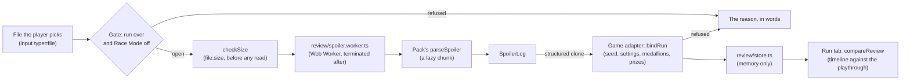
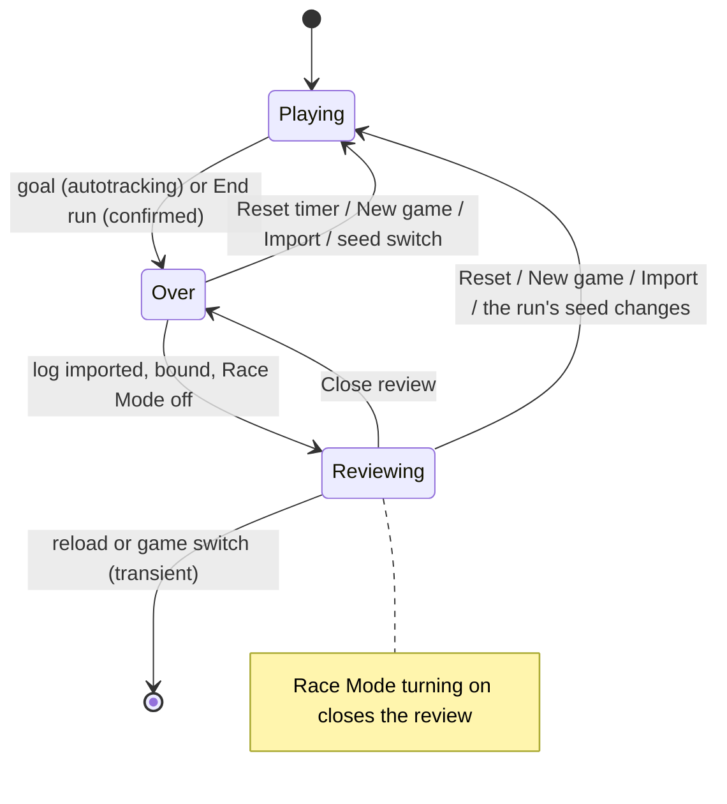

# Reviewing a finished run

Once a run is over, the player can import the seed's spoiler log and see the board and the Run tab
against it. This document is the design: when a review may open, how a log is read and bound to
the run, where it lives, and what ALttPR's Run tab compares. What players see is in the
[guide](guide.md#reviewing-a-run); the log formats and the model are the packages'
([`@alltp/spoiler`](../packages/spoiler/README.md), the ALttPR pack's
[Spoiler logs](../packs/alttpr/README.md#spoiler-logs)).

Today only **A Link to the Past** reviews. The shared parts (`apps/web/src/review/`,
`components/ui/Review*.tsx`) take a game's adapter; SMZ3 and Super Metroid join them later.

## The gate

A review opens only when the run is **over** and **Race Mode is off** (`review/gate.ts`).

- **Over** is the run timer's `finished`: autotracking stopped it at the goal, or the player used
  **End run** (the shared `components/ui/RunTimer.tsx`, a `ConfirmDialog` that opens on Cancel,
  "End this run?"). End run is offered while the timer counts or is paused; it is final, so peeking
  at a spoiler costs the player their timer, and the board never shows one while a run is live (a
  stream of the window included).
- **Race Mode** is `isRaceModeOn` (`autotrack/raceMode.ts`, shared with the seed import): the
  player's "always on", the race flag of the game last read, or a connected session whose status
  says race. It refuses even a finished run, and turning it on closes an open review.

`useReview` (`games/alttpr/review/useReview.ts`) returns the review only while the gate stands open
and the run is still on the seed it was bound to, so a stale review never shows for a frame;
`useCloseReview`, mounted once by the board, then drops it from the store.

## Reading a file

`review/read.ts` checks the size on `file.size` (`checkSize`: 1 MiB for ALttPR) before a byte is
read, then posts the `File` (a handle: cloning copies nothing) to a module worker. The worker
(`review/spoiler.worker.ts`) reads the text, loads the game's parser as a chunk and answers with the
`SpoilerLog`; the page terminates it after the one answer, or after 30 s. The page never holds the
text. Where there is no `Worker` (jsdom), the same `parseFile` runs in place. Nothing in the
parser throws on a file's content: every reason not to show it is a refusal, worded by
`review/words.ts`.

The worker and its chunks are named `review-*` (`worker.rollupOptions` in `apps/web/vite.config.ts`)
and listed `onDemand` in the service worker, so no install downloads them. The ALttPR parser's chunk
holds the pack's location tables (`known.ts` reads the three worlds' regions to check names): about
280 kB (60 kB gzip), fetched once, the first time a log is imported. Slimming it means a generated
list of location ids in the pack; it has not been worth its keep yet.

## Binding the log to the run

`bindRun` (`games/alttpr/review/adapter.ts`) gives `@alltp/spoiler`'s `bindSeed` the evidence and
follows its rule: **refuse on any contradiction, verified when the seeds are equal, otherwise
"not verified" with the note shown**.

| Evidence | Run | Log |
|---|---|---|
| Seed | `Progress.seed` (the ROM's `VT <hash>`, or the seed the run started from) | the seed file's `hash`, or the `_<hash>` in the file's name (said "matched by its file name") |
| Settings | the run type's compared settings, through the seed import's `checkSeed` | the log's `meta`, read as a seed file's |
| Medallions | the board's two pads, when set | `Special` |
| Prizes | each dungeon's reward, when set | `<Dungeon> - Prize` |

A mystery run's hidden settings are not compared. A run that knows no seed (tracked by hand) or a
log that names none (a renamed file) opens "Not verified", with how many settings agreed.

## Memory only

The review is `useReviewStore` (`review/store.ts`): Zustand, no `persist`. It is not in
`localStorage`, an export, a shared link, the stream view, the overlay API or live follow, all of
which read the game's own store or storage; a spec asserts the saved run, the link and storage are
the same after an import, and that none of those modules imports the review. A reload drops it.

## The Run tab

`compareReview` (adapter) turns the run's timeline into `@alltp/spoiler` finds and sets them against
the playthrough with `compareRun`:

- a `check:<location>` is a find at that location; an `item:<id>:<level>` is a find of that pack item
  (`PACK_ITEMS`; a progressive item's levels are one more of it each); a boss beaten (`item:bossN:2`)
  is a find at the dungeon's boss and prize locations;
- a check and the item it gave, stamped at one instant (autotracking lays a reading's news at
  one), are **one** find, so the item is not matched again by its order;
- a find with a location matches that placement exactly; an item found with no location matches
  the k-th placement of that item in sphere order, marked "by item order";
- **late** is `compareRun`'s `behind`: placements of later spheres found before this one. The
  playthrough lists items by the sphere where they become reachable, so a late item means another
  route (a shortcut, a trick, a different order), not a mistake.

What the board cannot tell is **unknown**, never missed: locations it does not track (the bottles,
the medallion pads, Ganon) and a dungeon's checks when only its counter was kept (a manual run, a
race: autotracking checks them one by one otherwise). A dungeon the counter finished reads "done,
no time recorded". The Missed list names the rest with what they held, required items first, and
says how many items a counted dungeon has left.

The tab shows the table (Sphere, Item, Where, Found, Note, with a caption "12 required items:
9 in order, 2 late, 1 missed"), the Missed list and the seed's facts (medallions, prizes, starting
items, bosses when shuffled). An entrance randomizer log reads the same way; its real entrance
connections are not shown yet. The timeline's `check:` rows gain "→ the item held".

## The board

While a review is open (`games/alttpr/review/labels.ts`) the board shows what each place held, and nothing changes outside one: every hook answers null and the components render as before.

- **Markers.** A location marker (not a dungeon's square) gains `data-held`, the most notable item it held as a small image on its corner (`--held`, drawn by `::before`, `image-rendering: pixelated`), and `data-review` `found` or `missed`: a solid ring when every location it stands for is checked, a dashed one when not, so the state is a shape as well as a colour. Its accessible name ends with the words, "Held: Bug Catching Net, Magic Powder and 3 more; not all checked". The image is decoration (the CSS draws it, the name says it).
- **Checks.** Each row names the item after the check, inside the checkbox's label so a screen reader hears it with the check, with its image; **Missed only** (shown in a review only) lists every unchecked check, over the state filters.
- **Grid.** A cell's name says where its item was: "Hookshot, at Eastern Palace - Map Chest", or "4 places: …" for a progressive item; the tooltip says it too (`Seed: …`). A marker's tooltip adds "→ item" to each location.
- **Notable first.** Items sort required (in the playthrough) > progression or prize > dungeon item > the rest; the first is the one drawn. Progressive items are drawn at their first level, which is the one a find of them gives.

The labels are worked out once per review (`labelsOf`, a `WeakMap` over the immutable `Loaded`) and read with `useReviewStore` selectors that return the same object until the review changes, so a review costs the board nothing past its first paint.

## Files

| File | Role |
|---|---|
| `apps/web/src/review/gate.ts`, `store.ts`, `read.ts`, `parse.ts`, `spoiler.worker.ts`, `words.ts` | Gate, memory store, bounded read in a worker, the parse, the sentences |
| `apps/web/src/autotrack/raceMode.ts` | Race Mode for any game's autotracking state |
| `apps/web/src/components/ui/ReviewDialog.tsx`, `ReviewNotice.tsx` | The import dialog and the standing banner |
| `apps/web/src/games/alttpr/review/` | `adapter.ts` (binding, finds, comparison), `useReview.ts`, `labels.ts` (what each place held), `fixtures.ts` (specs) |
| `apps/web/src/games/alttpr/components/map/` | `ReviewSection.tsx` (Review run, the Run tab section), `ReviewResult.tsx` (lazy), `AlttprReviewDialog.tsx` (lazy) |
| `apps/web/src/games/review.css` | The styles, loaded with ALttPR's module |
