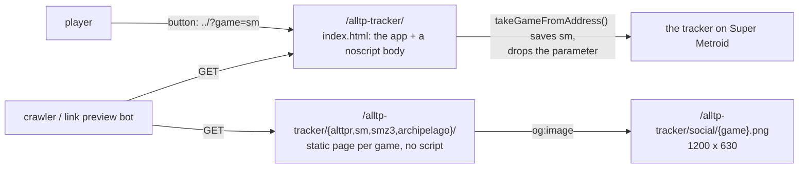

# Search engines and link previews

The tracker is a single-page app: one `index.html`, and the game it shows is picked from the device's storage. A crawler (or a link preview bot) fetches the HTML and runs no script, or runs it with a fresh storage: it would see one page, about the default game. This document says how each game gets an address, a title, a description and a preview image of its own.

## What is served



| Address | What it is | Canonical |
|---|---|---|
| `/alltp-tracker/` | The app. Its static `<head>` is generic (every game); its static body is a short text with a link to each game's page, inside a `<noscript>` (see below). The title is then set for the game tracked (`pageTitle`, `src/games/registry.ts`). | itself |
| `/alltp-tracker/<id>/` | A static page per game, written at build time by `seo/plugin.ts` from `seo/games.ts` (`landing.ts` is the template). No script: what a crawler reads is what a player sees. Its button opens the tracker on that game. | itself |
| `/alltp-tracker/social/<id>.png` | The link preview image (Open Graph and X's large card): a real screenshot of the board. | |
| `/alltp-tracker/sitemap.xml`, `robots.txt` | The app and each game page; allow everything. | |

Why a page per game rather than the app at an address per game: the app picks its game from storage, so a second address would need a second entry point, its own update bookkeeping in the service worker (`sw/plugin.ts` marks `index.html` only) and a game switch that navigates instead of reloading. A static page costs a few kB (each is 4 to 5 kB in the build), needs none of it, and is what a search engine ranks better than an empty shell.

`?game=<id>` (`takeGameFromAddress`) is the link between the two: it saves the game as a switch in the run type dialog does (each game keeps its own run, so nothing is lost), then removes the parameter from the address. It also works as a shareable link to the tracker on a given game.

## Constraints

- **The body of `index.html` is in `<noscript>`, never painted by a browser that runs scripts.** It was a plain `<main>` in `#root` until the tracker mounted, which a reload showed for 100 to 300 ms (more on a slow device) before the board: a flash of other content, and a late-feeling load. A crawler that runs no script, or a browser with scripts off, reads and sees exactly the same text, as `<noscript>` is meant for; one that runs scripts gets the tracker itself, so nothing is hidden from a person to be shown to a robot. `e2e/pwa.e2e.ts` fails if the text is visible at any point of a reload.

- **`robots.txt` is inert on `kqesar.github.io`.** Crawlers read it at the root of a host only; this site lives under `/alltp-tracker/` and there is no `kqesar.github.io` user-site repository to hold one. Without a `robots.txt`, everything is allowed, which is what the file says. The sitemap is valid under the project path (it only lists addresses below it); submit it in the search engines' consoles. The files take effect if the site moves to a domain of its own.
- **Absolute URLs in the tags.** `rel="canonical"`, `og:url`, `og:image` and `twitter:image` carry the full address (`SITE` in `seo/games.ts`): scrapers do not resolve the base path, and the canonical must not depend on how the page was reached. A move to another host changes that one constant, `index.html`, and `public/sitemap.xml`; `e2e/seo.e2e.ts` fails until they agree.
- **Not in the service worker's install.** The game pages, the cards, `robots.txt` and the sitemap are in `uncached` (`vite.config.ts`): no player's offline copy needs them. The desktop build drops the cards, `robots.txt` and the sitemap (`SITE_ONLY`) and has no game pages.
- **The title is not a version marker.** The tracker sets `document.title` for its game, so the update e2e test tells versions apart by the `application-name` meta instead.

## Link preview images

`apps/web/scripts/social-cards.mjs` draws them: it opens the production build in Chromium, clicks a few items so the board shows a run in progress, takes a 1200 x 630 screenshot, and cuts it to 128 colours with ImageMagick (about 500 kB down to 170 kB; the board has fewer colours, so nothing visible changes). Run it again when a board's look changes:

```sh
pnpm --filter @alltp/web build && pnpm --filter @alltp/web preview --port 4173 &
pnpm --filter @alltp/web exec node scripts/social-cards.mjs http://localhost:4173/alltp-tracker/
```

The Archipelago card shows a room: the script answers the board's socket itself (Playwright's `routeWebSocket`) with what AP 0.6.8 sent the bench's tracker on Link (`packages/archipelago/test/fixtures/normal-session.json`), a sixth of the locations checked and a few items given on top, so no server runs.

PNG, not WebP: link previews do not all read WebP.

## Adding a game

Its entry in `GAMES` (`src/games/registry.ts`), its page in `SEO_GAMES` (`seo/games.ts`: name, description of at most 160 characters, features), its address in `public/sitemap.xml`, its link in `index.html`'s body, its `uncached` pattern in `vite.config.ts`, and its card in `social-cards.mjs`. The e2e test covers each of them.
