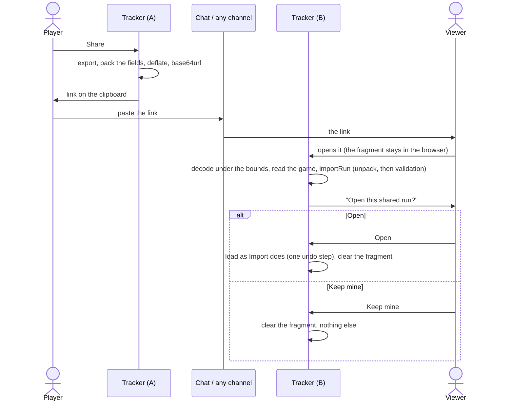
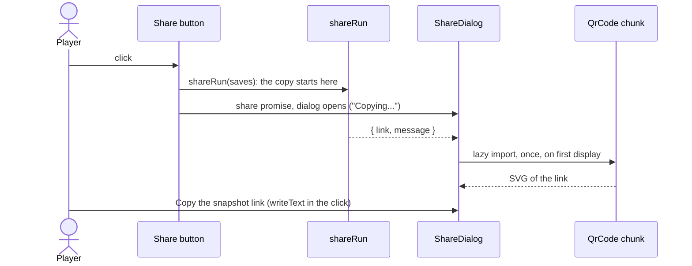

# Sharing a run through its URL

The toolbar's **Share** button copies a link that holds the player's run and opens a dialog that shows the same link as a QR code. There is no server: the run travels in the address's **fragment** (`#run=…`), the part after the `#`, which the browser keeps to itself and never puts in a request. Opening the link asks before replacing anything.

The button is off while Race Mode is on or not yet known to be off (`isRaceModeOrPending`, the overlay API's and live follow's own test): a link carries the places checked and when (`checked`, the timeline's `check:` stamps), which Race Mode keeps from both. Export is off for the same reason; Import is not. In the desktop app the button still opens the dialog in a race, with live follow's switch and a note instead of a link (`ShareDialog`'s `race`; its Copy button stays, `aria-disabled`, so a focus on it is kept). The dialog follows Race Mode as it is now (`useShare`): a link appears, made without a copy since no click is at hand, when Race Mode goes off while it is open, and goes again when it comes back.

## Format

```
https://<site>/alltp-tracker/#run=<base64url( deflate-raw( JSON ) )>
```

The JSON is one of two forms, told apart by its `format`:

- **Plain** (`alltp-tracker-save`, the first version's, and still what Super Metroid writes): what **Export** writes, `{ format, game, version, progress }`. The receiving game reads it with the validation and migrations it already has for a file; a save carries its version, and `migrate` upgrades an old one.
- **Packed** (`alltp-tracker-link`; ALttPR and SMZ3; `link`, the layout version, 3 for ALttPR since its timeline's second layout, 2 for SMZ3): the same object with the fields that dominate its size swapped for bytes indexed by the pack's ordered tables (below), plus the `sizes` of those tables and a `table` digest of their contents. It is expanded back to a plain save before the game's import sees it, so the validation, the migrations and the undo step are the plain form's.

The decoder accepts both; the encoder writes the packed form where a game has one. A link made by any earlier version still opens as it did (`unpackLink` passes a plain save through untouched).

- Compression is the browser's own `CompressionStream("deflate-raw")`: no dependency, a few milliseconds, the same call to read it back. Base64url (`-` and `_`, no padding) needs no escaping in an address.
- `window.location` on the site, the published site's address from the desktop app (`utils/view.ts`, `shareBaseUrl`): the app's own address, `tauri://localhost`, opens nowhere else.

### The packed form

`share/packed.ts` holds the mechanism; each game's `share.ts` (`games/alttpr/share.ts`, `games/smz3/share.ts`) names its fields and their tables. A field travels as base64url bytes inside the JSON (so deflate still sees one text), in `progress` where the plain form has its object or list.

| Field | Game | Packed as |
|---|---|---|
| `checked` | ALttPR, SMZ3 | A bitset over the pack's ordered locations (bit `i` is `locations[i]`): 217 locations are 28 bytes, 316 are 40. The ids are most of a late SMZ3 link, each a distinct string no compression predicts. |
| `items` | ALttPR | Varints over the item table's order (a flag is 0 or 1, a counter its signed value). The key names were the second weight after `checked`. |
| `timeline` | ALttPR | See below. |

**The tables, their sizes and their digest.** A bit or an index means whatever the table's order says it means: a table that gains an entry in the middle shifts every index after it. So the tables are **append-only**: a new location or item goes at the end, and none is moved or removed. The link carries `sizes`, how long each table was when it was made, and `table`, a 32-bit FNV-1a of those prefixes' contents (six base64url characters). The reader cuts its own tables to the link's sizes, rebuilds what depends on them, and compares the digest:

- the digest matches: the link reads against the prefix it was made with. What the link does not hold (an item added since) is left to the game's own import, which gives it the value a fresh run has;
- it does not match (a table reordered, an entry changed or removed), or `link` names no layout version a tracker writes: the link is refused with "This link comes from another version of the tracker" and nothing is changed;
- a size is longer than the tracker's table, or `link` a later version than its codec reads: a newer tracker made it, and it is refused with "This link comes from a newer version of the tracker: reload to update" (below).

**Layout versions.** `link` says how the fields' bytes are laid out. Every codec reads 2, the first packed layout (`LINK_VERSION`); a codec that changes a field's bytes writes the next version (`PackCodec.version`) and reads every one from 2 up to it, its fields built for the link's own (`at(tables, version)`). A save is written in the earliest version whose bytes for it are the latest's (`PackCodec.versionFor`), so a link that gains nothing from a later layout keeps opening in older trackers. ALttPR writes 3 since its timeline's second layout (below), 2 for a save without a find; SMZ3, whose bytes never changed, still writes 2.

**A newer tracker's link.** A link of a later version than the codec reads, or with a table longer than this tracker's (tables only grow, so a newer tracker made it), is refused with its own reason, "This link comes from a newer version of the tracker: reload to update" (`NEWER_VERSION`, `Unpacked.newer`, passed on by the game's `importRun`). The notice then offers **Reload**, which keeps the address: a new version already waiting is taken on the way (`useUpdateStore`'s `apply`), else the page reloads, which fetches the latest release from the network (`sw/sw.ts`), and that one opens the link. Only the player's dismissal clears the address. A tab left open on a release before this one (v2.58.0 and earlier) still says "another version", and its dismissal clears the link: that cannot be changed after the fact.

This is what keeps old links alive when the tracker grows: adding the half magic cell, or a location, no longer breaks a link made before. A table that is reordered or cut still refuses every link made against it, which is the point of the digest. The digest guards against an accident, not against malice: a hostile link can claim any digest, and the game's own validation still judges what comes out.

Where each table's order comes from:

| Table | Order |
|---|---|
| ALttPR locations | The pack's (`MAP_LOCATIONS`). A new location must come after the existing ones; a spec holds the link made before the sizes to it. |
| ALttPR items | `SHARE_ITEMS` in `games/alttpr/share.ts`, written out: the order links first shipped with, which neither the grid nor `data/items.ts` moves. A new item is appended; a spec fails until it is. |
| ALttPR timeline keys | Derived from the items and locations the link was made against, through `isTimelineKey`, so the key table cannot drift from what an import accepts, and an older link's key indices (and the bits each takes) are the ones it was written with. The digest covers them too. |
| SMZ3 locations | The pack's regions' order (`LOCATION_IDS`), appended to as above. |

A link written before `sizes` existed (the first packed links) carries none: it is read as the tables had the sizes `legacySizes` names, and its digest still has to match.

**The timeline** is the heaviest field, a find's key and instant being close to noise. The finds are ordered by instant, each with its key (an index in the key table, in a fixed number of bits: 9 for today's 318 keys), the time since the find before, and its timer reading, stored as its *drift* from the clock (`at - ms`): a timer running straight keeps one drift, so a stretch of finds sharing it is a single *run*; a pause or a stop starts another; `null` (timer not started) is a run of its own. Bits rather than bytes because a varint's continuation bits make deflate's job harder: measured on a late run, byte-aligned varints cost about 1470 characters of the link, the bit block about 1110.

| Layout | Varints | Then bits |
|---|---|---|
| Link 2 (`wholeDriftsField`, read only) | count, first instant, the gaps' Rice parameter, how many runs, then each run: its length, `0` for no reading or `1` and its drift whole (a signed varint of an epoch-sized number: six bytes) | each key, then each gap as a Rice code |
| Link 3 (`compactField`, written) | count, first instant, `k * 2 + shared` (the gaps' Rice parameter, and whether a bit marks a shared instant), the runs' Rice parameter, the drift changes' Rice parameter | each key; each gap as a Rice code, or with `shared`: `0` for the instant of the find before, else `1` and the gap less one; then each run: its length less one as a Rice code, `0` for no reading, or `1` and the change from the last drift written (the first instant before any), zigzagged, as a Rice code |

Link 3 exists because of the timer on the game's clock (`timerClock: "game"`), which every menu, pause or door that stops the game's counter sets again: its runs are short, about three finds each, and link 2 wrote each one's drift whole. Measured on a real autotracked run on the game's clock (October 2026: 83 finds, 28 runs), link 2's timeline cost about 7.2 characters a find, and a late run of about 250 finds passed 2000 characters. A drift's change is a pause: a few hundred milliseconds to a few seconds, a Rice code of about fifteen bits. And autotracking lays a check and the item it gave at one instant, about three finds in ten, which a plain Rice code of the gaps paid as much as any gap; one bit says it when that is shorter (`shared`, the writer's choice per link: a run tracked by hand, its finds a click apart, keeps plain codes). What was considered and left: an Exp-Golomb code for the changes (two bits fewer each, about 30 characters at 270 finds, for a code the bit writer does not have), and coding the key of a check against the `checked` set (a bit a find, tying two fields together). Two runs side by side never share a reading, nor do they in link 3's bytes: a reader refuses them, as it refuses a key twice, so every timeline has one link 3 form.

**Old links keep opening exactly.** Link 2's reader is kept as it was, and `apps/web/src/share/fixtures/links-alttpr-v2.json` holds links its own writer packed (v2.58.0's, commit `1dfb31e1`, the last release to write it for a timeline with finds; their content never changed or regenerated, Biome only orders their keys), each beside the save it was made from: an empty timeline, a run on real time, one on the game's clock, finds before the timer and a reset mid-run, and the largest values a field holds. `games/alttpr/share.spec.ts` opens each and compares the run with its save.

**Link 2 when nothing is gained.** A timeline with no find is one zero byte in both layouts, so a save without a find (a new run, and the short link Share falls back to) is written as link 2 (`versionFor`, the earliest version whose bytes are the latest's for that save): a tracker before link 3 still opens it, and its bytes are those v2.58.0 wrote (a spec repacks its recorded one). Any other save is link 3.

**The seed** (`seed`, the id of the seed the run was played on: alttpr.com's hash, a Map Rando seed name, samus.link's guid; null when unknown) travels in every link, packed or plain, as the plain string every game's save holds. It is not a packed field: a hash is ten random characters and a guid 32 hex digits, which no table indexes and deflate already carries at about their entropy. Packing the guid as 16 bytes would save about 25 characters of an SMZ3 link, not worth a field that must also say null and refuse a seed that is not a guid. A link made before runs kept their seed has none, and opens with the run's seed null.

A save the codec cannot hold exactly (an id the pack does not list, an instant that is not a whole number, a field of another shape) is not packed: it is written plain, which any version opens.

**Bounds.** Everything below is checked at the boundary, before the game's own validation sees the run:

- the payload and inflation bounds above are unchanged: 64 K characters, 1 MiB inflated, and a deflate bomb stops at the limit;
- the envelope is validated with Zod (`format`, `game`, `link`, `table`, `sizes` when present, `progress` an object); sizes are whole numbers, one per table, none longer than the table;
- a packed field is base64url, and its bytes are checked against the table: a bitset is exactly `ceil(n / 8)` bytes with no bit past the table's end; items are exactly one value per table entry, a flag 0 or 1; a timeline has at most one find per key, keys inside the table, no number above 2^50, runs that cover exactly the finds, a Rice parameter of at most 40, and no byte or bit left over. Each read returns "not a tracker run" on any failure, never a partial value.



## Opening a link

`SharedRunPrompt` (`components/ui/`), one of the page's notices in each game's app, never in the stream view:

1. It reads `#run=` when the page loads and on `hashchange`, so a link opened in a tab already on the tracker asks too.
2. `decodeRun` bounds the payload: at most 64 K characters, and at most 1 MiB once inflated. The inflation is read chunk by chunk and stops at the limit, so a deflate bomb (a few hundred bytes that inflate to gigabytes) costs one megabyte at most.
3. The envelope is checked with Zod (`format`, plain or packed, and a `game` among the known ones). The **game's own import** (`importRun` in `games/<id>/module.ts`) then expands a packed link (a link whose tables are not a prefix of this tracker's is refused here) and checks the run with the `parseSave` of Import: ALttPR's `validateProgress` against its tables, Super Metroid's and SMZ3's Zod schemas, counts within their pools.
4. Only then does the notice ask. **Open** loads the run exactly as Import does (one undo step; ALttPR's timer goes idle) and clears the fragment. **Keep mine** only clears the fragment.
5. A payload that does not decode, is not a tracker save, or fails a game's validation shows its reason and "Nothing was changed". Nothing is applied before Open, and the text of a refusal is cut short, since a hostile link controls it. A link a newer tracker wrote adds **Reload**, which keeps the fragment (see "A newer tracker's link" above); the fragment goes only when the player dismisses the notice.

A link for another game is laid in that game's store, then the page loads again on it, as the game picker does (`switchGame`). The undo point does not survive that reload.

## The Share dialog and its QR code

Share does two things in one click, the same in the three games (`components/ui/ShareDialog.tsx`, on the shared `Modal`):

1. **It copies the link at once.** `shareRun` starts the copy before its first `await`: the text goes to the browser as a promise inside a `ClipboardItem` (Safari wants the copy to start in the click and accepts the text a moment later), with `writeText` as the fallback. It returns `{ link, message }`: the link made and the line to tell the player.
2. **It opens the dialog** "Share this run": the line in a `role="status"` region ("Copying…" while the link is made, then copied, copied without the timeline, long-link warning, clipboard refused, or the `RunLinkError` message), the QR code of that very link (same tier, same fallback rule), a line of help (scan it to open the run on another device; a snapshot that does not follow the game) and **Copy the snapshot link** (named after what it copies: in the desktop app it sits under live follow's own link), a `writeText` inside its own click that updates the line. The toolbar's status no longer announces Share. When the link is ALttPR's shortened one (`Link.full`, the first link `makeLink` made, kept when it fell back), a section under the help says what it left out and the full link's length, and **Copy the full link (with the timeline)** copies that one (`copyFullLink`), for a review on another device. The short link stays the default, the one shown as a QR code and copied again. The button stays until the dialog closes: Race Mode coming on turns it off (`aria-disabled`, described by the race note, the length gone with the link) rather than taking it away from under a focus.

A clipboard refusal still shows the QR code: it is the way out then. No link at all (`RunLinkError`, a browser that cannot compress) shows only the reason.



### The code

- **Library: `lean-qr`** (MIT, no dependencies, about 3.6 KB gzipped for `generate`, actively maintained). It picks the smallest version that holds the text and the highest error correction that fits that version, and segments the text into the cheapest modes. Called with `minCorrectionLevel: correction.L`, so correction never costs a bigger version than needed. The alternatives: `uqr` (about 3.9 KB gzipped, comparable, less active), `qrcode-generator` (about 7.6 KB gzipped) and `qrcode` (heavier, with dependencies, aimed at Node and canvas).
- **Zero bytes on page load.** `ShareDialog` loads `QrCode` with `lazy(() => import(...))`, so `lean-qr` sits in a chunk of its own (about 3.9 KB gzipped) fetched the first time the dialog shows a link; the entry chunk and the games' chunks do not change.
- **Drawing.** One inline SVG `<path>`: each horizontal run of dark modules is one `M x y h n v1 h-n z` rectangle (`modulesPath`), the `viewBox` holds the 4-module quiet zone, `shape-rendering="crispEdges"`. Dark modules are black on a white ground in every theme, because a scanner needs dark on light. `role="img"` with an `aria-label`. The square is `min(100%, 320px)` wide, so it never overflows the dialog on a phone.
- **A link a QR code cannot hold** (past version 40, about 2.9 KB: `generate` throws) shows a sentence in place of the code. No case in the table above gets there.

Sizes measured on real links (all decoded with `zbarimg`, at 2 and at 3 pixels per module):

| Link | Characters | Version | Modules |
|---|---|---|---|
| Super Metroid | ~420 | 13 | 69 |
| ALttPR without its timeline | ~550 | 16 | 81 |
| SMZ3 | ~1030 | 23 | 109 |
| ALttPR, late, with its timeline | ~1650 | 30 | 137 |

(Measured before runs carried their seed, which adds 17 to 19 characters to Super Metroid's and ALttPR's links and 48 to SMZ3's; the lengths in the next table include it.)
| 2000 characters | 2000 | 33 | 149 |

## Length

A link goes through chat apps, so its length matters. Browsers take hundreds of kilobytes (Chrome 2 MB, Firefox 1 MB, Safari 80 KB); Discord cuts a message at 2000 characters, the strictest of the common ones.

Measured on runs played through the real stores, a click or a check every 20 to 100 seconds, with the site's address (44 characters) included (`share/runLink.spec.ts`, which fails if a case passes 2000). The first version's lengths are in parentheses:

| Run | Early (~15 %) | Mid (~50 %) | Late (~95 %) |
|---|---|---|---|
| Super Metroid (plain) | 432 | 446 | 435 |
| ALttPR, with its timeline | 963 (2580) | 1331 (4922) | 1686 (7135) |
| ALttPR, without its timeline | 579 (1403) | 600 (1943) | 572 (2603) |
| SMZ3 | 1046 (1512) | 1076 (2522) | 1047 (3402) |

Every case is under 2000, the timeline included (the seed each run carries is part of these lengths): a late ALttPR run is 1686, and a late SMZ3 run costs the same as an early one, since its checked locations are now a constant 40 bytes. Super Metroid stays plain: its link is about 440 characters for a run tracked by hand, nothing the packing could shorten enough to be worth tying it to a table. A run autotracking followed also carries `found`, each place seen collected with its time: about 670 characters with 30 places and 1600 with all 100 (a deflated export, measured with the real log's ids and times 20 to 110 seconds apart), still under 2000.

These runs' timer runs straight, so every find shares one drift: they are a floor on the timeline's cost. An autotracked run on the game's clock is the costly case (see link 3 above). `playOnGameClock` (`share/playedRuns.ts`) lays one through the store with the shape measured on a real one: readings half a second to five minutes apart, about two in five bringing an item at the check's instant, a new drift at about one find in three (mostly a pause of 0.2 to 12 seconds, now and then minutes, sometimes a quarter second back). Its link 2 lengths match the real run's (1152 against 1157 at 83 finds). The link's length, the site's address included:

| Finds on the game's clock | 66 | 83 | 250 | 271 | 300 |
|---|---|---|---|---|---|
| Link 2 | 1035 | 1152 | 2263 | 2375 | 2606 |
| Link 3 | 900 | 992 | 1800 | 1887 | 2071 |
| Without the timeline | 536 | 536 | 528 | 522 | 522 |

Link 3 takes 13 % off a short run's link and 21 % off a long one's, and keeps a run on the game's clock whole up to about 280 finds (the real run of October 2026 ended at 271). A run tracked on real time costs what it did in link 2, give or take five characters. `share/runLink.spec.ts` holds the game's clock to 2000 at 66, 250 and 270 finds, and `games/alttpr/share.spec.ts` the fallback at 300.

What the tracker does about it:

- **The timeline is kept when it fits.** If a full link still passes 2000 characters (a run on the game's clock past about 280 finds), ALttPR drops its timeline and says so ("Link copied without the timeline, to keep it short"); the shared run still imports, only "when" is lost, and so does the review of a run opened from it, which says why (`no-timeline` in [review.md](review.md#when-the-waits-are-hidden)). The full link is not lost: the dialog's **Copy the full link (with the timeline)** copies it, its length said. What is left to shrink is the rest of the link (next point), which every link pays.
- **Past 2000 characters anyway**, the link is copied all the same and the status warns that some chat apps will cut it. It works wherever it is pasted whole: browsers, most messengers, a message edited by hand.
- **Where the rest of a link goes.** The remainder (about 500 characters for ALttPR with nothing else in it) is the run's settings and fixed keys, the envelope, the site's address and deflate's header. It does not grow with the run, which is what keeps the late cases flat.
- A QR code holds about 2.9 KB in binary: every case above fits one (see below).

## What it does not do

- **No live following.** A link is a snapshot. Following a player live needs a relay, which a page cannot open: the desktop app has one, for devices on the same network (a phone, a second screen; no hosted server, so no remote restream). See [Live follow on the LAN](desktop.md#live-follow-on-the-lan).
- **The desktop app cannot open a link itself.** Its webview has no address bar and no `#run=` to read: a viewer opens the link in a browser, where the run lives apart from the app's own.
- **No spoiler review.** A review of a finished run against its seed's spoiler log is memory only and never travels in a link (see [Reviewing a run](review.md)).
- **No account, no server-side short link.** The link and its QR code are all there is: the code is drawn in the page from the same address, and nothing is stored anywhere.

## Files

| File | Role |
|---|---|
| `apps/web/src/share/runLink.ts` | Encode, decode under the bounds, envelope, fragment helpers |
| `apps/web/src/share/packed.ts` | The packed form: codec framework, table sizes and digest, bitset field, pack and unpack |
| `apps/web/src/share/bytes.ts` | Base64url, varints, bit writer and reader (Rice codes) |
| `apps/web/src/games/alttpr/share.ts`, `games/smz3/share.ts` | A game's codec: its fields and the append-only tables they index |
| `apps/web/src/share/shareRun.ts` | Share's action: tiers, clipboard, the line for the dialog; `copyLink` for the footer's copy |
| `apps/web/src/components/ui/ShareDialog.tsx` | The dialog Share opens: outcome line, QR code, Copy the snapshot link |
| `apps/web/src/components/ui/QrCode.tsx` | The QR code as one SVG path (lazy chunk with `lean-qr`) |
| `apps/web/src/components/ui/SharedRunPrompt.tsx` | The notice that asks, opens or keeps |
| `apps/web/src/games/*/module.ts` | `importRun`, the game's own validation |
| `apps/web/e2e/share.e2e.ts` | Share and its dialog (keyboard, axe), open in a fresh browser (packed and plain), Keep mine, another version's link, hostile links, axe |
| `apps/web/e2e/fixtures/share-v1-*.json` | Real exports, made into the first version's links by the e2e test |
| `apps/web/src/share/fixtures/links-alttpr-v2.json` | ALttPR links of the timeline's first layout (link 2), recorded from its own writer with their saves: never edited |
| `apps/web/src/share/playedRuns.ts` | Runs played through the real stores for the specs that measure or round-trip a link, `playOnGameClock` among them |
