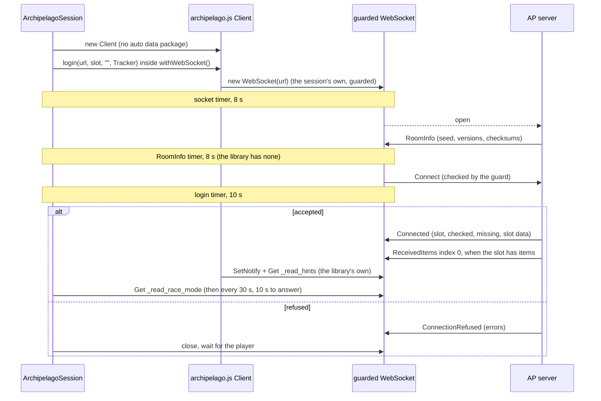
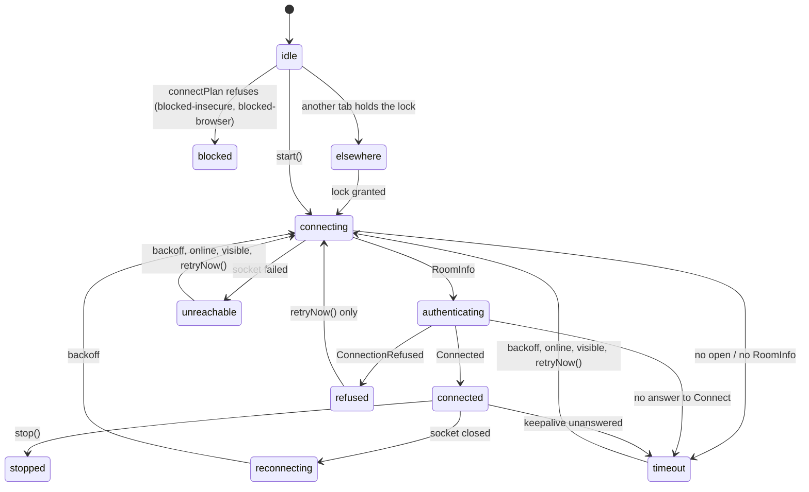

# @alltp/archipelago

The tracker's link to an [Archipelago](https://archipelago.gg) (AP) room: it
joins the room as a read-only **Tracker** on the player's slot, keeps that
connection alive, folds what the server says into a snapshot (items
received, locations checked and left, the race flag), loads the names behind
AP's ids, and says in plain terms what to fix when any of that fails.

- **Game-agnostic.** No world, item or location lives here: names come from
  the room's own data packages. The app's boards (`apps/web`, next) map them
  onto art.
- **The server is the truth.** Nothing here computes logic or reachability:
  the snapshot is what the server states, never what the tracker guesses.
- **Read-only, twice over.** The Tracker tag makes the server refuse checks
  and goals; a guard on the socket refuses every other packet a tracker has
  no business sending (see "Read-only guarantee").
- **No UI, no DOM, no Node.** The sources compile against ES2022 only
  (`tsconfig.src.json`); browser APIs come through typed seams
  (`src/platform.ts`) that tests replace.
- **One runtime dependency**, archipelago.js, pinned exactly (see
  "archipelago.js"). `ws` is a dev dependency for the fake server.
- `src/index.ts` is the public surface. Nothing in the app imports the
  package yet: the board that does is the next task of the series.

```ts
import {
  ArchipelagoSession,
  connectPlan,
  NameDataLoader,
  parseAddress,
} from "@alltp/archipelago";

const parsed = parseAddress("/connect archipelago.gg:60030");
if (!parsed.ok || parsed.kind !== "server") throw new Error("not a server address");
const session = new ArchipelagoSession({
  address: parsed.address,
  page: { browser: "chromium", kind: "secure" }, // or { kind: "desktop" }
  slot: "Link", // case-sensitive
  uuid: deviceId, // kept by the app, one per device
  snapshot: persisted, // what the app saved last time
  lock: tabLock, // one connection per browser
});
session.subscribe((status) => render(status)); // status.code: see "Diagnostic codes"
session.onSnapshot((snapshot, reset) => save(snapshot, reset));
session.start();

const names = new NameDataLoader({ fetch: (game) => session.getDataPackage(game), store });
```

## Architecture

| Module | What it holds |
| --- | --- |
| `address.ts` | Every form of the Room field, the address class (loopback, private, public), the URLs a page may try (`connectPlan`), room links and archipelago.gg's room status |
| `session.ts` | The connection: one archipelago.js Client per attempt on a socket of its own, its timeouts, backoff, keepalive, the tab lock, requests (`get`, `getDataPackage`) |
| `guard.ts` | The outgoing whitelist, checked on every frame before it leaves |
| `snapshot.ts` | The pure reducer from server packets to the slot's state |
| `datapackage.ts` | Name data per game and checksum, through a store the app provides; location groups |
| `diagnostics.ts` | The status union, refusal reasons, the hint for an unreachable server |
| `report.ts` | One sentence per status and the copyable report (no slot, password or port) |
| `setup.ts` | The "Connect to a room" guide as data |
| `platform.ts` | Clock, visibility, network state, WebSocket and UUID seams |

### The protocol subset

What a tracker sends, and only that (`guard.ts`):

| Packet | When |
| --- | --- |
| `Connect` | Once per socket: `name` the slot, `game: ""`, `tags: ["Tracker"]`, `items_handling: 0b111` (every item the slot receives, its own included), `slot_data: true`, this device's `uuid`, archipelago.js's version (0.6.3) |
| `Get` | `_read_race_mode` after Connected and every 30 s (the keepalive); `_read_location_name_groups_<game>`; archipelago.js's own `_read_hints_<team>_<slot>` |
| `SetNotify` | archipelago.js's own, on `_read_hints_<team>_<slot>` |
| `GetDataPackage` | One game at a time, only the games the board needs |
| `Sync` | When `ReceivedItems` skips an index |

What it reads: `RoomInfo` (versions, seed, games, checksums), `Connected`
(team, slot, players, checked and missing locations, slot data),
`ConnectionRefused`, `ReceivedItems`, `RoomUpdate`, `Retrieved`, `SetReply`,
`DataPackage`. Every other packet (`PrintJSON` for the feed, later) reaches
`onPacket` listeners untouched.



### The session



- **One run loop, generations.** `start()` opens a generation; `stop()` ends
  it, wakes any wait, releases the lock and closes the socket. Every write
  (status, snapshot) checks the generation, so a stale attempt never writes.
  A stopped session holds no timer, socket or listener (tested).
- **A fresh Client per attempt**, on a socket the session creates: the
  library's `login()` leaks listeners when reused, and it cannot close a
  socket that never got RoomInfo.
- **Backoff** 1 s, 2 s, 4 s… up to 30 s, minus up to 20 % jitter. A
  connection that lived 10 s resets it when it drops. Coming back `online`
  or the page becoming visible ends a backoff at once; neither ends a
  refusal, which waits for `retryNow()`.
- **archipelago.gg pauses idle rooms.** After three failures in a row on
  archipelago.gg, the hint becomes `room-paused` (open the room's page to
  wake it) and retries slow to 60 s.
- **Keepalive.** While connected and visible, a `Get _read_race_mode` every
  30 s that must come back within 10 s: a laptop that slept fires no
  `close`. Hidden, nothing is sent; showing the page again checks at once.
- **Scheme-less addresses** try each URL of `connectPlan` in turn within one
  attempt (wss, then ws where allowed), and remember the one that worked.
- **The tab lock** is a seam (`TabLock`, the shape of the app's autotracking
  lock): the app gives the Web Lock `alltp-tracker-archipelago`, so one tab
  per browser holds the connection and the others follow it.

### The snapshot

`reduce(snapshot, packet)` is pure; the session runs it on every packet and
the app persists its result. What it holds is published (live follow, the
stream view): never the address, the port or the password, which the server
never sends.

- **Ready on Connected alone.** A slot that received nothing gets no
  `ReceivedItems` at Connect; its first item later comes at index 0
  (recorded).
- **Items:** index 0 replaces the list, the next index appends, anything
  else asks for `Sync` and changes nothing (archipelago.js detects no gap).
- **Checks:** Connected's lists replace; `RoomUpdate.checked_locations` is
  merged as a union, since a Collect repeats ids already sent (recorded).
- **Identity** is `seed_name` + generator version + team + slot + game:
  `seed_name` follows `--seed`, so a normal and a race multiworld can share
  it. Another identity at Connected drops the old snapshot (`reset`); the
  same one keeps its items on screen until the server resends them at
  index 0, which it does at once whenever the list is not empty.
- `beginConnection()` marks the data as no longer current between
  connections (`ready: false`), keeping it on screen.

## Addresses and connectivity

`parseAddress` reads `archipelago.gg:38281`, `/connect archipelago.gg:38281`
(what a room page prints), `wss://host:port`, `ws://host:port`,
`localhost:38281`, `[::1]:38281`, a bare host (port 38281), and a room link
`https://archipelago.gg/room/<id>`, which the app resolves through
`/api/room_status/<id>` (`parseRoomStatus`: the port and the slots, name and
game).

Measured on 2026-10-24 (the S1 gate: a probe page served at the site's own
origin through Playwright, and the release desktop app driven through the
WebKit inspector):

| Page \ server | archipelago.gg wss | ws://127.0.0.1 | ws:// private LAN IP | ws:// public host |
| --- | --- | --- | --- | --- |
| Site, Chromium 156 | yes | blocked by Local Network Access; yes once granted | yes once granted (mixed content only warns) | no (`SecurityError`) |
| Site, Firefox 157 | yes | yes, no prompt | no | no |
| Desktop app, Linux (WebKitGTK 2.54.2) | yes | yes | yes | not tested |

- archipelago.gg room ports speak **wss only**: plain `ws://` fails with
  1006. A scheme-less archipelago.gg address is tried over wss alone.
- `connectPlan(address, page)` is the static check made before any socket:
  `blocked-insecure` for ws:// to a public host from an https page (every
  browser), `blocked-browser` where this browser refuses what others allow
  (Firefox to the LAN; Safari, untested here, to this device and the LAN,
  WebKit bug 171934). An unknown browser is let try; if it throws
  `SecurityError`, the session reports `blocked-insecure` and stops.
- `localNetwork` flags Chromium's Local Network Access prompt for a later
  task (the app's permission flow).

## Diagnostic codes

`session.status` is a `SessionStatus`, discriminated by `code`. A status
that waits carries `retryInMs`: the delay before the next attempt, or
`null` when the session waits for the player.

| Code | Meaning | Data for the UI | Retry |
| --- | --- | --- | --- |
| `idle`, `stopped` | Not started; stopped (`detail` when the guard stopped it) | `detail?` | none |
| `elsewhere` | Another tab of this browser holds the connection | | when that tab lets go |
| `blocked-insecure` | ws:// to a public host from an https page | `addressClass` | none: use wss or the desktop app |
| `blocked-browser` | ws:// this browser refuses to this device or the LAN | `addressClass`, `browser` | none |
| `connecting` | Opening the socket (`socket`), then waiting for RoomInfo (`room-info`) | `url`, `attempt`, `stage` | |
| `authenticating` | Connect sent | `url`, `attempt` | |
| `unreachable` | The socket failed; `hint`: `offline`, `room-paused`, `no-tls` (wss to a server that likely speaks ws), `not-running` (ws to this device or the LAN), `unknown` | `url`, `attempt`, `hint` | backoff; 60 s once `room-paused` |
| `timeout` | No open, no RoomInfo, no answer to Connect, or an unanswered keepalive | `stage` | backoff; 60 s on a silent archipelago.gg |
| `refused` | `ConnectionRefused`: `InvalidSlot`, `InvalidPassword`, `IncompatibleVersion`, `InvalidItemsHandling`, `InvalidGame` (known reasons first, others kept) | `reasons`, `serverVersion` | the player (`retryNow()`) |
| `connected` | Tracking | `url` | a drop reconnects |
| `reconnecting` | A working connection dropped | `attempt` | backoff |
| `unavailable` | The app's Archipelago chunk failed to load (set by the app) | `detail` | |

**`IncompatibleVersion` and `--compatibility 0`.** A room started with
`--compatibility 0` accepts only clients announcing its exact AP version.
The session never copies the server's version into Connect: that would
defeat what the room's host asked for. The refusal says so, with both
versions (`describeRefusal`).

`describeStatus(status)` gives one English sentence per status, never the
port. `diagnosticReport` adds the page context, the address with its port
masked (`wss://archipelago.gg:•••••`), the room's versions and game count,
the slot's game and counts: never the slot name, the password, the seed or
a User-Agent string.

## Read-only guarantee

1. **The Tracker tag.** MultiServer answers a tracker's `LocationChecks` and
   `StatusUpdate` with `InvalidPacket` (recorded: the bench's tracker sent
   both on purpose).
2. **The guard** (`guardSocket`), on the socket itself, so it sees every
   frame archipelago.js writes, its own included. A frame passes only if it
   is a JSON list of packets, each one of: `Connect` (no game, tags exactly
   `["Tracker"]`, `items_handling` 0–7, no other field), `Get` and
   `SetNotify` on `_read_hints_*`, `_read_client_status_*`,
   `_read_slot_data_*`, `_read_race_mode` and
   `_read_location_name_groups_*` only, `GetDataPackage`, `Sync`.
   Everything else throws a `GuardError` before a byte goes out:
   `LocationChecks`, `StatusUpdate`, `Say`, `Set`, `CreateHints`,
   `UpdateHint`, `ConnectUpdate`, `LocationScouts`, and **`Bounce`, which
   the server does not refuse** (recorded). A refusal stops the session: it
   is a bug, never something to retry.

`guard.spec.ts` holds a fast-check property: random frames, mixing
arbitrary packets with well-formed ones, never put a packet on the wire that
an independent oracle calls read-only. Broken on purpose, it fails at once:
allowing `Bounce` gave the counterexample `[{"cmd":"Bounce"}]`; accepting
any tag list containing `Tracker` gave a Connect tagged
`["Tracker","TextOnly"]` (2026-10-24).

## Name data

AP sends ids; each game's data package names them. `NameDataLoader.load(game,
checksum)` serves a game from memory, then from the app's store (IndexedDB,
the `PackageStore` seam) under `game + checksum`, then from the server,
one game per `GetDataPackage`. A package whose checksum differs from the
room's is used but kept under its own, so the next visit asks again.
`neededGames(snapshot)` is the slot's own game (its items and locations),
plus with `senders` the games of the slots that sent it items.

Location groups are not in the websocket data package:
`loadLocationGroups(game, get)` reads `_read_location_name_groups_<game>`
and drops `Everywhere` (21 groups for ALttP, 20 without it).

Checksums of AP 0.6.8, the same archipelago.gg serves (`upstream.json`,
`test/datapackages/`):

| Game | Checksum | Items / locations |
| --- | --- | --- |
| A Link to the Past | `1858ba29ffb7bf55e9e71a76fc7aba1b5c0950e4` | 146 / 286 |
| Super Metroid | `4fd6c0bb6c0f0ab1157fb5dbda01a572ae3d0da6` | 24 / 101 |
| SMZ3 | `12f632000dfc0e2bb4404146d4c9121e830b9b8f` | 151 / 316 |
| APQuest | `854499b00d82a68764ce591dd80218ad75e83e2b` | 7 / 7 |
| Archipelago | `ac9141e9ad0318df2fa27da5f20c50a842afeecb` | 1 / 2 |

## Setup guide

`SETUP_STEPS` (`src/setup.ts`): find the room's address, reach the server,
the slot name, the password. Each step lists the statuses that mark it done
or failing (`refused:<reason>` for refusals), and variants per page (site,
desktop app) and host (archipelago.gg, self-hosted); `setupProgress(status,
context)` ticks them and names the step to open. The slot step says the
room sees the tracker join and leave (`… tracking … has joined`, recorded).

## archipelago.js

**Why it earns its place.** It is the JS client AP's own protocol document
lists (the only JS/TS row of its community libraries table), so the owner
chose the official ecosystem's client over a hand-rolled one: typed
packets, the login handshake, data storage notifications, and fixes that
land for every JS client at once. MIT, zero dependencies, about 7.5 KB
gzipped minified; pinned exactly at 2.1.0 (`upstream.json`), Dependabot as
the bump path. It sends version 0.6.3 and claims the protocol up to 0.6.7;
the bench ran it against AP 0.6.8.

Its rough edges, each measured (`test/fixtures/archipelagojs-edges.json`)
and worked around here:

| Edge | Workaround |
| --- | --- |
| No reconnect | The session's run loop, backoff and keepalive |
| Opaque errors ("Failed to connect…", `LoginError.message` with an unbalanced `[`) | Refusals read from `err.errors`, never the message; failures classified by stage and address (`unreachableHint`) |
| No timeout on opening the socket or on RoomInfo (10 s on Connect only) | The session's own timers per stage; the library's is pushed past ours |
| `disconnect()` cannot close a socket that never got RoomInfo | The session keeps the raw socket and closes it itself |
| No injectable WebSocket: it reads `window`/`global`/`self.WebSocket` at every connect | `withWebSocket()` swaps the global for the synchronous part of `login()` only, so the library builds the session's socket, guarded |
| `login()` always reconnects, and each one on a Client leaks two listeners | A fresh Client per attempt |
| One uuid shared by every Client of the page | The app's own uuid per device, passed to `login()` |
| `autoFetchDataPackage` fetches every game of the room | Off; `NameDataLoader` fetches only the games needed |
| `debugLogVersions` would write the User-Agent into data storage | Off (it defaults to off) |
| It sends `SetNotify` and `Get` for `_read_hints_*` by itself after Connected | Allowed by the guard |
| Its 0.6.3 is refused by `--compatibility 0` rooms (Connect goes out before `RoomInfo.version` can be read) | Kept: refused with `IncompatibleVersion` and explained (above) |
| No gap detection in its items manager | The reducer's index check and `Sync` |
| A `null` packet in a frame throws in its parser and drops the rest of the frame | None needed: AP never sends one; noted for an upstream report |
| `maximumMessages` keeps a chat log | 0: the session reads raw packets |

## Tests

- `src/*.spec.ts`: one spec per module. The reducer and the session run on
  the recorded fixtures (`test/fixtures/`, `test/datapackages/`); the
  session runs the real archipelago.js on in-memory sockets
  (`test/fake-socket.ts`) under a manual clock (`test/fixtures.ts`), through
  every failure: refusal, unreachable, black hole, silent server, unanswered
  Connect, paused room, drop, keepalive, tab lock, blocked page, guard.
- `test/responder.ts`: what an AP 0.6.8 server answers, replayed from a
  fixture; both fakes answer through it.
- `test/fake-ap-server.ts`: an in-process AP server on `ws`, replaying
  frames and failing on demand (refuse, no RoomInfo, no answer to Connect,
  cut). `ws` is there because Node 22 ships a WebSocket client, not a
  server; `test/session.e2e.spec.ts` drives the session through Node's own
  WebSocket, the one browsers expose.
- `test/upstream.spec.ts`: `upstream.json`, the dependency pin, the
  fixtures' recorded versions and the name-data checksums agree.
- `test/real-server.spec.ts`: against a real server, only when
  `AP_SERVER_URL` is set (see below); `.github/workflows/archipelago.yml`
  sets it up in CI.

### Recording the fixtures

The fixtures are recorded, never hand-edited. With AP 0.6.8's frozen Linux
release (system Python 3.14 is too new for AP 0.6.x; the release bundles
3.12):

```sh
curl -L -O https://github.com/ArchipelagoMW/Archipelago/releases/download/0.6.8/Archipelago_0.6.8_linux-x86_64.tar.gz
sha256sum Archipelago_0.6.8_linux-x86_64.tar.gz   # upstream.json "assets"
tar -xzf Archipelago_0.6.8_linux-x86_64.tar.gz -C ~/ap
AP_DIR=~/ap/Archipelago pnpm --filter @alltp/archipelago record-fixtures
```

`packages/archipelago/scripts/record-fixtures.mjs` hosts `test/server/*.archipelago` (no ROM is
needed to host) through `packages/archipelago/scripts/serve.sh` on ports 38281 (plain), 38282
(`--password bench-pass`), 38283 (the race multiworld) and 38284
(`--compatibility 0`), plays the scenes each fixture is named after through
archipelago.js, and writes every frame both ways. The multiworlds were
generated (that step needs the ALttP and SM ROMs in `host.yaml`) from four
slots, Link (ALttP), Samus (SM), Hybrid Hero (SMZ3) and Quester (APQuest,
the ROM-less game: Clique left AP's core before 0.6.8), with
`ArchipelagoGenerate --seed 4242`, then again with `--race`.

## Checked against a real server

AP 0.6.8 (frozen Linux release, Python 3.12.14), archipelago.js 2.1.0, Node
22.23.3's WebSocket, `test/server/normal-seed4242.archipelago` served by
`packages/archipelago/scripts/serve.sh` on 127.0.0.1, on 2026-10-24:

- `AP_SERVER_URL=ws://127.0.0.1:38291 pnpm vitest run --project archipelago real-server`:
  both tests pass. The session connected on Link as a tracker (server
  0.6.8, 249 locations, race flag off), loaded ALttP's names (checksum as
  pinned, 286 locations) and its location groups, and was refused `link`
  with `InvalidSlot`.
- The server's log shows only `Connect`, `Get` (`_read_race_mode`,
  `_read_location_name_groups_A Link to the Past`, the library's
  `_read_hints_0_1`), `SetNotify` and `GetDataPackage`; no `InvalidPacket`.
  The room announced "Link (Team #1) tracking A Link to the Past has
  joined. Client(0.6.3), ['Tracker']".
- The fixtures were recorded again from the repository with the adapted
  script on the same day; the suite passed on that recording too.

CI does the same on every pull request or push to master that touches this
package, and weekly (`.github/workflows/archipelago.yml`, `docs/ci.md`): it
downloads the release `upstream.json` pins, checks its sha256 against
`assets`, hosts `normal-seed4242.archipelago` with `serve.sh` and runs the
spec. It is not a required check; a failed weekly run opens an issue labelled
`archipelago-server`. The weekly Logic drift workflow also compares `release`
with Archipelago's latest stable release and opens an `ap-drift` issue when
it is newer, listing the `watched` files that changed between the two.

## Not verified

- Safari and iOS: the WebKit row of the connectivity table is from WebKit's
  bug tracker, not measured.
- The desktop app on macOS and Windows (WebView2's local network behaviour).
- A real archipelago.gg room through this package (the S1 gate reached one
  with archipelago.js alone, from both browsers).
