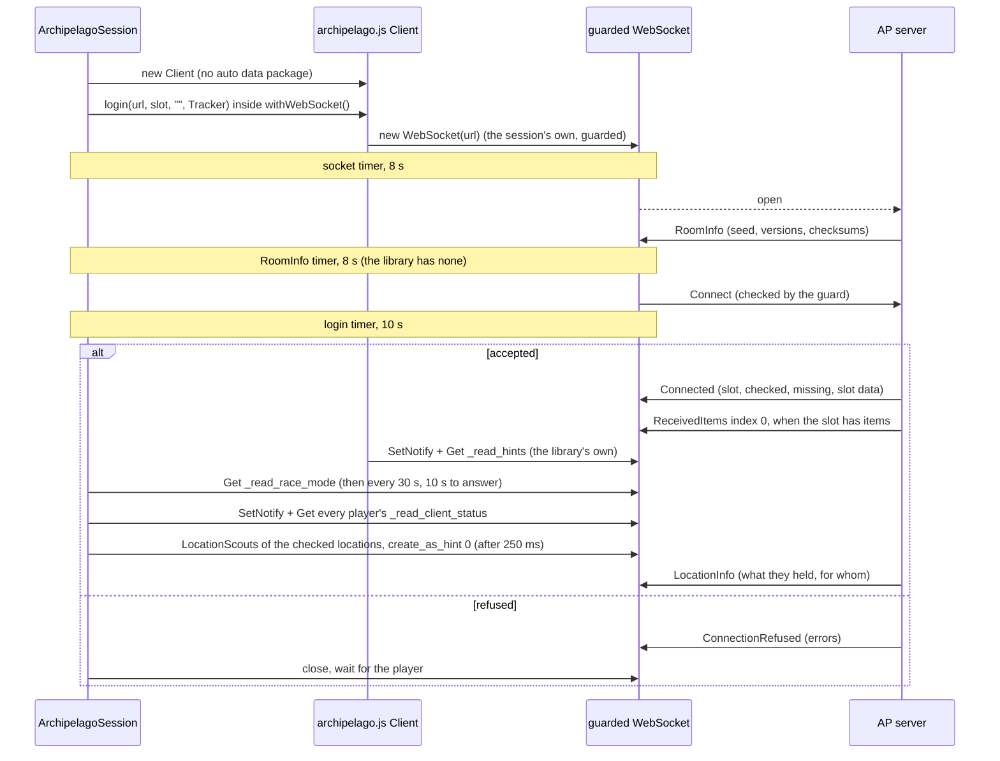
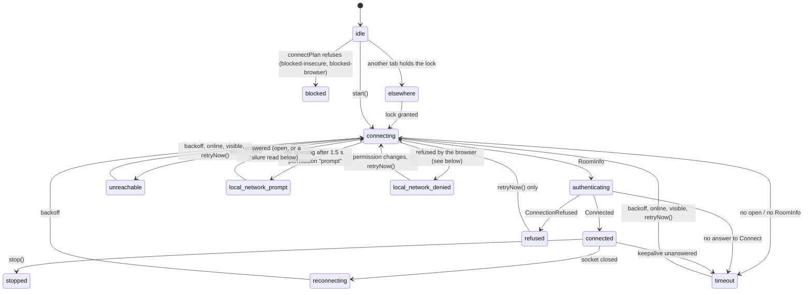

# @alltp/archipelago

The tracker's link to an [Archipelago](https://archipelago.gg) (AP) room: it
joins the room as a read-only **Tracker** on the player's slot, keeps that
connection alive, folds what the server says into a snapshot (items
received, locations checked and left, what the checked ones held, the race
flag, the slot's hints, every player's status), reads the room's feed, loads
the names behind AP's ids, and says in plain terms what to fix when any of
that fails.

- **Game-agnostic.** No world, item or location lives here: names come from
  the room's own data packages. The app's board
  (`apps/web/src/games/archipelago/`, [docs/archipelago.md](../../docs/archipelago.md))
  maps them onto art.
- **The server is the truth.** Nothing here computes logic or reachability:
  the snapshot is what the server states, never what the tracker guesses.
- **Read-only, twice over.** The Tracker tag makes the server refuse checks
  and goals; a guard on the socket refuses every other packet a tracker has
  no business sending (see "Read-only guarantee").
- **No UI, no DOM, no Node.** The sources compile against ES2022 only
  (`tsconfig.src.json`); browser APIs come through typed seams
  (`src/platform.ts`) that tests replace.
- **One runtime dependency**, archipelago.js, pinned exactly (see
  "archipelago.js"). `ws` is a dev dependency for the fake server.
- `src/index.ts` is the public surface. The app's Archipelago module imports
  it: the board, its connect dialog and, in a chunk of its own loaded on
  Connect, the session (`apps/web/src/games/archipelago/runtime.ts`).

```ts
import {
  ArchipelagoSession,
  connectPlan,
  NameDataLoader,
  parseAddress,
} from "@alltp/archipelago";

const parsed = parseAddress("/connect archipelago.gg:60030");
if (!parsed.ok || parsed.kind !== "server") throw new Error("not a server address");
const session = new ArchipelagoSession({
  address: parsed.address,
  page: { browser: "chromium", gated: true, kind: "secure" }, // or { kind: "desktop" }
  slot: "Link", // case-sensitive
  uuid: deviceId, // kept by the app, one per device
  snapshot: persisted, // what the app saved last time
  lock: tabLock, // one connection per browser
  permission: (name) => systemPermission(globalThis, namesOf(name)), // @alltp/autotrack's
});
session.subscribe((status) => render(status)); // status.code: see "Diagnostic codes"
session.onSnapshot((snapshot, reset) => save(snapshot, reset));
session.start();

const names = new NameDataLoader({ fetch: (game) => session.getDataPackage(game), store });
```

## Architecture

| Module | What it holds |
| --- | --- |
| `address.ts` | Every form of the Room field, the address class (loopback, private, public), the URLs a page may try and the permission they wait on (`connectPlan`), the pre-check (`reachOf`), room links and archipelago.gg's room status |
| `session.ts` | The connection: one archipelago.js Client per attempt on a socket of its own, its timeouts, backoff, keepalive, the tab lock, requests (`get`, `getDataPackage`) |
| `guard.ts` | The outgoing whitelist, checked on every frame before it leaves |
| `snapshot.ts` | The pure reducer from server packets to the slot's state |
| `feed.ts` | The room's feed: PrintJSON to events, folded into lines (bursts, presence, countdown), resolved into names |
| `hints.ts` | Hints and their 0.6 statuses, the hint cost, the players' client status |
| `datapackage.ts` | Name data per game and checksum, through a store the app provides; location groups |
| `diagnostics.ts` | The status union, refusal reasons, the hint for an unreachable server |
| `report.ts` | One sentence per status and the copyable report (no slot, password or port) |
| `setup.ts` | The "Connect to a room" guide as data |
| `platform.ts` | Clock, visibility, network state, WebSocket, UUID and local network permission seams |

### The protocol subset

What a tracker sends, and only that (`guard.ts`):

| Packet | When |
| --- | --- |
| `Connect` | Once per socket: `name` the slot, `game: ""`, `tags: ["Tracker"]`, `items_handling: 0b111` (every item the slot receives, its own included), `slot_data: true`, this device's `uuid`, archipelago.js's version (0.6.3) |
| `Get` | `_read_race_mode` after Connected and every 30 s (the keepalive); `_read_client_status_<team>_<slot>` of every player of the team after Connected; `_read_location_name_groups_<game>`; archipelago.js's own `_read_hints_<team>_<slot>` |
| `SetNotify` | archipelago.js's own, on `_read_hints_<team>_<slot>`; the session's, on every player's `_read_client_status_<team>_<slot>` |
| `GetDataPackage` | One game at a time, only the games the board needs |
| `Sync` | When `ReceivedItems` skips an index |
| `LocationScouts` | `create_as_hint: 0`, for the slot's checked locations not asked about yet: after Connected, then once per burst of checks (250 ms) |

What it reads: `RoomInfo` (versions, seed, games, checksums, hint cost),
`Connected` (team, slot, players, checked and missing locations, slot data,
hint points), `ConnectionRefused`, `ReceivedItems`, `RoomUpdate`,
`Retrieved` and `SetReply` (the race flag, hints, client statuses),
`LocationInfo`, `DataPackage`. Every packet, `PrintJSON` included, also
reaches `onPacket` listeners untouched: the app folds the feed from them
(`feed.ts`).



### The session



- **One run loop, generations.** `start()` opens a generation; `stop()` ends
  it, wakes any wait, releases the lock and closes the socket. Every write
  (status, snapshot) checks the generation, so a stale attempt never writes.
  A stopped session holds no timer, socket or listener (tested).
- **A fresh Client per attempt**, on a socket the session creates: the
  library's `login()` leaks listeners when reused, and it cannot close a
  socket that never got RoomInfo.
- **Backoff** 1 s, 2 s, 4 s… up to 30 s, minus up to 20 % jitter. A
  connection that lived 10 s resets it when it drops. Coming back `online`
  or the page becoming visible ends a backoff at once; neither ends a
  refusal, which waits for `retryNow()`.
- **archipelago.gg pauses idle rooms.** After three failures in a row on
  archipelago.gg, the hint becomes `room-paused` (open the room's page to
  wake it) and retries slow to 60 s.
- **Keepalive.** While connected and visible, a `Get _read_race_mode` every
  30 s that must come back within 10 s: a laptop that slept fires no
  `close`. Hidden, nothing is sent; showing the page again checks at once.
- **Scheme-less addresses** try each URL of `connectPlan` in turn within one
  attempt (wss, then ws where allowed), and remember the one that worked.
- **The tab lock** is a seam (`TabLock`, the shape of the app's autotracking
  lock): the app gives the Web Lock `alltp-tracker-archipelago`, so one tab
  per browser holds the connection and the others follow it.
- **The local network permission** is a seam too (`permission`, a
  `PermissionFactory`; "The local network permission" below).

### The snapshot

`reduce(snapshot, packet)` is pure; the session runs it on every packet and
the app persists its result. What it holds is published (live follow, the
stream view): never the address, the port or the password, which the server
never sends.

- **Ready on Connected alone.** A slot that received nothing gets no
  `ReceivedItems` at Connect; its first item later comes at index 0
  (recorded).
- **Items:** index 0 replaces the list, the next index appends, anything
  else asks for `Sync` and changes nothing (archipelago.js detects no gap).
- **Checks:** Connected's lists replace; `RoomUpdate.checked_locations` is
  merged as a union, since a Collect repeats ids already sent (recorded).
- **Identity** is `seed_name` + generator version + team + slot + game:
  `seed_name` follows `--seed`, so a normal and a race multiworld can share
  it. Another identity at Connected drops the old snapshot (`reset`); the
  same one keeps its items on screen until the server resends them at
  index 0, which it does at once whenever the list is not empty.
- `beginConnection()` marks the data as no longer current between
  connections (`ready: false`), keeping it on screen.
- **Hints** are `_read_hints_<team>_<slot>`'s value, read by the library's
  own Get and replaced by each SetReply (`parseHints`, `hints.ts`).
- **Players' status** (`clientStatus`, by slot): each player's
  `_read_client_status_<team>_<slot>`, read after Connected and watched
  (0 unknown, 5 connected, 10 ready, 20 playing, 30 goal; recorded: 5, then 30
  as Quester reached its goal).
- **What I sent** (`sent`): `LocationInfo`'s items for the slot's checked
  locations, `player` being the receiver; a location the snapshot does not
  hold checked is ignored. Another run drops hints, statuses and `sent`.

## The feed

`feed.ts` turns the room's `PrintJSON` into lines, by the packet's typed
fields only (never its text, which AP may reword):

- **Kept:** `ItemSend` (finder, item, receiver, location, item flags),
  `Hint`, `Goal`, `Release`, `Collect`, `Join`, `Part`, `Countdown`.
- **Dropped:** `Chat` and `ServerChat` (no chat), `Tutorial`,
  `CommandResult`, `AdminCommandResult`, `TagsChanged`, `ItemCheat` (an
  admin's `!getitem`) and untyped messages.
- **Folded** (`foldFeed`, by ids): the item sends that follow a `Release`
  of slot S and come from S's world, or a `Collect` of S and go to S, join
  its line ("Quester released 4 items, 2 for you"; recorded order at a goal:
  Goal, Collect and its sends, Release and its sends). Joins and parts in a
  row collapse into one line, each player as they stand last. A countdown
  counts down on one line ("Starting countdown of 2s", 2, 1, then 0, "GO").
  The tail keeps 200 lines.
- **Involving me** (`involves`): the slot's items sent or received, its
  hints, its goal, a release or collect by it or with its items, and the
  countdown. Joins and parts are the room's only.
- **Names** (`resolveLine`): an item is named by its receiver's game, a
  location by its finder's (`lineGames`), so the app loads another game's
  names only when a line needs them; until then a line reads "Item 84194".
  A resolved line is parts (player, item with its flags, location, words),
  which the board, the stream view and a screen reader read alike.

## Addresses and connectivity

`parseAddress` reads `archipelago.gg:38281`, `/connect archipelago.gg:38281`
(what a room page prints), `wss://host:port`, `ws://host:port`,
`localhost:38281`, `[::1]:38281`, a bare host (port 38281), and a room link
`https://archipelago.gg/room/<id>`, which the app resolves through
`/api/room_status/<id>` (`parseRoomStatus`: the port and the slots, name and
game).

Measured on 2026-10-24 (the S1 gate: a probe page served at the site's own
origin through Playwright, and the release desktop app driven through the
WebKit inspector; the permission's states again for S4, Chromium 156 and
Firefox 157 headless):

| Page \ server | archipelago.gg wss | ws://127.0.0.1 | ws:// private LAN IP | ws:// public host |
| --- | --- | --- | --- | --- |
| Site, Chromium 156 | yes | blocked by Local Network Access; yes once granted | yes once granted (mixed content only warns) | no (`SecurityError`) |
| Site, Firefox 157 | yes | yes, no prompt | no | no |
| Site, Safari / iOS | not tested | no (WebKit bug 171934) | no | no |
| Desktop app, Linux (WebKitGTK 2.54.2) | yes | yes | yes | not tested |
| Desktop app, macOS, Windows | not tested | not tested | not tested | not tested |

- archipelago.gg room ports speak **wss only**: plain `ws://` fails with
  1006. A scheme-less archipelago.gg address is tried over wss alone.
- Headless Chromium 156, the permission undecided: every name reads
  `prompt` (`loopback-network`, `local-network`, `local-network-access`)
  and a loopback socket fails at once (1006,
  `net::ERR_BLOCKED_BY_LOCAL_NETWORK_ACCESS_CHECKS`). Chrome's headless
  mode (Playwright's `chromium` channel; CI's Google Chrome 155) then reads
  the permission `denied`, as a refused prompt; Playwright's default
  headless shell keeps `prompt`, which no browser a player uses does. Granting
  `local-network-access` (Playwright's only accepted name) turns all three
  `granted` and fires each status's `change` event; clearing it fires
  `change` back to `prompt`.
- A LAN address with no host behind it (`ws://192.168.1.20` from a
  192.168.1.0/24 machine): the socket hangs 3 s, fails with
  `ERR_ADDRESS_UNREACHABLE`, and the permission stays `prompt` in the
  headless shell; Chromium checks a LAN address only once connected. On a
  CI runner, where that address is routed away, it hangs past the socket
  timeout.
- Firefox 157 (Playwright's build) reads `loopback-network` and
  `local-network` as `prompt`, knows no `local-network-access`, and
  connects to loopback without asking.

### The pre-check

`connectPlan(address, page)` is the static check made before any socket:
the URLs to try, and the local network permission they wait on
(`permission`: `loopback-network` for this device, `local-network` for the
LAN, null for a public host, the desktop app, an http page, or a browser
that does not gate: `PageContext.gated`, which the app reads from
autotrack's `loopbackAccess`, Chromium 147+ and Firefox 154+), or why none
is worth trying: `blocked-insecure` for ws:// to a public host from an https
page (every browser), `blocked-browser` where this browser refuses what
others allow (Firefox to the LAN; Safari to this device and the LAN). An
unknown browser is let try; if it throws `SecurityError`, the session
reports `blocked-insecure` and stops.

`reachOf(address, page, permissionState)` turns that plan and what the page
knows of the permission into what will happen, and `describeReach` into one
sentence with the way out, which the app shows under the Room field:

| From the site | archipelago.gg | wss:// public | ws:// public | this device | the LAN, ws:// | the LAN, wss:// |
| --- | --- | --- | --- | --- | --- | --- |
| Chromium | open | open | blocked-insecure | ask / denied | ask / denied | ask / denied |
| Firefox | open | open | blocked-insecure | open (ask / denied once gated) | blocked-browser | open |
| Safari | open | open | blocked-insecure | blocked-browser (ws://), open (wss://) | blocked-browser | open |
| Other | open | open | blocked-insecure | open | open | open |

`ask` while the permission reads `prompt`; `denied` once refused, or when
the caller passes the session's refusal (`reachOf`'s fourth argument, the
`state` of a `local-network-denied` for this address: a dismissed or
headless prompt leaves the permission reading `prompt`); `open` once
granted or unsupported. A denial says how to undo it: in Chromium, the
site settings entry by its own label (`CHROMIUM_SETTING`: "Apps on device"
for this device, "Local network" for the LAN, from
`components/site_settings_strings.grdp` at chromium/chromium `344811fd`),
then Connect, or Retry while a session waits. The desktop app and an http
page are `open` everywhere. `address.spec.ts` holds the whole table, browser
× class × scheme, and the session's refusal.

### The local network permission

The package queries no permission: `SessionOptions.permission` is a
`PermissionFactory`, given the plan's permission name, whose shape is
`@alltp/autotrack`'s `systemPermission`. The app passes that one (over
`LOCAL_NETWORK_PERMISSION_NAMES` or `LAN_PERMISSION_NAMES`); without it,
nothing below is detected (`NO_PERMISSION`). With a plan that waits on a
permission, the session:

1. subscribes to its change event: a grant or a refusal in the browser ends
   any wait at once;
2. before each attempt, reads it: `denied` opens no socket and reports
   `local-network-denied` (`state: "denied"`), waiting for a change or
   `retryNow()`;
3. while a socket to this device is still CONNECTING after `promptAfterMs`
   (1.5 s, as autotrack: a loopback handshake takes milliseconds) and the
   permission reads `prompt`, reports `local-network-prompt` and lifts the
   socket timeout: the player's answer has no deadline. Not for the LAN:
   Chromium checks a LAN address once connected, so an unreachable host
   hangs exactly like a prompt (measured below); a LAN socket keeps its
   timeout, and the answer's change event retries at once;
4. after a failed socket, reads it again: `denied` reports
   `local-network-denied` (`state: "denied"`); still `prompt` after a
   socket to this device that hung on the prompt (dismissed) reports it
   with `state: "prompt"` (Retry asks again); either waits for the player.
   A quick failure while `prompt` is the server's (`unreachable`, the usual
   backoff): only Playwright's headless shell fails a blocked socket and
   keeps `prompt`, and Firefox reads `prompt` without gating.

`session.spec.ts` drives each branch on a socket held in CONNECTING (the
fake network's `held` route) under a fake permission; the app's browser test
drives Chromium's real one from the site's own origin.

## Diagnostic codes

`session.status` is a `SessionStatus`, discriminated by `code`. A status
that waits carries `retryInMs`: the delay before the next attempt, or
`null` when the session waits for the player.

| Code | Meaning | Data for the UI | Retry |
| --- | --- | --- | --- |
| `idle`, `stopped` | Not started; stopped (`detail` when the guard stopped it) | `detail?` | none |
| `elsewhere` | Another tab of this browser holds the connection | | when that tab lets go |
| `blocked-insecure` | ws:// to a public host from an https page | `addressClass` | none: ask the host for wss, or use the desktop app |
| `blocked-browser` | ws:// this browser refuses to this device or the LAN | `addressClass`, `browser` | none: Chrome or Edge, or the desktop app |
| `local-network-prompt` | The browser shows its local network prompt: the socket has hung in CONNECTING for `promptAfterMs` while the permission reads `prompt` | `url`, `permission` | waits for the answer, no timeout |
| `local-network-denied` | The browser does not let the site reach the server: the permission reads `denied`, or a socket failed while it read `prompt` (see "The local network permission") | `url`, `permission`, `state` | the player: a permission change or `retryNow()` (`retryInMs: null`) |
| `connecting` | Opening the socket (`socket`), then waiting for RoomInfo (`room-info`) | `url`, `attempt`, `stage` | |
| `authenticating` | Connect sent | `url`, `attempt` | |
| `unreachable` | The socket failed; `hint`: `offline`, `room-paused`, `no-tls` (wss to a server that likely speaks ws), `not-running` (ws to this device or the LAN), `unknown` | `url`, `attempt`, `hint` | backoff; 60 s once `room-paused` |
| `timeout` | No open, no RoomInfo, no answer to Connect, or an unanswered keepalive | `stage` | backoff; 60 s on a silent archipelago.gg |
| `refused` | `ConnectionRefused`: `InvalidSlot`, `InvalidPassword`, `IncompatibleVersion`, `InvalidItemsHandling`, `InvalidGame` (known reasons first, others kept) | `reasons`, `serverVersion` | the player (`retryNow()`) |
| `connected` | Tracking | `url` | a drop reconnects |
| `reconnecting` | A working connection dropped | `attempt` | backoff |
| `unavailable` | The app's Archipelago chunk failed to load (set by the app) | `detail` | |

**`IncompatibleVersion` and `--compatibility 0`.** A room started with
`--compatibility 0` accepts only clients announcing its exact AP version.
The session never copies the server's version into Connect: that would
defeat what the room's host asked for. The refusal says so, with both
versions (`describeRefusal`).

`describeStatus(status)` gives one English sentence per status, never the
port. `diagnosticReport` adds the page context, the address with its port
masked (`wss://archipelago.gg:•••••`), the room's versions and game count,
the slot's game and counts: never the slot name, the password, the seed or
a User-Agent string.

## Read-only guarantee

1. **The Tracker tag.** MultiServer answers a tracker's `LocationChecks` and
   `StatusUpdate` with `InvalidPacket` (recorded: the bench's tracker sent
   both on purpose).
2. **The guard** (`guardSocket`), on the socket itself, so it sees every
   frame archipelago.js writes, its own included. A frame passes only if it
   is a JSON list of packets, each one of: `Connect` (no game, tags exactly
   `["Tracker"]`, `items_handling` 0–7, no other field), `Get` and
   `SetNotify` on `_read_hints_*`, `_read_client_status_*`,
   `_read_slot_data_*`, `_read_race_mode` and
   `_read_location_name_groups_*` only, `GetDataPackage`, `Sync`, and
   `LocationScouts` with `create_as_hint` exactly `0` (no hint created or
   announced) for locations the server already states checked (the guard's
   `GuardContext`, which the session answers from its snapshot as each frame
   leaves). Everything else throws a `GuardError` before a byte goes out:
   `LocationChecks`, `StatusUpdate`, `Say`, `Set`, `CreateHints`,
   `UpdateHint`, `ConnectUpdate`, a scout of an unchecked location or with
   a hint, and **`Bounce`, which the server does not refuse** (recorded). A
   refusal stops the session: it is a bug, never something to retry.

Why scouts at all: "What I sent" shows what each of the slot's checked
locations held and for whom. A checked location's content is no secret
(the player opened it, and the server already broadcast the send), and
`create_as_hint: 0` changes nothing on the server: recorded, a tracker's
scout of its four checked locations got `LocationInfo` back and no hint,
`SetReply` or `PrintJSON` followed.

`guard.spec.ts` holds a fast-check property: random frames, mixing
arbitrary packets with well-formed ones, never put a packet on the wire that
an independent oracle calls read-only. Broken on purpose, it fails at once:
allowing `Bounce` gave the counterexample `[{"cmd":"Bounce"}]`; accepting
any tag list containing `Tracker` gave a Connect tagged
`["Tracker","TextOnly"]` (2026-10-24). The scouts' rule was broken the same
way: dropping the checked test gave
`[{"cmd":"LocationScouts","create_as_hint":0,"locations":[1310730]}]` (a
location the property's slot has not checked); accepting any integer
`create_as_hint` gave one with `create_as_hint: 2` (2026-10-24).

## Name data

AP sends ids; each game's data package names them. `NameDataLoader.load(game,
checksum)` serves a game from memory, then from the app's store (IndexedDB,
the `PackageStore` seam) under `game + checksum`, then from the server,
one game per `GetDataPackage`. A package whose checksum differs from the
room's is used but kept under its own, so the next visit asks again.
`neededGames(snapshot)` is the slot's own game (its items and locations),
plus with `senders` the games of the slots that sent it items.

Location groups are not in the websocket data package:
`loadLocationGroups(game, get)` reads `_read_location_name_groups_<game>`
and drops `Everywhere` (21 groups for ALttP, 20 without it).

Checksums of AP 0.6.8, the same archipelago.gg serves (`upstream.json`,
`test/datapackages/`):

| Game | Checksum | Items / locations |
| --- | --- | --- |
| A Link to the Past | `1858ba29ffb7bf55e9e71a76fc7aba1b5c0950e4` | 146 / 286 |
| Super Metroid | `4fd6c0bb6c0f0ab1157fb5dbda01a572ae3d0da6` | 24 / 101 |
| SMZ3 | `12f632000dfc0e2bb4404146d4c9121e830b9b8f` | 151 / 316 |
| APQuest | `854499b00d82a68764ce591dd80218ad75e83e2b` | 7 / 7 |
| Archipelago | `ac9141e9ad0318df2fa27da5f20c50a842afeecb` | 1 / 2 |

## Setup guide

`SETUP_STEPS` (`src/setup.ts`): find the room's address, allow the
connection in the browser, reach the server, the slot name, the password.
Each step lists the statuses that mark it done or failing
(`refused:<reason>` for refusals), and variants per page (site, desktop
app), host (archipelago.gg, self-hosted), browser and address class;
`setupProgress(status, context)` ticks them, leaves out a step no variant
fits, and names the step to open. The browser's step exists only on the
site, for a self-hosted server on this device or the LAN, in a browser it
knows: Chromium's words for each permission (its loopback prompt as Chrome's
release notes quote it), Firefox's (this device: allowed, measured; the
LAN: refused, use Chrome, Edge or the desktop app), Safari's (WebKit bug
171934: the desktop app). The slot step says the room sees the tracker join
and leave (`… tracking … has joined`, recorded).

## archipelago.js

**Why it earns its place.** It is the JS client AP's own protocol document
lists (the only JS/TS row of its community libraries table), so the owner
chose the official ecosystem's client over a hand-rolled one: typed
packets, the login handshake, data storage notifications, and fixes that
land for every JS client at once. MIT, zero dependencies, about 7.5 KB
gzipped minified; pinned exactly at 2.1.0 (`upstream.json`), Dependabot as
the bump path. It sends version 0.6.3 and claims the protocol up to 0.6.7;
the bench ran it against AP 0.6.8.

Its rough edges, each measured (`test/fixtures/archipelagojs-edges.json`)
and worked around here:

| Edge | Workaround |
| --- | --- |
| No reconnect | The session's run loop, backoff and keepalive |
| Opaque errors ("Failed to connect…", `LoginError.message` with an unbalanced `[`) | Refusals read from `err.errors`, never the message; failures classified by stage and address (`unreachableHint`) |
| No timeout on opening the socket or on RoomInfo (10 s on Connect only) | The session's own timers per stage; the library's is pushed past ours |
| `disconnect()` cannot close a socket that never got RoomInfo | The session keeps the raw socket and closes it itself |
| No injectable WebSocket: it reads `window`/`global`/`self.WebSocket` at every connect | `withWebSocket()` swaps the global for the synchronous part of `login()` only, so the library builds the session's socket, guarded |
| `login()` always reconnects, and each one on a Client leaks two listeners | A fresh Client per attempt |
| One uuid shared by every Client of the page | The app's own uuid per device, passed to `login()` |
| `autoFetchDataPackage` fetches every game of the room | Off; `NameDataLoader` fetches only the games needed |
| `debugLogVersions` would write the User-Agent into data storage | Off (it defaults to off) |
| It sends `SetNotify` and `Get` for `_read_hints_*` by itself after Connected | Allowed by the guard |
| Its 0.6.3 is refused by `--compatibility 0` rooms (Connect goes out before `RoomInfo.version` can be read) | Kept: refused with `IncompatibleVersion` and explained (above) |
| No gap detection in its items manager | The reducer's index check and `Sync` |
| A `null` packet in a frame throws in its parser and drops the rest of the frame | None needed: AP never sends one; noted for an upstream report |
| `maximumMessages` keeps a chat log | 0: the session reads raw packets |

## Tests

- `src/*.spec.ts`: one spec per module. The reducer and the session run on
  the recorded fixtures (`test/fixtures/`, `test/datapackages/`); the
  session runs the real archipelago.js on in-memory sockets
  (`test/fake-socket.ts`) under a manual clock (`test/fixtures.ts`), through
  every failure: refusal, unreachable, black hole, silent server, unanswered
  Connect, paused room, drop, keepalive, tab lock, blocked page, guard.
- `test/responder.ts`: what an AP 0.6.8 server answers, replayed from a
  fixture; both fakes answer through it (a `LocationScouts` from what the
  recording's `LocationInfo` said those locations of the slot held).
- `test/fake-ap-server.ts`: an in-process AP server on `ws`, replaying
  frames and failing on demand (refuse, no RoomInfo, no answer to Connect,
  cut). `ws` is there because Node 22 ships a WebSocket client, not a
  server; `test/session.e2e.spec.ts` drives the session through Node's own
  WebSocket, the one browsers expose.
- `test/upstream.spec.ts`: `upstream.json`, the dependency pin, the
  fixtures' recorded versions and the name-data checksums agree.
- `test/real-server.spec.ts`: against a real server, only when
  `AP_SERVER_URL` is set (see below); `.github/workflows/archipelago.yml`
  sets it up in CI.

### Recording the fixtures

The fixtures are recorded, never hand-edited. With AP 0.6.8's frozen Linux
release (system Python 3.14 is too new for AP 0.6.x; the release bundles
3.12):

```sh
curl -L -O https://github.com/ArchipelagoMW/Archipelago/releases/download/0.6.8/Archipelago_0.6.8_linux-x86_64.tar.gz
sha256sum Archipelago_0.6.8_linux-x86_64.tar.gz   # upstream.json "assets"
tar -xzf Archipelago_0.6.8_linux-x86_64.tar.gz -C ~/ap
AP_DIR=~/ap/Archipelago pnpm --filter @alltp/archipelago record-fixtures
```

`packages/archipelago/scripts/record-fixtures.mjs` hosts `test/server/*.archipelago` (no ROM is
needed to host) through `packages/archipelago/scripts/serve.sh` on ports 38281 (plain), 38282
(`--password bench-pass`), 38283 (the race multiworld) and 38284
(`--compatibility 0`), plays the scenes each fixture is named after through
archipelago.js, and writes every frame both ways. The multiworlds were
generated (that step needs the ALttP and SM ROMs in `host.yaml`) from four
slots, Link (ALttP), Samus (SM), Hybrid Hero (SMZ3) and Quester (APQuest,
the ROM-less game: Clique left AP's core before 0.6.8), with
`ArchipelagoGenerate --seed 4242`, then again with `--race`.

`sm-smz3-session.json` is played on a server of its own (38285): a tracker
on Samus, then one on Hybrid Hero, each reading its world's location groups
(AP 0.6.8 holds only `Everywhere` for both), while a game client on the same
slot checks locations holding the slot's own items. `AP_ONLY=sm-smz3-session`
records that scene alone and leaves the other fixtures as they are (how it
was added, on 2026-10-24).

## Checked against a real server

AP 0.6.8 (frozen Linux release, Python 3.12.14), archipelago.js 2.1.0, Node
22.23.3's WebSocket, `test/server/normal-seed4242.archipelago` served by
`packages/archipelago/scripts/serve.sh` on 127.0.0.1, on 2026-10-24:

- `AP_SERVER_URL=ws://127.0.0.1:38291 pnpm vitest run --project archipelago real-server`:
  both tests pass. The session connected on Link as a tracker (server
  0.6.8, 249 locations, race flag off), loaded ALttP's names (checksum as
  pinned, 286 locations) and its location groups, and was refused `link`
  with `InvalidSlot`.
- The server's log shows only `Connect`, `Get` (`_read_race_mode`,
  `_read_location_name_groups_A Link to the Past`, the library's
  `_read_hints_0_1`), `SetNotify` and `GetDataPackage`; no `InvalidPacket`.
  The room announced "Link (Team #1) tracking A Link to the Past has
  joined. Client(0.6.3), ['Tracker']".
- The fixtures were recorded again from the repository with the adapted
  script on the same day; the suite passed on that recording too.
- Again with the feed and hints series (same day, same server): the spec
  also waits for the slot's hints (`[]`) and the four players' status (Link
  5, connected). The log shows the session's `SetNotify` and `Get` of
  `_read_client_status_0_1` to `_0_4`, and still no `InvalidPacket`.
  `normal-session.json` was recorded again with a last scene: the refreshed
  tracker reads and watches every slot's status and scouts its four checked
  locations (`create_as_hint: 0`); the server answered `LocationInfo` and
  nothing else. The other fixtures were left as recorded before.

CI does the same on every pull request or push to master that touches this
package, and weekly (`.github/workflows/archipelago.yml`, `docs/ci.md`): it
downloads the release `upstream.json` pins, checks its sha256 against
`assets`, hosts `normal-seed4242.archipelago` with `serve.sh` and runs the
spec. It is not a required check; a failed weekly run opens an issue labelled
`archipelago-server`. The weekly Logic drift workflow also compares `release`
with Archipelago's latest stable release and opens an `ap-drift` issue when
it is newer, listing the `watched` files that changed between the two.

## Not verified

- Safari and iOS: the WebKit row of the connectivity table is from WebKit's
  bug tracker, not measured.
- The desktop app on macOS and Windows (WKWebView; WebView2, a Chromium,
  whose page `http://tauri.localhost` may meet its local network rules).
- A headed browser's prompt: measured headless, where an undecided
  permission fails the socket at once; the hang the session reads as a
  prompt on loopback is from Chromium's and autotrack's behaviour, held by
  the specs. Whether a headed Chrome's LAN prompt outlasts the 8 s socket
  timeout often enough to matter (the answer's change event retries anyway).
- A real Firefox's local network prompt (Firefox 154+ release notes):
  Playwright's build never asked.
- A real archipelago.gg room through this package (the S1 gate reached one
  with archipelago.js alone, from both browsers).
