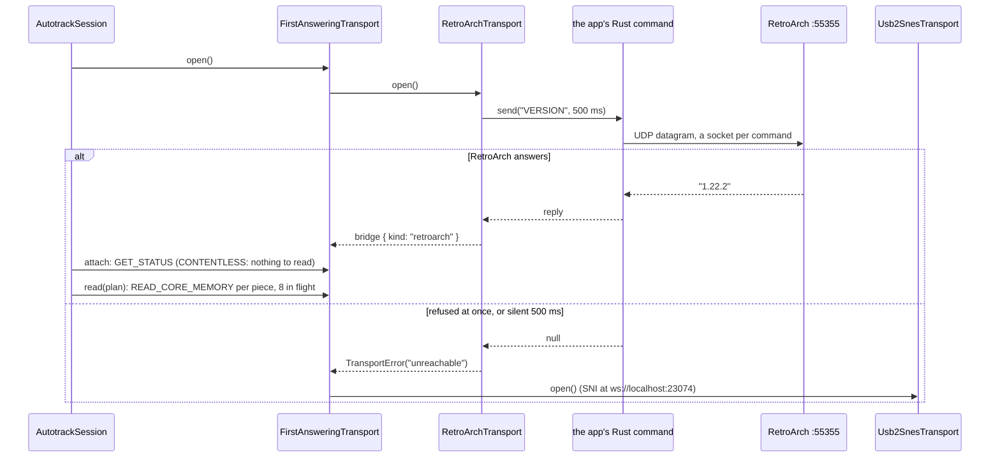

# @alltp/autotrack

The tracker's autotracking connection layer: it reaches a local bridge (SNI
or QUsb2Snes) from a static HTTPS page, or RetroArch itself from the desktop
app, attaches to the emulator or console, reads the memory a game pack asks
for, and says in plain terms what to fix when any of that fails.

- **Game-agnostic.** No address, no game id and no racing rule lives here. A
  pack supplies its memory ranges, its race profile, its race flag, its game
  check and, for a combined ROM such as SMZ3, its modes.
- **No UI, no DOM, no Node.** The sources compile against ES2022 only
  (`tsconfig.src.json`); browser APIs come through typed seams
  (`src/platform.ts`, `src/permission.ts`) that tests replace.
- **No runtime dependency.** `ws` is a dev dependency for the fake bridge.
- `src/index.ts` is the public surface; the app (`apps/web`) runs one session
  per game.

```ts
import {
  AutotrackSession,
  bus,
  definePack,
  defineRaceProfile,
  detectEnvironment,
} from "@alltp/autotrack";

const profile = defineRaceProfile({ /* the community's rules, see "Race Mode" */ });
const pack = definePack({
  gameCheck: { ranges: ["header"], verify: (bytes) => /* ... */ ({ ok: true }) },
  id: "alttpr",
  profile,
  ranges: [
    { address: bus(0x00ffc0), category: "rom-header", id: "header", size: 0x15 },
    { address: bus(0x7ef340), category: "items", everyMs: 500, id: "items", size: 0x40 },
  ],
});

const session = new AutotrackSession({ environment: await detectEnvironment(), pack });
session.subscribe((status) => render(status)); // status.code, see "Diagnostic codes"
session.onUpdate(({ changed, snapshot }) => apply(changed, snapshot));
session.onSteady((at) => holdClock(at)); // a poll ran, memory did not change
button.onclick = () => session.start(); // from a click: the browser may prompt
```

## Architecture

```
AutotrackSession ──────────────── one run loop, one generation per start()
  │  connect → list devices → attach → game check → poll, with backoff
  │  diagnoses every failure as a SessionStatus
  ├── Transport (interface) ────── Usb2SnesTransport on the site; in the
  │                                 desktop app FirstAnsweringTransport:
  │                                 RetroArchTransport (UDP), then usb2snes
  └── Poller ──────────────────── plans per (due set, mode), built once
        ├── planReads()            coalescing into usb2snes GetAddress pieces
        ├── assertRaceSafe()       checks every race plan before it is used
        └── MemorySnapshot         one buffer per attach, views per range
```

| Module | Role |
| --- | --- |
| `address.ts` | FX Pak Pro regions; LoROM/HiROM A-bus ⇄ FX Pak translation |
| `plan.ts` | Read planning: merge, pack into requests, cut at pages |
| `race.ts` | Race profiles, `covers`, the race guard |
| `race-mode.ts` | The Race Mode switch: setting × race flag |
| `pack.ts` | The pack contract and `definePack` (errors at load) |
| `transport.ts` | The transport interface and device types |
| `usb2snes.ts` | The usb2snes WebSocket client |
| `retroarch.ts` | RetroArch's network commands over an injected UDP `send` |
| `first-answering.ts` | Tries transports in order; the first that answers carries the session |
| `scheduler.ts` | The poller: two-phase ticks, modes, snapshots and diffs |
| `diagnostics.ts` | `SessionStatus`, failure classification |
| `permission.ts` | The browser's local network permission |
| `environment.ts` | `detectEnvironment()`: OS, CPU, browser, loopback gating |
| `session.ts` | `AutotrackSession`: the state machine |
| `setup.ts` | The setup guide as data, and `setupProgress()` |
| `report.ts` | `describeStatus()`, `diagnosticReport()` |
| `platform.ts` | Typed seams over the host's globals (WebSocket and the like), so the sources compile against ES2022 only |
| `errors.ts` | The error classes: `DefinitionError`, `RaceViolationError`, `TransportError` |
| `version.ts` | `AUTOTRACK_VERSION`, printed in the diagnostic report |

### Transports: usb2snes, and why not gRPC-web

SNI and QUsb2Snes both serve the usb2snes WebSocket protocol on
`ws://localhost:23074` (8080 is retired in both). It is the only transport
here. SNI also serves gRPC-web on port 8190; it was weighed for its device
kind, capabilities and `FetchFields`, and left out on evidence:

- **The core name is not there.** RetroArch's `GET_STATUS` reply puts the
  core's `system_id` first (command.c, `command_get_status`, master at
  75f278e286c1c6e9226d58268b4ab43b53974e84), and every
  SNES core's info file says `systemid = "super_nes"` (libretro-core-info:
  snes9x, bsnes_mercury_*, mesen-s, snes9x2010). SNI's `FetchFields(CoreName)`
  relays that string, so it cannot tell Snes9x from bsnes-mercury.
- **The device kind is already in the usb2snes path.** SNI's `DeviceList`
  returns device URIs whose scheme is the driver (`ra://`, `fxpakpro://`,
  `luabridge://`, `emunwa://`; services/usb2snes/usb2snes.go); QUsb2Snes
  names carry a prefix (`SD2SNES `, `RetroArch `, `Emu - `), and `Info`
  carries its flags (`NO_ROM_READ`).
- **Capabilities are static per driver** (`driverCapabilities` in each SNI
  driver), so they follow from the kind.
- **Errors are no richer.** SNI's RetroArch driver turns a `-1` read reply
  into zeros on both paths (devices/snes/drivers/retroarch/raclient.go,
  `MultiReadMemory`: "filling response with $00").
- **Cost.** A second loopback origin to permit, a CORS preflight per call,
  SNI only. Bundled with esbuild (minified, ESM, browser) for the two calls
  that matter, `ListDevices` and `FetchFields`:

  | Option | Minified | gzip |
  | --- | ---: | ---: |
  | `@connectrpc/connect-web` 2.2.0 + `@bufbuild/protobuf` 2.16.0 (generated `sni_pb.ts`) | 127,914 B | 35,851 B |
  | Hand-written gRPC-web framing and protobuf wire code | 1,582 B | 851 B |
  | For scale: this package's connection core (session, transport, poller) | 27,128 B | 9,887 B |

  Even the hand-written client would buy nothing the usb2snes path lacks.

The `Transport` interface takes plans in FX Pak Pro space and returns bytes,
so the desktop app's direct RetroArch transport slots in beside it (below).

### RetroArch, direct (the desktop app)

A page cannot send UDP; the desktop app can, so it reads RetroArch through
its network commands with no bridge (`RetroArchTransport`), and falls back to
SNI for every other device (`FirstAnsweringTransport`, tried in that order
on each connection; only "nothing answered" moves on).



- **Addresses.** `send` is injected: the transport is plain TypeScript, the
  app supplies a Tauri command (`apps/desktop/src-tauri/src/retroarch.rs`,
  which passes only `VERSION`, `GET_STATUS` and `READ_CORE_MEMORY`). A piece's
  FX Pak Pro address goes through `pakToBus()` under **the pack's mapping**
  (`profile.mapping`), as SNI translates for RetroArch. The mapping is not
  read from the header: SMZ3's `$00:FFC0` reads another part of the ROM on
  bsnes-mercury (the second ExHiROM half is not served), while `$C0:FFC0`,
  where `pakToBus` sends the pack's header range, reads `ZSM11.3.2`. A ROM of
  another mapping fails the game check, as it should.
- **Pieces.** `RETROARCH_LIMITS`: 4096 bytes a piece, eight a request, all in
  flight together. RetroArch serves commands once per frame: one at a time
  cost ~16 ms each, sixteen at once were answered in 2.6 ms. It caps a read at
  its memory descriptor's end only (`command_read_memory`, v1.22.2), so a
  reply can come back short, in silence: the transport reads on from there.
  The ceiling is the datagram (about 21,800 bytes of reply).
- **Replies.** The address comes back unpadded (`ffc0` for `00ffc0`) and is
  compared as a number. `-1` and a text is RetroArch's error, kept as the
  error's `reason`, so `classifyReadFailure` names the cause (`no memory map
  defined`: Snes9x, bsnes, bsnes-hd).
- **No content.** RetroArch without a game answers reads with the same `no
  memory map defined` as a core without a map. `attach()` reads `GET_STATUS`;
  while it says `CONTENTLESS` the transport sends no read and fails it, and
  the session diagnoses `no-content` (load the game), not the core.
- **Timeouts.** `VERSION` waits 500 ms (a closed port refuses at once, so an
  absent RetroArch costs nothing), a read 2 s. UDP has no connection: a reply
  arriving after `close()` is dropped.
- **Preference.** A fallback is kept only once it lists a device. Until
  then, each time the session asks for devices, `FirstAnsweringTransport`
  tries the transports before it again, and one answering ends the
  connection with a `superseded` error, which the session retries at once.
  Without it, a tracker opened before RetroArch, with SNI running, would
  wait on SNI and reach RetroArch through SNI once SNI found it (seen on a
  real setup).
- **Mirrors.** bsnes-mercury answers the second ExHiROM half with the first
  half's bytes (no error), as it does through SNI; the SMZ3 pack checks two
  bytes it can foretell before trusting that memory.

### The usb2snes protocol as implemented

From QUsb2Snes docs/Protocol.md and core/wsservercommands.cpp at
184545cb6ed174b6cc4e7e646ddf0ee23407ebd1, and SNI
services/usb2snes/usb2snes.go at 77ba8ac44ec63fc1c5f41549b6da9851085790a2.

- Requests are JSON text frames `{Opcode, Space: "SNES", Operands}`; JSON
  replies are `{Results: [...]}`; `GetAddress` replies with raw bytes, in one
  message (SNI) or several (QUsb2Snes on some devices): the client
  accumulates into the caller's buffer.
- Replies carry no id, so the client keeps **one request in flight** and
  queues the rest. A reply that times out drops the socket: a late reply
  would be taken for the next request's.
- `AppVersion` identifies the bridge (`SNI-v0.0.103`, `QUsb2Snes-0.7.42`);
  `Name` names the client; `DeviceList`; `Attach` has no reply, so `Info`
  follows to confirm it (Protocol.md's advice).
- `GetAddress` takes several `(address, size)` pairs. QUsb2Snes refuses a
  pair over 255 bytes when there are several ("VGet with a size > 255"), but
  takes one pair of any size, so a plan with one span sends it whole.
- Errors close the socket. SNI drops it without a close frame (the browser
  sees 1006); QUsb2Snes closes with 1000 and the error text as the reason,
  or 1008 "Not in trusted origin" for a site it does not trust yet.

### Address spaces

Every address in this package is in the **FX Pak Pro space**, the one
`GetAddress` takes on both bridges (SNI README "FX Pak Pro Address Space";
sni.proto `AddressSpace`):

| FX Pak Pro | Memory |
| --- | --- |
| `$00_0000-$DF_FFFF` | ROM, linear (file offset without header) |
| `$E0_0000-$EF_FFFF` | SRAM, linear |
| `$F5_0000-$F6_FFFF` | WRAM (`$7E:0000-$7F:FFFF`) |
| `$F7_0000-$F9_08FF` | VRAM, APU, CGRAM, OAM, MISC, PPU and CPU registers (FX Pak Pro only) |

What each bridge does with it:

- **FX Pak Pro**: native; SNI and QUsb2Snes pass addresses through.
- **SNI on RetroArch, Lua bridges and NWA emulators**: SNI translates to the
  SNES A-bus with the ROM's mapping, which it detects on `Attach` by reading
  the header (`mapping.Detect`, devices/snes/mapping/). The RetroArch driver
  assumes the core exposes the A-bus, "true for the bsnes-mercury core at
  least" (SNI README, RetroArch). SNI translates each piece's start address
  and reads on from there, so the planner never lets a ROM or SRAM piece
  cross an 8 KiB page (LoROM pages are 32 KiB, HiROM SRAM windows 8 KiB).
- **QUsb2Snes on RetroArch**: its own translation (retroarchhost.cpp,
  `translateAddress`): WRAM to `$7E0000+`; ROM only for HiROM with
  `READ_CORE_MEMORY` ("Half of LoROM is unmapped ... in bsnes-mercury"), so
  a LoROM game's ROM reads fail and Info reports `NO_ROM_READ`; on Snes9x
  it falls back to `READ_CORE_RAM`.

`bus(address, mapping)` translates a pack's A-bus address once, at load;
`busRange(first, last)` refuses a range that is not one block (a LoROM bank
crossing). The code ports alttpo/snes mapping/{lorom,hirom,exhirom}/mapping.go
at 644082b79cd30cc28a8f02ed545da286b9c4984a, the library SNI uses, but for one
limit: alttpo/snes masks LoROM banks with `$3F` (2 MiB of ROM, enough for
A Link to the Past), which folds Super Metroid's banks `$C0-$DF` onto `$80`.
Here LoROM covers 4 MiB (banks masked with `$7F`): Map Rando's seed name at
`$DF:FEF0` is ROM offset `$2F_FEF0`. SNI's own Pak-to-bus side
(`PakAddressToBus`) already covers 4 MiB, so the addresses it is sent come
back to the right bank. HiROM's ROM mirrors in the upper halves of banks
`$00-$3F` and `$80-$BF` map to the bytes the cartridge puts there (`$00:FFC0`
is ROM `$00_FFC0`): alttpo/snes folds them onto 32 KiB pages, an address
its own `PakAddressToBus` then sends to another byte. A property spec holds
every mapping to a model of the hardware: the address SNI sends back reads
the same ROM byte as the pack's.

ExHiROM (`"exhirom"`, the SMZ3 combined ROM's) is HiROM over 8 MiB: the
first 4 MiB in banks `$C0-$FF` and the upper halves of `$80-$BF`, the second
in `$40-$7D` and the upper halves of `$00-$3F`; its SRAM is HiROM's, banks
`$A0-$BF:6000-7FFF`. samus.link's seed block at `$80:FF50` is ROM `$00_FF50`,
the header at `$00:FFC0` ROM `$40_FFC0`, and which game runs, `$A1:73FE`, SRAM
`$E0_33FE`. The upper halves of `$3E-$3F` (ROM `$7E_8000-$7F_FFFF`) stay
unmapped: SNI sends `$7E_0000` to `$3E:8000`, 32 KiB short of that byte.

Example: the ALttPR race flag at A-bus `$30:8213` (LoROM) is ROM offset
`$18_0213`; WRAM `$7E:F340` is `$F5_F340`.

## Diagnostic codes

`session.status` is a `SessionStatus`, discriminated by `code`. Every
waiting status carries `retryInMs`: the delay before the next attempt, or
`null` when the session waits for the user (a permission change wakes it,
and so does `retryNow()`).

| Code | Meaning | Data for the UI | Retry |
| --- | --- | --- | --- |
| `idle`, `stopped` | Not started; stopped | | none |
| `connecting` | Opening the socket | `url`, `attempt` | |
| `local-network-prompt` | The browser shows its permission prompt (the socket has hung in CONNECTING for `promptAfterMs`, 1.5 s, and the permission reads `prompt`) | `permission` | waits for the answer |
| `local-network-denied` | The permission is denied, or a prompt was shown and not accepted | `permission` (name, state) | user (no timer: Chromium blocks a site for 7 days after 3 dismissals) |
| `browser-blocks-bridge` | Safari / iOS: ws://localhost from HTTPS is mixed content | `browser` | user |
| `bridge-unreachable` | Nothing answered: SNI not running, another port, or a block the browser does not report | `url`, `attempt`, `permission`, `detail` | backoff; user while a Chromium permission is undecided (151+ prompts even when nothing listens) |
| `bridge-refused` | The bridge accepted then refused the site (QUsb2Snes "Not in trusted origin": click Yes in its window) | `detail` | user (a retry pops QUsb2Snes's question again) |
| `no-device` | The bridge sees no emulator or console (QUsb2Snes lists RetroArch only once its core and content answer) | `bridge` | backoff, same socket |
| `attaching` | Attaching | `bridge`, `device`, `devices` | |
| `attach-failed` | `Attach`/`Info` closed the socket | `device`, `detail` | backoff |
| `memory-unreadable` | Attached, but memory cannot be read | `cause`, `evidence`, `remedy`, `detail`, `device` | backoff |
| `game-mismatch` | The pack's game check failed; `check.code` is `ARCHIPELAGO_ROM` (`archipelago-rom`) for a ROM Archipelago patched, which each pack knows by its world's title and the app answers with its Archipelago board | `check.code`, `check.message` | backoff, same socket |
| `connected` | Polling | `race`, `unreadable`, `paused` | a drop after `stableAfterMs` (5 s) reconnects at once |

`memory-unreadable` causes, with the evidence that settles them:

| Cause | Evidence | Remedy |
| --- | --- | --- |
| `no-memory-map` | RetroArch's reply `-1 no memory map defined` (command.c, `command_memory_get_pointer`), QUsb2Snes's "core does not support memory read", or **inferred**: SNI drops the socket on the first `GetAddress` of a RetroArch device with content loaded (mapping detection fails on the zero-filled header reads) | `switch-core` to bsnes-mercury |
| `address-unmapped` | `-1 no descriptor for address`, `-1 no data for descriptor` | `switch-core` |
| `no-content` | `Info` said nothing runs (SNI's "No Info" fallback, the FX Pak Pro menu), or QUsb2Snes's "not running a super nintendo game" | `load-game` |
| `rom-unreadable` | `Info` flag `NO_ROM_READ` and the game check needs ROM; QUsb2Snes "Can't get ROM info" | `use-sni` on QUsb2Snes |
| `zero-filled` | Every byte of the game check is zero: SNI's substitute for failed RetroArch reads | `switch-core` on RetroArch |
| `read-failed` | Anything else | `check-bridge-log` |

Which cores give RetroArch a memory map (`RETRO_ENVIRONMENT_SET_MEMORY_MAPS`
in the core's libretro.cpp): bsnes-mercury yes (SNI's documented core),
Mesen-S and Snes9x 2010 yes but untested with SNI, Snes9x, bsnes and bsnes-hd
no.

`describeStatus(status)` gives one English sentence per status;
`diagnosticReport()` a copyable plain-text report (package version,
environment, bridge, devices, status, message, remedy, race state, times),
without the ROM name or the User-Agent string.

## Local network access

Sources: Chrome release notes 142, 145 and 147; WICG Local Network Access
spec; Chromium and Firefox sources as cited in the research notes; Firefox
153 and 154 release notes; WebKit bug 171934.

- **Chromium** gates fetch to loopback from public pages since 142 and
  WebSockets since **147** ("WebSockets connections to local addresses now
  trigger permission prompts"). Since 145 the permission is split:
  `loopback-network` (localhost, 127.0.0.1) and `local-network` (LAN);
  `local-network-access` stays as an alias that combines both. The prompt
  reads "Access other apps and services on this device".
- **Firefox** gates loopback since 153 and WebSockets since **154**; it
  knows `loopback-network` and `local-network`, not the alias. A denied
  WebSocket looks exactly like a closed port.
- **Safari / iOS**: no prompt; `ws://localhost` from HTTPS is blocked as
  mixed content (bug 171934 open). The tracker cannot autotrack there from
  GitHub Pages; the desktop app is the way.
- `ws://localhost` is not mixed content in Chromium and Firefox (loopback is
  potentially trustworthy); no `Access-Control-Allow-Private-Network` and no
  `targetAddressSpace` are needed for it.
- A page cannot tell "denied" from "nothing listening" from the socket
  (close 1006 either way, by spec). `systemPermission()` queries
  `loopback-network`, then `local-network-access` (Chrome 142-144); the
  session reads the state after a failure and how long the socket hung: a
  pending prompt holds a loopback socket in CONNECTING while the bridge
  listens. The UI should call `start()` from a click while the state is
  `prompt`.

## Race Mode

A **race profile** is one community's rules: the memory it permits, its
categories of tracked information, permitted or not, and its race flag. The
package defines the shape (`defineRaceProfile`); packs bring the profiles.
The ALttPR one answers to the [ALTTPR Auto-tracker Rules and Guidelines
v2.0](https://docs.google.com/document/d/e/2PACX-1vTgsj0FMiWyaBOYP97e_ABc4P_0vIGiJxoUJ5Rj-PBr1T7i_zpyLqhLLVkbftPwS_B6nwad5j5zhtMg/pub) (2024), which racetime.gg's ALTTPR category links; it lives in the
pack (`packs/alttpr/src/autotrack/race-profile.ts`), each category quoting
v2.0, and this package's tests import it. It reads what v2.0 permits in so
many words, and nothing it leaves in doubt:

- memory (LoROM, ends inclusive): `$00:FFB0-$00:FFDF` (header),
  `$7E:0010` (the game mode), `$7E:F000-$7E:F500`, `$30:8213-$30:8214`
  (the race flag and its complement). v2.0 lists no addresses ("it does not
  matter where information is gathered, only that its use is allowed or
  disallowed") and lets a tracker read any ROM but entrance and location
  contents: these windows are the tracker's own limit, from the rules'
  earlier version but for WRAM, cut to the game mode after the race admins'
  clarification of June 2026 (a tracker may not identify or display Link's
  position, room or dungeon), and for bank `$30`, cut to the flag: the seed
  type beside it is a setting, which v2.0 lets a tracker set itself up from
  only "if it can ensure it does not do so on Mystery seeds", and a race
  seed's ROM does not say whether it is one;
- permitted categories: items, keys, boss kills, checks outside and inside
  dungeons (`dungeon-checks`: v2.0's "dungeon-locations" and per-dungeon
  counts), game start, goal, the heart count on screen (`health`:
  MaximumHealth) and the bottles' contents (`bottles`), both named among
  the HUD's counts v2.0 lets a tracker react to, the pendants and crystals
  taken (`prizes-held`: "their prizes upon collection", the pack's
  decoders letting the crystals out as a count, never which is 5 or 6), the
  MSU-1 track, the header, the race flag; forbidden: entrances and spheres
  (as v2.0 has it), the ROM's prize table and the world map's prizes
  (`prizes`: location contents and map checks), the rest of the HUD's data
  (bombs, heart pieces) and the ROM's settings and stats, which v2.0 allows
  within limits but Race Mode keeps the player's; and anything else;
- race flag `$30:8213`: `0x01` race, `0x00` not. v2.0 names no race flag:
  the randomizer's tournament flag is what switches Race Mode on.

Super Metroid's (Map Rando) and SMZ3's profiles live in their packs:
racetime.gg's categories for them link no tracker rules, so each keeps to
what its community's tournament rules state (Map Rando's: items and boss
kills; SMZ3's: v2.0), as their READMEs describe.

Compliant by construction:

1. `definePack` refuses a race-permitted range outside permitted memory and
   a category the profile does not know.
2. Each tick has a **race phase** and a **casual phase**. The race phase
   reads the flag, the mode probe and the permitted ranges, and **no other
   byte**. Casual plans bridge gaps of up to `gap` bytes to save pieces; a
   race plan never does: every byte outside the race-permitted ranges read
   in the mode it is planned for (and the flag) is a barrier
   (`pack.raceBytes`, `pack.raceBarriers`, one entry per mode). In doubt,
   forbidden: a byte no range names (ALttPR's rupee count between the
   bottles and the compasses) is not read, even to be discarded.
   `assertRaceSafe` checks every byte of every request of every race plan
   when it is built, before any use, against those ranges, not against
   range names. On ALttPR this costs nothing that matters: 793 bytes in 20
   pieces instead of 830 in 15, still one request.
3. The casual phase (forbidden categories) runs only if Race Mode is off
   **after the flag the race phase just read**: a race ROM loaded mid-session
   never receives a forbidden read. A casual fetch already in flight when
   Race Mode comes on (the player's switch lands during the request) is
   dropped, never laid into the snapshot.
   As Race Mode comes on, the poller also **forgets** the bytes of every
   range it forbids (`has` turns false, the ids are reported changed), so a
   reading decodes them as unread instead of holding what the race no longer
   lets the tracker see; they are read again when Race Mode goes off.
4. It fails closed: in `auto`, Race Mode is on until the flag reads "open",
   and stays on when the device cannot read ROM (`NO_ROM_READ`) or the flag
   reads neither value.
5. The setting is the user's (`raceSetting`, then `setRaceMode`, which
   takes effect from the next tick and reports the new status at once).
   `on` holds Race Mode whatever the flag says, for a race on a seed
   generated without it; the app offers `auto` and `on` for every game
   (`apps/web/src/autotrack/raceChoice.ts`), never `off`. The package
   supports `off` over a race ROM, with `race.overridden` true for the UI
   to warn.

`race.raceLegal` is true when every read the poller issues is permitted:
Race Mode is on, or the pack reads nothing forbidden.

The fast-check property in `scheduler.spec.ts` runs random packs under the
ALttPR profile and checks every piece sent: inside permitted memory, and
forbidden bytes only where a permitted range covers them.

## Polling

- A pack's cadences (`everyMs`) set a tick (their gcd) and a cycle (their
  lcm, at most 4096 ticks). `definePack` lays the cycle out as distinct due
  sets; the poller builds a plan per due set and mode on first use and
  reuses it, with the request's JSON cached by the transport.
- A poll allocates no buffer: bytes land in one scratch buffer, then in a
  snapshot buffer allocated at attach, with a fixed view per range. What a
  poll still allocates: the promises, the WebSocket message.
- `onUpdate` receives the same `PollUpdate` object every time, with the ids
  that changed; `snapshot.previous(id)` holds the bytes before the change.
- `onSteady` receives the clock's time after each poll that read memory and
  found it unchanged (never the first poll, which reads every range for the
  first time, and never while the page is hidden: nothing is polled then).
  It is how a follower learns that a frame counter stands still, a paused
  emulator or a frozen game, which `onUpdate` can never say: it speaks only
  of change. It holds for a counter the pack reads on every tick; a counter
  read more slowly cannot tell a steady tick from one that did not read it. A tick that only an assist's ranges (`optIn`) made due is
  no poll for this and never reports steady (`Poller.readBase`).
- Polling pauses while the page is hidden (`pauseWhenHidden`).

### Assists: opt-in and gated ranges

A pack can offer an assist the player turns on, which reads memory only while
it is wanted. Four fields of a `RangeSpec` carry it; all but `optIn` are for
ranges of a **forbidden** category, so Race Mode never reaches them
(`definePack` refuses them on a permitted one).

- `optIn: "name"`: the range is read only while the host has the switch on
  (`session.setOptIn(name, on)`, or `SessionOptions.optIn` at the start; it
  outlives a reconnection). Off, the poller plans no request for it, a tick due
  for nothing else sends nothing, the range forgets its bytes (`has` is false,
  the id is reported changed), and a read in flight is not laid back. Plans are
  cached per due set, mode **and** switch mask. At most 8 switches.
- `when(view)` (with `everyMs`): a **gate**. The range is read only while it
  holds over the snapshot as the tick left it, after the tick's other reads
  and never in a plan: the gated ranges that are not alone go together, as one
  request. Put the bytes the gate reads in the pack's own plan at its own cadence
  (an `optIn` range in the casual plan costs no request of its own, as it rides
  with the others); the gated ranges can then fall due more often than that, at no
  cost while the gate is shut. A tick that has no race phase of its own reads the
  race flag first, so a race ROM loaded since is caught before any gated read.
  When `when` stops holding the range forgets its bytes, unless `keep(view)`
  holds (a menu over the room): nothing is read then, nothing forgotten. The
  group's request covers the ranges whose gate holds and whose switch is on,
  planned once per such set: a range behind a switch that is off is never asked
  for beside the others. A switch turned off counts its gates as shut, so on
  again an alone range is read at once.
- `alone: true`: a gated big span, sent as a request of its own, never merged:
  planned beside others, usb2snes cuts a span into 255-byte pieces (QUsb2Snes
  refuses more in a multi-range request), while a single range goes whole.
  Measured against SNI and RetroArch, 8 KiB took 64-107 ms as 33 pieces and
  16-21 ms alone. It is read when its cadence is due, on the tick `when` turns
  true, and on a tick where a range of `refreshOn` changed, so its bytes match the
  state read with them.
- A gated read the device refuses (a RetroArch `-1`, a reply that does not
  fit: a `device` or `protocol` error) is not the session's failure: it skips
  the range on that device, for the rest of the session and through
  reconnections, and lists its id among `unreadable` in the `connected` status
  and the diagnostic report; the pack's own reads go on. A dropped connection or
  a timeout says nothing of the range (the emulator closed, the bridge
  restarted; over usb2snes a refusal looks the same): the tick fails and the
  session connects again, as for the pack's own reads. Only when it fails so on
  a second connection to the same device is the range skipped.
- A tick that only an assist's ranges made due says nothing of a game standing
  still: it is not a steady poll (`Poller.readBase`).

Gated ranges are read in the casual phase: the tick that Race Mode holds never
reaches them, and one that comes on while a read is in flight drops it.
ALttPR's dark room map uses all of it (`packs/alttpr`, "The dark room map").

An alone range may refresh on another alone range: `definePack` orders them so
the one refreshed is read after the one it watches, on the same tick, and
refuses a `refreshOn` that loops.

### On-demand reads

Some bytes have no address a pack can write down: a ROM table points at them,
or a pointer in WRAM does. `session.request({ category, ranges })` (the
poller's `request`) reads such ranges, FX Pak Pro addresses computed at run
time, and resolves with each range's bytes in order.

- **Casual by construction.** The category must be one the race profile
  forbids (`DefinitionError` otherwise), so no race reads it. A request is
  served on a coming tick, after its gated reads, never while Race Mode is on:
  one asked in Race Mode, or before the race flag is first read, is refused
  (`RaceViolationError`); one waiting when Race Mode comes on is refused
  unread; one whose bytes come back after it came on is refused, the bytes
  dropped. A tick that would not have read the race flag reads it first.
- Each range lies inside one memory region; a request carries at most
  `ON_DEMAND_MAX` bytes (64 KiB), planned like any read (ROM pieces stop at 8
  KiB pages, so LoROM data crossing a bank end is one range). ROM a device
  cannot read is refused (`TransportError`).
- A failed read rejects that request, and nothing is skipped: the next request
  tries again. What else follows depends on the bridge. A RetroArch `-1` (the
  desktop app's direct path) fails that request alone and the tick goes on.
  Over usb2snes a failed read closes the socket (a timeout drops it, and a
  refusal is signalled by a close): the rest of the tick fails and the session
  connects again, as for any lost connection. A host should therefore not
  retry a failing read on a short fixed beat (the dark room's picture backs
  off and gives up). Requests waiting when the connection ends, or asked while
  not connected, are rejected.
- A request may carry a `signal` (an `AbortSignal`): aborted while it waits for
  its tick, it is rejected with an `AbortError` and never sent. The dark room's
  picture drops its reads so when its style turns to Plan.
- What a request reads is the host's to hold: the session keeps nothing.
  ALttPR's dark room picture reads the ROM's tile sheets and Link's graphics so
  (`packs/alttpr`, "The dark room in the game's graphics").

### Modes: combined ROMs

SMZ3 holds Super Metroid and ALttP in one ROM: the running game's state is
in WRAM, the other's in SRAM. A pack declares `modes: { range, names,
decode }`: the probe range is read on every tick, first, and ranges with
`modes: [...]` are read only in those modes. Plans follow the last mode the
probe gave; a tick that sees a new mode keeps only the shared ranges and
skips the casual phase, and the next tick reads the new layout. From the
switch on, every mode-bound range counts as unread (`has` is false) until
read in the new mode: a decoder never takes an earlier stint's bytes, which
still sit in the snapshot, for the current one. Categories
stay per range, and the profile per community.

A portal can also fall inside a tick, between the probe and the reads of
mode-bound ranges, which would then hold the other game's memory under the
old mode's name. A tick that read a mode-bound range (either phase) therefore
reads the probe once more at its end, in a request of its own (two bytes), and
if the mode is no longer the planned one it counts as a switch: the update
says `modeChanged`, every mode-bound range counts as unread, the casual
ranges it read are dropped, and the next tick plans for the new mode.

**What it costs.** One extra request of two bytes (the probe) on a tick that read a
mode-bound range, at the pack's cadence (once a second for SMZ3); nothing on any
other tick. A pack without `modes` (A Link to the Past, Super Metroid) builds no
probe plan and sends exactly the requests its plans hold, as before:
`scheduler.spec.ts` counts them tick by tick against the plans worked out from
each pack's data, and the same spec passes on the poller from before the guard.
**Why.** The race phase reads the probe first and the casual phase reads after
it, so a portal between them (or between the probe and a mode-bound read
later in the same request) hands a decoder the other game's memory under the old
mode's name, which no ordering of one request's pieces can rule out: SRAM sorts
before WRAM, and the probe is SRAM.

## Setup guide and environment

`SETUP_STEPS` is the "Set up autotracking" guide as data: get SNI, run it,
set up the emulator (RetroArch with bsnes-mercury and Network Commands, FX
Pak Pro, BizHawk, NWA), allow the browser connection, load the game. Each
step lists the status keys that mark it done or failing, and variants per
OS, CPU, browser and device, with English text, links and sources.
`setupProgress(status, environment, { game, device })` derives each step's
state and the step to open; `device`, the UI's pick, fits the text until the
session names the device it attached. `sniAssets(environment)` names the SNI download
(`sni-v{version}-windows-amd64.zip`, `-darwin-universal.tar.gz`,
`-linux-amd64(-notray).tar.xz`, arm64 variants).

`desktopSetupSteps(device)` is the desktop app's guide: for RetroArch, read
directly, the emulator step (with RetroArch not answering among its
failures) and the game; for any other device SNI's steps as on the site. No
browser stands in between, so neither has the permission step.

`detectEnvironment()` reads User-Agent Client Hints (CPU from
`getHighEntropyValues`) and falls back to the User-Agent string, which only
gives the CPU where it is not frozen (Firefox on Linux): elsewhere `arch` is
`"unknown"` and the guide lists every download for the OS.

## Tests

- `test/fake-usb2snes.ts`: an in-process usb2snes server on `ws`, over a
  16 MiB memory image, behaving like SNI or QUsb2Snes and failing on demand
  (no device, dropped socket, dropped mid-read, close with reason, untrusted
  origin, hangs, chunked replies). `ws` is there because Node 22 ships a
  WebSocket client, not a server; the client side is Node's own WebSocket,
  the one browsers expose.
- `test/memory-transport.ts`: a scriptable in-memory transport for the
  session under fake timers.
- `test/fake-retroarch.ts`: a RetroArch answering `send` as 1.22.2 with
  bsnes-mercury did (unpadded echoes, short reads at a descriptor's end,
  `CONTENTLESS`, Snes9x's refusal), by bus address over a memory image.
- Properties (fast-check): planning covers every byte, respects limits and
  pages, bridges at most `gap` bytes and no barrier, makes the fewest spans,
  and places every range; Race Mode never sends a forbidden byte; address
  translation round-trips.
- `test/session.e2e.spec.ts`: one realistic session end to end.
- Each guarantee was checked by breaking the code and watching a test fail.

## Checked against a real bridge

SNI v0.0.103 (linux-amd64), RetroArch 1.22.2 (AppImage), bsnes-mercury
Performance (libretro buildbot, 2026-10-16), an ALttPR open seed, on
2026-10-16:

- `AppVersion` answers `SNI-v0.0.103`, with a `v`; `DeviceList` gives
  `ra://127.0.0.1:55355`; `Info` gives `["1.22.2", "retroarch", "alttpr"]`
  for content named `alttpr - NoGlitches-open-ganon_9MQ9gO1wMD`, so the ROM
  field is not the full name.
- bsnes-mercury exposes ROM bank `$30`: `GetAddress` at `$18_0213` (A-bus
  `$30:8213`, the race flag) and at `$00_7FC0` (the header) returned the
  ROM file's bytes, through SNI and through `READ_CORE_MEMORY` directly.
- WRAM at `$F5_xxxx` reads live values (game mode `$7E:0010`).
- Snes9x answers `READ_CORE_MEMORY` with `-1 no memory map defined`.

## Checked against a real RetroArch, direct

RetroArch 1.22.2 (AppImage) and the desktop app's release build on Linux,
in a private display, SNI v0.0.103 running beside them, on 2026-10-19:

- With bsnes-mercury and an ALttPR Crosskeys seed: connected directly
  (`RetroArch 1.22.2 · udp://127.0.0.1:55355`), the seed's run type read.
- The app opened before RetroArch: SNI answered first and saw no device;
  once RetroArch started, the session left SNI for it (`superseded`). Before
  that rule, it stayed on SNI and reached RetroArch through it.
- RetroArch without content: "No game is running", the game step failing.
  Snes9x: "Cannot read the game's memory", from RetroArch's own `no memory
  map defined`, with bsnes-mercury as the fix.
- An SMZ3 seed (ExHiROM): the title `ZSM11.3.2…` read at `$C0:FFC0`, Super
  Metroid running, the seed's settings read, its requirements reported as
  not served.

## Not verified against a real bridge

- SNI dropping the socket on RetroArch + Snes9x is read from SNI's source,
  not observed (RetroArch's own refusal, above, is).
- QUsb2Snes's close reasons for RetroArch failures: only "Error in device
  protocol" reaches the client in the code read; the specific texts may not.
- Chromium's 7-day block after dismissals and Firefox's behaviour while its
  prompt is open come from source reading, not from a browser.
