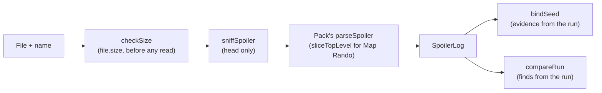

# @alltp/spoiler

The game-agnostic part of reviewing a finished run against the seed's spoiler log. A game pack
parses its randomizer's file into the one shape defined here; this package holds what does not
depend on the game: the shape, the bounded slicer that makes a 21 MB log cheap, which-randomizer
detection, the question "is this file the run's seed?" and the comparison of what the player did
against what the seed held.

It imports nothing: no DOM, no Node, no dependency. The sources type-check against ES2022 only, so
the package runs unchanged in a page, a Web Worker and the tests. Dependencies point one way: the
app and the packs import this package, never the reverse.

The package stops where the game starts: it reads no store and no timeline. The app's adapters turn
a run into `Evidence` and `Find`s and a pack turns a file into a `SpoilerLog`.

## The model (`model.ts`)

A `SpoilerLog` is what any pack returns. `placements` is the core: one `Placement` per location,
with the item it held and the playthrough `sphere` it sits in (SMZ3 and ALttPR spheres, Map Rando
steps; null when the file puts it in none). The rest is the file's context: `seed` (the id and where
it came from, `content` or `file-name`), `spheres` (0 when the file has no playthrough, as a spoiler
race's), `start`, `skipped` (names the pack saw and ignored, for the dialog) and `extra`, the game's
own typed facts (settings, medallions, prizes, objectives).

Pack ids are the identity: `location` is the pack's location id and `item` the pack's item id, so
the app can lay a placement over a marker or a grid cell without a name lookup. Names as written
(`locationName`, `itemName`) are kept for display. A `Placement` has no "level": a progressive item
is several placements of one item id, told apart by their order.

## Results and errors (`result.ts`)

Everything that reads input data answers `{ ok: true, value } | { ok: false, error, detail? }` and
**never throws on it**; specs hold the readers to that with random text. `SpoilerError` is the one
list of reasons, shared with the app (which words each one) and the packs:

| Code | Meaning |
|---|---|
| `not-over`, `race-mode` | the app's gate: no review while a run is live or in Race Mode |
| `too-large` | over the game's size bound |
| `not-a-spoiler` | binary, a ROM, or not the document a spoiler is (also every slicer failure) |
| `other-game` | another randomizer's file, one the tracker has |
| `unsupported` | Archipelago, samus.link's Super Metroid, multiworld |
| `stripped` | the site withheld the spoiler (race seed, mystery) |
| `newer-version` | names or items the pack does not know |
| `seed-differs`, `settings-differ` | the file is not the run's (see below) |

A `detail` is short context the code does not carry (a key, a setting, two seeds) and is cut to 80
characters: a refusal never quotes a file at length.

## Bounds (`limits.ts`)

`checkSize(game, bytes)` is checked on `file.size` before a byte is read: 1 MiB for ALttPR and SMZ3
(their logs are 20-80 KB), 64 MiB for Map Rando (about 21 MB, nearly all of it sm-json-data copied
into the file). `SNIFF_HEAD_LENGTH` is how much of a file `sniffSpoiler` needs, so the rest is
never decoded for that purpose. `MAX_SLICE_DEPTH` bounds the slicer.

## `sliceTopLevel(text, keys)`

Map Rando's `spoiler.json` is 20.9 MB of which the tracker reads about 39 KB (`summary`,
`all_items`, the objectives and a few sizes); `details`, `game_data` and the traversals are the other
99.8 %. `sliceTopLevel` walks the top-level object, skips every value it does not want by counting
brackets (strings skipped whole, so a `}` inside one counts for nothing), and `JSON.parse`s only the
wanted values.

Measured on the real sample in Node 24, desktop CPU: **36-40 ms and 39 KB kept, against 80-120 ms
and about 34 MB of heap for a full `JSON.parse`**. A phone is several times slower, which is why
the app runs it in a worker.

Properties the specs hold it to:

- same answer as `JSON.parse` on random documents (any keys, escapes, indentation) and on a 4 MB one;
- bounded: nothing recurses, nesting past `MAX_SLICE_DEPTH` (256) is refused (10^5 levels included),
  and it never allocates for what it skips;
- every malformation is a `not-a-spoiler` refusal: every proper prefix of a valid document, text
  after the object, a bad key, an unterminated string or escape, a wanted value that is not JSON;
- a repeated key keeps its last value, as `JSON.parse` does; a `__proto__` key is data.

What it does not do: validate what it skips. Brackets are counted, not matched by kind, so a file
that is not valid JSON may pass in a part nobody asked for; the wanted values are fully parsed.

## `sniffSpoiler(head, fileName)`

Which randomizer wrote a file, from the first `SNIFF_HEAD_LENGTH` characters and the name. It
answers `{ known: true, game, format }` (`format` is null for ALttPR, where only the body tells the
plain vt log from the entrance randomizer's) or `{ known: false, what }` with `what` one of
`archipelago`, `smz3-sm` (samus.link's Super Metroid, a real spoiler this tracker does not read),
`rom` (a NUL or replacement character in the head, or a ROM or archive extension) and `unknown`.

Signatures, each from a real file: ALttPR's JSON starts with `"meta"` (the Save Spoiler file) or
with `"logic"` and `"patch"` (the S3 seed file); Map Rando's carries `item_priority`, `all_items`,
`start_location` or a first `summary` step; samus.link's Download starts `- SMZ3 <version>` (`- SM`
for Super Metroid) and its API starts `{"seed":{` (its `gameId` sits after the spoiler text, past
any head, so a Super Metroid API file reads as SMZ3 here and its pack refuses it). The sniff decides
nothing about soundness: that is the parse.

## `bindSeed(evidence)`

Whether a log is the run's, one rule for every game: **refuse on any contradiction; verified when
the seed ids are equal; otherwise "not verified", with the note shown, never silently trusted**.
The adapter gathers `Evidence`: the seed id each side holds (ALttPR's hash, SMZ3's guid, null where
unknown) and a list of `Fact`s both sides may state (settings, a medallion on the board, a set of
objectives). Then:

1. two seed ids that differ: `seed-differs`, `detail` "run / file";
2. a fact stated by both with two values: `settings-differ`, `detail` "name: run / file";
3. equal seed ids: `verified`; else `not-verified`, with how many facts agreed.

A side that states nothing contradicts nothing, so a manual run (no seed) and Map Rando (a log that
names no seed at all) are always `not-verified`, and only a refusal can say a log is wrong.
Values compare strictly (`7` is not `"7"`): the adapter normalizes.

## `compareRun({ placements, finds, unknown })`

Sets what the player did against the seed's playthrough. A `Find` is one event the tracker
recorded: a `location` checked, an `item` got, or both, with a growing `at` (ms into the run, or
its order). One find per event; an adapter that has a check and the item it gave makes one find with
both.

- **By location**, exactly: a find with a `location` goes to that placement (the earlier of two for
  one place counts; the other is `unmatched`).
- **By item**, for a find with an `item` and no location (a run without per-location checks, a
  progressive upgrade): the k-th find of an item goes to the k-th placement of that item in sphere
  order. These entries are `inferred`. This is the one place the comparison guesses, so the
  entry says so.
- Each `Entry` is `found`, `missed` or `unknown` (never found, and the caller listed the location
  in `unknown`, as for a dungeon's checks outside autotracking, which count chests and do not say
  which).
- `behind` is the lateness: how many placements of **later spheres** were found before this one. A
  sphere is where an item becomes reachable, so finding it after some of the next sphere means
  the player took another route (a shortcut, a trick, a different order), which the review
  reports without calling it wrong.
- `summary` counts the placements of the playthrough (those with a sphere): `required`, `inOrder`,
  `late`, `missed`, `unknown`. Placements outside the playthrough get entries, not counts.

Lateness is O(r²) over the r required placements (a few hundred at most); matching sorts the
finds. Specs cover in-order, late, missed, unknown, ties in time, repeated places, progressive
items by item, and that the input is not mutated.

## Tests

Specs sit beside the sources (`src/*.spec.ts`) and run in Node (`pnpm test`, project `spoiler`).
The sniff specs quote the heads of real files (alttpr.com, Map Rando, samus.link). The real files
themselves arrive with each pack's parser, with their provenance. A spec that cannot fail is a bug:
the slicer's specs were checked by breaking its escape handling and watching them go red.
