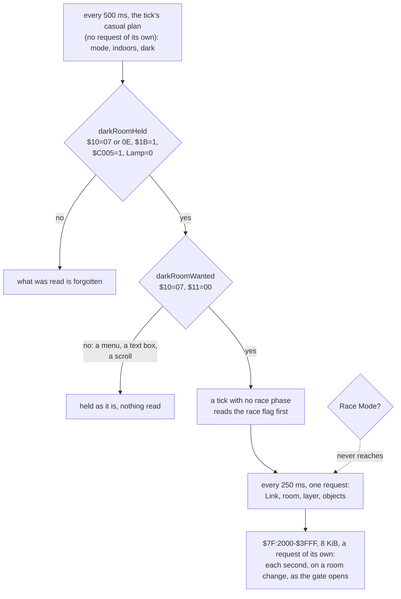
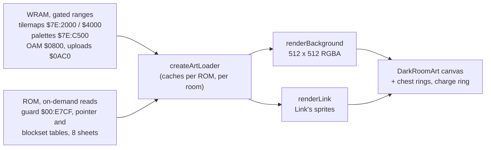
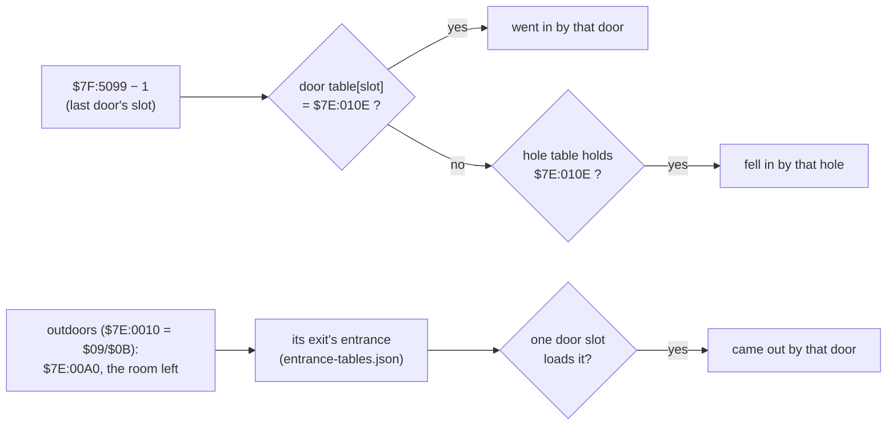
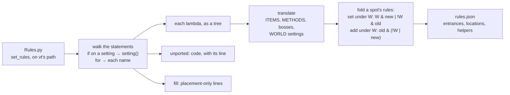

# @alltp/pack-alttpr

The A Link to the Past Randomizer game pack: the v31 rules (Standard, Open and
Inverted worlds, NoGlitches) as plain data over `@alltp/engine`, read from
[sporchia/alttp_vt_randomizer](https://github.com/sporchia/alttp_vt_randomizer)
at the commit `upstream.json` pins, and held to upstream's own test cases.

| Module | Ports |
| --- | --- |
| `src/items.ts` | `app/Item.php`, `config/item.php`: item ids, ranges, and how upstream counts them |
| `src/settings.ts` | `app/World.php`, `config/logic.php`: every config value a rule reads, `UNKNOWN` for those a Mystery run hides, and the presets |
| `src/helpers.ts` | `app/Support/ItemCollection.php`: `@canLiftRocks`, `@hasSword2`… |
| `src/bosses.ts` | `app/Boss.php`, `app/Randomizer.php` (`placeBosses`): each boss's `canBeat`, the boss each dungeon fights, and the bosses each may hold under boss shuffle |
| `src/world.ts` | `app/Region.php`: regions, entrances, prizes, `canFill` |
| `src/worlds/*.ts` | `app/World/Standard.php`, `app/World/Open.php`, `app/World/Inverted.php`: the region modules of each world |
| `src/regions/**` | one module per upstream region file |
| `src/fill.ts` | `app/Location.php`: `canFill`, whether the randomizer may place an item somewhere |
| `src/keys.ts` | `app/Support/LocationCollection.php`: where a dungeon's items may sit (`itemInLocations`), and the key model |
| `src/dungeons.ts` | the thirteen dungeons, the code of their items and their pool |
| `src/tracker.ts` | `TrackerInput`, what the player records, and `toState`, the state it gives |
| `src/legacy.ts` | the app's save format before the pack (version 5), mapped to the pack |
| `src/markers.ts`, `src/marker-status.ts` | the map markers, and what a marker shows (`markerStatus`, which any game's map takes) |
| `src/goals.ts` | `app/Randomizer.php`, `config/alttp.php`, `app/World.php`: where each goal puts the Triforce, its go mode, and a Triforce Hunt's pieces |
| `src/seed-link.ts` | `app/Seed.php`, `routes/web.php`: a seed's hash, from a link to its page, and where its file lies |
| `src/entrances.ts` | `cassidoxa/ALttPEntranceRandomizer` (`EntranceShuffle.py`, `Regions.py`), at the commit vt pins: the overworld's entrances and where the crossed shuffle may lead them (`src/entrances/er.json`, imported), and the doors and holes autotracking shows Link went through (`linksOf`) |
| `src/seed-file.ts` | `app/Jobs/SendPatchToDisk.php`, `World.php`, `EntranceRandomizer.php`: a seed's settings from its file (its entrance shuffle included, and its logic, any of the five alttpr.com offers, `RandomizerController.php:110-116`, where the ROM's seed type folds the three major ones into one), through a Zod schema of `spoiler.meta` |
| `src/spoiler/*.ts` | `World::getSpoiler` (`app/World.php`), the entrance randomizer's `Spoiler.to_json` (`BaseClasses.py`): the spoiler log alttpr.com lets a player save, as `@alltp/spoiler`'s model (see "Spoiler logs") |
| `src/er-world.ts` | `cassidoxa/ALttPEntranceRandomizer` (`Regions.py`, `Rules.py`): the world a seed with shuffled entrances is filled in, for the doors noted (see "The entrance randomizer's world") |
| `src/derived.ts`, `src/medallions.ts` | facts the state derives before solving, for the rules that are not monotone in the items (Palace of Darkness's keys; what a medallion pad wants) |
| `src/location.ts`, `src/rules.ts` | what a location is (its kinds, its rule and upstream source); every named rule, as the engine loads them |
| `src/autotrack/*.ts` | the autotracking pack (`ALTTPR_AUTOTRACK`): the memory map, decoders, game and race-flag probes, race profile, check flags, seed settings, the prizes the game shows (`prizes.ts`) and the pad medallions it shows (`medallion-pads.ts`), from the `z3randomizer` ASM and the ALTTPR Auto-tracker Rules v2.0 |
| `src/pack.ts` | the run's world, compiled with its settings |
| `src/tricks.ts` | `config/logic.php`, `CustomizerController.php`, the customizer's `glitches.js`: the tricks world, six minor tricks as items (see "Tricks") |
| `src/margin.ts`, `src/rewritten.ts` | `itemPlacement !== 'basic'` in the regions' health gates and `Boss.php`, `region.requireBetterSword` and `requireBetterBow` (`World.php`): the world without basic placement's safety margins (see "Basic placement's safety margin"), and the rewritten world it shares with the tricks world |

`upstream.json` maps every upstream file to its module, with its status;
`test/contract.ts` checks the pack against every case of the test files it
marks ported.

## The world model

Upstream has no graph. Each region is an object with a `can_enter` closure,
which may call another region's `canEnter`, and each location a closure that
runs after its region's (`Location::canAccess`). The pack turns that into the
engine's graph:

- **Regions.** Each upstream region becomes an engine region whose id is the
  camelCase of its key in `World/Standard.php` (`regionId('Tower of Hera')`
  is `towerOfHera`), so any module can name it. A module may split a region
  into parts for its own use (Turtle Rock's three ways in); a part has no
  `name`.
- **The start.** Upstream has no start region: a region whose `can_enter`
  calls no other region's is entered from anywhere. The graph starts at
  `start`, which holds nothing, and that entry is an entrance from `start`.
- **Entrances.** A region lists its ways in, its `can_enter` read as an OR of
  branches. A branch that calls `X->canEnter()` is an entrance from `X` with
  the rest of the branch; any other is an entrance from `start`; an OR gives
  several. Conditions around the OR go into each branch. East Death
  Mountain's `RescueZelda && (… || Hookshot && West->canEnter() || Hammer &&
  Hera->canEnter())` is `{ from: "westDeathMountain", req: "rescueZelda &
  hookshot" }` and `{ from: "towerOfHera", req: "rescueZelda & hammer" }`,
  its glitch branches entrances from `start`. The entrance lives in the
  module of the region it enters, as upstream's rule lives in that region's
  file. An entrance cannot `reach()` a region: the engine's single pass
  refuses it, so a cross-region condition is always the graph's.
- **Locations.** A location's `req` is its closure without its own region's
  `canEnter`, which the graph already applies. Another region's `canEnter`
  inside it is `reach(id)`; another location's `canAccess` is that location's
  rule (and `reach()` of its region if it is elsewhere). Its id is
  `locationId(name)`, its `kind` the upstream class, its `source` the line of
  its closure, or of its declaration when it has none.
- **Prizes.** A region's `can_complete` is the rule of its prize location
  (`RegionDef.prize`): the pendant or crystal of a dungeon, Zelda, Agahnim. A
  dungeon's `can_complete` is its boss's `canAccess`, so the boss and the
  prize share one rule. The tracker derives pendants, crystals, `rescueZelda`
  and `defeatAgahnim` from what the player records; the solver does not
  compute events.
- **The overworld.** No hub stands for the Light World: its three regions
  enter from `start` with `rescueZelda`, as upstream writes them. West Death
  Mountain enters from `start` (the flute, or a glove and the lamp), East
  Death Mountain from West Death Mountain and from Tower of Hera, the Dark
  World's regions from `start` (Agahnim, or the hammer and glove routes) and
  from one another, and its Death Mountain from the Light World's.
- **Standard and Open.** The two worlds list the same modules but the
  escape: `regions/open/hyrule-castle-escape.ts` replaces Standard's, as
  `app/Region/Open/HyruleCastleEscape.php` does. Open gives RescueZelda at the
  start (`Randomizer.php:133`), which the tracker's state does.
- **Inverted.** `app/World/Inverted.php` lists its own region
  classes (`regions/inverted/**`) and Standard's Medallions and Fountains.
  Each class extends Standard's (the escape, Open's), in one of two ways. A
  class whose `initalize` does not call its parent's (the overworld, Turtle
  Rock) replaces every rule: its module stands alone, and a location it sets
  no rule for is `true`, cited at its `initalize` line. A class that calls
  `parent::initalize()` and sets a few rules again (the escape, the other
  dungeons) is `extendModule(parent, file, changes)` (`src/world.ts`): the
  parent's regions with those rules replaced, the others still cited in the
  parent's file. Inverted moves locations: Link's House to the south of the
  Dark World, Ether Tablet and Spectacle Rock to East Death Mountain, Ganon
  to the Light World; and it adds the Bomb Merchant, an event holding the
  Big Red Bomb that its Pyramid Fairy wants. The importer reads each world's
  locations through its class chain and the `removeItem`s on it. Every
  Inverted file is ported and its test files run in the contract.
- **Settings.** A config read is a setting, folded at compile time:
  `config('itemPlacement') === 'advanced'` is `setting(advancedPlacement)`,
  `!== 'basic'` is `!setting(basicPlacement)`, `has('Lamp',
  config('item.require.Lamp', 1))` is `lamp >= setting(requireLamp)`. A glitch
  branch keeps its flag (`setting(canBootsClip) & pegasusBoots`): NoGlitches
  folds it away, a glitched logic keeps it (see "Glitched logics and No
  Logic").
- **What a tracker cannot know.** Upstream's rules may ask where an item
  sits (`$location->hasItem(...)`); a tracker does not know the placement,
  so that test is `maybe`: "the boss holds its own compass" makes
  `!setting(wildCompasses) | compassP1 | maybe`.
- **Dungeon items.** A region's `regionItems` is its `$region_items`, which
  `canFill` keeps in it unless the class is wild.
- **Filling.** A location's `fill` is what its region file tells
  Location::canFill: the items it always takes (`setAlwaysAllow`), those its
  fill rules refuse (`setFillRules`, clause by clause), and its rule once it
  holds an item that rule asks about (`holding`): placing the item settles
  a `hasItem` the location's `req` reads as `maybe`. `filler(world,
  settings).canFill(location, item, state)` reads them as upstream does:
  always allowed, or kept by the region, not refused and reachable with the
  item there. Every dungeon boss writes the same rules, which `dungeonBoss`
  (`src/bosses.ts`) builds. The 262 `fill` cases of the upstream tests run
  in the contract.
- **Where dungeon items sit.** The randomizer places the dungeon items
  first, each where canFill holds with every item not placed yet assumed
  held, and canFill only grows with the items held. `possibleLocations`
  lists where an item may sit at all: wherever canFill is not `no` with
  everything else held (`everythingBut`). Swamp Palace's key can only be at
  its entrance; Desert Palace's, in the Map Chest, the Torch or the Big
  Chest.
- **Pending modules.** A region file not ported yet would still have its
  module: its upstream regions with no entrance and no location. The worlds
  list every module from the start, so a port only fills its own module in.
  Today `upstream.json` marks every file ported.

## What the player records

A `TrackerInput` is what the player records of a run, and
`toState(input, settings)` the engine state it gives, from scratch on every
call: knowledge is not monotone (learning that Misery Mire wants Ether
closes it to a player holding Bombos only), so nothing carries over.

- **Items**, by pack id, within their pool: everything the player marks by
  hand (`INVENTORY_ITEM_IDS`). Big keys, maps and compasses count whenever
  marked. Prizes, events and small keys are not items the player marks.
- **Finished dungeons and their prizes.** The solver computes no event:
  Zelda is rescued from the start in Open (`Randomizer.php:133-135`) and
  once Hyrule Castle is finished in Standard; Agahnim is defeated with
  Castle Tower, Agahnim 2 with Ganon's Tower. The other ten dungeons drop a
  pendant or a crystal, shuffled among them. The player records it as one
  of the four classes the rules tell apart (`PRIZES`): the green pendant,
  which Sahasrahla wants; another pendant, which only the pedestal reads,
  with all three; a red crystal (5 or 6), which the Pyramid Fairy wants;
  another crystal, which only counts. A finished dungeon's known prize
  gives the next item of its class, in dungeon order.
- **The medallion pads**, through their facts (`src/medallions.ts`). A pad
  the player has not noted is unknown.
- **The bosses**, under boss shuffle, through their slots' facts
  (`bosses`, `src/bosses.ts`): a slot the player has not met is unknown. See
  [Boss shuffle](#boss-shuffle).
- **The derived facts** (`src/derived.ts`), from the items it gives.
- **Small keys**, per dungeon, only with wild keys. Outside keysanity the
  key model reads the dungeons without them.
- **The counts not known** (`unknown`, `src/unknown-counts.ts`): Link's
  health and the escape's ten bombs, which a player sees on the HUD but may
  not record, and whether the flute was activated, which Race Mode never
  reads. See below.

### Counts a tracker may not know

Upstream's `hasHealth($minimum)` sums the health items collected, a heart
container 1 and a piece a quarter (`ItemCollection.php:546-553`). Every
world is given three boss heart containers before its fill, Link's 3
starting hearts, with the bomb and arrow capacities, which no rule reads
(`Randomizer.php:46-56`, `PRE_COLLECTED`); every fill and a seed's
playthrough start from them (`World.php:557`, `RandomAssumed.php:86`,
`PlaythroughService.php:181`), so `toState` adds them to the hearts the
player found (`PRE_COLLECTED_STATE`) and `@hasHealth7` is 7 hearts on
screen. A state holds 14 containers at most (`STATE_MAX`). The upstream
tests pass their collections as they are, with nothing pre-collected, and
the fixtures do the same. The
basic item placement gates eight dungeons on it
(`rescueZelda & (!setting(basicPlacement) | … & @hasHealth7 & @hasABottle)`,
`PalaceOfDarkness.php:183-185` and its seven siblings), and the entrance
randomizer's Spike Cave and Misery Mire spike chest read `has_hearts(4)`.
A tracker that never records hearts would hold every one of them out of
logic for good, whatever the player holds; `canKillEscapeThings` has the
same edge for the uncle's `TenBombs`.

The engine has no unknown item count (only unknown settings, folded at
compile time), so the pack carries the knowledge in the state, as it does
the medallion pads: `healthUnknown` or `bombsUnknown` at 1 while the count
is unknown (`TrackerInput.unknown`). Every rule is loaded through
`unknownCountRequirement`, which pairs each atom of such an item with its
fact: `heartContainer >= 7` becomes `heartContainer >= 7 | healthUnknown &
maybe`. With the count known the fact is 0 and the rule reads as upstream
wrote it, so upstream's tests hold unchanged; while unknown the rule is at
worst `maybe`, and counts recorded still bring it in logic. The rewrite
runs on the named rules (`RULES`), on every region rule `buildWorld` lays
(the tricks world's too) and on the entrance randomizer's helpers and
spots, so a rule ported later is covered without a line here. The app holds
its rules to this (`logic/atoms.spec.ts`: every atom a world reads is one
the board can satisfy, or a count paired with its fact).

Autotracking reads Link's health as the pause menu shows it, one range
(`health`, `$7E:F36B-$7E:F36C`, `sram.asm:130-132`): the hearts on screen,
`MaximumHealth` (`$7E:F36C`: `$08` a heart, from `$18` to `$A0`), whole, and
the pieces toward the next heart, `HeartPieceQuarter` (`$7E:F36B`: 0 to 3,
wrapping to `$00` as the fourth adds a heart), so 9 hearts and three pieces
read `{ hearts: 9, quarters: 3 }` (`decodeHealth`), each piece a quarter to
`hasHealth`. Its category, `health`, is one of the two HUD counts Race Mode
reads, beside the bottles'
contents (`bottles`, which `@hasABottle` and `bottleCount` read in the same
gate): v2.0 says "The tracker may also display and/or react to changes in
current bomb count, arrow count, rupee count, heart count, heart piece
count, and bottle contents", and the basic placement's dungeons ask for
both. The stats' heart counters (`heart-containers`, `heart-pieces`: every
container and piece collected, not the menu's count) stay `hud`, unread in
a race.

The bottles' contents are the same four bytes as their count
(`BottleContents`, `$7E:F35C-$7E:F35F`, `sram.asm:111-115`): `$00` no bottle,
`$01` a mushroom, `$02` empty, `$03` red, `$04` green, `$05` blue, `$06` a
fairy, `$07` a bee, `$08` a good bee. `decodeItems` counts the slots that
are not `$00` (`bottle`, which the rules read), and `decodeBottles` gives
what each of them holds, in the game's order, as the tracker's values
(0 empty, 1 red, 2 green, 3 blue, 4 fairy, 5 bee, 6 good bee; a mushroom
and any other byte read empty). A potion drunk empties a bottle, so
contents move both ways. Both run in Race Mode: they are the "bottle
contents" the quote above names.

How many bombs and arrows Link can hold is a range of its own
(`capacities`, `$7E:F370-$7E:F371`, `sram.asm:135-136`: `BombCapacity` and
`ArrowCapacity`, "flatly how many can be held", set by each upgrade in
`newitems.asm:353-400`: 10 and 30 at the start, `+5` or `+10` a step, `50`
and `70` at the top). `decodeCapacities` reads both, clamped to 0-99, and
reads neither while both are `0` (a game with no save loaded). v2.0 names
the bomb and arrow counts but no capacity upgrade, so its category is `hud`,
forbidden in a race like the counts beside it: the planner treats the two
bytes as a barrier, and Race Mode's reads of the hearts and the pendants
around them are no longer bridged across (`memory.spec.ts`).

### The Triforce pieces of a Triforce Hunt

alttpr.com's `triforce-hunt` goal puts 30 `TriforcePiece` items among the
others and asks for 20 (`config/alttp.php:32-41`, `TRIFORCE_HUNT`); a
customized seed sets `item.Goal.Required`. The ROM holds the number asked
for, `GoalItemRequirement` (a word at `$30:8167`, `tables.asm:789-791`,
written by `Rom.php:472-476` from `World.php:1125`), and counts the pieces
found in `GoalCounter` (a word at `$7E:F418`, `sram.asm:265`), which every
goal item Link raises adds one to (`newitems.asm:102-105, 470-473`). The
game's HUD draws the two as "found/asked" (`newhud.asm:69-80`), and Murahdahla
at Hyrule Castle takes the pieces in (`elder.asm:35-66`, `World.php:1196`).
The pack lists `TriforcePiece` as an item no rule reads (`items.ts`): the
randomizer's own win test is `has('TriforcePiece', item.Goal.Required)` beside
the north east Light World's entry (`World.php:103-105`), which only Standard
gates, on the escape, so there is no location to solve for. A hunt's go mode
is the count (`huntGoModeOf(held, required)`: `yes` once the pieces asked for
are held), which the app holds beside the board's two counters.

- `decodeGoalPieces` reads `GoalCounter` (the range `goal-counter`, category
  `items`): the ALttPR Auto-tracker Rules v2.0 list "Triforce pieces" among
  "the following inventory items may be auto-tracked", so Race Mode reads it
  (`memory.spec.ts` pins it among the race reads). A word above 50, ganonhunt's
  pool and the most any goal asks for, is no count of the game's: not read.
- `SeedSettingsReading.goalPieces` reads `GoalItemRequirement` from the ROM
  (1 to 50; none for a goal that asks for none or a counter-only `$FFFF`).
  It is a setting, category `other`, so Race Mode never reads it.

### A dungeon's prize, as the game shows it

Autotracking names a dungeon's prize as soon as the player could know it in
the game, never earlier, and only outside Race Mode (`decodePrizes`,
`src/autotrack/prizes.ts`). The ROM names every prize in two tables of
z3randomizer's, one byte per dungeon from Eastern Palace to Turtle Rock in
the order `DungeonID / 2 - 2`, Castle Tower's slot empty:

| Table | Address (ROM offset) | Byte |
| --- | --- | --- |
| `CrystalPendantFlags` (`tables.asm:611-626`) | `$02:A09D` (`0x1209D`), 11 bytes | the prize's bit in the pendants' (`$7EF374`) or the crystals' (`$7EF37A`) field |
| `CrystalPendantFlags_2` (`tables.asm:213-233`) | `$30:8052` (`0x180052`), 11 bytes | `$00` a pendant, `$40` a crystal |

vt writes them as the second and fifth bytes of each prize item at the
second and fifth addresses of each `Prize` location (`Item.php:148-150,
254-260`; `Region/Standard/EasternPalace.php:58` and the nine alike;
`Location.php:271-278`). Open, Inverted and Retro reuse the Standard
dungeons' prize locations, and the entrance randomizer writes the same
bytes at the same addresses (`Regions.py:624-633`, `Rom.py:473-476`).
The bit and the kind together give the class: the pendant bit `$04` is the
green pendant, crystals 5 and 6 (`$04`, `$01`) are red. Checked against
four alttpr.com seeds' spoilers (`test/prize-tables.json`: Open, Standard
with mc, Inverted with full; every prize matched).

The game shows a prize when the dungeon is finished (DungeonsCompleted),
or when the world map draws it (`overworldmap.asm:59-141`): in the world
Link is in (`CurrentWorld`, `$7EF3CA`) for that world's dungeons, and
either always (`MapMode`, `$30:803B`, `$00`) or once its dungeon's map is
held or revealed (`$01`: MapField `$7EF368` or MapOverlay `$7EF414`, which
Sahasrahla and the Bomb Merchant fill with the green pendant's and the red
crystals' dungeons). vt writes `MapMode` `$01` when maps leave their
dungeons (dungeon items mc, mcs, full: `World.php:122-124, 1232`), and so
does the entrance randomizer with keysanity (`Rom.py:928`). Any other
prize never leaves the decoder. A range not read counts as not met; a ROM
the device does not serve (zero-filled) names nothing, and the app falls
back to telling a finished dungeon's prize by elimination. A prize the
player named stays theirs.

Beside the dungeons' prizes, the rules get the prizes Link holds by class,
whichever dungeon gave them (`decodePrizesHeld`, `TrackerInput.held`): the
green pendant, the other pendants, and the crystals counted. The game sets
a prize's bit in `PendantsField` or `CrystalsField` (`sram.asm:139-150`)
only as Link takes it, so this is v2.0's "prizes upon collection", which
Race Mode reads: only the count of the crystals leaves the decoder, never
which is 5 or 6. `toState` tops the dungeons' prizes up from the next free
items of each class, a counted crystal taking a regular one while one is
left: a count makes a crystal red only when there are more crystals than
regular ones (six or seven), which any player can count too.

### A pad's medallion, as the game shows it

Autotracking fills Misery Mire's and Turtle Rock's medallion as soon as the
player could know it in the game, never earlier, and only outside Race Mode
(`decodeMedallions`, `src/autotrack/medallion-pads.ts`). The ROM names both
in z3randomizer's `MireRequiredMedallion` and `TRockRequiredMedallion`
(`tables.asm:53-62`): `$30:8022` and `$30:8023`, `$00` Bombos, `$01` Ether,
`$02` Quake. vt writes the medallion item's second byte at both
(`Region/Standard/Medallions.php:30-31`, `Item.php:108-110`,
`Location.php:271-278`), and Inverted reuses that region
(`World/Inverted.php:53`; both pads still need the medallion in
`Region/Inverted/MiseryMire.php:31-33` and `TurtleRock.php:55-57`), so the
bytes and the screens below hold for every world. Read on a rig seed and a
daily seed, they matched the graphics each patch carries.

The game shows the medallion nowhere but on the dungeon's entrance, as the
emblem carved there: the base patch swaps the overworld graphics sheet
(`LTTP_RND_GeneralBugfixes.asm:188-206`; vt writes the sheet's pointer
bytes with the medallion, `Medallions.php:30-31`). No map, HUD or menu draws
it, no hint names it (vt leaves it out of the hints, `HintService.php:147,
156`), and no flag records that the player looked. The decoder follows that:

| The game shows it when | Memory |
| --- | --- |
| the entrance's overworld screen is in view | `OverworldIndex` (`$7E:008A`, `ram.asm:93`) is `$70` for Misery Mire or `$47` for Turtle Rock (`medallions.asm:6, 25`, which the game checks for both worlds alike), with the game mode `$09`, the overworld: the index keeps the screen Link left while he is in a cave or a dungeon |
| the entrance is open already | bit `$20` of the screen's event byte, `$7EF280` + the screen (`medallions.asm:9, 28`): only the right medallion cast on the pad sets it |

The screen is a proxy: the emblem lies somewhere on it, and standing on the
screen is the nearest the memory gets to seeing it. What the reading keeps
is only what is shown; the app remembers it for the session and the run
keeps it (see the guide). The bytes are read with the ROM's other tables, at
the settings' pace, and the screen with the game mode. A device that serves
no ROM there (zero-filled) would read Bombos twice, so the decoder trusts
the table only when `prize-kinds` holds a seed's seven crystals, and names
nothing otherwise (`not-read`).

Race Mode reads neither range: their category is `other`, which the rules
(v2.0: "anything not covered ... is not permitted"; ROM addresses of
entrance locations "should not ever be accessed") leave to the player. The
opened bit lies in the `overworld` range the checks read, but the decoder
asks for nothing then.

### What autotracking gives the rules

Two specs hold autotracking to the rules, so that what memory holds cannot
silently stop short of the logic, as the hearts and the escape's Ten Bombs
did until 2.52.0:

- **Locations** (`src/autotrack/check-flags.spec.ts`): every location of
  every world the app compiles (Open, Standard, Inverted, Retro, and the
  entrance randomizer's but for the events its solver gives) has a flag in
  `CHECK_FLAGS`, or a reason in `UNMAPPED_LOCATIONS`: the Pyramid Fairy's
  two trades, the fairy fountains' bottles, Ganon, the two pads' medallions
  (told otherwise, above) and Inverted's Bomb Merchant.
- **Items** (the app's `games/alttpr/autotrack/rules.spec.ts`): a console
  holding everything, read and laid on a fresh board in each world and
  dungeon item level, gives `toState` every pack item at the level the game
  holds, outside Race Mode and in it, but for these:

| Item | Why the rules do not get it from memory |
| --- | --- |
| `bow` 2 (the silver bow) | the board shows it as the bow and the silver arrows, which `canShootArrows2` reads alike |
| `shopArrow`, `shopKey` | no memory says what a retro shop sells |
| `bigRedBomb` | no flag keeps the Bomb Merchant (`UNMAPPED_LOCATIONS`); outside Race Mode, in an Inverted run (the one world whose map has the Merchant), the app checks it once a reading sees Link carry the big bomb (`FollowerIndicator` `$0D`, `sram.asm:211`, which only the purchase sets for good: zelda3 `sprite_main.c:24295`) and keeps it for the session |
| small keys | in their dungeons the key model holds them; retro's generic keys are never vouched for; with keys outside their dungeons the board takes the keys found (below) |

Three more reach the rules through values no cell draws, which the app's
`logic/packItems.ts` lists: outside Race Mode, the flute activated
(`InventoryTracking` f, `inventory.asm:450-453`: `flute` 2, so an Inverted
run that activated it out of logic keeps `canFly`; in Race Mode the decoder
reads the flute held, never which bit, and the activation is an unknown
count, `fluteActivationUnknown`, which holds only while the flute is held,
so `canFly` reads maybe at most: activating it is an event at a place in
Inverted, which v2.0 does not name), the prizes held by class (above), and, outside
Race Mode, Standard's escape: `ProgressIndicator` `$02`, set as the rain
ends with Zelda in the Sanctuary (`zelda.asm:11-13`), is upstream's
`RescueZelda`, and until it the app counts Hyrule Castle unfinished, so the
Light World stays shut during the escape. A run by hand still counts the
escape done from the start, and so does the app once the value can no longer
be read: Race Mode coming on, the connection lost, autotracking stopped, an
import or a shared run set it back to not known, so it never sticks.

A shield a Pikit takes drops `ShieldEquipment` (`$7EF35A`) to 0; it takes
the fighter's and the fire shield, never the mirror shield, and gives it
back when it dies (zelda3 `sprite_main.c:19892-19894`, `sprite.c:1413`).
The rules read the mirror shield alone (`canBlockLasers`, `shield >= 3`),
so the logic never moves with it: the board keeps the shield found until
**Sync from game** sets it to what Link holds.

**Small keys** are read from the base patch's count of the keys received as
items, per dungeon (`collected-keys`: `DungeonCollectedKeys`, `$7EF4E0`,
`sram.asm:361-375`), not from the keys in hand (`DungeonKeys`), which a door
spends. `DungeonIncrement` (`inventory.asm:208-213`) counts every item of
property `$40` (`$24` and `$A0-$AD`, `itemdatatables.asm:730, 854-867`)
through `CountChestKey` (`stats.asm:126-148`): a key from a chest, an NPC or
a torch, wherever it is found. v31's one standing key spot, Tower of Hera's
basement cage, takes the path below. A key an enemy or a pot drops
(not shuffled in v31) goes through `IncrementSmallKeysNoPrimary`
(`stats.asm:90-117`), which raises the keys in hand only: it is no location,
and the rules never count it. That routine counts once more in Tower of
Hera's basement (room `$87`): there, it calls `AddInventory`, whose
`DungeonIncrement` counts the key, then `CountChestKey` again
(`stats.asm:99-103`). vt puts the standing key sprite there only for Hera's
own key (`HeraBasement.php:27`), so that key is counted twice. The decoder
takes the second count back by name (`HERA_BASEMENT_DOUBLE_COUNT`): Hera's
pool holds one key, so a count of 2 is that key. No other count may exceed
its dungeon's keys. If one does, the rules get the dungeon's keys, and
`decodeItems` reports the count it read in `beyond` (for Hera, the byte as
read, before the take-back), which "What I read" shows on the dungeon's
line ("2 small keys found (the game counts 3, more than the dungeon
holds)"), so a double count elsewhere is noticed rather than hidden by the
cap. The sewers' and Hyrule Castle's bytes are written together. The count
is saved with the file, so keys found while the tracker was closed are
counted, and no door ever lowers it.

With generic keys (retro) the app reads no key count, in any mode. Such a
key is no dungeon's and never reaches `CountChestKey` (`KeyGK`, `$AF`, has no
property `$40`), but the routine above still counts Hera's basement cage
when its sprite is the standing key, whatever generic key it gives: Hera's
byte would only say where a key was taken. `gameView` lays no small key and
the readout lists none (`genericKeys`).

A board saved before this count was read may hold more keys than it, counted
from the keys in hand, drops included. A merge never lowers a mark, so such
a board stays optimistic until **Sync from game**.

The count needs the base patch the pack pins (z3randomizer 31.2.2, through
`CountChestKey`). A ROM from an older base patch without it reads 0 keys
found. The tracker already rests on that patch for other ranges
(`DungeonsCompleted`, `InventoryTracking`). alttpr.com served it for both
seeds checked on 2026-10-28 (a Full keysanity one and a Crosskeys one: the
same BPS).

Seen on a real game (2026-10-28, an alttpr.com Full keysanity seed on the
pinned base patch, bsnes-mercury in RetroArch, read over its UDP commands,
the tracker's production build following through SNI). "Played" rows were
played with the pad from a dungeon or cave entrance (walking, stairs,
sword, pots, crystal switches); the others reached the spot through memory
writes (Link's position, a spawned sprite):

| Event | How | Keys in hand (`$7EF37C+i`) | `DungeonCollectedKeys` (`$7EF4E0+i`) | Tracker |
| --- | --- | --- | --- | --- |
| Turtle Rock's key from Eastern Palace's Cannonball Chest | played | 0 → 1 | 0 → 1 | 1 of 4 |
| Tower of Hera's own key, standing in its basement cage (vt's bytes for that placement: `$AA` at `$180162`, sprite `$E4` at `$4E3BB`) | played | 0 → 1 | 0 → **2** | 1 of 1 |
| Hera's key spent on its locked staircase | played | 1 → 0 | 2 → 2 | 1 of 1 |
| Skull Woods' key from a chest of Blind's Hideout | position written | 0 → 1 | 0 → 1 | |
| Desert Palace's own key, from the torch (`$A3` at `$180160`) | position written | 0 → 0 (`CurrentSmallKeys` 0 → 1) | 0 → 1 | |
| A key sprite (`$E4`, what a drop or pot key becomes) picked up in Desert Palace | sprite written | 0 → 1 | 1 → 1 | |

No drop or pot key was reached by play: that row rests on the spawned
sprite and on `IncrementSmallKeysNoPrimary`, which never calls
`CountChestKey` outside room `$87`.

A Crosskeys seed from alttpr.com uses the same base patch (`/api/h/<hash>`
names the same BPS), so the count is there too. In a run whose keys stay in
their dungeons, the same count tells which checked chests held the
dungeon's own keys: a dungeon's counter is exact once its map, compass and
big key are read too (the app's `counterRanges`).

### What Race Mode reads (v2.0)

Race Mode reads what the ALTTPR Auto-tracker Rules v2.0 permit in so many
words, and nothing they leave in doubt (`race-profile.ts` quotes each
category's line; `memory.spec.ts` lists every range a race reads, and holds
the real poller to their bytes: what lies between two of them, the rupee and
arrow counts, the ability flags, the keys held, the map icons, the starting
entrance, is never read, not even to be discarded):

| Read in a race | v2.0 |
| --- | --- |
| items, dungeon items, bosses | "Y-, B-, and A-items"; "Dungeon items (keys, maps, compasses)"; "Defeated bosses" |
| locations checked, outside and inside the dungeons, and so each dungeon's counter | "overworld-locations, underworld-locations, and dungeon-locations"; "how many locations have been cleared, both in total, and per dungeon" |
| the heart count, the pieces toward the next heart, the bottles' contents | "heart count, heart piece count, and bottle contents" |
| the pendants by name, the crystals as a count | "Defeated bosses and their prizes upon collection (but not identify if a crystal is a 5/6 crystal or a regular crystal)" |
| the game's start and end | "when the game starts and when the game ends" |

| Kept from a race | Why |
| --- | --- |
| which crystal is 5 or 6; which dungeon gave which prize | "trackers may not auto-track which crystal is a 5/6-crystal"; "may not associate an acquired item with a specific location" |
| the ROM's prize table, the world map's prizes | "ROM addresses associated with ... chest or other location contents should not ever be accessed"; "Map checks are not allowed to be auto-tracked" |
| Zelda's rescue (the `zelda` check, Standard's escape) | "may not alert whether or not Zelda was rescued in a Standard opening seed" |
| whether the flute was activated | an event at a place in Inverted, not named: the flute is read found, its activation an unknown count (maybe at most) |
| the big bomb (`FollowerIndicator`), the ROM's stats, the bomb count, the bomb and arrow capacities, the stats' heart counters, the seed's settings | not named, or named within limits: "Anything not covered in this document is, by default, considered not permitted" |
| Link's position, room, dungeon, entrances | the race admins' clarification of June 2026 (below) and "Region endpoints may not be auto-tracked" |

A dungeon location checked says Link cleared it, as a cave's says he was in
the cave: that is the location tracking v2.0 names, not a display of where
he is. The decoders read only the chest, key and boss bits of a room's word,
never its doors or the quadrants visited, and nothing marks where he is now.
`DungeonLocationsChecked` (`$7EF4C0`, the HUD's per-dungeon count) is not
read: the locations' own flags give the same count and say which.

## The dark room map

Without the Lamp a dark room shows almost nothing. The game knows the room
all the same: its collision map is in WRAM. `decodeDarkRoom` (`src/autotrack/
dark-room.ts`) turns it into what a schematic can draw, and the app shows it
in the map panel while Link is in such a room (`docs/guide.md`, "Dark room
map"). It is an **assist**, so it is a device option, on by default, and it is
**never read in Race Mode**.

Sources: the game's decompilation, `snesrev/zelda3` at
`45a149d8b4bb8098f53d1009f76e76e7d8b79bbf` (`MEMORY_SOURCES.zelda3`; `g_ram + N`
is `$7E:0000 + N`), each address cited in `memory.ts` by file and line. Its
values were read from `dungeon.c` and `tile_detect.c`, then checked against a
running game (RetroArch 1.22.2, bsnes-mercury, SNI): Link's House, the Old
Man's cave and the Secret Passage were loaded by the game's own entrance code
and read. The two recordings in `test/dark-room/` are that memory, written by
`pnpm --filter @alltp/pack-alttpr record-dark-room` (the script's header says
how), never edited.

### What is read, and when



| Range | Address | Size | When | Why |
| --- | --- | ---: | --- | --- |
| `dark-room-mode` | `$7E:0010` | 2 | 500 ms, the gate | main module and submodule (`$10/$11`), not the frame counter `$1A` beside them |
| `dark-room-indoors` | `$7E:001B` | 1 | 500 ms, the gate | indoors |
| `dark-room-dark` | `$7E:C005` | 1 | 500 ms, the gate | the room is dark by its header |
| `dark-room-link` | `$7E:0020` | 4 | 250 ms, gated | Link's Y and X, absolute in the dungeon's grid |
| `dark-room-room` | `$7E:00A0` | 2 | 250 ms, gated | the room's id (not the quadrant bytes, which change inside a room) |
| `dark-room-layer` | `$7E:00EE` | 1 | 250 ms, gated | which attribute table Link stands on |
| `dark-room-lights` | `$7E:0458` | 34 | 250 ms, gated | the header's collision layer (`$046C`), where the torches start (`$0478`) |
| `dark-room-objects` | `$7E:0500` | 96 | 250 ms, gated | what each object is (`$0500`), the torches' words, bit `$8000` lit (`$0540`) |
| `dark-room-chests` | `$7E:06E0` | 32 | 250 ms, gated | a chest's word with `$8000` is a big key lock |
| `dark-room-doors` | `$7E:1980` | 32 | 250 ms, gated | each closed door's type |
| `dark-room-stance` | `$7E:002F` | 75 | 250 ms, gated | the way Link faces (`$2F`) and his sword's charge (`$79`, 48 and up a spin attack ready), one span from one to the other |
| `dark-room-map` | `$7F:2000` | 8192 | 1 s, gated, alone | the two attribute tables, 64 x 64 bytes each |

The Lamp is read from the equipment the items are read from (`equipment-b`,
`$7E:F34A`). `$C005`, not `$0458`, says the room is dark: the Lamp does not
change it, it draws a cone (`hud.c:1343-1349`).

- **The gate costs no request.** Its three ranges are in the casual plan, with
  the game's own, every 500 ms (4 bytes in 2 pieces more than before). Everything
  else is gated (`@alltp/autotrack`, "Assists: opt-in and gated ranges"): in
  the ticks between, in the overworld, with the Lamp, or in Race Mode, nothing is
  sent. In a dark room, each of those ticks sends the race flag (a casual read
  needs a race phase's flag first) and the position, then the rest.
  `dark-room-cost.spec.ts` counts it over ten seconds: 40 requests outside a
  dark room with the option on or off (Race Mode 20), 110 in a dark room (11 a
  second). Before the gate moved into the casual plan, the option on sent 80 and
  40 in the same places.
- **The room is held, not re-read, over a menu.** `darkRoomHeld` is true in
  the menu and the text modules (`$10 = 0E`), where `$1B` stays 1; the ranges
  keep their bytes (`keep`) and the panel stays. Nothing is read until play is back
  (`$10 = 07`, `$11 = 00`), which is when the table is whole
  (`dungeon.c:3803-3827` rebuilds it over several frames in a scroll). The Lamp, a
  lit room, leaving the dungeon, a death or Race Mode let it go.
- **The map is its own request.** Planned beside other ranges, usb2snes cuts a
  span into 255-byte pieces; measured against SNI on RetroArch, 8 KiB took 64 to
  107 ms as pieces and 16 to 21 ms alone. It is read when the gate opens, on
  its second, and at once on a room change (`refreshOn: ["dark-room-room"]`),
  because the table is written whole on a room load and patched live by doors,
  chests and blocks, so the bytes must belong to the room read beside them.
- **Always 8 KiB.** `$046C` says whether the second table matters, but ranges are
  static: the map's size is the same in every room, and the read stays one
  request.
- **Off costs nothing.** All the ranges name the `dark-room` switch
  (`DARK_ROOM_SWITCH`): with the option off, the poller plans none of them.
  The one trace is the pack's tick, 250 ms instead of 500 ms: an empty tick
  sends nothing, and does not count as a steady poll (`Poller.readBase`).
- **A range the device cannot serve is skipped, not the session.** Refused (a
  RetroArch `-1`), or failing on two connections in a row (a timeout on the 8
  KiB, say), a gated range is skipped on that device from then on,
  reconnections included, and listed among `unreadable` ranges in the
  diagnostic report; the board's tracking goes on without it. A picture's range
  skipped so shows the plan with a note saying the console's graphics could not
  be read.

### Race Mode never reads it

Their category, `navigation` (`race-profile.ts`), is not permitted: the rules'
catch-all ("anything not covered ... is not permitted"), because the plan shows
what the game hides without the Lamp. So `definePack` puts every range in
`forbiddenBytes`, Race Mode's merges never bridge into them, and the casual
phase, where gated ranges are read, runs only when the flag just read says Race
Mode is off (a tick that has no race phase reads the flag first). `dark-room.spec.ts` and `memory.spec.ts` hold it: the category is
forbidden, the race plan carries none of its bytes, the full race plan is
byte for byte what it was, and a pack that put the map in a permitted category
does not define. `decodeDarkRoom(view, { race: true })` is null before it
asks for a range.

### Race Mode never reads where Link is

The race admins' clarification of 11 and 13 June 2026 (no change to v2.0)
says a tracker in a race may not identify or display Link's position: the
dungeon ID, the room ID or the X/Y coordinates. So it may not switch maps on
entering a dungeon, track entrances or overworld tile swaps by itself, or
clear a floor item when Link enters its cave. Race Mode complies by
construction, in two layers:

- every range that holds such a fact is filed under `navigation`, `entrances`
  or `other` (`memory.ts`: Link's coordinates `$7E:0020-$7E:0023`, indoors
  `$1B`, the overworld screen `$8A`, the room `$A0`, the entrance `$010E`,
  all named in z3randomizer's `ram.asm`), none of which a race permits;
- the race profile's WRAM window is the game mode alone, `$7E:0010`
  (`race-profile.ts`), so a range filed under a permitted category by mistake
  would not define (`definePack` refuses a race-permitted range outside the
  windows). The window had been the earlier rules' `$7E:0000-$7E:00B0` and
  `$7E:010B` (the MSU-1 track, read by nothing), which held all of it.

The game mode is read for when the game starts and ends. The app keeps only
whether it is in play, before play or at the goal, never which dungeon or the
overworld. `memory.spec.ts` holds the position out: it fails if a permitted
window or range covers one of those addresses.

### The decoder

`decodeDarkRoom(view, { race })` is null unless the room is held (`darkRoomHeld`)
and every range is read. It gives:

- the room's id, and the layer: `$EE` picks the second table only where the
  header says the room has two (`$046C != 0`); in a single-layer room the second
  table is junk (mostly `$1C`);
- Link's footprint, the 2 x 2 tiles he collides with, `((X & 0x1FF) >> 3,
  ((Y & 0x1FF) + 8) >> 3)` (`tile_detect.c:7-10`), with his stance: the way he
  faces and his sword's charge (none, charging, charged), or no facing for a
  memory without `dark-room-stance` (the two recordings predate it);
- one **kind** per tile (`TILE`), and the raw byte beside it, so a value no
  kind names (`unknown`) is still there to read;
- the box worth drawing: what Link can reach through tiles that are not wall (a
  room is one quadrant or two; the rest of the 64 x 64 space holds floor and
  walls it never uses), and the closed chests' boxes, a big chest being the wide
  one, and the torches, lit or not.

| Values | Kind |
| --- | --- |
| `00 1C 48 4A 60 66` | floor |
| `01-04 0B 26 43 46 50-57 6C-6F` | wall |
| `10-13 18-1B` | diagonal wall |
| `08 09` / `0D 44` / `0E 0F` / `20 B0-BD` / `28-2F` | water / spikes / ice / pit / ledge |
| `1D-1F 22 30-39 3D-3F 5E 5F` | stairs |
| `58-5D 63` / `27` | closed chest, or a big key lock when its word has `$8000` / opened chest |
| `67` / `68-6B` | raised peg / conveyor |
| `70-7F` | block (`$0500[n] = 0`), pot (`$1111`), another object |
| `80-8D 90-AF` / `8E 8F` | open doorway / exit |
| `C0-CF` | torch, lit by `$0540 + $0478 + 2n` bit `$8000` |
| `F0-FF` | closed door, its type from `$1980 + 2k`: key (`1C`), bombable (`28 30`), shutter (`18 44 48 4A`), else closed |

`27` is also a hookshot target (`dungeon.c:5762`), which dungeons seldom hold:
it is drawn as an opened chest.

### Limits

- Seen on a real game: the three dark rooms above, the pots, the exit, stairs, a
  chest, an unlit torch. Not seen: a closed door of each type, a block pushed,
  a torch lit, crystal pegs, a layered room (`$046C != 0`), a big chest, and the
  sewers (from the Sanctuary the rig's Link stopped under the north doorway).
  Their decoding is read from the source and held by synthetic memory
  (`dark-room.spec.ts`), which the recordings do not cover.
- Only Link's own layer is drawn in a layered room, and a closed door is drawn
  by type but a "big key door" has no type of its own here.

### The dark room in the game's graphics

The panel's default style, **Game art**, draws the room as the game would draw
it lit, and Link as the game draws him (`src/autotrack/dark-room-art.ts`,
pure, and `dark-room-art-loader.ts`, which reads and caches). Nothing of the
game ships with the tracker: every tile, colour and sprite is rebuilt at run
time from the player's own console and ROM over the autotracking link, held in
the page's memory, and never saved, exported, shared, streamed, followed or put
in the overlay API. The plan above stays as the other style and as the
fallback.

Why the ROM and not VRAM: SNI's RetroArch driver answers VRAM addresses with
WRAM bytes, without an error, and RetroArch's own commands (the desktop app)
have no VRAM at all. WRAM holds the tilemaps the game uploads VRAM from and the
palettes it uploads CGRAM from; the tile graphics are unpacked from the ROM by
the game's own algorithm. Measured in the study that chose this (2026-10-27),
the rebuilt BG2 matched a screenshot taken with the darkness' colour math off
on 98.8-99.5 % of the pixels below the HUD, the rest being sprites.



**The room.** As `InitializeTilesets` (`load_gfx.c:814-844`) lays VRAM:

- the blocksets `$0AA1` (main) and `$0AA2` (aux) pick eight sheets from the
  ROM's tables: main 0-2, aux 0-3 where not 0 (else main 3-6), main 7;
- each sheet's address is in three tables of 223 bytes (banks, highs, lows) at
  `$00:CFC0`, `$00:D09F`, `$00:D17E` of the JP 1.0 ROM ALttPR is built on (zelda3
  names the US ROM's); the main and aux blocksets at `$00:E0B3` and `$00:DDD7`;
  a seed relocates a few sheets, which reading the pointers covers;
- **the guard**: the 15 bytes of code at `$00:E7CF` that read those tables
  (`LDA $CFC0,Y : STA $CA` and the two alike). Other bytes mean another base
  patch: the plan is shown, for that ROM, with a note saying why;
- a sheet is unpacked by the game's LZ format (`Decompress`,
  `load_gfx.c:1007-1055`: literal, byte, word and incrementing fills, a copy
  from an earlier offset; `$FF` ends it) from a 0x640-byte window, the most a
  0x600-byte sheet's stream can take; 3 bpp tiles become 4 bpp, the first four
  sheets "high" (colours 9-15) in a dungeon (`load_gfx.c:938-977`);
- tiles 432-463 are the animated frame, copied from WRAM at the pointer
  `$0ADC` (`nmi.c:204`), read once per room: water and lava show one frame;
- BG2, plus BG1 when the main screen draws it (`$1C` bit 0), in mode 1's
  priority order, in the colours of `$7E:C500` (the buffer the NMI copies to
  CGRAM: a dark room keeps its colours, its darkness being colour math,
  `load_gfx.c:1658-1697`). BG1 is drawn opaque, not blended.

**Link.** Each frame the NMI copies Link's graphics to sprite VRAM
(`NMI_DoUpdates`, `nmi.c:172-199`): his body from ROM, in the bank the base
patch keeps at `$BC` (`$10`, or a custom player sprite's: so the player's
chosen sprite is the one drawn), his sword, shield and held items from the
WRAM buffers they were unpacked into (`$7E:9000` on), by the sources at
`$0AC0-$0AF9`. The loader reads those pieces (body pieces cached per ROM, WRAM
pieces per room), rebuilds sprite tiles 0-13, 16-29, 32-37 and 48-53, and draws
every sprite of the OAM buffer (`$0800`, which the NMI copies to OAM) made of
those tiles only, the lower index on top, placed in the room by BG2's scroll.
OBSEL is the game's fixed 8 x 8 / 16 x 16 at word `$4000`. His pose, the way he
faces, his sword and shield are therefore the screen's. What is not drawn:

- the sword's charge sparkle and his shadow, from sheets the uploads do not
  fill: the charge is a ring of the tracker's own (dashed while charging, whole
  once a spin attack is ready, from `$79`), and the sentence says it;
- every other sprite: enemies, keys and items on the floor, Uncle. They come
  from the room's sprite sheets (another blockset table, another expansion and
  their own VRAM slots), which this does not rebuild: more reads and code for
  what the plan's purpose, finding the way and the chests, does not need;
- Link always on top: a sprite the game would hide behind a high-priority tile
  is drawn over it, so he is never lost;
- the screen shows Link where the camera put him: when the sprite lies more than
  24 px from the footprint read in the same poll (a room transition, a position
  written by a tool) the loader draws none and the marker shows instead.

**Reads.** All `navigation`, so never in Race Mode: the picture's WRAM ranges
are gated like the map's and wait for their own switch, `dark-room-art`
(`DARK_ROOM_ART_SWITCH`), on only while the map is on and its style is Game
art; the ROM and Link's pieces are on-demand reads (`@alltp/autotrack`,
"On-demand reads"), which the session refuses in Race Mode by construction.

| Range | Address | Size | When |
| --- | --- | ---: | --- |
| `dark-room-art-screens` | `$7E:001C` | 2 | 250 ms, gated: the main and sub screens' layers |
| `dark-room-art-view` | `$7E:00A2` | 74 | 250 ms, gated: the sprite bank (`$BC`), BG2's scroll (`$E2`, `$E8`) |
| `dark-room-art-sprites` | `$7E:0800` | 762 | 250 ms, gated: OAM, the blocksets, the uploads' sources |
| `dark-room-art-palette` | `$7E:C500` | 512 | 250 ms, gated |
| `dark-room-art-bg2` | `$7E:2000` | 8192 | gated, alone: on entry, when the map, the objects or the doors change (the game patches the tilemap with them), every 5 s |
| `dark-room-art-bg1` | `$7E:4000` | 8192 | the same, only while `$1C` bit 0 is set (`backgroundWanted`) |

The small ranges are cut so that the 250 ms request keeps eight spans: one
request over usb2snes and over RetroArch's own commands alike
(`dark-room-cost.spec.ts`). Costs:

- **at rest in a dark room**: no request more than the plan's (11 a second),
  bytes more in the same request, and the tilemap every 5 s (2 requests in
  ten seconds, counted by the spec);
- **a room's first entry, cold**: one on-demand read of the guard and tables
  (4 ranges, 1.3 KiB, once per ROM), one of the 8 sheets' windows, the
  animated frame and Link's pieces (up to 14.7 KiB, once per blockset); on the
  rig (RetroArch 1.22.2, bsnes-mercury, SNI 0.0.103, Chromium), the picture
  showed 0.27 s after the plan;
- **as Link moves**: a new pose's body pieces once per ROM, a new WRAM piece
  once per room and per sword and shield (a new one is unpacked over the old
  one, same address); otherwise nothing.

A read of the room's graphics that fails shows the plan with a note, and is
tried again after 5 s, then 10, 20: the pause is set by the failure alone, so
a room where things move retries all the same. After four failures the loader
gives up on that ROM ("could not be read"), since over usb2snes each failed read
drops the connection. A failed read of Link's graphics keeps the room drawn and
drops his sprite only, on the same pauses. A sheet that does not unpack is kept
as such for the ROM and never read again.

**Seen on the rig** (2026-10-27, seed `9MQ9gO1wMD`, through SNI): Link's House,
the Secret Passage (Hyrule Castle's dark room, with its chest opened live: the
tilemap patch came through and the ring went) and the Death Mountain dark cave
`0xE7`, Link walking, facing each way, his sword and shield, a charged spin
attack, each against a screenshot of the same frame. **Not seen**: a dark room
of another dungeon (Palace of Darkness, Eastern Palace, Turtle Rock, the
sewers), a room drawing BG1, a custom player sprite, an FX Pak Pro, QUsb2Snes.

## Boss shuffle

alttpr.com's enemizer can move the dungeons' bosses (`enemizer.bossShuffle`,
`config/alttp.php:241-246`). vt places them before it fills the seed
(`Randomizer.php:140`, `placeBosses` at 361-452), and every region's rule
reads its boss through `$this->boss->canBeat` (`EasternPalace.php:89` and
the twelve alike; Ganon's Tower's three at `GanonsTower.php:337-383`), so
the fill only ever relies on beating the bosses it placed.

| Value | What `placeBosses` does |
| --- | --- |
| `none` | each dungeon its vanilla boss (434-447) |
| `simple` | the ten placeable bosses plus Armos, Lanmolas and Moldorm once more, one per slot (418-431) |
| `full` | the ten plus three drawn at random, one per slot (406-417) |
| `random` | any boss, drawn per slot, repeats allowed (397-405) |

Agahnim in Castle Tower and Agahnim 2 atop Ganon's Tower never move
(451-452). Each slot's `canPlaceBoss` narrows what it takes, whatever the
mode:

| Slot | Never holds |
| --- | --- |
| Tower of Hera, Ganon's Tower top | Armos, Arrghus, Blind, Lanmolas, Trinexx (`TowerOfHera.php:74-92`, `GanonsTower.php:157-168`) |
| Skull Woods | Trinexx (`SkullWoods.php:81-97`) |
| Ganon's Tower middle | Blind (`GanonsTower.php:170-177`) |
| every other | nothing (`Region.php:98-111`) |

Swordless keeps Kholdstare in Ice Palace, shuffled or not, and nowhere else
(`Randomizer.php:380-394`, `Region.php:100-105`).

The three shuffling modes give each slot the same possible bosses, so the
pack reads one flag, `bossShuffle` (`src/settings.ts`, `UNKNOWN` in a
Mystery run). Each slot's rule (`BOSS_SLOTS`) is its vanilla boss without
it, and with it:

- the boss the player knows (`<slot>BossIs<Boss>`, from
  `TrackerInput.bosses`): exactly that boss's `canBeat`, as upstream reads
  it;
- while unknown (`<slot>BossUnknown`, which `toState` sets for every slot
  not known): `yes` when every boss the slot may hold is beaten, `maybe`
  when some is, `no` when none is (`bossesAt`), each through the bosses'
  own `canBeat` (`BOSSES`), never spelled again.

The dungeons' boss locations and prizes, Ganon's Tower's climb and Agahnim
2, and so the go mode, all read the slots, and follow. Without
boss shuffle every rule folds to its vanilla boss at compile time: upstream's
tests and the tracker's refactor guard are unchanged.

**'simple' places each boss a fixed number of times**: the ten placeable
once, Armos, Lanmolas and Moldorm twice (`Randomizer.php:418-423`, thirteen
for thirteen slots; twelve for twelve in swordless, without Ice Palace and
Kholdstare). So once the player knows a boss in as many slots as it has
copies, it is in no other: `bossFacts` (given `simpleBossShuffle`, a setting
of its own) sets `<slot>BossNot<Boss>` in each slot still unknown, and the
slot's `yes` no longer waits on beating it. That is sound (it rules out
only what the draw cannot give) and cheap (a count over the slots known),
but not complete: which bosses the unknown slots share among themselves
narrows nothing more. 'full' and 'random' may repeat any boss, so knowing
one rules nothing out there.

**Autotracking tells a boss once the player meets it** (`decodeBosses`,
`src/autotrack/boss-rooms.ts`), outside Race Mode only. The enemizer writes
every boss into the ROM (vt `Enemizer.php:222-245`), but that table is never
read: it would name every boss before the player met one. The decoder reads
what is on screen instead:

| What | Where | Source |
| --- | --- | --- |
| a dungeon, game mode `$07` | `$7E:0010` | z3 `ram.asm:41` |
| the room is a dungeon's boss room | `RoomIndex`, `$7E:00A0` | z3 `ram.asm:107`; the ten rooms of `heartpieces.asm:345-378` (CheckIfBossRoom): the enemizer moves the boss, not the room |
| one boss's sprites loaded | the sixteen slots' states (`$7E:0DD0`, 0 empty) and types (`$7E:0E20`) | zelda3 `variables.h:724, 729`; each boss's types named in `sprite_main.c:466-711` (Kholdstare's shell, Trinexx's three heads) |

Two bosses' sprites, none, or a boss the slot cannot hold tell nothing.
Ganon's Tower's three fight in rooms CheckIfBossRoom does not list: they are
never told. Both ranges are categories no race permits (`entrances`,
`navigation`): the race admins' clarification of June 2026 bars identifying
Link's room, so a race leaves the boss to the player. Not yet checked on the
real game: the specs build the bytes by hand.

The entrance randomizer's port (`src/entrances/rules.json`) is imported as
the randomizer writes it on vt's path, with no boss shuffle: a crossed run
with shuffled bosses is not one the pack models.

No ROM table states the setting itself: only the bosses the enemizer wrote
into each boss room, which the player is not to learn before meeting them.
It comes from the seed's file (`seed-file.ts`, `enemizer.boss_shuffle` in
its `meta`, which a tournament Mystery seed hides).

## A Mystery run

A Mystery seed hides its settings: its file on alttpr.com keeps only its
logic and build (`SendPatchToDisk.php:46-67`), its intro text is masked
(`Rom.php:2117`), and as a tournament seed its ROM settings are not read in
Race Mode. The player learns them as the run goes.

`settingsFromUpstream(mode, config)` takes `UNKNOWN` for each config value
a player discovers: `mode.weapons`, `goal`, `crystals.tower`,
`crystals.ganon`, `itemPlacement`, `accessibility`, `item.pool`,
`item.functionality` and `enemizer.bossShuffle`.
- **Derived settings follow Kleene's logic.** A setting derived from an
  unknown value is unknown (`Flag`), unless the known ones settle it:
  - `requireBetterBow` is basic placement *or* swordless, true as soon as
    either is known true;
  - `catchableFairies` is false with any functionality but normal.
  - A crystal count is a range, 0 to 7 (`Count`).
- **The engine reads them** (its README, Settings not known yet): an unknown
  flag is read both ways and the readings met, an unknown threshold is yes
  at its top and maybe from its bottom.
- **The world and the dungeon items stay known.** The world shows on the
  first screen. The dungeon items decide the key model and the counters,
  which no `maybe` can stand for: a Mystery run assumes them until the
  player sets them.

`seedFileReading` reads such a file's settings as `mystery`, a reason of
its own: hidden by the seed, not a value vt never writes. Only a
tournament seed's file is stripped; any other keeps its spoiler whole.

`mystery.spec.ts` holds a hidden world to soundness against random
completions of its settings, in each world: nothing it says yes or no to
turns out otherwise.

## The retro world

`settingsFromUpstream("retro")` builds `app/World/Retro.php`: the Open world
with four things forced over the config (`Retro.php:18-23`).

- **The rupee bow** (`rupeeBow`). The bow shoots rupees once an arrow is
  bought in a shop (`shopArrow`), or with the silver arrows
  (`canShootArrows`, `ItemCollection.php:476-492`).
- **Generic keys** (`genericKeys`). A small key opens any dungeon's doors.
  Once a key is for sale (`shopKey`), `ItemCollection::has` holds any count
  of any small key (`ItemCollection.php:269-272`). The pack says so as a
  derived fact (`derived.ts`): every small key joins the state at its count
  in the pool. Ice Palace's Spike Room reads `hookshot | shopKey` itself
  (`IcePalace.php:90`).
- **Wild keys** (`wildKeys`): the keys leave their dungeons.
- **Take-any caves** (`region.takeAnys`): a heart container, a blue potion
  and the old man's sword in caves. No rule reads them.

`shopArrow` and `shopKey` are what the player marks on finding a shop that
sells them: five shops drawn at random sell both, and the Dark World's
Forest Shop always sells arrows (`Randomizer.php:716-760`). No other world
sells them, so `everything` holds them in the retro world alone.

**The key model** cannot tell whose a generic key is, so it never vouches
for one. A retro dungeon's small keys go untracked even though they are
wild, and they are never surely in hand. Their dungeon is never safe for
keys: a key door is `maybe` until a key is for sale, and `yes` after.

`test/upstream/RetroBow.json` holds the official `RetroBowTest` (32 cases)
to the rupee bow.

## The entrance randomizer's tables

vt hands a seed with shuffled entrances to the entrance randomizer, a Python
program at the commit vt's composer.json pins (`upstream.json`,
`entranceRandomizer`). `packs/alttpr/scripts/import-er.mjs` reads its tables into
`src/entrances/er.json`, and its rules into `src/entrances/rules.json`
(below); the repository's Biome then formats both, so a re-import of the
same commit changes nothing:

```bash
pnpm --filter @alltp/pack-alttpr import-er <er-checkout> --rom <base.sfc>
```

- **Read, never run.** A small Python reader (`packs/alttpr/scripts/python.mjs`) reads
  the literals the source assigns or passes (`Cave_Exits_Base = [...]`,
  its later `+=`, `scramble_holes`' lists, `skull_woods_shuffle`'s calls,
  the `create_*_region` calls of `Regions.py`). Anything else there stops
  the import with the file and line.
- **A region's engine id** is its name in lowerCamel case
  (`regionId`: "Ganons Tower (Tile Room)" is `ganonsTowerTileRoom`), what
  the rules' `reach()` names.
- **A door's position** is where Link comes out of it (`door_addresses`: its
  area and his coordinates in the world, 4096 pixels a side).
- **A hole's position** comes from the base ROM's hole table, whose entry
  `door_addresses` gives. The ROM is the Japanese 1.0 one alttpr.com asks
  for, checked by its MD5. The table's rows run 7 above the tiles the
  overworld draws: `CreatePyramidHole` draws the Pyramid's at rows 7 to 9,
  where the table says 0. With them, every hole lands within a point of the
  legacy map's marker of what lies under it.

`src/entrances.ts` reads it:

- `ENTRANCES`, each with its position on the map, door or hole;
- `TARGETS`: a side of a dungeon or connector cave (its exit), a single
  door's place, or where a hole drops, grouped by the place a player knows
  (`place`, `side`);
- `crossedPool(mode)`: what alttpr.com's crossed shuffle mixes. It
  shuffles Ganon's Tower by default (`EntranceRandomizer.py:228`).
  - `targetsOf`: what the shuffle may give each entrance. A hole gets a
    drop, a hole's cave door gets such a cave's exit, Skull Woods' doors and
    holes get their own, and any other door the rest.
  - `partner`: what one note settles, since a hole and its cave's door
    lead into the same cave.
- `fullPool(mode)`: what the full shuffle mixes (`EntranceShuffle.py:
  260-364`): the same doors and holes, as both draw on the same tables,
  `scramble_holes` and Skull Woods' shuffle, but a cave stays in the world
  of its door, so a Dark World door never leads to the Old Man's cave and
  house (`:301-322, 352`) nor, in Standard, to the castle's side doors
  (`:315`). The simple, restricted and insanity shuffles pool other doors
  with other targets (`:63-259, 759-905`) and are not ported.
- `PLACE_OF_LOCATION`: the place a check inside lies in, by the region the
  randomizer puts it in. A few of its names are vt's under other words
  (`VT_NAMES`), and its bosses' and sewers' regions are told by hand
  (`REGION_PLACES`).

`test/er-seeds/0yAObedRMV.json` is a real Crosskeys seed's spoiler: its
shuffled entrances are exactly the pool, and every one leads to a target
the model knows.

### Where Link went: autotracking the entrances

Outside races, autotracking notes each door or hole Link goes through. The
race rules (ALTTPR Auto-tracker Rules v2.0) forbid it ("Region endpoints may
not be auto-tracked", and entrance ROM addresses "should not ever be
accessed by an auto-tracker before or during a race"), so its ranges are the
`entrances` category of the race profile: Race Mode never reads them.

The randomizer writes where each entrance leads into the ROM (`Rom.py:
490-539`): a door's slot of the game's door table (PC `0xDBB73`) and a
hole's bytes of its hole table (`0xDB84C`) get the entrance number of their
target (`exit_ids`); a cave's exit gets the position of the door it is
coupled with, its room left as the game has it. The base patch keeps the
slot of the last overworld door Link took (`PreviousOverworldDoor`,
`$7F:5099`, plus one) as the game loads its entrance (`$7E:010E`)
(z3randomizer `doorframefixes.asm:8-12`). A respawn keeps that slot and
loads entrance 0, which no door or hole loads (seen on a real game after a
save and quit, 2026-10-19).
`decodeEntrances` reads three facts, each "this slot loads this entrance",
which the seed's ROM itself states:



- **In by a door**: the slot counts only when the door table agrees with
  the entrance loaded. A fall leaves the last door behind a hole's entrance,
  and a respawn behind entrance 0.
- **In by a hole**: the hole table holds the entrance loaded.
- **Out by a door**: the game finds the exit by the room Link leaves (zelda3
  `overworld.c:1784-1789`, its last exit of that room), and the crossed
  shuffle couples every cave's exit with the door that loads it
  (`connect_two_way`). A cave of one door brings Link back where he came in
  (rooms `$100-$17F` but Link's House), so it has no exit to read; several
  doors loading one entrance (the healer fairies' alike rooms) tell none.

The importer reads the base ROM's exit rooms (79 words at `0x15AEE`, before
the exits' areas `Rom.py:500` writes) and cross-checks every door's slot of
the base ROM's door table against `door_addresses`' room for it, so slots,
exit numbers and rooms agree with the game. `src/autotrack/entrance-tables.json`
keeps what the decoder needs (the door table's size, each room's exit
entrance), a few hundred bytes: the session's chunk never loads `er.json`.
`linksOf` (in `src/entrances.ts`, loaded with the entrance tables) names the
facts: the entrance's id, and its target's, or a few alike that the game
loads by one entrance (the healer fairies, some shops, the fortune
tellers). Memory keeps only the last door each way: a door taken while the
tracker is not connected is not caught up, but the last.

### Its rules

A seed with shuffled entrances is filled by the entrance randomizer, under
its own rules (`Rules.py`, `Bosses.py`), dungeons included: not vt's, which
the regions of this pack port. The same run of `import-er` translates them
into the engine's language, `src/entrances/rules.json`
(`packs/alttpr/scripts/er-rules.mjs`, over the Python reader `packs/alttpr/scripts/python.mjs`).



- **vt's path.** `set_rules` is walked as vt calls the randomizer
  (`app/EntranceRandomizer.php`): No Glitches, the Open or Standard world,
  no retro, no boss shuffle. A branch on another value (No Logic,
  Inverted, the triforce goals) is `false` and is never read; one on a
  setting the pack has becomes `setting()`: the mode `standardMode`, the
  goals, `swordless`, `locationsAccessibility`, `cantTakeDamage`. The
  randomizer's keysanity is vt's `--keysanity`, which only `full` dungeon
  items pass, so it reads `wildBigKeys`.
- **One rule per spot.** Each `set_rule` replaces an entrance's or a
  location's rule, each `add_rule` ands one to it, in call order. Under a
  branch on the settings W, a set is `W & new | !W & old` and an add
  `old & (!W | new)`, so the settings still fold at compile time. Each spot
  lists the lines that make its rule.
- **Items** map to the pack's (`ITEMS`): `Master Sword` is `sword >= 2`,
  as `collect` grants the levels in order; `Silver Arrows` is `bow >= 2 |
  silverArrowUpgrade`; keys are the pack's by dungeon. A name no item of
  `Items.py` bears is never held: `Rules.py:181` asks for `'Mirror'`,
  which No Glitches sets to `false` anyway.
- **Methods** of the collection state are helpers named after them
  (`has_Boots` is `@erHasBoots`, `can_kill_most_things(player, 8)`
  `@erCanKillMostThings8`), each citing its `BaseClasses.py` line. A rule
  stands as it is written, even where a seed's fill never meets it: hearts
  and bombs are no advancement items, so the fill never counts them, but
  the randomizer's own tests do (`TestMiseryMire.py:72` opens the Spike
  Chest with a heart container), so `has_hearts(4)` is `heartContainer >= 4
  | heartContainer >= 3 & pieceOfHeart >= 4`: `heart_count` adds the 3
  starting hearts (`BaseClasses.py:418`), which the state holds as heart
  containers, and the contract's states start from them. `can_extend_magic` counts the bottles a potion shop
  refills, by the pack's bottle magic settings.
- **Bosses**: each `Bosses.py` rule is a helper (`@erDefeatArmosKnights`),
  each dungeon's the one `Dungeons.py` gives it.
- **Placements** (`item_name`, `item_in_locations`) are `maybe`, as the
  pack's own rules read vt's: a tracker does not know them.
- **Events** (`Open Floodgate`, `Get Frog`, `Return Smith`, `Pick Up
  Purple Chest`) are items of their own, held once their location is
  reached (`events`, from `ItemList.py`). Agahnim's are the pack's
  `defeatAgahnim`, which the player marks.
- **What reads the connections** becomes data the world fills in:
  - the big bomb's route, one case per list of doors the Big Bomb Shop may
    be entered by (`bombShop`: `set_big_bomb_rules` tests
    `bombshop_entrance.name`);
  - Turtle Rock's key doors, by what everything held reaches
    (`set_trock_key_rules`): each such region a derived setting,
    `allItemsReach_<region>`, read with the entrances' rules as they stood
    at that line (`allItemsReach`: two bomb jumps were still open);
  - the swamp patch, a derived setting (`swampPatch`), and whether a region
    lies in the light world (`lightWorld_<region>`).

  `derived` lists each derived setting and what it reads. A count a local
  function gives by what a location holds (Turtle Rock's
  `tr_big_key_chest_keys_needed`) reads each placed count as `maybe`.
- **What is code** stays out, listed in `unported` with its line, and is
  ported by hand in the world: the save-and-quit points and the bunny's
  paths (which regions the entrances make dark, `bunny` holding its two
  lists).
- **Placement-only rules** (`forbid_item`, `add_item_rule`,
  `set_always_allow`) decide where an item may go, not what Link can
  reach: their lines are listed in `fill`.

### Its world

`src/er-world.ts` builds the world the randomizer fills a seed in, for a
run's settings and its connections, and compiles it with the engine.

```mermaid
flowchart LR
  noted["entrances noted<br/>(entrance id → target id)"] --> conn["crossedConnections<br/>kept doors, mandatory,<br/>two-way caves, one-way doors"]
  conn --> mark["mark light / dark<br/>(mark_light_world_regions)"]
  conn --> spots["rules.json per spot<br/>+ the bomb shop's case"]
  mark --> bunny["bunny's rules<br/>(set_bunny_rules)"]
  spots --> bunny
  conn --> derived["derived settings<br/>swampPatch, lightWorld_*,<br/>allItemsReach_* (a first solve)"]
  bunny --> graph["graph: start → save-and-quit points,<br/>reach() in exits as facts"]
  derived --> compile["compileWorld"]
  graph --> compile
  compile --> solve["solveFacts: solve until<br/>no event or reach fact is gained"]
```

- **Connections** (`ErConnections`: an entrance's name to the region it
  opens on). `crossedConnections(mode, noted)` makes what
  `link_entrances` keeps (Link's House, the Tavern's back door, in
  Standard the escape's doors) and the mandatory ones, then each noted
  entrance: a dungeon's or a connector cave's exit both ways
  (`connect_two_way`), a single cave or a hole one way. An entrance not
  noted leads nowhere, so a check is in logic only through doors the
  player knows. `vanillaConnections` and `mandatoryConnections` are the
  randomizer's tests' worlds.
- **Save-and-quit points**: the start reaches Link's House and Sanctuary
  (Standard: the uncle's passage, then Link's House once Sanctuary is),
  and the Old Man's house once his location is reached.
- **Facts.** The engine reads `reach()` in locations only. A rule of an
  exit or of a helper that asks for a region reads the fact
  `reached_<region>` instead, given by a location of its own in that
  region, and an event item (the floodgate, the frog) is held once its
  location is: `solveFactsState` solves, adds what was surely reached, and
  solves again until nothing is gained, as the randomizer sweeps for
  events. A fact needs `yes`: a region or event only `maybe` reached gives
  nothing, which reads its rules as `no`, never wrongly `yes`.
- **What a check misses.** `analyzeFacts` asks the engine's blockers with
  the facts acquirable, then puts in place of each fact what brings its
  location in logic, every way of it within `maxAtoms`: the Blacksmith
  wants the smith back, who wants the frog, so it misses the Titan's Mitt
  and the pearl.
- **Derived settings**: whether Swamp Palace needs its patch (its door
  and the Dam's not both vanilla), each region's light world mark, and
  Turtle Rock's `allItemsReach_*`, from a first world with the entrances'
  rules of that moment, solved with everything held.
- **Cost**: building a world takes about 6 to 8 ms (two compiles), done
  once per entrance noted; a solve about 0.2 ms.

The randomizer's own tests hold it: `test/er-upstream/` (510 cases of its
dungeon and Death Mountain tests, imported by `packs/alttpr/scripts/er-tests.mjs` with
the world each `setUp` builds) run in `test/er-contract.spec.ts` under the
pack's contract, upstream `true` our `yes` and `false` never `yes`. And on
the real Crosskeys seed `0yAObedRMV`, every entrance noted from its
spoiler, everything held reaches all its locations.

## The legacy format

Before the pack, the app saved its own ids: items with their legacy values
(the bow 1 for the silver arrows alone, 2 the bow, 3 both; a boss 2 once
beaten; a reward 1 to 4), one flag per chest marker of its map by position,
and per dungeon index a counter, a pad and a key count. `src/legacy.ts`
keeps a frozen copy of that format (the app at 2.11.0) and maps it:

- `legacyItem(id, value)`: what one legacy value records, as pack items, a
  dungeon finished, its prize, or how many of its items were found, which
  carries over though keysanity's counter now starts higher;
- `LEGACY_CHESTS`: the 64 markers, by position, and the locations each
  stands for. A cave of several chests stands for all of them;
  "Fugitive under the bridge" is the Hobo; "Bridge", on Hyrule Castle's own
  bridge, stands for nothing, since v31 has no check there;
- `LEGACY_DUNGEONS`: the 10 dungeon indices;
- `NOT_ON_THE_OLD_MAP`: every location outside those ten dungeons that no
  marker stands for, and why: the Waterfall of Wishing, Castle Tower and
  Ganon's Tower, and what is no check (trades, fountains, pads, events);
- `fromLegacy(progress)`: a whole legacy run as a `TrackerInput`, its
  checked locations and its counters.

## The map

`MARKERS` places every check of the world on exactly one marker, in the
legacy map's coordinate space (`apps/web/public/assets/map.webp`, 884 x 442):
`x` and `y` are percents of the whole image, the Light World on its left
half (x 0 to 50), the Dark World on its right half. A marker stands for one
location or several (a cave's chests), or for a dungeon's item locations.

- The legacy map's chest markers that stand for a check keep their
  position and their group, in their legacy order, under plain names, but
  for two places it split in two, now one marker each, standing for all of
  the place's locations: Hookshot Cave (its bottom right chest, which the
  boots reach, with the other three) and Sahasrahla's Hut (the three chests
  with Sahasrahla's gift, given in the same house). A merged marker is
  available when all its locations are, possible when only some are, and
  its tooltip lists each with what it lacks. Each says where its position
  was read (the cave's midway between the two legacy markers, the hut where
  the legacy hut marker stood). `LEGACY_CHESTS` is untouched, so a legacy
  save still checks the same locations, and `MAP_LOCATIONS` keeps its
  order, which shared links index (a merge never moves a location in it).
- Its 10 dungeons keep theirs.
- Three markers are new, for what it lacked: the Waterfall of Wishing
  (`waterfall-fairy`), Castle Tower and Ganon's Tower. Each says where its
  position was read: the alttprandohelper tracker the legacy map comes from
  (its worlds each span 0-100%, so its Light World x is halved), or the map
  image itself.
- The Blacksmith sits in the Light World, where the smiths reward, though
  upstream's region is the Dark World's, where the frog waits.

`markerStatus(tris)` reads a marker from the tris of the locations it still
stands for: available when all are `yes`, possible when some are `yes` or
`maybe`, unavailable otherwise.

**Dungeon counters.** The player counts down a dungeon's items without
saying which chests they opened. `dungeonItemCount(dungeon, settings)` is
where the counter starts: the dungeon's item locations, less the dungeon
items that stay in it (each class that is not wild), which are no items to
the player. The pools of `config/item.php:94-147` give, for the standard,
`mc`, `mcs` and `full` dungeon items:

| Dungeon | standard | mc | mcs | full |
| --- | --- | --- | --- | --- |
| Hyrule Castle | 8 | 9 | 10 | 10 |
| Eastern Palace | 3 | 5 | 5 | 6 |
| Desert Palace | 2 | 4 | 5 | 6 |
| Tower of Hera | 2 | 4 | 5 | 6 |
| Castle Tower | 0 | 0 | 2 | 2 |
| Palace of Darkness | 5 | 7 | 13 | 14 |
| Swamp Palace | 6 | 8 | 9 | 10 |
| Skull Woods | 2 | 4 | 7 | 8 |
| Thieves' Town | 4 | 6 | 7 | 8 |
| Ice Palace | 3 | 5 | 7 | 8 |
| Misery Mire | 2 | 4 | 7 | 8 |
| Turtle Rock | 5 | 7 | 11 | 12 |
| Ganon's Tower | 20 | 22 | 26 | 27 |

`dungeonStatus(remaining, tris)` reads a counter with R items left from the
tris of all its item locations. The R items sit at distinct locations the
player has not opened, so when R exceeds the `maybe` and `no` locations
together, one item is surely at a `yes` one: available. Otherwise possible
while some location is `yes` or `maybe`, else unavailable. "As many
reachable locations as items left" would be wrong: with two `yes` and two
`no` locations and two items left, the player may have opened the two
`yes` ones. A property checks the rule against every way R items can sit.

## Paid checks

`RUPEE_COSTS` (`src/rupee-costs.ts`) lists the checks the game charges rupees
for, by location id, and `rupeeCostOf(id)` reads one. It is display data: the
randomizer does not model money (no rule asks for a rupee), so the logic, the
fill and the tris ignore it, and the app only prints the price after the
check's name.

| Location | Rupees | Dialogue (`app/Text.php`) | ROM code that charges it |
| --- | --- | --- | --- |
| Bottle Merchant | 100 | `bottle_vendor_choice`, line 512 | zelda3 `Sprite_BottleVendor`, `sprite_main.c:6185` |
| Chest Game | 30 | `game_chest_village_of_outcasts`, line 808 | `ChestGameGuy`, `sprite_main.c:25029` |
| Digging Game | 80 | `game_digging_choice`, line 886 | `Sprite_D5_DigGameGuy`, `sprite_main.c:19175` |
| King Zora | 500 | `zora_tells_cost`, line 750 | `Sprite_52_KingZora`, `sprite_main.c:3024` |
| Blacksmith | 10 | `blacksmiths_paywall`, line 528 | z3randomizer `swordswap.asm:113-128` (`GetSmithSword`) |
| Bomb Merchant (Inverted) | 100 | `bomb_shop_big_bomb`, line 664 | `Sprite_BombShop_SuperBomb`, `sprite_main.c:24291` |

The price is stated in the dialogue vt writes into the ROM (the commit
`upstream.json` pins), which `test/upstream/rupee-texts.json` holds; the spec
checks each price against its line. The ROM code is a cross-check from the
base game's disassembly (snesrev/zelda3 at `45a149d`, whose line numbers the
table gives) and, for the Blacksmith, from the randomizer's patch
(KatDevsGames/z3randomizer at `dcb0a2b`, the commit vt's `composer.lock` pins):
with `region.swordsInPool` the smith gives the item for 10 rupees, as the
base game's tempering does without it. No setting of vt changes any of these
prices; Retro's shops are not locations of the pack. Everything else that
takes rupees in the game (the archery game, Kiki, the fortune tellers, the
witch's potions, the bomb shop's bombs) holds no item of the randomizer.

The fixture is written, never edited, by

```sh
pnpm --filter @alltp/pack-alttpr import-rupee-texts <vt-checkout>
```

and `upstream.json` lists `app/Text.php`, so the weekly drift workflow
watches it.

## The key model

Outside keysanity the player does not track the dungeons' small keys, nor
their big keys: the *untracked items* are each dungeon's small keys while
`wildKeys` is off, its big key while `wildBigKeys` is off. Upstream's rules
count them (`keyD1 >= 6`), so the tracker has to say something without
them. `solveWithKeys(filler, state)` reads a location in three steps:

1. **The keys surely in hand.** An untracked item sits at one of its
   `possibleLocations`. When every one of them is `yes`, Link reaches it
   wherever it is, so its whole count joins the state, which may bring
   another in reach; this repeats until nothing more joins. Swamp Palace's
   key, which only its entrance can hold, is in hand once Link is inside.
2. A location `yes` with those keys is **yes**.
3. A location `yes` with every untracked item of the dungeons its rule reads
   is **yes** if those dungeons are all *safe for keys*; otherwise it is
   **maybe** if it is possible with all of them, **no** if not even then.

A dungeon is *safe for keys* when, at every count of its untracked items
(none to all of its small keys, without and with its big key), each place
they may sit is at least as available to the player as with every item
held: no key can hide behind something the player lacks. The dungeons a
location reads are those whose untracked items its rule reads, helpers
included, once the settings are folded and the branches through a region
no state reaches (glitched ways in) are left out: its own dungeon's, and
Turtle Rock's for Mimic Cave, whose door is inside. Keysanity tracks every
key, and the model is then the solver.

**Why `yes` holds** (sketch; `src/key-model.spec.ts` checks each fact it
rests on):

- The randomizer places the dungeon items first, each where Location::canFill
  holds with every item not placed yet assumed held
  (`app/Filler/RandomAssumed.php:25-34, 59-135`), and canFill only grows with
  the items held. So an item never sits where canFill is `no` with
  everything else held: outside `possibleLocations`. Step 1 follows, and
  step 2 is the solver on a state the player truly has.
- The same assumed fill means that with every item held, Link collects all
  of a dungeon's untracked items, opening at each count what that count
  opens, except an item an always-allow rule lets lock itself in: Tower of
  Hera's key in its Big Key Chest, the big keys of Swamp Palace and Skull
  Woods in their Big Chests. No other location reads those (tested), so the
  spot holds its own key and nothing a player wants.
- No way in reads a key (tested): keys move locations, never regions. In a
  safe dungeon the player's state is, at every count, at least as good as
  everything on every place the items may sit, so collecting step by step
  the player takes at least what everything takes, which is all of them. A
  location `yes` with all of them is then reached.
- Every placement a dungeon rule asks about (`hasItem`, `itemInLocations`)
  is one `maybe` beside the branch it relaxes, so comparing yes, maybe and
  no compares the same placements on both sides.

**Its laws**, as fast-check properties over random states of the Open and
Standard worlds: adding an item never lowers a location (near the top too,
where one item turns a dungeon safe), and a location is never above the
solver with every untracked item nor below it without them. With wild keys,
Palace of Darkness's doors do want one key more once the hammer, a bow and
the lamp are held, as upstream has it (`src/derived.ts`); the model is then
the solver, so that drop stays.

**Cost.** The first call of a world builds what does not depend on the
state (where each item may sit, the world with everything held at each
count): about 14 ms under Vitest. Each call after that takes a few solves:
the keys in hand, all keys, and the counts a dungeon's safety asks about,
about 0.2 to 0.5 ms under Vitest for every location of the world.

## Glitched logics and No Logic

vt has no region file per logic: a glitched logic is a set of flags
(`config/logic.php`), each read by `config('canBootsClip', false)` in the
same region files, and the pack ports every such branch behind its
`setting(...)`. `settingsFromUpstream` takes the seed's `logic` and turns on
its flags (`LOGIC_FLAGS`). A logic's flags are listed there only once its
port holds to upstream's tests; until then it reads as NoGlitches, and the
app counts its runs not modelled.

| Logic | Flags | Held to |
| --- | --- | --- |
| NoGlitches | none (`logic.php:4`) | `tests/NoGlitches`, `tests/Inverted` |
| OverworldGlitches | not yet | |
| HybridMajorGlitches | not yet | |
| MajorGlitches | not yet | |

- **The boots.** A glitched world starts with the Pegasus Boots, unless the
  customizer built it (`Randomizer.php:122-131`): `bootsAtStart`, which
  `toState` adds to what the player found. Upstream's tests hold no
  pre-collected item, so the contract never reads it.
- **No Logic** has no rules: vt skips every region's `initalize`
  (`World.php:93`), so every location is accessible and no fill rule holds,
  but a dungeon's items still stay in it (`Region::canFill`), the sewers key
  excepted (`Region.php:238`). `noLogicSettings(settings)` reads such a seed
  with the rules of `settings`' logic, the glitches the player plays it
  with, the boots given (`bootsAtStart`) and `noLogic` set: `canFill` keeps
  only the region's own test (`src/fill.ts`), and the key model calls no
  dungeon safe for keys (a key may sit behind its own door), so a key door is
  `yes` only once every place its key may sit is reached, `maybe` before;
  `toState` reads the small keys a player marks by hand (`TrackerInput.keys`),
  as with wild keys, so marking them settles their doors.

## Tricks

The pack models NoGlitches only, but upstream's region files already write
what six minor tricks open, behind config flags no NoGlitches run sets. The
*tricks world* (`src/tricks.ts`) keeps those branches, so the tracker can
say which checks out of logic a trick would open, and which trick.

| Trick (`TrickId`) | Item | Upstream switch | Turned on by |
| --- | --- | --- | --- |
| `darkRooms` | `trickDarkRooms` | `item.require.Lamp` at 0: `has('Lamp', 0)` is true with no Lamp (`ItemCollection.php:260`) | the customizer's "Allow dark room navigation" (`CustomizerController.php:156`, `Settings.vue:74-84`) |
| `fakeFlipper` | `trickFakeFlipper` | `canFakeFlipper` | OverworldGlitches and up (`config/logic.php:7`) |
| `waterWalk` | `trickWaterWalk` | `canWaterWalk` | the same (`logic.php:11`) |
| `superBunny` | `trickSuperBunny` | `canSuperBunny` | the same (`logic.php:6`) |
| `bunnyRevive` | `trickBunnyRevive` | `canBunnyRevive` (with a bottle, the net and a catchable fairy, `@canBunnyRevive`) | no logic: the customizer alone (`resources/js/store/modules/glitches.js:8`) |
| `dungeonRevive` | `trickDungeonRevive` | `canDungeonRevive` | OverworldGlitches and up (`logic.php:12`) |

No upstream logic turns these six on alone, so the tricks world is no
seed's logic: a check it opens stays out of logic. Minor Glitches left in
VT8.25 (`resources/views/updates.blade.php:965`), and OverworldGlitches
adds boots clips, mirror clips and super speed (`config/logic.php:5-13`),
which the pack does not port.

**One world, the tricks as items.** A setting is folded at compile time, so
the real world cannot hold a trick for one state and not another, and a
world per combination would be 64 compiles. `trickModules(settings)` rewrites
every requirement of the run's modules instead (entrances, locations, what
seeing a location needs) and `TRICK_RULES` the helpers:
`setting(canFakeFlipper)` becomes the item `trickFakeFlipper`, and
`lamp >= setting(requireLamp)` becomes `(lamp >= setting(requireLamp) |
trickDarkRooms)`. The rest of each rule, other glitches included, is left as
it is. `compileTricks(settings)` compiles it with `STATE_NAMES` and
`TRICK_ITEMS`, once per settings object; `trickState(ids)` is the state that
holds those tricks, to spread over the real world's state.

**Exact, not approximate** (`src/tricks.spec.ts`, fast-check over random
states of Open, Standard and Inverted, every location, visible and region):

- with a set of tricks held, the tricks world reads as the real world
  compiled with those switches on (`requireLamp` at 0 for the dark rooms);
- with none, as the real world;
- learning one more trick never closes anything.

Fake flipper and water walk are separate items, so a check that needs both
(Zora's Ledge, `LightWorld/NorthEast.php:75`) asks for both. A rule that asks
a trick to be off (`!setting(canFakeFlipper)`) would break monotonicity:
`trickRequirement` throws on it, and today no rule does.

**What a trick does not move.**

- **Placement.** The seed was filled under NoGlitches, so the fill rules
  stay the real world's, and so does where each dungeon item may sit:
  `untrackedItems(trickFiller(settings))` equals the real world's (tested in
  every world, with wild maps, keysanity and retro).
- **Palace of Darkness's keys.** vt with the dark rooms allowed asks a sixth
  key once the hammer and a bow are held (`PalaceOfDarkness.php:88`). That
  fact (`podFewerKeysSuffice`) is derived from the real items under the real
  settings before solving (`src/derived.ts`) and reads no trick's item, so a
  player using a trick sees the key count the run's logic asks.

**The key model** (`solveWithKeys`) takes `trickFiller(settings)`: a
`Filler` carries the modules it was built from (`Filler.modules`), and the
model reads which dungeons' keys each location's rule reads from those, so a
trick's branch that read a key would count. Today none reads a key its
location does not already read: the dungeons each location reads are the
real world's.

**Limits.** "Doable" means what vt's glitched logic counts, no more: a trick
branch keeps its own conditions (`!setting(cantTakeDamage)` for some fake
flipper branches, a bottle and the net for bunny revival), and the dark rooms
trick stands in for the Lamp in every dark room, as `item.require.Lamp` at 0
does, so it also covers the rooms the Fire Rod lights under advanced
placement. Crossed entrance runs have no tricks world.

**Cost**, measured under Vitest on the development machine (the median of 15
runs per world, each on a new settings object; `src/tricks.spec.ts` keeps a
loose budget):

| Step | Tricks world | Real world |
| --- | --- | --- |
| The first compile of a variant, its rewrite included | 10 ms | |
| Compile and key model, cold | 23 ms | 23 ms |
| A keyed solve read for every location, warm | 0.1 to 0.9 ms | 0.1 to 0.3 ms |

## Basic placement's safety margin

Basic item placement adds clauses to rules that the advanced placement does
without. Upstream's advanced placement counts the place in logic without
them, so they are no wall: they promise the player is never asked to scrape
through. The pack keeps them as upstream writes them (the counts, the go
mode and the refactor guard read them), and the tracker also asks what the
run could do without those that ask Link to take a beating or to hit
harder: the safety margins.

| Margin (`MARGIN_GATES`) | Basic asks | Upstream |
| --- | --- | --- |
| Palace of Darkness, Swamp Palace, Skull Woods, Thieves' Town (their ways in) | a sword (or a swordless run), 7 hearts on screen (the 3 Link starts with count), a bottle | `PalaceOfDarkness.php:186`, `SwampPalace.php:177`, `SkullWoods.php:153`, `ThievesTown.php:118`; Inverted's alike |
| Ice Palace, Misery Mire, Turtle Rock, Ganon's Tower (their ways in) | the Master Sword (or swordless), 12 hearts on screen, two bottles or a mail | `IcePalace.php:137`, `MiseryMire.php:132`, `TurtleRock.php:261`, `GanonsTower.php:401`; Inverted's alike |
| Helmasaur King | the Master Sword or a bow, where a sword does | `Boss.php:86` |
| Arrghus | the Master Sword (or swordless) | `Boss.php:91` |
| Mothula | the Master Sword, or the Fire Rod with magic | `Boss.php:96` |
| Blind | a sword with the Cape or the Cane of Byrna (or swordless) | `Boss.php:103` |
| Kholdstare | the Master Sword, or the Fire Rod with more magic, or Bombos and the Fire Rod | `Boss.php:108` |
| Vitreous | the Master Sword or a bow | `Boss.php:115` |
| Trinexx | the Tempered Sword, or the Master Sword with magic (or swordless) | `Boss.php:119` |
| Turtle Rock's laser bridge (its four chests) | the Cape, the Cane of Byrna or the Mirror Shield against the lasers | `TurtleRock.php:192-222`; Inverted's `TurtleRock.php:135-162` |
| Ganon | the Tempered Sword where the Master Sword does (`region.requireBetterSword`), the silver arrows (`region.requireBetterBow`, which a swordless run sets whatever the placement) | `World.php:261-273`, `DarkWorld/NorthEast.php:227-232` |

**The margin world** (`src/margin.ts`). Each margin is an item
(`marginMiseryMire`, `marginArrghus`, `marginLaserBridge`, `marginGanon`…). `marginRequirement`
reads every rule with where it sits (`RuleSite`, which `src/rewritten.ts`
passes): in a dungeon's region, an `or` with `!setting(basicPlacement)`
beside an argument reading `@hasHealth…` gains the dungeon's item (a health
gate anywhere else throws), and in Turtle Rock's an `or` with
`!setting(basicPlacement)` beside `cape` gains `marginLaserBridge` (one
anywhere else throws); in a boss's rule, every `!setting(basicPlacement)`
reads `| ` the boss's item (Helmasaur King's `!setting(basicPlacement) &
@hasSword` branch included); anywhere, `!setting(requireBetterSword)` reads
`| marginGanon` and `!setting(requireBetterBow)` `| !setting(swordless) &
marginGanon`. `marginModules`, `MARGIN_RULES`, `compileMargin` and
`marginFiller` are that world's modules, named rules, compiled world and key
model, built the way the tricks world is (`src/rewritten.ts`, which both
share: the rules rewritten, the fill rules the real world's, once per
settings object). With no margin held it reads as the real world; with one,
as the real world without it; `MARGIN_STATE` holds them all.
`src/margin.spec.ts` pins every rule that moves, with its upstream source:
in Open, Standard and Inverted, the eight dungeons' ways in, the laser
bridge's four chests and Ganon's rule, and among the named rules the seven
bosses'.

**What is not a margin.** The other clauses basic placement adds ask the
player to get through a place, not to be sturdier, so a tracker saying
"doable now" for them could send a player where they cannot pass: the Pegasus Boots where the Hookshot crosses a
gap (Misery Mire, Ganon's Tower's map chest, `GanonsTower.php:266`, the
Hookshot Cave), Bob's Chest's Fire Rod or Ether (`GanonsTower.php:286`), the
Book of Mudora at the Pedestal, the Magic Mirror to bring the smith back,
the Hookshot at the Bumper Cave, Ice Palace's keys with the Cane of Somaria
(the one rule reading `setting(basicPlacement)` the other way), and Skull
Woods's forced key (a fill rule, `region.forceSkullWoodsKey`). A dark room's
Lamp is no placement rule at all.

The tracker reads it as a state of its own beside the real solution
(`apps/web/src/games/alttpr/logic/solution.ts`, `marginOf`; the guide's
"Basic placement's safety margin"): never in the solution, the analysis or
Race Mode's reads. The run's analysis asks the margin world which margins
open each check (`Missing.margin.gates`), so the words name them. An
advanced run's margin world is its real world, and an unknown placement
(Mystery) folds `!setting(basicPlacement)` to maybe, so the margins are
maybe already.

## Go mode

A run is won once Link holds the Triforce (`app/World.php:101-106`), which
`prepareWorld` puts at the Master Sword Pedestal for the pedestal goal and
at Ganon for the others (`app/Randomizer.php:103-114`). Go mode is that
location in logic. `GO_MODES` lists, per goal, the locations to reach in
order, each with its upstream line:

| Goal | Steps |
| --- | --- |
| `ganon` | Agahnim 2, the prize of Ganon's Tower (`GanonsTower.php:388`), then Ganon (`DarkWorld/NorthEast.php:186`), whose rule wants Agahnim 2 beaten |
| `fastGanon` (upstream `fast_ganon`) | Ganon, who wants the crystals and the pyramid but not Agahnim 2 (`DarkWorld/NorthEast.php:226`) |
| `pedestal` | the Master Sword Pedestal (`LightWorld/NorthWest.php:86`) |

The solver computes no event, so a step that gives one (Agahnim 2 gives
`defeatAgahnim2`) is solved first, and the steps after it in a state that
holds it; once the player holds it, the step is done. The dungeons goal
(Ganon wants every dungeon) and completionist (every location) have no go
mode before their end, and the triforce hunts have no location to reach: a
hunt's go mode is the count of its pieces (`TRIFORCE_HUNT`, `huntGoModeOf`;
see the Triforce pieces above).

- `goModeOf(settings)`: the run's go mode, if its goal has one and is
  known (a Mystery run's hidden goal has none yet).
- `goModeStatus(filler, state, mode)`: each step in the key model, and the
  lowest of them: `yes` is go mode, `maybe` go mode only possibly.
- `goModeBlockers(world, state, mode, options)`: what is missing, as the
  engine's blockers: each step's minimal sets (`blockers(step, "yes")`),
  joined with `joinBlockers`. Ask it of `withUntracked(filler, state)`, the
  state with every key the player does not track held: a key is never
  something to collect, and the key model says the rest.

## Spoiler logs

`parseSpoiler(text, fileName)` (`src/spoiler/parse.ts`) reads the spoiler log
alttpr.com lets a player save, into `@alltp/spoiler`'s `SpoilerLog` (its
README is the model's design doc). It is pure and never throws on the file:
a reason not to show it is a refusal with one of that package's codes. The
review that uses it (a finished run, Race Mode off) lives in the app; this
is only the reading. The app loads it through the package's `./spoiler`
export (`@alltp/pack-alttpr/spoiler`), never through the index the board
imports, so the location tables it checks names against stay out of the
board's chunk.

What the site writes. The seed page's "Save Spoiler" button saves
`JSON.stringify(spoiler, null, 4)` in `alttpr - <logic>-<mode>-<goal>_<hash>.txt`
(vt `resources/js/HashLoader.vue:199-204` at the pinned commit). The seed file
S3 keeps (`seedFileUrl`, `{ hash, spoiler, … }`) holds the same object and is
read too, which is how a log gets its hash from its content. The spoiler has no
hash inside: only that wrapper has it, and a saved log only its name, which a
player may rename. `log.seed` says which (`content`, `file-name`, or none), and
`@alltp/spoiler`'s `bindSeed` treats a name as weak evidence.

Two layouts, told apart by an `Entrances` list:

| | vt's own (`vt.ts`) | The entrance randomizer's (`er.ts`) |
| --- | --- | --- |
| Made when | the seed has no shuffled entrances | the entrances are shuffled; vt stores what the Python program wrote (`EntranceRandomizer.php:159-166`) |
| A name | `Hobo:1` (`name:world`) | `Hobo`, no world |
| An item | the vt class `UPSTREAM_ITEMS` keys on: `ProgressiveSword:1` | English: `Progressive Sword`, `Small Key (Ice Palace)` |
| Sections | one per vt region, kept as `Placement.area` | by kind of region (`Caves`, `Light World`…): meaningless, `area` is null |
| Playthrough | spheres of locations by region, then two counts | spheres of locations, flat |
| `Special` | the two bottles and the two medallions, which are locations of the pack | the two medallions only |
| Ids | `locationId(name)` | `erLocationId(name)` (the nine names the randomizer writes otherwise than vt) |

vt's layout writes two values without a world, because `World::getSpoiler`
spells them out instead of asking the item (`app/World.php:965-969` at the
pinned commit): `Key`, every small key of a seed with generic keys (Retro,
`rom.genericKeys`), and `Nothing`, a location holding no item. They are read
as the item they stand for (`Key` as `KeyGK`, the class the entrance
randomizer's `Small Key (Universal)` joins; its pack item is null, as the
board counts no generic key), only in an item position, and every other name
without a `:1` keeps refusing the log as a multiworld. Shops, `Equipped` and
`Special` always carry the world (`ShopKey:1`).

vt's playthrough may also open with a sphere `"0"`, the starting equipment as
`{ "Equipped": { "Equipment Slot 1": "UncleSword:1" } }` (`PlaythroughService.php:220-235`):
written whenever the world has pre-collected items besides hearts, ammunition
and events, which is every seed with assured weapons (Standard's and the
default; `Randomizer.php:258-259`) and the glitched logics' Boots (`:123`). It
holds items, not locations, so it is read as nothing (the `Equipped` section
gives the `start`) and is no sphere; any other shape at `"0"` still refuses as a
malformed playthrough. The entrance randomizer's playthrough numbers from 1
(`Main.py:414`).

Both come out as the same log. `placements` are the pack's locations with the
pack's item id (`fromUpstream(class).item`, null for rupees, ammunition and
the rest no rule reads) and the sphere the playthrough gives, or null. The
playthrough lists the items the win needs only, so most placements have none;
a spoiler race's log (`spoilers: "on"`, a tournament seed) has locations and no
playthrough at all, and reads with `spheres` 0. Events the file lists (the
entrance randomizer's `Beat Agahnim 1`, `Get Frog`…) have no item to map to and
go to `skipped` by their location; vt's playthrough also names Agahnim 2 and
Ganon, which its sections leave out, and those only count in `spheres`.
`extra` (`AlttprSpoilerExtra`) holds what the shared model has no field for:
the `meta` settings as a seed file's are read (`metaReading` in
`seed-file.ts`, a `SeedSettingsReading`), the two medallions, the prize of
each dungeon, the bosses when they are shuffled, the shops, and the starting
items by name (`start`). The entrance randomizer's `Entrances` and `paths` are
not read yet: the review of a shuffle's real connections is a later step.

Refusals, with the code and `detail`:

| Code | When |
| --- | --- |
| `too-large` | over `MAX_SPOILER_BYTES.alttpr` |
| `not-a-spoiler` | a ROM, not JSON, not an object with a `meta`, a location twice, a malformed playthrough, no location at all |
| `other-game` | `sniffSpoiler` names Map Rando or samus.link's SMZ3 (`detail` the game) |
| `unsupported` | Archipelago, samus.link's Super Metroid, a multiworld (`worlds` or `players` over 1, a name or item of another world) |
| `stripped` | a `meta` and no location: the site withheld it, `detail` being `meta.spoilers` (`off` for a race, `mystery`, `generate`) |
| `newer-version` | an item no table knows, or more than four locations the pack has no id for (fewer go to `skipped`) |

`fileFacts(log)` lists what a log states that a run can state too, for
`bindSeed`: the settings (`logic`, `mode`, `goal`, `crystalsTower`…, by the
names of `SeedSettingsReading`), `medallion:mire`, `medallion:turtle-rock` and
`prize:<dungeon id>`; a mystery seed's hidden settings are absent. The app's
adapter pairs each with the run's value of the same name.

### The generated tables

- `src/spoiler/item-names.json`: vt class -> English name
  (`resources/lang/en/item.php`), for the names shown and the starting items.
- `src/spoiler/er-items.json`: the entrance randomizer's item name -> vt class,
  or null for an event. The two programs share nothing but the code the ROM
  stores an item under, so the join is that code: vt's `app/Item.php`
  (`new Item('Hookshot', [0x0A], …)`) against `item_table` in the randomizer's
  `Items.py`. A pendant or crystal has a list of sprite bytes instead; its last
  byte is the prize's item code, which the programs number differently (vt's
  Power Pendant is 0x39, the randomizer's Red Pendant 0x38), so the five bytes
  before it are the key. The importer stops at a code that matches no item or
  two.

Both are written, never edited, by

```sh
pnpm --filter @alltp/pack-alttpr import-item-names --vt <vt-checkout> --er <er-checkout>
```

at the commits `upstream.json` pins (`entranceRandomizer.spoilerItems` names
the second; the first reads the two files the manifest already lists, so the
weekly drift workflow watches them). A checkout is read, never run.

### Fixtures

`test/spoilers/*.txt` are real files, byte for byte what the button saves:
`9MQ9gO1wMD` (vt's own layout), `0yAObedRMV` (entrance randomizer,
"crossed", keysanity), `eM43RgZ4Gj` (the daily challenge: a race seed whose
spoiler is `meta` only), `xvJo0drkyJ` (a mystery seed, the same) and
`VMR3zKaKv5` (Retro, with 19 bare `Key`s) and `6v1ab7qmv7` (Standard, assured
weapons: a sphere 0 in its playthrough). Written by

```sh
pnpm --filter @alltp/pack-alttpr spoiler-fixtures <hash>…
```

from the seed files on S3, with their `patch` left out. `test/spoilers/index.json`
records where each came from: the address, when it was recorded, the file's own
`generated` time, its size and SHA-256 and what its `meta` says of the seed.
The script refuses a file whose `meta` carries `notes`, free text a player
wrote; the files hold seed data, item names and a public daily's title, no
personal data. Spoiler-race, multiworld, shuffled-boss and malformed variants
are made in the specs by editing a fixture's parsed document, never stored.
