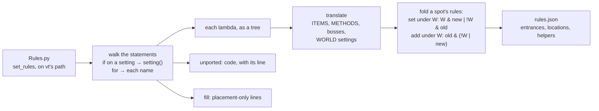

# @alltp/pack-alttpr

The A Link to the Past Randomizer game pack: the v31 rules (Standard, Open and
Inverted worlds, NoGlitches) as plain data over `@alltp/engine`, read from
[sporchia/alttp_vt_randomizer](https://github.com/sporchia/alttp_vt_randomizer)
at the commit `upstream.json` pins, and held to upstream's own test cases.

| Module | Ports |
| --- | --- |
| `src/items.ts` | `app/Item.php`, `config/item.php`: item ids, ranges, and how upstream counts them |
| `src/settings.ts` | `app/World.php`, `config/logic.php`: every config value a rule reads, `UNKNOWN` for those a Mystery run hides, and the presets |
| `src/helpers.ts` | `app/Support/ItemCollection.php`: `@canLiftRocks`, `@hasSword2`… |
| `src/bosses.ts` | `app/Boss.php`: each boss's `canBeat`, and the boss each dungeon fights |
| `src/world.ts` | `app/Region.php`: regions, entrances, prizes, `canFill` |
| `src/worlds/*.ts` | `app/World/Standard.php`, `app/World/Open.php`, `app/World/Inverted.php`: the region modules of each world |
| `src/regions/**` | one module per upstream region file |
| `src/fill.ts` | `app/Location.php`: `canFill`, whether the randomizer may place an item somewhere |
| `src/keys.ts` | `app/Support/LocationCollection.php`: where a dungeon's items may sit (`itemInLocations`), and the key model |
| `src/dungeons.ts` | the thirteen dungeons, the code of their items and their pool |
| `src/tracker.ts` | `TrackerInput`, what the player records, and `toState`, the state it gives |
| `src/legacy.ts` | the app's save format before the pack (version 5), mapped to the pack |
| `src/markers.ts` | the map markers, and what a marker shows |
| `src/goals.ts` | `app/Randomizer.php`: where each goal puts the Triforce, and its go mode |
| `src/seed-link.ts` | `app/Seed.php`, `routes/web.php`: a seed's hash, from a link to its page, and where its file lies |
| `src/entrances.ts` | `cassidoxa/ALttPEntranceRandomizer` (`EntranceShuffle.py`, `Regions.py`), at the commit vt pins: the overworld's entrances and where the crossed shuffle may lead them (`src/entrances/er.json`, imported) |
| `src/seed-file.ts` | `app/Jobs/SendPatchToDisk.php`, `World.php`, `EntranceRandomizer.php`: a seed's settings from its file (its entrance shuffle included), through a Zod schema of `spoiler.meta` |
| `src/pack.ts` | the run's world, compiled with its settings |

`upstream.json` maps every upstream file to its module, with its status;
`test/contract.ts` checks the pack against every case of the test files it
marks ported.

## The world model

Upstream has no graph. Each region is an object with a `can_enter` closure,
which may call another region's `canEnter`, and each location a closure that
runs after its region's (`Location::canAccess`). The pack turns that into the
engine's graph:

- **Regions.** Each upstream region becomes an engine region whose id is the
  camelCase of its key in `World/Standard.php` (`regionId('Tower of Hera')`
  is `towerOfHera`), so any module can name it. A module may split a region
  into parts for its own use (Turtle Rock's three ways in); a part has no
  `name`.
- **The start.** Upstream has no start region: a region whose `can_enter`
  calls no other region's is entered from anywhere. The graph starts at
  `start`, which holds nothing, and that entry is an entrance from `start`.
- **Entrances.** A region lists its ways in, its `can_enter` read as an OR of
  branches. A branch that calls `X->canEnter()` is an entrance from `X` with
  the rest of the branch; any other is an entrance from `start`; an OR gives
  several. Conditions around the OR go into each branch. East Death
  Mountain's `RescueZelda && (… || Hookshot && West->canEnter() || Hammer &&
  Hera->canEnter())` is `{ from: "westDeathMountain", req: "rescueZelda &
  hookshot" }` and `{ from: "towerOfHera", req: "rescueZelda & hammer" }`,
  its glitch branches entrances from `start`. The entrance lives in the
  module of the region it enters, as upstream's rule lives in that region's
  file. An entrance cannot `reach()` a region: the engine's single pass
  refuses it, so a cross-region condition is always the graph's.
- **Locations.** A location's `req` is its closure without its own region's
  `canEnter`, which the graph already applies. Another region's `canEnter`
  inside it is `reach(id)`; another location's `canAccess` is that location's
  rule (and `reach()` of its region if it is elsewhere). Its id is
  `locationId(name)`, its `kind` the upstream class, its `source` the line of
  its closure, or of its declaration when it has none.
- **Prizes.** A region's `can_complete` is the rule of its prize location
  (`RegionDef.prize`): the pendant or crystal of a dungeon, Zelda, Agahnim. A
  dungeon's `can_complete` is its boss's `canAccess`, so the boss and the
  prize share one rule. The tracker derives pendants, crystals, `rescueZelda`
  and `defeatAgahnim` from what the player records; the solver does not
  compute events.
- **The overworld.** No hub stands for the Light World: its three regions
  enter from `start` with `rescueZelda`, as upstream writes them. West Death
  Mountain enters from `start` (the flute, or a glove and the lamp), East
  Death Mountain from West Death Mountain and from Tower of Hera, the Dark
  World's regions from `start` (Agahnim, or the hammer and glove routes) and
  from one another, and its Death Mountain from the Light World's.
- **Standard and Open.** The two worlds list the same modules but the
  escape: `regions/open/hyrule-castle-escape.ts` replaces Standard's, as
  `app/Region/Open/HyruleCastleEscape.php` does. Open gives RescueZelda at the
  start (`Randomizer.php:133`), which the tracker's state does.
- **Inverted.** `app/World/Inverted.php` lists its own region
  classes (`regions/inverted/**`) and Standard's Medallions and Fountains.
  Each class extends Standard's (the escape, Open's), in one of two ways. A
  class whose `initalize` does not call its parent's (the overworld, Turtle
  Rock) replaces every rule: its module stands alone, and a location it sets
  no rule for is `true`, cited at its `initalize` line. A class that calls
  `parent::initalize()` and sets a few rules again (the escape, the other
  dungeons) is `extendModule(parent, file, changes)` (`src/world.ts`): the
  parent's regions with those rules replaced, the others still cited in the
  parent's file. Inverted moves locations: Link's House to the south of the
  Dark World, Ether Tablet and Spectacle Rock to East Death Mountain, Ganon
  to the Light World; and it adds the Bomb Merchant, an event holding the
  Big Red Bomb that its Pyramid Fairy wants. The importer reads each world's
  locations through its class chain and the `removeItem`s on it. Every
  Inverted file is ported and its 22 test files run in the contract; the
  app reads an Inverted run as Open until it lays the Inverted map out.
- **Settings.** A config read is a setting, folded at compile time:
  `config('itemPlacement') === 'advanced'` is `setting(advancedPlacement)`,
  `!== 'basic'` is `!setting(basicPlacement)`, `has('Lamp',
  config('item.require.Lamp', 1))` is `lamp >= setting(requireLamp)`. A glitch
  branch keeps its flag (`setting(canBootsClip) & pegasusBoots`): NoGlitches
  folds it away.
- **What a tracker cannot know.** Upstream's rules may ask where an item
  sits (`$location->hasItem(...)`); a tracker does not know the placement,
  so that test is `maybe`: "the boss holds its own compass" makes
  `!setting(wildCompasses) | compassP1 | maybe`.
- **Dungeon items.** A region's `regionItems` is its `$region_items`, which
  `canFill` keeps in it unless the class is wild.
- **Filling.** A location's `fill` is what its region file tells
  Location::canFill: the items it always takes (`setAlwaysAllow`), those its
  fill rules refuse (`setFillRules`, clause by clause), and its rule once it
  holds an item that rule asks about (`holding`): placing the item settles
  a `hasItem` the location's `req` reads as `maybe`. `filler(world,
  settings).canFill(location, item, state)` reads them as upstream does:
  always allowed, or kept by the region, not refused and reachable with the
  item there. Every dungeon boss writes the same rules, which `dungeonBoss`
  (`src/bosses.ts`) builds. The 262 `fill` cases of the upstream tests run
  in the contract.
- **Where dungeon items sit.** The randomizer places the dungeon items
  first, each where canFill holds with every item not placed yet assumed
  held, and canFill only grows with the items held. `possibleLocations`
  lists where an item may sit at all: wherever canFill is not `no` with
  everything else held (`everythingBut`). Swamp Palace's key can only be at
  its entrance; Desert Palace's, in the Map Chest, the Torch or the Big
  Chest.
- **Pending modules.** A region file not ported yet still has its module: its
  upstream regions with no entrance and no location. The worlds list every
  module from the start, so a port only fills its own module in.

## What the player records

A `TrackerInput` is what the player records of a run, and
`toState(input, settings)` the engine state it gives, from scratch on every
call: knowledge is not monotone (learning that Misery Mire wants Ether
closes it to a player holding Bombos only), so nothing carries over.

- **Items**, by pack id, within their pool: everything the player marks by
  hand (`INVENTORY_ITEM_IDS`). Big keys, maps and compasses count whenever
  marked. Prizes, events and small keys are not items the player marks.
- **Finished dungeons and their prizes.** The solver computes no event:
  Zelda is rescued from the start in Open (`Randomizer.php:133-135`) and
  once Hyrule Castle is finished in Standard; Agahnim is defeated with
  Castle Tower, Agahnim 2 with Ganon's Tower. The other ten dungeons drop a
  pendant or a crystal, shuffled among them. The player records it as one
  of the four classes the rules tell apart (`PRIZES`): the green pendant,
  which Sahasrahla wants; another pendant, which only the pedestal reads,
  with all three; a red crystal (5 or 6), which the Pyramid Fairy wants;
  another crystal, which only counts. A finished dungeon's known prize
  gives the next item of its class, in dungeon order.
- **The medallion pads**, through their facts (`src/medallions.ts`). A pad
  the player has not noted is unknown.
- **The derived facts** (`src/derived.ts`), from the items it gives.
- **Small keys**, per dungeon, only with wild keys. Outside keysanity the
  key model reads the dungeons without them.

## A Mystery run

A Mystery seed hides its settings: its file on alttpr.com keeps only its
logic and build (`SendPatchToDisk.php:46-67`), its intro text is masked
(`Rom.php:2117`), and as a tournament seed its ROM settings are not read in
Race Mode. The player learns them as the run goes.

`settingsFromUpstream(mode, config)` takes `UNKNOWN` for each config value
a player discovers: `mode.weapons`, `goal`, `crystals.tower`,
`crystals.ganon`, `itemPlacement`, `accessibility`, `item.pool` and
`item.functionality`.
- **Derived settings follow Kleene's logic.** A setting derived from an
  unknown value is unknown (`Flag`), unless the known ones settle it:
  - `requireBetterBow` is basic placement *or* swordless, true as soon as
    either is known true;
  - `catchableFairies` is false with any functionality but normal.
  - A crystal count is a range, 0 to 7 (`Count`).
- **The engine reads them** (its README, Settings not known yet): an unknown
  flag is read both ways and the readings met, an unknown threshold is yes
  at its top and maybe from its bottom.
- **The world and the dungeon items stay known.** The world shows on the
  first screen. The dungeon items decide the key model and the counters,
  which no `maybe` can stand for: a Mystery run assumes them until the
  player sets them.

`seedFileReading` reads such a file's settings as `mystery`, a reason of
its own: hidden by the seed, not a value vt never writes. Only a
tournament seed's file is stripped; any other keeps its spoiler whole.

`mystery.spec.ts` holds a hidden world to soundness against random
completions of its settings, in each world: nothing it says yes or no to
turns out otherwise.

## The retro world

`settingsFromUpstream("retro")` builds `app/World/Retro.php`: the Open world
with four things forced over the config (`Retro.php:18-23`).

- **The rupee bow** (`rupeeBow`). The bow shoots rupees once an arrow is
  bought in a shop (`shopArrow`), or with the silver arrows
  (`canShootArrows`, `ItemCollection.php:476-492`).
- **Generic keys** (`genericKeys`). A small key opens any dungeon's doors.
  Once a key is for sale (`shopKey`), `ItemCollection::has` holds any count
  of any small key (`ItemCollection.php:269-272`). The pack says so as a
  derived fact (`derived.ts`): every small key joins the state at its count
  in the pool. Ice Palace's Spike Room reads `hookshot | shopKey` itself
  (`IcePalace.php:90`).
- **Wild keys** (`wildKeys`): the keys leave their dungeons.
- **Take-any caves** (`region.takeAnys`): a heart container, a blue potion
  and the old man's sword in caves. No rule reads them.

`shopArrow` and `shopKey` are what the player marks on finding a shop that
sells them: five shops drawn at random sell both, and the Dark World's
Forest Shop always sells arrows (`Randomizer.php:716-760`). No other world
sells them, so `everything` holds them in the retro world alone.

**The key model** cannot tell whose a generic key is, so it never vouches
for one. A retro dungeon's small keys go untracked even though they are
wild, and they are never surely in hand. Their dungeon is never safe for
keys: a key door is `maybe` until a key is for sale, and `yes` after.

`test/upstream/RetroBow.json` holds the official `RetroBowTest` (32 cases)
to the rupee bow.

## The entrance randomizer's tables

vt hands a seed with shuffled entrances to the entrance randomizer, a Python
program at the commit vt's composer.json pins (`upstream.json`,
`entranceRandomizer`). `scripts/import-er.mjs` reads its tables into
`src/entrances/er.json`, and its rules into `src/entrances/rules.json`
(below); the repository's Biome then formats both, so a re-import of the
same commit changes nothing:

```bash
pnpm --filter @alltp/pack-alttpr import-er <er-checkout> --rom <base.sfc>
```

- **Read, never run.** A small Python reader (`scripts/python.mjs`) reads
  the literals the source assigns or passes (`Cave_Exits_Base = [...]`,
  its later `+=`, `scramble_holes`' lists, `skull_woods_shuffle`'s calls,
  the `create_*_region` calls of `Regions.py`). Anything else there stops
  the import with the file and line.
- **A region's engine id** is its name in lowerCamel case
  (`regionId`: "Ganons Tower (Tile Room)" is `ganonsTowerTileRoom`), what
  the rules' `reach()` names.
- **A door's position** is where Link comes out of it (`door_addresses`: its
  area and his coordinates in the world, 4096 pixels a side).
- **A hole's position** comes from the base ROM's hole table, whose entry
  `door_addresses` gives. The ROM is the Japanese 1.0 one alttpr.com asks
  for, checked by its MD5. The table's rows run 7 above the tiles the
  overworld draws: `CreatePyramidHole` draws the Pyramid's at rows 7 to 9,
  where the table says 0. With them, every hole lands within a point of the
  legacy map's marker of what lies under it.

`src/entrances.ts` reads it:

- `ENTRANCES`, each with its position on the map, door or hole;
- `TARGETS`: a side of a dungeon or connector cave (its exit), a single
  door's place, or where a hole drops, grouped by the place a player knows
  (`place`, `side`);
- `crossedPool(mode)`: what alttpr.com's crossed shuffle mixes. It
  shuffles Ganon's Tower by default (`EntranceRandomizer.py:228`).
  - `targetsOf`: what the shuffle may give each entrance. A hole gets a
    drop, a hole's cave door gets such a cave's exit, Skull Woods' doors and
    holes get their own, and any other door the rest.
  - `partner`: what one note settles, since a hole and its cave's door
    lead into the same cave.
- `PLACE_OF_LOCATION`: the place a check inside lies in, by the region the
  randomizer puts it in. A few of its names are vt's under other words
  (`VT_NAMES`), and its bosses' and sewers' regions are told by hand
  (`REGION_PLACES`).

`test/er-seeds/0yAObedRMV.json` is a real Crosskeys seed's spoiler: its
shuffled entrances are exactly the pool, and every one leads to a target
the model knows.

### Its rules

A seed with shuffled entrances is filled by the entrance randomizer, under
its own rules (`Rules.py`, `Bosses.py`), dungeons included: not vt's, which
the regions of this pack port. The same run of `import-er` translates them
into the engine's language, `src/entrances/rules.json`
(`scripts/er-rules.mjs`, over the Python reader `scripts/python.mjs`).



- **vt's path.** `set_rules` is walked as vt calls the randomizer
  (`app/EntranceRandomizer.php`): No Glitches, the Open or Standard world,
  no retro, no boss shuffle. A branch on another value (No Logic,
  Inverted, the triforce goals) is `false` and is never read; one on a
  setting the pack has becomes `setting()`: the mode `standardMode`, the
  goals, `swordless`, `locationsAccessibility`, `cantTakeDamage`. The
  randomizer's keysanity is vt's `--keysanity`, which only `full` dungeon
  items pass, so it reads `wildBigKeys`.
- **One rule per spot.** Each `set_rule` replaces an entrance's or a
  location's rule, each `add_rule` ands one to it, in call order. Under a
  branch on the settings W, a set is `W & new | !W & old` and an add
  `old & (!W | new)`, so the settings still fold at compile time. Each spot
  lists the lines that make its rule.
- **Items** map to the pack's (`ITEMS`): `Master Sword` is `sword >= 2`,
  as `collect` grants the levels in order; `Silver Arrows` is `bow >= 2 |
  silverArrowUpgrade`; keys are the pack's by dungeon. A name no item of
  `Items.py` bears is never held: `Rules.py:181` asks for `'Mirror'`,
  which No Glitches sets to `false` anyway.
- **Methods** of the collection state are helpers named after them
  (`has_Boots` is `@erHasBoots`, `can_kill_most_things(player, 8)`
  `@erCanKillMostThings8`), each citing its `BaseClasses.py` line. A rule
  stands as it is written, even where a seed's fill never meets it: hearts
  and bombs are no advancement items, so the fill never counts them, but
  the randomizer's own tests do (`TestMiseryMire.py:72` opens the Spike
  Chest with a heart container), so `has_hearts(4)` is `heartContainer |
  pieceOfHeart >= 4`. `can_extend_magic` counts the bottles a potion shop
  refills, by the pack's bottle magic settings.
- **Bosses**: each `Bosses.py` rule is a helper (`@erDefeatArmosKnights`),
  each dungeon's the one `Dungeons.py` gives it.
- **Placements** (`item_name`, `item_in_locations`) are `maybe`, as the
  pack's own rules read vt's: a tracker does not know them.
- **Events** (`Open Floodgate`, `Get Frog`, `Return Smith`, `Pick Up
  Purple Chest`) are items of their own, held once their location is
  reached (`events`, from `ItemList.py`). Agahnim's are the pack's
  `defeatAgahnim`, which the player marks.
- **What reads the connections** becomes data the world fills in:
  - the big bomb's route, one case per list of doors the Big Bomb Shop may
    be entered by (`bombShop`: `set_big_bomb_rules` tests
    `bombshop_entrance.name`);
  - Turtle Rock's key doors, by what everything held reaches
    (`set_trock_key_rules`): each such region a derived setting,
    `allItemsReach_<region>`, read with the entrances' rules as they stood
    at that line (`allItemsReach`: two bomb jumps were still open);
  - the swamp patch, a derived setting (`swampPatch`), and whether a region
    lies in the light world (`lightWorld_<region>`).

  `derived` lists each derived setting and what it reads. A count a local
  function gives by what a location holds (Turtle Rock's
  `tr_big_key_chest_keys_needed`) reads each placed count as `maybe`.
- **What is code** stays out, listed in `unported` with its line, and is
  ported by hand in the world: the save-and-quit points and the bunny's
  paths (which regions the entrances make dark, `bunny` holding its two
  lists).
- **Placement-only rules** (`forbid_item`, `add_item_rule`,
  `set_always_allow`) decide where an item may go, not what Link can
  reach: their lines are listed in `fill`.

### Its world

`src/er-world.ts` builds the world the randomizer fills a seed in, for a
run's settings and its connections, and compiles it with the engine.

```mermaid
flowchart LR
  noted["entrances noted<br/>(entrance id → target id)"] --> conn["crossedConnections<br/>kept doors, mandatory,<br/>two-way caves, one-way doors"]
  conn --> mark["mark light / dark<br/>(mark_light_world_regions)"]
  conn --> spots["rules.json per spot<br/>+ the bomb shop's case"]
  mark --> bunny["bunny's rules<br/>(set_bunny_rules)"]
  spots --> bunny
  conn --> derived["derived settings<br/>swampPatch, lightWorld_*,<br/>allItemsReach_* (a first solve)"]
  bunny --> graph["graph: start → save-and-quit points,<br/>reach() in exits as facts"]
  derived --> compile["compileWorld"]
  graph --> compile
  compile --> solve["solveFacts: solve until<br/>no event or reach fact is gained"]
```

- **Connections** (`ErConnections`: an entrance's name to the region it
  opens on). `crossedConnections(mode, noted)` makes what
  `link_entrances` keeps (Link's House, the Tavern's back door, in
  Standard the escape's doors) and the mandatory ones, then each noted
  entrance: a dungeon's or a connector cave's exit both ways
  (`connect_two_way`), a single cave or a hole one way. An entrance not
  noted leads nowhere, so a check is in logic only through doors the
  player knows. `vanillaConnections` and `mandatoryConnections` are the
  randomizer's tests' worlds.
- **Save-and-quit points**: the start reaches Link's House and Sanctuary
  (Standard: the uncle's passage, then Link's House once Sanctuary is),
  and the Old Man's house once his location is reached.
- **Facts.** The engine reads `reach()` in locations only. A rule of an
  exit or of a helper that asks for a region reads the fact
  `reached_<region>` instead, given by a location of its own in that
  region, and an event item (the floodgate, the frog) is held once its
  location is: `solveFactsState` solves, adds what was surely reached, and
  solves again until nothing is gained, as the randomizer sweeps for
  events. A fact needs `yes`: a region or event only `maybe` reached gives
  nothing, which reads its rules as `no`, never wrongly `yes`.
- **What a check misses.** `analyzeFacts` asks the engine's blockers with
  the facts acquirable, then puts in place of each fact what brings its
  location in logic, every way of it within `maxAtoms`: the Blacksmith
  wants the smith back, who wants the frog, so it misses the Titan's Mitt
  and the pearl.
- **Derived settings**: whether Swamp Palace needs its patch (its door
  and the Dam's not both vanilla), each region's light world mark, and
  Turtle Rock's `allItemsReach_*`, from a first world with the entrances'
  rules of that moment, solved with everything held.
- **Cost**: building a world takes about 6 to 8 ms (two compiles), done
  once per entrance noted; a solve about 0.2 ms.

The randomizer's own tests hold it: `test/er-upstream/` (510 cases of its
dungeon and Death Mountain tests, imported by `scripts/er-tests.mjs` with
the world each `setUp` builds) run in `test/er-contract.spec.ts` under the
pack's contract, upstream `true` our `yes` and `false` never `yes`. And on
the real Crosskeys seed `0yAObedRMV`, every entrance noted from its
spoiler, everything held reaches all its 233 locations.

## The legacy format

Before the pack, the app saved its own ids: items with their legacy values
(the bow 1 for the silver arrows alone, 2 the bow, 3 both; a boss 2 once
beaten; a reward 1 to 4), one flag per chest marker of its map by position,
and per dungeon index a counter, a pad and a key count. `src/legacy.ts`
keeps a frozen copy of that format (the app at 2.11.0) and maps it:

- `legacyItem(id, value)`: what one legacy value records, as pack items, a
  dungeon finished, its prize, or how many of its items were found, which
  carries over though keysanity's counter now starts higher;
- `LEGACY_CHESTS`: the 64 markers, by position, and the locations each
  stands for. A cave of several chests stands for all of them;
  "Fugitive under the bridge" is the Hobo; "Bridge", on Hyrule Castle's own
  bridge, stands for nothing, since v31 has no check there;
- `LEGACY_DUNGEONS`: the 10 dungeon indices;
- `NOT_ON_THE_OLD_MAP`: every location outside those ten dungeons that no
  marker stands for, and why: the Waterfall of Wishing, Castle Tower and
  Ganon's Tower, and what is no check (trades, fountains, pads, events);
- `fromLegacy(progress)`: a whole legacy run as a `TrackerInput`, its
  checked locations and its counters.

## The map

`MARKERS` places every check of the world on exactly one marker, in the
legacy map's coordinate space (`apps/web/public/assets/map.png`, 884 x 442):
`x` and `y` are percents of the whole image, the Light World on its left
half (x 0 to 50), the Dark World on its right half. A marker stands for one
location or several (a cave's chests), or for a dungeon's item locations.

- The legacy map's 63 chest markers that stand for a check keep their
  position and their group, in their legacy order, under plain names.
- Its 10 dungeons keep theirs.
- Three markers are new, for what it lacked: the Waterfall of Wishing
  (`waterfall-fairy`), Castle Tower and Ganon's Tower. Each says where its
  position was read: the alttprandohelper tracker the legacy map comes from
  (its worlds each span 0-100%, so its Light World x is halved), or the map
  image itself.
- The Blacksmith sits in the Light World, where the smiths reward, though
  upstream's region is the Dark World's, where the frog waits.

`markerStatus(tris)` reads a marker from the tris of the locations it still
stands for: available when all are `yes`, possible when some are `yes` or
`maybe`, unavailable otherwise.

**Dungeon counters.** The player counts down a dungeon's items without
saying which chests they opened. `dungeonItemCount(dungeon, settings)` is
where the counter starts: the dungeon's item locations, less the dungeon
items that stay in it (each class that is not wild), which are no items to
the player. The pools of `config/item.php:94-147` give, for the standard,
`mc`, `mcs` and `full` dungeon items:

| Dungeon | standard | mc | mcs | full |
| --- | --- | --- | --- | --- |
| Hyrule Castle | 8 | 9 | 10 | 10 |
| Eastern Palace | 3 | 5 | 5 | 6 |
| Desert Palace | 2 | 4 | 5 | 6 |
| Tower of Hera | 2 | 4 | 5 | 6 |
| Castle Tower | 0 | 0 | 2 | 2 |
| Palace of Darkness | 5 | 7 | 13 | 14 |
| Swamp Palace | 6 | 8 | 9 | 10 |
| Skull Woods | 2 | 4 | 7 | 8 |
| Thieves' Town | 4 | 6 | 7 | 8 |
| Ice Palace | 3 | 5 | 7 | 8 |
| Misery Mire | 2 | 4 | 7 | 8 |
| Turtle Rock | 5 | 7 | 11 | 12 |
| Ganon's Tower | 20 | 22 | 26 | 27 |

`dungeonStatus(remaining, tris)` reads a counter with R items left from the
tris of all its item locations. The R items sit at distinct locations the
player has not opened, so when R exceeds the `maybe` and `no` locations
together, one item is surely at a `yes` one: available. Otherwise possible
while some location is `yes` or `maybe`, else unavailable. "As many
reachable locations as items left" would be wrong: with two `yes` and two
`no` locations and two items left, the player may have opened the two
`yes` ones. A property checks the rule against every way R items can sit.

## The key model

Outside keysanity the player does not track the dungeons' small keys, nor
their big keys: the *untracked items* are each dungeon's small keys while
`wildKeys` is off, its big key while `wildBigKeys` is off. Upstream's rules
count them (`keyD1 >= 6`), so the tracker has to say something without
them. `solveWithKeys(filler, state)` reads a location in three steps:

1. **The keys surely in hand.** An untracked item sits at one of its
   `possibleLocations`. When every one of them is `yes`, Link reaches it
   wherever it is, so its whole count joins the state, which may bring
   another in reach; this repeats until nothing more joins. Swamp Palace's
   key, which only its entrance can hold, is in hand once Link is inside.
2. A location `yes` with those keys is **yes**.
3. A location `yes` with every untracked item of the dungeons its rule reads
   is **yes** if those dungeons are all *safe for keys*; otherwise it is
   **maybe** if it is possible with all of them, **no** if not even then.

A dungeon is *safe for keys* when, at every count of its untracked items
(none to all of its small keys, without and with its big key), each place
they may sit is at least as available to the player as with every item
held: no key can hide behind something the player lacks. The dungeons a
location reads are those whose untracked items its rule reads, helpers
included, once the settings are folded and the branches through a region
no state reaches (glitched ways in) are left out: its own dungeon's, and
Turtle Rock's for Mimic Cave, whose door is inside. Keysanity tracks every
key, and the model is then the solver.

**Why `yes` holds** (sketch; `src/key-model.spec.ts` checks each fact it
rests on):

- The randomizer places the dungeon items first, each where Location::canFill
  holds with every item not placed yet assumed held
  (`app/Filler/RandomAssumed.php:25-34, 59-135`), and canFill only grows with
  the items held. So an item never sits where canFill is `no` with
  everything else held: outside `possibleLocations`. Step 1 follows, and
  step 2 is the solver on a state the player truly has.
- The same assumed fill means that with every item held, Link collects all
  of a dungeon's untracked items, opening at each count what that count
  opens, except an item an always-allow rule lets lock itself in: Tower of
  Hera's key in its Big Key Chest, the big keys of Swamp Palace and Skull
  Woods in their Big Chests. No other location reads those (tested), so the
  spot holds its own key and nothing a player wants.
- No way in reads a key (tested): keys move locations, never regions. In a
  safe dungeon the player's state is, at every count, at least as good as
  everything on every place the items may sit, so collecting step by step
  the player takes at least what everything takes, which is all of them. A
  location `yes` with all of them is then reached.
- Every placement a dungeon rule asks about (`hasItem`, `itemInLocations`)
  is one `maybe` beside the branch it relaxes, so comparing yes, maybe and
  no compares the same placements on both sides.

**Its laws**, as fast-check properties over random states of the Open and
Standard worlds: adding an item never lowers a location (near the top too,
where one item turns a dungeon safe), and a location is never above the
solver with every untracked item nor below it without them. With wild keys,
Palace of Darkness's doors do want one key more once the hammer, a bow and
the lamp are held, as upstream has it (`src/derived.ts`); the model is then
the solver, so that drop stays.

**Cost.** The first call of a world builds what does not depend on the
state (where each item may sit, the world with everything held at each
count): about 14 ms under Vitest. Each call after that takes a few solves:
the keys in hand, all keys, and the counts a dungeon's safety asks about,
about 0.2 to 0.5 ms under Vitest for every location of the world.

## Go mode

A run is won once Link holds the Triforce (`app/World.php:101-106`), which
`prepareWorld` puts at the Master Sword Pedestal for the pedestal goal and
at Ganon for the others (`app/Randomizer.php:103-114`). Go mode is that
location in logic. `GO_MODES` lists, per goal, the locations to reach in
order, each with its upstream line:

| Goal | Steps |
| --- | --- |
| `ganon` | Agahnim 2, the prize of Ganon's Tower (`GanonsTower.php:388`), then Ganon (`DarkWorld/NorthEast.php:186`), whose rule wants Agahnim 2 beaten |
| `fast_ganon` | Ganon, who wants the crystals and the pyramid but not Agahnim 2 (`DarkWorld/NorthEast.php:226`) |
| `pedestal` | the Master Sword Pedestal (`LightWorld/NorthWest.php:86`) |

The solver computes no event, so a step that gives one (Agahnim 2 gives
`defeatAgahnim2`) is solved first, and the steps after it in a state that
holds it; once the player holds it, the step is done. The dungeons goal
(Ganon wants every dungeon) and completionist (every location) have no go
mode before their end, and the triforce hunts count pieces this pack does
not have.

- `goModeOf(settings)`: the run's go mode, if its goal has one and is
  known (a Mystery run's hidden goal has none yet).
- `goModeStatus(filler, state, mode)`: each step in the key model, and the
  lowest of them: `yes` is go mode, `maybe` go mode only possibly.
- `goModeBlockers(world, state, mode, options)`: what is missing, as the
  engine's blockers: each step's minimal sets (`blockers(step, "yes")`),
  joined with `joinBlockers`. Ask it of `withUntracked(filler, state)`, the
  state with every key the player does not track held: a key is never
  something to collect, and the key model says the rest.
