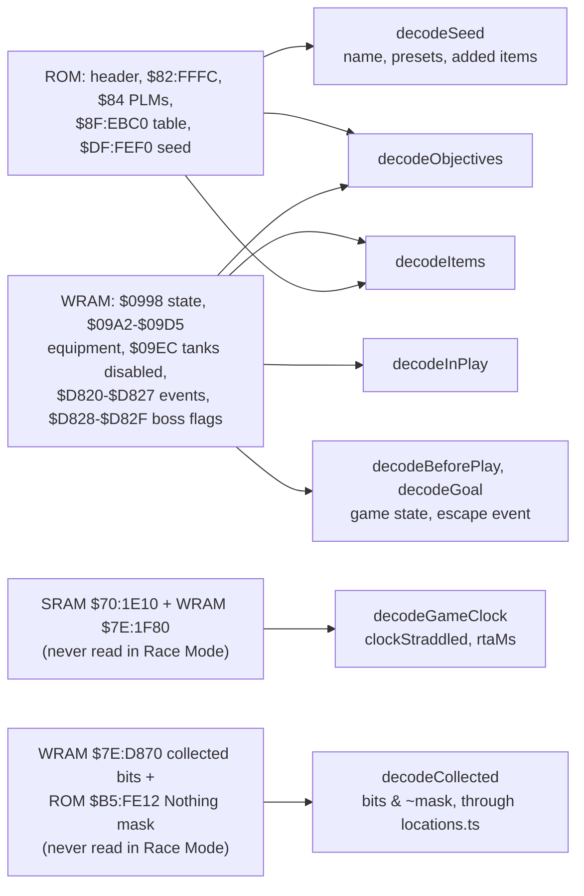

# @alltp/pack-sm

Super Metroid as the tracker plays it: **Map Rando** seeds (maprando.com,
`blkerby/MapRandomizer`), the randomizer the community races. On
racetime.gg's Super Metroid Randomizer category, about 99 % of the races of
August to October 2026 linked a maprando.com seed (measured on 2026-10-19
from the races' info links; the rest were DASH).

The pack holds what a tracker of those seeds needs, read from Map Rando's
own source at the commit `upstream.json` pins, never from memory:

| Module | What | Source |
| --- | --- | --- |
| `src/items.ts` | the items, Map Rando's `enum Item` but Nothing, with the game's full pool for the counted ones | `rust/maprando-game/src/lib.rs:155-181` |
| `src/objectives.ts` | the 19 objectives a seed may ask for, by group, each with its flag | `rust/maprando/src/patch.rs:3327-3355, 3596-3681` |
| `src/settings.ts` | the presets the ROM keeps for autotrackers, and the items its settings add | `settings.rs:113-241`, `patch.rs:783, 2038-2105`, `Bank DF.txt` |
| `src/spoiler.ts` | Map Rando's spoiler log read into `@alltp/spoiler`'s shape | `rust/maprando/src/spoiler_log.rs:110-149, 197-262, 1236`, `settings.rs:521-545` |
| `src/locations.ts` | the 100 item locations by the spoiler log's `room_id:node_id`, each with its bit in the game's collected array; generated (`pnpm --filter @alltp/pack-sm import-locations <sm-json-data checkout> <vanilla.sfc>`), never edited | `rust/maprando-game/src/lib.rs:4908-4914`, `patch.rs:843-866`, sm-json-data's item nodes (`upstream.json`) |
| `src/autotrack/` | the memory map, the decoders, the game check and the race profile | below |

## No logic, on purpose

Map Rando reconnects the game's rooms, and its logic is `sm-json-data`, a
database of strategies per room that spends energy, ammunition and frames of
heat. A tracker cannot follow it without the seed's map and a solver of that
database; players follow the game's own map, and the trackers they use (the
EmoTracker package maprando.com credits) track items and objectives. So does
this pack: what the player holds, the seed's objectives, and whether each
is done.

## Autotracking

- **The game check**: Map Rando names the cartridge "SUPERMETROID MAPRANDO"
  (`patch.rs:2111-2112`), where the original game's header says
  "Super Metroid". Archipelago's Super Metroid (VARIA's randomizer) writes
  "SM", AP's version, the player and the seed (AP 0.6.8,
  `worlds/sm/__init__.py:677-681`): refused as `archipelago-rom`, which points
  the player to the app's Archipelago board (AP's own client tracks that ROM;
  nothing of its logic or settings is read).
- **Items** (`decodeItems`): the items and beams collected (`$09A4`, `$09A8`),
  by the bits the patcher gives a seed's starting items (`patch.rs:
  2300-2324`), Map Rando's three included (the Wall Jump Boots, the Spark
  and Blue Boosters). Packs and tanks are counted from the maximum they
  raised (`$09C4-$09D4`, `new_game.asm:85-120`) over what one gives, which
  the patcher writes into the items' PLMs for a seed of other sizes
  (`patch.rs:794-838`; the original game's are 100, 5, 5, 5 and 100, read
  from its ROM). Energy starts at 99, and an energy tank disabled from the
  pause menu takes 100 off the maximum but counts in `$09EC`
  (`disableable_etanks.asm:564-569`): it is held all the same.
- **Objectives** (`decodeObjectives`): the ROM keeps how many the seed has
  (`$82:FFFC`, its high bit the fast pause menu) and each one's flag, an
  event address and a mask (`$8F:EBC0`, `$8F:EBE8`, `patch.rs:3574-3584,
  3683-3684`), in the pause screen's order. An objective is done once its
  flag is set in WRAM: the events (`$7E:D820-$D827`) or the boss flags
  (`$7E:D828-$D82F`). Race Mode reads neither the table nor the events:
  `decodeBossKills` then says which boss kills the boss flags hold (see
  Races).
- **The seed** (`decodeSeed`): its name at `$DF:FEF0`, which
  maprando.com/seed/<name>/ finds, the presets at `$DF:FF09-$FF0D` (0 for a
  setting the seed customized) and the items its settings add at `$DF:FF05`
  (`Bank DF.txt`).
- **Locations collected** (`decodeCollected`): Map Rando keeps one bit per item
  location in the vanilla array at `$7E:D870`, 20 bytes, bits 0 to 154
  (`item_count.asm:126-136` sums it; `patch.rs:212`), and a bit is set by the
  location's item PLM, whose argument (the bit's index) the patcher never
  rewrites, only the PLM's type (`patch.rs:843-866`). So the bit of each
  location is the same for every seed: `src/locations.ts`, 100 rows, read from
  sm-json-data's item nodes (their `nodeAddress` is the PLM in the vanilla ROM)
  and the word at PLM + 4, a bijection onto 100 of the bits 0 to 154, equal to
  the table for all 100 PLMs of four real seeds' ROMs, and covering exactly the
  `all_items` of the real log (`locations.spec.ts`). A location that holds
  **Nothing** has its bit set from a new game (`new_game.asm:121-128` copies
  the ROM's mask, `$B5:FE12`, 20 bytes, into the array), so a set bit alone
  does not say collected: the decoder removes the mask, `bits & ~mask`, as
  Map Rando's own counter does (`item_count.asm:117-136`), and answers a set of
  keys that never names a Nothing location. A running game always holds the
  mask's bits (they are copied in and never cleared), so the decoder answers
  "not read" when the mask names a bit the array lacks: the menus' leftover
  WRAM, or a mask from another ROM. Verified on a rig (RetroArch,
  seed `dsjF6gGsH`, 2026-10-26): items picked up by the game itself in three
  rooms set exactly the table's bits. Not verified in a running game: a seed
  with Nothing locations (none of four seeds had any); the mask rests on the
  source and the unit tests.
- **In play** (`decodeInPlay`): game state `$07` or `$08`
  (`fast_reload.asm:134-136`).
- **Before play** (`decodeBeforePlay`): states `$00-$06` (the title, the menus,
  the file select, the loading of a game) and `$1F`, where a new game is set
  up (`fast_reload.asm:46-47, 166-167`, `new_game.asm:195-212`). A reading in
  play after one before play is a game starting: the run timer starts there,
  and not on `$1F` or `$06`, which a poll every second misses.
- **The goal** (`decodeGoal`): event `$0E`, the escape (`$D821` bit 6, set when
  Mother Brain dies: `stats.asm`, `hook_samus_enter_ship`), with the game state
  `$26` (Samus escapes) or `$27` (the ending and credits): Samus in the ship.
  `stat_final_time` is no signal: a new game does not clear it.
- **The RTA clock** (`decodeGameClock`, `rtaMs`): Map Rando's frame counter,
  which its credits print as the final time (`stats.asm`, "based on VARIA
  patch by total & ouiche"). Every NMI counts, lag, menus, the file select and
  the credits too, and a death or a reload never rewinds it, unlike the
  game's own IGT (`$7E:09DA`, which reverts to the last save). It has two
  parts: `!stat_timer`, a 32-bit count in SRAM (`$70:1E10`) which the NMI
  counter adds its 255 to when it fills and on every item pickup, and
  `!nmi_counter`, a byte of WRAM (`$7E:1F80`) holding the frames not yet
  flushed, 0 to 254 (`constants.asm`, `stats.asm`): the clock is their sum.
  It is a count since the console's SRAM was set up, not since a run began:
  the app notes it when the run starts. Frames convert at Map Rando's
  `100 / 60.09881186` hundredths a frame (`credits.asm`, `adjust_time_fps`),
  defined here from that source (packs import nothing of each other).
  **The flush guard** (`clockStraddled`): the two parts are read one after the
  other, the SRAM word first (the planner sorts pieces by address; the spec
  holds the order), and a flush between them leaves the old word with the new
  counter, so the sum falls back by up to 254 frames. Such a reading is told
  by the word standing still while the counter went back, which only a
  missed flush does (a flush raises the word): it is not a time, and the
  app holds the last one. Not verified against a live console: how SNI and
  RetroArch order a multi-range read is taken from the planner's contract.

Bank `$DF` lies past the first 2 MiB of this 3 MiB LoROM game: it reads
through `@alltp/autotrack`'s 4 MiB LoROM mapping (its README, "Address
spaces").

### Races

Map Rando races run on racetime.gg/smr, whose rules say nothing of trackers
or autotracking (its category info, read 2026-10-19, 2026-10-25 and
2026-10-27); Map Rando's "Race mode" only locks a seed's spoiler on the
website and writes nothing into the ROM. The one rule found that states what
Map Rando races allow is a tournament's: "Auto tracking is permitted for items
and boss kills. Auto tracking of the map layout is not permitted."
([Super Metroid Map Randomizer - Hard Tricky Multicategory
Tournament](https://docs.google.com/document/d/1CF84nNmK0JqFP6lmxTpViiRC5nFuXBrTzeV320eJdOo),
2025, read 2026-10-27). What no rule states is not permitted in Race Mode, as
A Link to the Past's rules have it (the app's owner, 2026-10-27). The pack has
no race flag, so the app keeps Race Mode on unless the player turns it off
(an option that reads On or Off). The race profile (`MAP_RANDO_RACE_PROFILE`)
permits the items (`items`), the boss flags (`boss-kills`) and what reading
them needs (`rom-header`, the game check; `game-state`, a game in play), and
forbids the rest:

- The boss flags (`boss-flags`, `$7E:D828-$7E:D82F`) are read alone:
  `decodeBossKills` names the objectives a boss kill completes that they say
  done (`isBossKill`: the four bosses, the minibosses and Bomb Torizo),
  whatever the seed asks for; the app marks done those the player set.
- The seed's objectives and settings (`objective-count`, `objective-flags`,
  `seed`) are never read in a race: the player sets them in the Mode dialog.
  Nor are the event flags (`events`, `$7E:D820-$7E:D827`: the escape, a
  statue used, a room cleared), so the goal is not known in a race and the
  app leaves the run timer to the player.
- The map layout is never read, race or not.

- The RTA clock (category `game-time`) reveals nothing of the seed, but the
  game shows it only in its end credits: Race Mode never reads `rta-saved` and
  `rta-pending`, and the run timer counts real time. The game's own in-game
  time (`$7E:09DA-$7E:09E1`) lies between the equipment and the energy tanks
  disabled: `equipment` stops before it and `disabled-tanks` starts after, and
  Race Mode's memory leaves it out.
- The locations (category `locations`: the collected bits, `collected`, and
  the Nothing mask, `nothing-mask`) would say where the seed put no item, since
  a Nothing location's bit is set from the first frame, which a player learns
  only by reaching the spot: Race Mode never reads either, and the run keeps
  the review by item count. Both are polled at one cadence, so a reading takes
  them from the same tick.

`memory.spec.ts` proves it over a real plan (no piece of the table, the seed,
the events, the clocks or the locations) and pins the list of forbidden ranges;
`decode.spec.ts` holds the boss kills a race tells. The rules of racetime.gg/smr ban the old emulators (SNES9x 1.43 and
below, ZSNES), not emulators in general (read again on 2026-10-25).

## Spoiler logs

`parseSpoiler(text, fileName)` reads the `spoiler.json` of maprando.com
(`/seed/<name>/data/spoiler.json`, "Spoiler log JSON" on the seed page) into
`@alltp/spoiler`'s `SpoilerLog`, for the post-run review. It never throws on
its input: a refusal is `{ ok: false, error, detail? }` with the package's
codes. The caller bounds the size first (`checkSize("sm", file.size)`, 64 MiB). Another
randomizer's file is told apart from its head and name (`sniffSpoiler`: `other-game`,
`unsupported`, a ROM), as the ALttPR and SMZ3 packs do; the app's review reads it in a worker
([docs/review.md](../../docs/review.md#super-metroid-map-rando)).

- **A file of 21 MB, 39 KB read.** `details` (routes), `game_data`
  (sm-json-data copied in) and the traversals are 99.8 % of it. `sliceTopLevel`
  takes `all_items`, `summary`, `objectives`, `start_location` and the three
  pack sizes without building the rest; zod (`zod/mini`) checks what it took
  (bounded: 500 locations, 200 steps, names of 200 characters).
- **Measured** on the real file of seed `dsjF6gGsH` (20 928 610 bytes, 100
  locations), Node 24.22, desktop CPU, under Vitest, median of 15 runs: slice
  35.8 ms, slice and parse 36.5 ms, against 83.6 ms for a full `JSON.parse`.
  A phone is several times slower: the app reads it in a worker.
- **Locations** are keyed `<room_id>:<node_id>` (sm-json-data's ids: node names
  repeat inside a room), named `<room>: <node>`, with the file's `area`. The
  pack has no location list of its own (no logic), so the log is the only
  source of them.
- **Items**: Rust `enum Item` variant names, through `SM_ITEMS[].variant` (the
  25 of `lib.rs:155-181`, held to their indices by the spec). "Nothing" is a
  location without an item: no placement, `skipped: ["Nothing"]`. A variant the
  pack lacks refuses as `newer-version`, naming it.
- **Steps**: `summary[].step` is the placement's `sphere`; `spheres` is the
  highest step holding an item. An item in no step (one logic never collects)
  keeps `sphere: null`. The file contradicting itself (a location twice, a step
  item `all_items` does not hold) is `not-a-spoiler`.
- **Objectives**: flag names (`f_DefeatedKraid`) to the pack's ids through
  `OBJECTIVES[].upstream`; an unknown flag refuses as `newer-version`.
- **No seed.** The file names no seed, version or date (searched: 0 hits for
  the seed's name), so `seed` is empty and a log is never "verified". The
  weak facts live in `mapRandoEvidence(extra, run)`, for `bindSeed`: the
  objectives (same set), and the Wall Jump Boots and split Speed Booster the
  seed placed against the run's ROM (`decodeSeed`). A log placing none of them
  says nothing, since a starting item is not a placement. Likewise "the run
  holds more of an item than the seed placed" is no refusal here: Map Rando's
  starting items (`details[0].start_state`, not read) would trip it;
  `extra.placed` holds the counts for the app to word.

**The fixture** `test/spoilers/dsjF6gGsH.json` (38 KB, with its
`.provenance.json`: source URL, SHA-256 and size of the 21 MB file) is the
real file cut to the keys the parser reads, in the file's order, by
`pnpm --filter @alltp/pack-sm spoiler-fixture <seed name | file> [name]`;
never edit it. It holds game data only: no seed name, path, address or account
(checked by search). To hold the parser to the real file and time it, run the
spec with `MAP_RANDO_SPOILER=<spoiler.json>` set: it must read the same log as
the fixture.

## Tests

`test/sm-rom.ts` writes a Map Rando seed in play into a memory image, as its
ROM and the game hold it; the decoders' spec, the web app's specs and its
browser tests build on it. The decoders' spec also runs them on random
bytes: they never throw, and keep every count within the pool.
