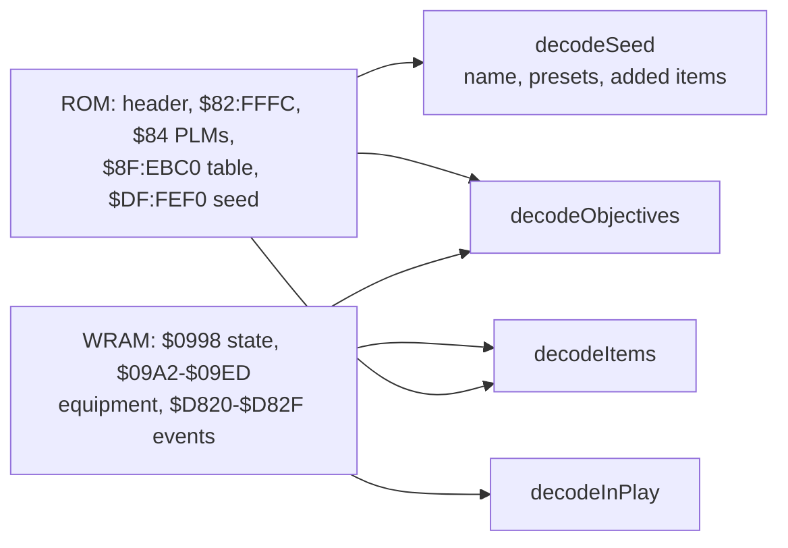

# @alltp/pack-sm

Super Metroid as the tracker plays it: **Map Rando** seeds (maprando.com,
`blkerby/MapRandomizer`), the randomizer the community races. On
racetime.gg's Super Metroid Randomizer category, about 99 % of the races of
August to October 2026 linked a maprando.com seed (measured on 2026-10-19
from the races' info links; the rest were DASH).

The pack holds what a tracker of those seeds needs, read from Map Rando's
own source at the commit `upstream.json` pins, never from memory:

| Module | What | Source |
| --- | --- | --- |
| `src/items.ts` | the items, Map Rando's `enum Item` but Nothing, with the game's full pool for the counted ones | `rust/maprando-game/src/lib.rs:155-181` |
| `src/objectives.ts` | the 19 objectives a seed may ask for, by group, each with its flag | `rust/maprando/src/patch.rs:3327-3355, 3596-3681` |
| `src/settings.ts` | the presets the ROM keeps for autotrackers, and the items its settings add | `settings.rs:113-241`, `patch.rs:783, 2038-2105`, `Bank DF.txt` |
| `src/autotrack/` | the memory map, the decoders, the game check and the race profile | below |

## No logic, on purpose

Map Rando reconnects the game's rooms, and its logic is `sm-json-data`, a
database of strategies per room that spends energy, ammunition and frames of
heat. A tracker cannot follow it without the seed's map and a solver of that
database; players follow the game's own map, and the trackers they use (the
EmoTracker package maprando.com credits) track items and objectives. So does
this pack: what the player holds, the seed's objectives, and whether each
is done.

## Autotracking

- **The game check**: Map Rando names the cartridge "SUPERMETROID MAPRANDO"
  (`patch.rs:2111-2112`), where the original game's header says
  "Super Metroid". Archipelago's Super Metroid (VARIA's randomizer) writes
  "SM", AP's version, the player and the seed (AP 0.6.8,
  `worlds/sm/__init__.py:677-681`): refused as `archipelago-rom`, which points
  the player to the app's Archipelago board (AP's own client tracks that ROM;
  nothing of its logic or settings is read).
- **Items** (`decodeItems`): the items and beams collected (`$09A4`, `$09A8`),
  by the bits the patcher gives a seed's starting items (`patch.rs:
  2300-2324`), Map Rando's three included (the Wall Jump Boots, the Spark
  and Blue Boosters). Packs and tanks are counted from the maximum they
  raised (`$09C4-$09D4`, `new_game.asm:85-120`) over what one gives, which
  the patcher writes into the items' PLMs for a seed of other sizes
  (`patch.rs:794-838`; the original game's are 100, 5, 5, 5 and 100, read
  from its ROM). Energy starts at 99, and an energy tank disabled from the
  pause menu takes 100 off the maximum but counts in `$09EC`
  (`disableable_etanks.asm:564-569`): it is held all the same.
- **Objectives** (`decodeObjectives`): the ROM keeps how many the seed has
  (`$82:FFFC`, its high bit the fast pause menu) and each one's flag, an
  event address and a mask (`$8F:EBC0`, `$8F:EBE8`, `patch.rs:3574-3584,
  3683-3684`), in the pause screen's order. An objective is done once its
  flag is set in WRAM (`$7E:D820-$D82F`).
- **The seed** (`decodeSeed`): its name at `$DF:FEF0`, which
  maprando.com/seed/<name>/ finds, the presets at `$DF:FF09-$FF0D` (0 for a
  setting the seed customized) and the items its settings add at `$DF:FF05`
  (`Bank DF.txt`).
- **In play** (`decodeInPlay`): game state `$07` or `$08`
  (`fast_reload.asm:134-136`).

Bank `$DF` lies past the first 2 MiB of this 3 MiB LoROM game: it reads
through `@alltp/autotrack`'s 4 MiB LoROM mapping (its README, "Address
spaces").

### Races

Map Rando races run on racetime.gg/smr, whose rules restrict no tracking
(its category info, read 2026-10-19); Map Rando's "Race mode" only locks a
seed's spoiler on the website and writes nothing into the ROM. The race
profile (`MAP_RANDO_RACE_PROFILE`) therefore permits every category this
pack reads, and the pack has no race flag. It reads what the player holds
and has done, never what a location holds.

## Tests

`test/sm-rom.ts` writes a Map Rando seed in play into a memory image, as its
ROM and the game hold it; the decoders' spec, the web app's specs and its
browser tests build on it. The decoders' spec also runs them on random
bytes: they never throw, and keep every count within the pool.
