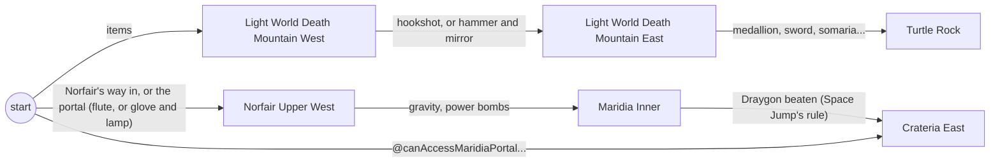

# @alltp/pack-smz3

SMZ3 as [samus.link](https://samus.link) generates it: the logic of both games, A Link to the Past and Super Metroid, as data over `@alltp/engine`, held to the randomizer's own logic tests.

Read from [`tewtal/SMZ3Randomizer`](https://github.com/tewtal/SMZ3Randomizer) (MIT) at the commit `upstream.json` pins: `production`, `d53be76` (11.3.2). samus.link and beta.samus.link both run it; about 97 % of racetime.gg's SMZ3 races of 2025-2026 used one of them.

| Module | What | Upstream |
| --- | --- | --- |
| `src/regions/{sm,zelda}/*.ts` | the 40 regions and 316 locations, one module per region file | `Randomizer.SMZ3/Regions/**` |
| `src/helpers.ts` | the item helpers, the portals between the games, the rewards | `Item.cs` (ProgressionExtensions), `World.cs` (CanAcquire) |
| `src/items.ts` | the items the logic reads and their most | `Item.cs` (Progression, the pools) |
| `src/settings.ts` | a run's settings, and the item placements rules ask about | `Config.cs`, `RandomizerOptions.cs` |
| `src/medallions.ts`, `src/derived.ts` | the facts a state carries beside the items | `MiseryMire.cs`, `TurtleRock.cs`, `PalaceOfDarkness.cs`, `IcePalace.cs` |
| `src/world.ts`, `src/pack.ts` | the graph, compiled for a run | `Region.cs`, `Location.cs` |
| `scripts/import-upstream-tests.mjs` | upstream's tests as JSON fixtures | `Randomizer.SMZ3.Tests/Logic/**` |

## The world model



Both games are one graph, as the engine's README plans for SMZ3. A region's `CanEnter` becomes its entrances. A branch that calls another region's (`World.CanEnter("...")`, or a location's `Available`) comes from that region; any other comes from `start`. The portals between the games are conditions on the items (`@canAccessNorfairUpperPortal`...), not regions, so the graph has no cycle across games.

- **Super Metroid's two logics.** Most SM rules differ between Normal and Hard (`Logic switch { Normal => ..., _ => ... }`). A rule may be `{ normal, hard }`, and the world of a run takes the one its logic asks for (`pick`).
- **Keysanity** stays a setting of the engine: `Config.Keysanity ? a : b` is `ifKeysanity(a, b)`. Without keysanity, upstream never places the keycards and holds every one, so `toState` adds them all.
- **Rewards.** Upstream asks whether the boss holding a pendant, a crystal or a boss token can be beaten (`World.CanAcquire`), since its filler knows which boss holds which. A tracker counts the rewards found instead (`pendantGreen`, `crystalRed`, `tokenKraid`...), which is what the game itself checks.
  - Agahnim alone is computed: Castle Tower always holds it (`@agahnim`).
  - Upstream's tests run a world whose bosses hold nothing, where every reward check passes; the setting `rewardsPlaced`, false only there, says so.
- **Placements.** A few dungeon rules ask what item sits at a location (`GetLocation(...).ItemIs(KeyPD)`), which a tracker does not know.
  - Each such placement is a setting (`PLACEMENTS`): unknown in a run, so the rule reads as maybe, and known in the tests that place it.
- **Facts.** The medallion pads are what the player knows (`mireIsEther`, `mireUnknown`), as in the ALttPR pack.
  - Palace of Darkness's and Ice Palace's non-monotone key rules read facts derived from the items (`podNoHammerBowLamp`, `ipNoBigKey`). A state recomputes these on every change, so every rule stays monotone within one state.

## The contract

`test/upstream/` holds upstream's four logic fixtures (Normal and Hard SM logic, with and without keysanity), 5,490 cases, written by the importer from a checkout. Upstream's code is read, never run. LogicTests.cs asserts each case minimal: with all it lists, the region (`CanEnter`) or the location (`CanAccess`, its own rule alone) is reachable; without any one of them, it is not. `test/contract.spec.ts` holds the pack to every case: upstream's `true` is `yes`, its `false` anything but `yes`. A location's case runs in a world where every location sits at the start (`locationsAtStart`), as upstream reads the rule alone. The regions it may reach stay in the graph.

**Cases the logic outran.** Commit `3dc171c` (2022-04-29) added `&& (items.Gravity || items.Ice || items.HiJump && items.SpringBall)` to yellow Maridia's three rules, after the tests' last change (2022-02-18). The cases without those items no longer hold upstream either: its CI only publishes and never runs the tests. The pack follows the logic samus.link runs, and the contract checks that these cases, and only these, break, each for that clause.

`test/regions.spec.ts` checks every module against the region files' names and lines (`test/upstream/regions.json`). Every rule carries its `source`, `file:line`.

```bash
# Regenerate the fixtures from a checkout of the pinned commit
pnpm --filter @alltp/pack-smz3 import-upstream <SMZ3Randomizer checkout>
```

## Not modelled

- **Ganon and Mother Brain.** Upstream's logic has no region for them: the game checks the goal (crystals for Ganon, bosses for Tourian), which the tracker counts from the rewards found.
- **The filler's rules** (`.Allow`, `.AlwaysAllow`, `CanFill`): they say where the randomizer may place an item, not what reaches a location.

## When upstream moves

The weekly Logic drift workflow compares `tewtal/SMZ3Randomizer`'s default branch with `commit` in `upstream.json`. When a file `upstream.json` lists has changed, it opens or updates the issue "Upstream logic drift (smz3): ...".

To port the change:

1. Read the upstream diff the issue links.
2. Port each changed rule into the module of its file: keep the rule as upstream writes it, and set `source` to its new line. Lines shift, so recheck every location of a changed file.
3. Check out the new commit, run the importer, then set `commit` here to it.
4. Hold the pack to the new fixtures. A case that breaks is a rule to port, never a fixture to edit; an entry of `STALE` that no longer breaks leaves the list.
